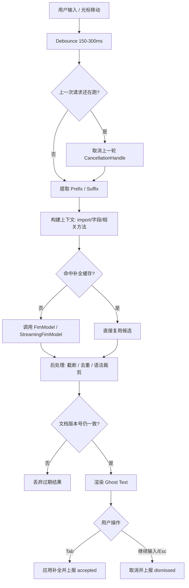
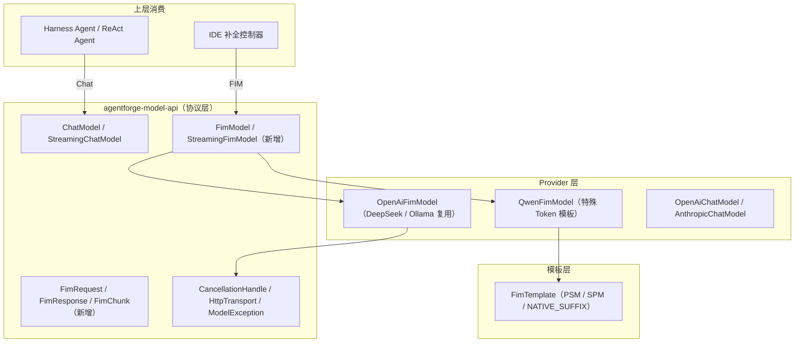
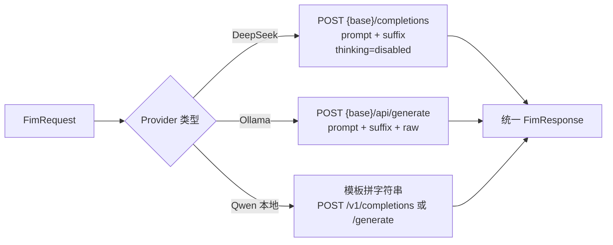

# AgentForge模型协议层 FimModel 原理01、DeepSeek FIM 快速对接与落地实现：OpenAI Completions 协议复用 + FimModel 契约设计

> 适用版本：release_1.x  
> 适用模块：`agentforge-model-api`（新增 `fim` 包）+ `agentforge-model-openai`（Completions/FIM Provider）+ `agentforge-model-registry`  
> 包前缀：`cloud.changlu.agentforge.model`  
> 维护者：长路  
> 资料核对时间：2026-11-25（所有厂商接口结论均以当日可访问的官方文档为准，并在文末列出来源）

系列定位：本文属于「AgentForge 核心模块设计原理文章系列 / 01、model 模型协议层 / fimmodel」，是该类别的第 01 篇。
全文只回答四个问题：

1. **背景**：AgentForge 已经有 `ChatModel` / `StreamingChatModel`，为什么还需要一个独立的 `FimModel`；
2. **调研分析**：Fill-in-the-Middle 到底有哪几种协议形态，DeepSeek 的 FIM 又"挂"在哪种协议上；
3. **设计思路**：如何在**不改动现有 ChatModel 协议**的前提下，扩出一套 FIM 契约；
4. **实现规划与实现**：给出可直接落地的 Java 代码、接入步骤、验证方式与上线清单。

> **实现状态（2026-11-25 已落地）**：本文对应的代码已提交到仓库，编译与单元测试全部通过。
>
> | 模块 | 内容 |
> |---|---|
> | `agentforge-model-api` | `fim` 包（`FimModel` / `StreamingFimModel` / `FimCall` / `FimFormat` / `FimTemplate` + `request` / `response` 子包） |
> | `agentforge-model-core` | `DefaultFimRequestParameters`、`TokenFimTemplate`、`FimTemplates`、`TemplateFimModel`、`TemplateStreamingFimModel`、`TemplateFimRequests`、`NativeSuffixFimTemplate` |
> | `agentforge-model-openai` | `OpenAiFimModel`（同步）、`OpenAiStreamingFimModel`（SSE 流式） |
> | `agentforge-model-registry` | `IModel` 新增 FIM default 方法、`OpenAiModel` / `DeepSeekModel` / `DashScopeModel` 的 FIM 装配、`LlmEnum`、`LlmFactory` FIM 入口、`fimTemplate` 配置 |
>
> **验证入口**：`FimLiveVerificationTest`（同时跑流式与非流式）。只需填 `FIM_BASE_URL` / `FIM_API_KEY` /
> `FIM_MODEL_NAME` 三个常量，或用 `-Dfim.baseUrl/-Dfim.apiKey/-Dfim.modelName` 传入。
>
> 说明：本文代码片段与仓库实现保持一致（类名、包路径、Builder 风格、`HttpTransport` / `Json` /
> `ModelException` 用法）。IDE 客户端补全控制器（4.7 节）按约定**仅作设计参考，本次未落地**。

<br/>

## 文档导航

| 文档 | 说明 |
|---|---|
| **当前文章（FimModel 原理01）** | FIM 协议调研 + `FimModel` 契约设计 + DeepSeek 快速对接 + IDE 补全链路落地 |
| [openai/OpenAI协议01、AgentForge 接入 OpenAI-compatible FIM：Xinference 与 vLLM 一套装配打通.md](openai/OpenAI协议01、AgentForge%20接入%20OpenAI-compatible%20FIM：Xinference%20与%20vLLM%20一套装配打通.md) | 后续：OpenAI-compatible（Xinference / vLLM / Ollama）FIM 装配、Token 形态配置化、为何不单独抽协议 |
| [../chatmodel/统一ChatModel协议层01、ChatModel 核心协议层设计：统一 API 契约封装与多协议扩展实现.md](../chatmodel/统一ChatModel协议层01、ChatModel%20核心协议层设计：统一%20API%20契约封装与多协议扩展实现.md) | 前置阅读：ChatModel 统一出入参、Provider 五步转换、`LlmFactory` 装配 |
| [../chatmodel/openai/OpenAI协议01、OpenAI底层协议快速理解.md](../chatmodel/openai/OpenAI协议01、OpenAI底层协议快速理解.md) | 前置阅读：`/chat/completions` wire 协议、SSE 解析 |

<br/>

## 目录

- [一、背景：为什么 AgentForge 需要一个独立的 FimModel](#一背景为什么-agentforge-需要一个独立的-fimmodel)
  - [1.1、一次真实的补全需求](#11一次真实的补全需求)
  - [1.2、FIM 与普通 Chat 的数学差异](#12fim-与普通-chat-的数学差异)
  - [1.3、现有模型协议层为什么"接不住" FIM](#13现有模型协议层为什么接不住-fim)
  - [1.4、本文目标与范围](#14本文目标与范围)
- [二、调研分析](#二调研分析)
  - [2.1、FIM 是怎么训练出来的（PSM / SPM）](#21fim-是怎么训练出来的psm--spm)
  - [2.2、Chat Completion 与 FIM Completion 的协议级差异](#22chat-completion-与-fim-completion-的协议级差异)
  - [2.3、FIM 的三种协议形态](#23fim-的三种协议形态)
  - [2.4、没有统一的 FIM 行业协议：五种实现横向对照](#24没有统一的-fim-行业协议五种实现横向对照)
  - [2.5、重点：FIM 与 OpenAI 协议的关系](#25重点fim-与-openai-协议的关系)
  - [2.6、DeepSeek FIM 协议逐字段拆解](#26deepseek-fim-协议逐字段拆解)
  - [2.7、模型与部署形态选型](#27模型与部署形态选型)
  - [2.8、客户端补全链路的硬性约束（Continue 实测参数）](#28客户端补全链路的硬性约束continue-实测参数)
  - [2.9、评测指标与数据集](#29评测指标与数据集)
  - [2.10、抽象选型：独立 FimModel，还是 CompletionModel + Capability](#210抽象选型独立-fimmodel还是-completionmodel--capability)
- [三、设计思路](#三设计思路)
  - [3.1、总体分层](#31总体分层)
  - [3.2、为什么 FIM 不复用 ChatModel](#32为什么-fim-不复用-chatmodel)
  - [3.3、FimModel 契约设计](#33fimmodel-契约设计)
  - [3.4、把"协议形态差异"收敛到 FimTemplate](#34把协议形态差异收敛到-fimtemplate)
  - [3.5、Provider 映射：DeepSeek / Ollama / Qwen](#35provider-映射deepseek--ollama--qwen)
  - [3.6、客户端补全控制器：防抖、取消、缓存、版本校验](#36客户端补全控制器防抖取消缓存版本校验)
  - [3.7、上下文工程边界](#37上下文工程边界)
  - [3.8、明确不做什么](#38明确不做什么)
- [四、核心代码实现规划与实现](#四核心代码实现规划与实现)
  - [4.1、模块与包规划](#41模块与包规划)
  - [4.2、实现一：`fim` 包契约与默认实现（api + core）](#42实现一fim-包契约与默认实现api--core)
  - [4.3、实现二：`OpenAiFimModel`（DeepSeek 直接复用）](#43实现二openafimmodeldeepseek-直接复用)
  - [4.4、实现三：`OpenAiStreamingFimModel` 流式补全](#44实现三openastreamingfimmodel-流式补全)
  - [4.5、实现四：`FimTemplate` 与 Qwen / Ollama 适配](#45实现四fimtemplate-与-qwen--ollama-适配)
  - [4.6、实现五：`FimModelRegistry` 与 LlmEnum 扩展](#46实现五fimmodelregistry-与-llmenum-扩展)
  - [4.7、实现六：IDE 侧补全控制器](#47实现六ide-侧补全控制器)
  - [4.8、分阶段落地路线](#48分阶段落地路线)
  - [4.9、验证方案](#49验证方案)
  - [4.10、上线前检查清单与已知风险](#410上线前检查清单与已知风险)
- [五、总结](#五总结)
- [六、Q&A：落地过程中的真实疑问](#六qa落地过程中的真实疑问)
- [参考资料来源](#参考资料来源)

---

## 一、背景：为什么 AgentForge 需要一个独立的 FimModel

### 1.1、一次真实的补全需求

假设在 IDEA 里写下面这段 Java，光标停在注释后：

```java
public User getUser(Long id) {
    User user = userMapper.selectById(id);
    // 光标在这里
    return user;
}
```

用户想要的是中间那 4 行空值校验，**而不是**让模型重新写一遍 `return user;`。

如果只是把光标前的文本丢给一个 Chat 模型续写，最典型的结果是：

```java
public User getUser(Long id) {
    User user = userMapper.selectById(id);
    if (user == null) {
        throw new RuntimeException("用户不存在");
    }
    return user;
}
        return user;   // ← 模型不知道后面已经有 return，重复生成
```

原因很朴素：**它没见过后文**。而 IDE 的行内补全场景里，后文（Suffix）是确定已知的信息，白白丢掉非常浪费。

### 1.2、FIM 与普通 Chat 的数学差异

| 能力 | 建模的分布 | 输入 |
|---|---|---|
| 普通续写（Next Token Prediction） | $P(\text{Middle} \mid \text{Prefix})$ | 只有前文 |
| 中间填充（Fill-in-the-Middle） | $P(\text{Middle} \mid \text{Prefix}, \text{Suffix})$ | 前文 + 后文 |

关键点：**FIM 不需要把 Decoder-only Transformer 改成 BERT 那种双向注意力**。它依然是标准的从左到右自回归模型，只是通过在训练阶段**重排数据**，让"中间内容"出现在序列末尾（详见 2.1）。

### 1.3、现有模型协议层为什么"接不住" FIM

AgentForge 当前的模型协议层长这样（真实路径）：

```text
agentforge-model/
├── agentforge-model-api/          协议层：ChatModel / StreamingChatModel / ChatRequest / ChatResponse
│                                  以及 HttpTransport / CancellationHandle / ModelException
├── agentforge-model-core/         默认实现：JdkHttpTransport / Json / DefaultChatRequestParameters / ToolService
├── agentforge-model-openai/       OpenAI Chat Completions Provider
├── agentforge-model-anthropic/    Anthropic Messages Provider
└── agentforge-model-registry/     IModel / LlmEnum / LlmFactory / LlmBasicConfig
```

把这套 Chat 协议硬套 FIM，会立刻撞上四处不匹配：

| 冲突点 | 现状（Chat 协议） | FIM 的真实需要 |
|---|---|---|
| 入参 | `ChatRequest` 要求 `messages` 非空，语义是"对话历史" | 只需要 `prefix` / `suffix` 两段纯文本，没有角色概念 |
| 出参 | `ChatResponse` 必须携带 `AiMessage` | 只需要一段补全文本 + finish reason + usage |
| 接口端点 | Provider 拼 `{baseUrl}/chat/completions` | DeepSeek 是 `{baseUrl}/completions`（Beta） |
| 延迟形态 | 一次对话几百毫秒到数秒可接受 | 行内补全要求首字 < 300ms，且**每次按键都可能触发** |

所以结论是：**FIM 应该是一条独立的模型能力协议，而不是 ChatModel 的一个参数分支**。

这也正是 LangChain4j 等框架的做法——`ChatModel` 与它并列存在独立的能力接口，而不是把"补全"塞进对话接口。

### 1.4、本文目标与范围

**目标（本次要交付的）**

1. 在 `agentforge-model-api` 中定义 Provider-neutral 的 `FimModel` / `StreamingFimModel` 契约；
2. 用**一个 Provider 类**（`OpenAiFimModel`）覆盖全部"OpenAI Completions 形状"的 FIM 服务（DeepSeek 及同类网关），快速拿到可用能力；Ollama / Codestral 因响应形状不同单独成类；
3. 给出 Qwen 系列特殊 Token 的模板化接入方式；
4. 给出 IDE 侧防抖 / 取消 / 缓存 / 文档版本校验的实现骨架；
5. 给出验证清单与上线风险。

**第二章调研要回答清的三件事**（后续设计全部建立在这三个结论之上）

1. **Chat 与 FIM 在协议层到底差什么**：请求结构、响应结构、流式提取路径、能力语义（2.2）——它决定哪些对象能复用、哪些必须独立；
2. **FIM 有没有统一行业协议**：五种主流实现的端点/字段/文本路径/流式帧格式横向对照（2.3、2.4）——结论是**没有统一协议**，所以差异必须收敛到 Provider；
3. **抽象该怎么切**：独立 `FimModel`，还是 `CompletionModel` + `ModelCapability`（2.10）——本文给出选型理由与折中方案。

**不在本文范围**

- 不实现仓库级代码索引（AST / LSP / 向量检索的具体工程）；
- 不实现 Next Edit Prediction（NEP）；
- 不做模型微调。

> 这三项是后续独立技术方向，边界见 3.7 / 3.8。

---

## 二、调研分析

### 2.1、FIM 是怎么训练出来的（PSM / SPM）

2022 年 7 月 OpenAI 在《Efficient Training of Language Models to Fill in the Middle》（arXiv:2207.14255）中系统性地解决了这个问题：**不改变模型结构，只重排训练数据**。

做法是：对一条完整训练样本随机切两刀，得到 `Prefix / Middle / Suffix`，然后重排成下面两种顺序之一，并在中间插入特殊 Token：

| 模式 | 全称 | 排列顺序 | 一条样本的实际形态 |
|---|---|---|---|
| PSM | Prefix-Suffix-Middle | 前缀 → 后缀 → 中间 | `<fim_prefix>P<fim_suffix>S<fim_middle>M` |
| SPM | Suffix-Prefix-Middle | 后缀 → 前缀 → 中间 | `<fim_suffix>S<fim_prefix>P<fim_middle>M` |

因为 `Middle` 被挪到了序列末尾，模型仍然只做"从左到右预测下一个 Token"，**训练目标完全不变**，但推理时只要构造同样的排列，它就会"把中间补出来"。

论文同时给出了一个很重要的工程结论：这种改造**不会显著损害原有的从左到右生成能力**，也就是一个模型可以同时会"续写"和"填充"。

> 工程含义：FIM 不是另一个模型，而是**同一份权重上的一种可被 Prompt 触发的模式**。因此协议层要做的不是"接一个新模型"，而是"用正确的字节序列去调用同一类模型"。

### 2.2、Chat Completion 与 FIM Completion 的协议级差异

在动代码之前，先把"两类模型在协议层到底差在哪"钉死。下面是逐维度的对照——**这张表决定了后面哪些对象能复用、哪些必须新造**。

#### （1）协议语义与能力矩阵

| 对比维度 | Chat Model | FIM Model |
|---|---|---|
| 协议类型 | Chat Completion | Fill-in-the-Middle Completion |
| 核心输入 | `messages`（多角色消息列表） | `prefix` + `suffix` |
| 上下文组织 | 消息列表（system / user / assistant / tool） | 前后缀纯文本 |
| 核心输出 | Assistant Message | Completion Text |
| System Prompt | 有独立 `role=system` 语义 | 没有独立字段（只能塞进 prefix） |
| 多轮对话 | 通过消息历史实现 | 无原生多轮语义 |
| Function Calling | 部分模型支持 | 通常不支持 |
| Thinking / Reasoning | 部分模型支持 | 通常不暴露独立推理字段（DeepSeek 甚至禁止） |
| Streaming | 支持 | 支持 |
| Token Usage | 支持 | 取决于服务商 |
| 主要用途 | 对话、推理、Agent | 代码补全、文本插入 |
| 典型端点 | `/v1/chat/completions` | `/v1/completions` 或 `/v1/fim/completions` |

> 来源：OpenAI Chat Completions 与 Completions 两份 API 参考 [9][10]；DeepSeek FIM 官方文档 [4][5]；Mistral Codestral [11]；Ollama [12]。

一个容易被忽略但很重要的判断：**FIM 与 Chat 并不是互斥的模型类别**。同一套权重可以同时具备两种能力（2.1 的结论），只是对外暴露的协议、输入模板与延迟预算不同。所以"模型是不是 FIM 模型"不是分类问题，而是**能力声明问题**——这直接引出 2.10 的抽象选型讨论。

#### （2）HTTP 请求结构对照

同样一段"实现加法函数"的意图，两种协议的请求体完全不同：

**Chat Completion**

```json
POST /chat/completions
{
  "model": "deepseek-flash",
  "messages": [
    { "role": "system", "content": "你是Java专家" },
    { "role": "user", "content": "实现加法函数" }
  ],
  "stream": true,
  "temperature": 0.7,
  "max_tokens": 1024
}
```

**FIM Completion**

```json
POST /beta/completions
{
  "model": "deepseek-flash",
  "prompt": "int add(int a, int b) {",
  "suffix": "}",
  "stream": true,
  "temperature": 0.1,
  "max_tokens": 128
}
```

参数层面的差异可以归纳成一句话：**两者的"模型生成参数"高度重合，"输入/输出的数据结构"完全不重合**。

| 请求参数 | Chat | FIM | 说明 |
|---|---|---|---|
| `model` | ✅ | ✅ | 模型标识 |
| `messages` | ✅ | — | 多角色消息列表 |
| `prompt` | — | ✅ | 前缀文本 |
| `suffix` | — | ✅（可选） | 后缀文本；不传退化为普通续写 |
| `tools` / `tool_choice` | ✅ | — | 工具定义与选择策略 |
| `response_format` | 部分支持 | — | 结构化输出 |
| `reasoning_effort` | 部分支持 | — | 推理强度 |
| `temperature` / `top_p` | ✅ | ✅ | 采样参数 |
| `max_tokens` | ✅ | ✅ | 最大生成长度 |
| `stop` | ✅ | ✅ | 停止序列（FIM 场景必设） |
| `stream` / `stream_options` | ✅ / 部分支持 | ✅ / 部分支持 | 流式输出与配置 |
| `logprobs` | 部分支持 | 部分支持 | Token 概率 |

> 具体字段支持情况仍取决于 Provider。上表以典型协议为参考，逐字段的 DeepSeek 版本见 2.6。

#### （3）响应结构对照

**Chat Model Response**

```json
{
  "id": "chatcmpl-001",
  "object": "chat.completion",
  "model": "deepseek-flash",
  "choices": [{
    "index": 0,
    "message": {
      "role": "assistant",
      "content": "public int add(int a, int b) {\n    return a + b;\n}"
    },
    "finish_reason": "stop"
  }],
  "usage": { "prompt_tokens": 20, "completion_tokens": 18, "total_tokens": 38 }
}
```

**FIM Model Response**

```json
{
  "id": "cmpl-001",
  "object": "text_completion",
  "model": "deepseek-flash",
  "choices": [{
    "index": 0,
    "text": "\n    return a + b;\n",
    "finish_reason": "stop"
  }],
  "usage": { "prompt_tokens": 15, "completion_tokens": 8, "total_tokens": 23 }
}
```

核心区别只有一句：**Chat 返回的是带角色语义的消息对象（`choices[0].message`），FIM 返回的是用于插入的文本片段（`choices[0].text`）**。前者要携带 `role` / `tool_calls` / `reasoning_content`，后者只需要一段能直接塞进光标位置的字符串。

#### （4）流式响应对照

两种协议都用 SSE 传输，`data: [DONE]` 结束，但事件里的 JSON 结构不同：

```text
# Chat SSE
data: {"choices":[{"delta":{"role":"assistant"}}]}
data: {"choices":[{"delta":{"content":"return"}}]}
data: {"choices":[{"delta":{"content":" a + b;"}}]}
data: {"choices":[{"delta":{},"finish_reason":"stop"}]}
data: [DONE]

# FIM SSE（DeepSeek）
data: {"choices":[{"text":"return","index":0}]}
data: {"choices":[{"text":" a","index":0}]}
data: {"choices":[{"text":" + b;","index":0}]}
data: {"choices":[{"text":"","finish_reason":"stop"}]}
data: [DONE]
```

| 类型 | 流式内容提取路径 |
|---|---|
| Chat 文本 | `choices[0].delta.content` |
| Chat 工具调用 | `choices[0].delta.tool_calls` |
| Chat 推理内容 | `choices[0].delta.reasoning_content` |
| FIM（DeepSeek） | `choices[0].text`（无 `delta` 包装） |

> 注意 Mistral Codestral 是例外：它的 FIM 响应复用了 Chat 的骨架，文本仍在 `delta.content` 里（见 2.4）。**"FIM 一律取 `choices[0].text`"是一个会被现实打脸的假设。**

#### （5）这个对比对设计的直接结论

| 结论 | 依据 |
|---|---|
| HTTP Client、SSE 传输、超时、连接池、重试可以完全复用 | 差异只在 JSON 的反序列化与事件语义，不在传输层 |
| 请求/响应对象必须独立 | `messages` 与 `prefix/suffix`、`message` 与 `text` 无法用一个结构同时表达 |
| `Message` / `ToolSpecification` 不属于 FIM | FIM 没有角色与工具概念，强行复用会把 `AiMessage` 拖进补全链路 |
| TokenUsage / FinishReason 可以统一 | 语义同构，只是 FIM 的 `finish_reason` 多几个厂商扩展取值（见 2.6） |

这正是本文选择"独立 `FimModel` 契约 + 复用 `HttpTransport` / `CancellationHandle` / `Json`"的调研依据，落地细节见第三章。

### 2.3、FIM 的三种协议形态

真实世界里，FIM 的"前 / 后"是怎么传给模型的，有三条完全不同的路线：

**形态 A：协议里直接有 `suffix` 字段（最省事）**

请求体里 `prompt` 就是前文，`suffix` 就是后文，模型自己负责拼接。

```json
POST /completions
{ "model": "deepseek-flash", "prompt": "<前文>", "suffix": "<后文>", "max_tokens": 128 }
```

走这条路的代表：**DeepSeek（Beta）**、**Ollama `/api/generate`**、**Mistral Codestral `/v1/fim/completions`**、以及 OpenAI 官方那个已经半退休的 legacy Completions（仅 `gpt-3.5-turbo-instruct` 支持 `suffix`）。

**形态 B：协议里没有 suffix，靠特殊 Token 自己拼（最灵活，也最容易踩坑）**

客户端必须把三段拼成一个字符串再发出去，并且**停止符必须包含这些特殊 Token**，否则会跑飞。

```text
<|fim_prefix|>{prefix}<|fim_suffix|>{suffix}<|fim_middle|>
```

不同模型家族的 Token **不通用**，这是接入层必须按模型分别适配的原因：

| 模型家族 | FIM 模板 | 依据 |
|---|---|---|
| Qwen2.5-Coder / Qwen3-Coder | `<\|fim_prefix\|>{p}<\|fim_suffix\|>{s}<\|fim_middle\|>` | Qwen 官方 README |
| StarCoder2 / Stable Code | `<fim_prefix>{p}<fim_suffix>{s}<fim_middle>` | StarCoder2 论文 5.1 节 |
| CodeLlama | `<PRE> {p} <SUF>{s} <MID>` | CodeLlama FIM |
| DeepSeek-Coder（开源权重） | `ffi{p}<｜place▁holder▁no▁363｜>{s}<｜place▁holder▁no▁767｜>` | 模型卡 |
| Codestral（本地/模板方式） | `[SUFFIX]{s}[PREFIX]{p}` | 注意：**是 SPM 顺序** |
| CodeGemma | `<\|fim_prefix\|>{p}<\|fim_suffix\|>{s}<\|fim_middle\|>` | 与 Qwen 同形但 Token 不同源 |

> 上表的模板取自 Continue 开源仓库 `core/autocomplete/templating/AutocompleteTemplate.ts`（MIT），它维护了十余个模型家族的 FIM 模板，是目前最实用的对照表。

**形态 C：模型根本不会 FIM，用 Chat + "填空提示词"兜底**

把 prefix/suffix 拼成一段"请补全 `[BLANK]`"的对话，让通用 Chat 模型返回中间片段。

````text
```java
public User getUser(Long id) {
    User user = userMapper.selectById(id);
[BLANK]
    return user;
}
```
只返回替换 [BLANK] 的代码，不要返回其它内容。
````

可以做，但**不适合行内补全**：通用 Chat 模型多一层指令理解与格式遵循，首字延迟普遍远高于 FIM 专用模型，而且对缩进、停止边界不敏感，容易多吐代码。它更适合"离线补全"或"没有 FIM 模型时的降级路径"。

### 2.4、没有统一的 FIM 行业协议：五种实现横向对照

这是本节最重要的一条结论，也是很多"照抄 DeepSeek 解析代码"的接入方案上线后翻车的根因：

> **FIM 至今没有像 OpenAI Chat Completion 那样被广泛统一的标准协议。** Chat 有事实上统一的 `messages` + `choices[0].message`，FIM 没有——端点、请求字段、响应文本路径、流式帧格式，每一步都可能不同。

#### （1）一张总表：同一件事，五种做法

| 服务商 / 形态 | Endpoint | 请求结构 | 响应文本路径 | 流式帧格式 |
|---|---|---|---|---|
| DeepSeek | `/beta/completions` | `prompt` + `suffix` | `choices[].text` | SSE（`data: {...}`） |
| Mistral Codestral | `/v1/fim/completions` | `prompt` + `suffix` | `choices[].message.content` | SSE（`delta.content`） |
| Ollama | `/api/generate` | `prompt` + `suffix` | `response` | **逐行完整 JSON**（非 SSE） |
| vLLM | `/v1/completions` | FIM Token 拼接后的单 `prompt` | `choices[].text` | SSE |
| HuggingFace Transformers | 无 HTTP 协议（进程内推理） | 直接拼 FIM Token 序列 | 生成 Token 序列 | — |

> 上表逐行依据：[4][5] DeepSeek、[11] Mistral、[12] Ollama、[13] vLLM、[14] Hugging Face；Chat 侧对照见 [9][10]。

逐个说清差异点：

- **DeepSeek**：最"正统"的 Completions 形状，`object: "text_completion"`，文本在 `choices[0].text`（详见 2.6）；
- **Mistral Codestral**：**需要特别注意的例外**。请求是 FIM（`prompt` + `suffix`），但响应结构复用了 Chat Completion 的部分定义——文本在 `choices[0].message.content`，流式也在 `delta.content`，而不是 `text`。这意味着"FIM 一律解析 `choices[0].text`"的实现会在 Codestral 上拿到空字符串，且**不报错**；
- **Ollama**：响应字段是顶层 `response`，流式返回的是**一行一个完整 JSON 对象**（每个对象自带 `response` 增量与 `done` 标记），不是 `data: xxx` 形式的 SSE。共用同一个 SSE 解析器必然失效（详见 3.5）；
- **vLLM**：走标准 `/v1/completions`，但 `suffix` 是否被透传取决于版本与模型模板；更稳妥的做法是客户端自己按模型家族拼 FIM Token（即 2.3 的形态 B），把 vLLM 当普通 completions 服务用；
- **HuggingFace**：根本没有 HTTP 协议层，直接 tokenizer 编码 + 进程内 generate。它说明"FIM 能力"可以完全不依赖任何 API 形状。

#### （2）三种主流协议形态的归纳

把上表压缩，业界只有三种"把前后缀送进模型"的方式（与 2.3 的 A/B/C 对应）：

| 方式 | 代表 | 输入 | 输出位置 |
|---|---|---|---|
| 方式一：传统 Completion 协议 | DeepSeek、vLLM | `prompt` + `suffix` | `choices[0].text` |
| 方式二：专用 FIM 协议（响应复用 Chat 骨架） | Mistral Codestral | `prompt` + `suffix` | `choices[0].message.content` / `delta.content` |
| 方式三：原始 Prompt + Special Token | Qwen Coder 等本地权重 | `<\|fim_prefix\|>p<\|fim_suffix\|>s<\|fim_middle\|>` | 生成的 Token 序列（落到 `text`） |

第三种方式本质上**连 HTTP 的 `suffix` 参数都不需要**：只要模型本身具备 FIM 能力，并且推理服务允许原样传入 Token 模板即可。这也是 `FimTemplate`（3.4）必须存在的原因——它把"模型家族知识"与"Provider 传输"解耦。

#### （3）对 AgentForge 的直接含义

| 结论 | 落地方式 |
|---|---|
| 不能假设所有 FIM 都返回 `choices[0].text` | 响应解析下沉到各 Provider（`OpenAiFimModel` 与未来的 `CodestralFimModel` 各管各的） |
| 不能假设所有 FIM 都用 SSE | 传输层保留"SSE"与"逐行 JSON"两种解析器（Ollama 单独成类） |
| 协议层只需要 `prefix/suffix + 文本结果 + finishReason + usage` | 这是唯一被所有厂商共享的最小公共集，也是 `FimRequest` / `FimResponse` 的全部内容 |
| 厂商差异必须收敛在 Provider 内部 | 符合 3.1 的"协议层不出现厂商字段"边界 |

这也解释了本文的两条实现策略：

1. **`OpenAiFimModel` 只覆盖"OpenAI Completions 形状"**——DeepSeek FIM 与任何返回 `choices[0].text` 的 OpenAI-compatible 网关，一行配置即可切换；
2. **响应形状不同的实现单独成类**——Ollama（顶层 `response` + 逐行 JSON）与 Codestral（`message.content` / `delta.content`）各自建 Provider，只复用 `HttpTransport`、`FimResponse` 装配与 `CancellationHandle`，不复用响应解析。差异见 3.5 与 4.10 的风险表。

### 2.5、重点：FIM 与 OpenAI 协议的关系

这一节直接回答"FIM 到底有什么 OpenAI 协议"。

#### （1）OpenAI 的 FIM 载体是 **legacy Completions**，不是 Chat Completions

OpenAI 官方 API 里，`suffix` 参数只出现在一个地方：

```http
POST https://api.openai.com/v1/completions
```

官方文档原文（截至 2026-11-25）对 `suffix` 的描述是：

> The suffix that comes after a completion of inserted text. **This parameter is only supported for gpt-3.5-turbo-instruct.**

也就是说：

- **OpenAI 从来不是"用 Chat Completions 做 FIM"**。`/chat/completions` 的请求体里没有 `suffix`，模型也不以中间填充方式训练；
- `/completions` 这个接口才是 FIM 的协议位置，它的响应对象类型是 `text_completion`，取文本用 `choices[0].text`（而不是 Chat 的 `choices[0].message.content`）；
- 但 OpenAI 自家支持 `suffix` 的模型只有 `gpt-3.5-turbo-instruct`，**今天再做行内补全不应该选它**（延迟与效果都不如专用代码模型）。

**所以"OpenAI 协议"对 FIM 的真正价值不是 OpenAI 官方模型，而是它定义的那个 wire 形状被大量服务实现了。**

#### （2）DeepSeek FIM = OpenAI Completions 形状 + Beta 前缀

DeepSeek 的 FIM 接口就是标准 Completions 形状，这一点非常关键——**它意味着 AgentForge 不需要写一个"DeepSeek 专属协议适配"**：

| 维度 | OpenAI legacy Completions | DeepSeek FIM |
|---|---|---|
| 路径 | `POST /v1/completions` | `POST /beta/completions` |
| base_url | `https://api.openai.com/v1` | `https://api.deepseek.com/beta` |
| 认证 | `Authorization: Bearer <key>` | 同 |
| 前文参数 | `prompt` | `prompt` |
| 后文参数 | `suffix` | `suffix` |
| 响应对象 | `object: "text_completion"` | `object: "text_completion"` |
| 取文本 | `choices[0].text` | `choices[0].text` |
| 流式 | SSE + `data: [DONE]` | SSE + `data: [DONE]` |
| usage 字段 | `prompt_tokens/completion_tokens/total_tokens` | 同 + `prompt_cache_hit_tokens` 等扩展 |

结论：**"接 DeepSeek FIM"≈"把 base_url 换成 `https://api.deepseek.com/beta`，路径用 `/completions`"**。这是本次能"快速对接"的根本原因。

#### （3）为什么不能用 `/chat/completions` 凑 FIM

三个硬理由：

1. **协议不接受 `suffix`**：Chat Completions 的 schema 里没有这个字段，传了会被忽略或报错；
2. **响应结构不对**：Chat 返回 `choices[0].message.content`，FIM 需要的是"补全片段"，中间多一层消息包装，流式增量解析也不同；
3. **成本与延迟**：Chat 请求走的是对话模板（system/user/assistant 包装），token 数与首字延迟都更高，而行内补全要求极低的单次成本。

#### （4）一张"协议 vs 服务"对照表

| 协议形状 | 端点 | 谁在用 | 是否需要自拼 Token |
|---|---|---|---|
| OpenAI Completions 形状（原生 suffix） | `{base}/completions` | DeepSeek FIM(Beta)、OpenAI `gpt-3.5-turbo-instruct`、部分 OpenAI-compatible 网关 | ❌ 不需要 |
| 专用 FIM 端点（原生 suffix） | `{base}/v1/fim/completions` | Mistral Codestral API | ❌ 不需要 |
| 原生 generate + suffix | `POST /api/generate` | Ollama（`suffix` 字段，官方注明用于 fill-in-the-middle 模型） | ❌ 不需要 |
| 裸 completions + 特殊 Token | 各推理服务原始 `/generate`、或详情见下 | Qwen / StarCoder2 / CodeLlama / CodeGemma 本地权重 | ✅ 需要 |
| Chat 形状 + 填空题提示词 | `/chat/completions` | 任何通用 Chat 模型（降级方案） | ✅ 需要（提示词） |

> 这一张表就是设计上的分水岭：**前两行可以复用同一套 `suffix` Provider；第三、四行才需要模板层。**

#### （5）一个必须写进文档的坑：DeepSeek 的思考模式

DeepSeek 官方模型价格/能力表明确写了：

> FIM 补全（Beta）：**仅非思考模式支持**

而 DeepSeek 的思考模式**默认是开启的**（`effort` 默认为 `high`），关闭方式是请求体里带：

```json
{ "thinking": { "type": "disabled" } }
```

如果漏了这一步，最坏情况是 FIM 请求失败，最好情况是白付思维链 token、延迟暴涨。**所以 FIM Provider 必须默认注入 `thinking.type=disabled`，并允许配置覆盖。**

### 2.6、DeepSeek FIM 协议逐字段拆解

**请求（`POST https://api.deepseek.com/beta/completions`）**

| 字段 | 必填 | 类型 | 说明 / 工程注意 |
|---|---|---|---|
| `model` | ✅ | string | 枚举：`deepseek-flash`、`deepseek-v4-pro` |
| `prompt` | ✅ | string | 光标**之前**的内容 |
| `suffix` | ❌ | string | 光标**之后**的内容；不能与 `echo` 同时使用 |
| `max_tokens` | ❌ | int ≥ 0 | 单次补全上限；**官方说明模型最大补全长度为 4K** |
| `temperature` | ❌ | 0–2 | 补全建议 `0`–`0.2` |
| `top_p` | ❌ | (0,1] | 与 temperature 二选一调 |
| `stop` | ❌ | string \| string[≤16] | 每个 string ≤ 512 字节；**行内补全必须设**，通常是 `\n\n`、`}`、`);` 等 |
| `stream` | ❌ | bool | `true` 时走 SSE，以 `data: [DONE]` 结束 |
| `stream_options.include_usage` | ❌ | bool | 必须配合 `stream: true`，否则 400 |
| `echo` | ❌ | bool | 回显 prompt；**与 `suffix` 互斥**，FIM 场景不要开 |
| `logprobs` | ❌ | 0–20 | 可用于做候选重排 / 置信度过滤 |
| `frequency_penalty` / `presence_penalty` | — | — | **已废弃**，传了也不生效 |

**响应（非流式与流式对象结构相同）**

```json
{
  "id": "60f16544-b4f2-4149-9326-79ccc6610d67",
  "choices": [
    { "text": "return a + b", "index": 0, "logprobs": null, "finish_reason": "stop" }
  ],
  "created": 1793084841,
  "model": "deepseek-flash",
  "system_fingerprint": "e72d3c7f663d3e1383b00b3884cb4501",
  "object": "text_completion",
  "usage": {
    "prompt_tokens": 12,
    "completion_tokens": 4,
    "total_tokens": 16,
    "prompt_tokens_details": { "cached_tokens": 0 },
    "prompt_cache_hit_tokens": 0,
    "prompt_cache_miss_tokens": 12
  }
}
```

`finish_reason` 的取值比 OpenAI 多两个，**必须在映射时处理，否则会掉进"未知原因"里**：

| finish_reason | 含义 | 建议映射 |
|---|---|---|
| `stop` | 自然停止 / 命中 stop 序列 | `STOP` |
| `length` | 达到 max_tokens 或上下文上限 | `LENGTH` |
| `content_filter` | 触发内容过滤 | `CONTENT_FILTER` |
| `insufficient_system_resource` | 后端推理资源受限被中断 | `RESOURCE_LIMIT`（**可重试**） |
| `aborted` | 生成被中断（通常是客户端取消） | `ABORTED`（**不重试**） |

流式的一个细节（官方明确写了）：**不会单独下发一个"只有 usage 的块"**，统计信息附加在 `data: [DONE]` 之前最后一个内容块上，该块的 `choices[0].text` 为空且 `finish_reason` 非 null。解析器必须以"最后一个块"为准收集 usage，否则拿不到计费数据。

### 2.7、模型与部署形态选型

| 方案 | 协议形态 | 部署 | 行内补全适配度 | 建议用途 |
|---|---|---|---|---|
| **DeepSeek `deepseek-flash`** | Completions + suffix | 云端 API | 高（免模板、免运维） | **Phase 1 首选**，快速验证 |
| **Codestral（Mistral API）** | `/v1/fim/completions` | 云端 API | 高（原生 FIM 端点，专为低延迟设计） | 商业补全主力候选 |
| **Qwen2.5-Coder 1.5B** | 特殊 Token（PSM） | Ollama / vLLM 本地 | 高（体积小，延迟可控） | 私有化 / 断网环境 |
| **Qwen2.5-Coder 7B** | 特殊 Token（PSM） | 本地 GPU | 中（需压 TTFT） | 企业内部补全 |
| **StarCoder2 3B/7B** | 特殊 Token | 本地 | 中 | 自研 / 微调基线 |
| OpenAI `gpt-3.5-turbo-instruct` | Completions + suffix | 云端 API | 低 | 不建议用于新产品 |

两条必须记住的选型原则（都有官方依据）：

1. **补全不是参数越大越好**。Continue 官方文档写明推荐模型是 Qwen2.5-Coder 1.5B / 7B、Codestral、Mercury Coder，并直接指出"多数 SOTA 补全模型不超过 10B，继续变大并不会显著提升补全效果"；
2. **通用大模型不适合补全**。同一份文档明确说 GPT-5 / Claude 这类模型"没有被训练成这种 prompt 格式"，因此"不会产出有用的补全"。

### 2.8、客户端补全链路的硬性约束（Continue 实测参数）

光有模型不够，行内补全体验的成败在客户端。Continue 开源的 autocomplete 配置给了很好的默认值参照：

| 参数 | Continue 默认/推荐值 | 作用 | 我们的取舍 |
|---|---|---|---|
| `debounceDelay` | `250` ms | 输入防抖 | 取 `150–300ms`，按机器性能调 |
| `maxPromptTokens` | `1024` | 上下文预算上限 | 初期 `2K`，稳定后涨到 `8K` |
| `prefixPercentage` | `0.3` | 预算里给 prefix 的比例 | 与 suffix 一起动态计算 |
| `maxSuffixPercentage` | `0.2` | 预算里给 suffix 的比例 | suffix 超过预算时截断 **文件头部优先** |
| `modelTimeout` | `150` ms（旧版默认） | 单次补全超时 | 我们按 P95 目标定 `≤ 800ms` 硬超时 |
| `onlyMyCode` | `true` | 不把依赖/生成代码算进上下文 | 建议开启 |

工程含义非常直接：**如果客户端不做防抖与请求取消，用户连打一句话就能发出几十个请求**，既烧钱又会让过期结果覆盖新结果（"幽灵补全"）。

正确链路应该长这样：



四个最容易被忽略但**必须做**的点：

1. **请求取消**：`CancellationHandle` 已有现成契约，直接复用（见 3.3）；
2. **文档版本校验**：请求发出时记录 `documentVersion`，结果回来时比对，不一致就丢弃；
3. **缓存**：以 `(filePath, prefixHash, suffixHash, modelName)` 为 key 做 LRU，命中率在连续输入场景非常高；
4. **流式边界处理**：流式首字早，但**不能边流边渲染未闭合的括号**，建议在客户端做括号/缩进补齐或在 `}` 处截断。

### 2.9、评测指标与数据集

FIM 不该用 SWE-bench 评（那是 Agent 工程能力）。应该评"补全本身"：

| 指标 | 含义 | 采集方式 |
|---|---|---|
| Exact Match | 与参考补全完全一致 | 离线数据集 |
| Edit Similarity | 编辑相似度（比 EM 更宽容） | 离线 |
| Compile Rate | 补全后能否编译 | 离线（javac / 语言服务器） |
| Test Pass Rate | 补全后测试通过率 | 离线 |
| **Acceptance Rate** | 用户按 Tab 的比例 | **线上埋点** |
| Accepted Tokens | 用户实际接受的 token 数 | 线上 |
| TTFT | 首 token 时间 | 线上 + 压测 |
| P95 Latency | 95 分位延迟 | 线上 |
| Retention Rate | 补全代码被保留（未被撤销）比例 | 线上 |
| Cost / 有效补全 | 单次"被接受"的补全成本 | 账单 ÷ acceptance |

数据集优先级：

| 数据集 | 特点 | 适配度 |
|---|---|---|
| **CrossCodeEval** | 基于真实仓库的**跨文件**补全，覆盖 Java / Python / TypeScript / C# | ⭐⭐⭐ 最贴近企业 Java 场景 |
| RepoEval | 仓库级补全 | ⭐⭐ |
| HumanEval Infilling | 函数中间填充 | ⭐ 起步够用 |
| 企业内部自建集 | 真实业务 API、框架、代码规范 | ⭐⭐⭐ 必做 |

> 对 AgentForge 这种 Java 后端为主的场景，**CrossCodeEval 的 Java 子集 + 自建集**是最小可用评测组合。

### 2.10、抽象选型：独立 FimModel，还是 CompletionModel + Capability

调研完协议形态，还有一个绕不开的设计问题：**在协议层，FIM 该建成独立接口，还是建成通用补全接口下的一个能力开关？** 这不是风格之争，选错会导致后面每加一个厂商都要改协议层。

#### （1）三条候选路线

| 路线 | 接口形态 | 能力区分方式 | 典型代表 |
|---|---|---|---|
| A：FIM 塞进 ChatModel | `chat(ChatRequest)` 里加 FIM 分支 | 请求参数里的 `if (isFim)` | —（反模式） |
| B：独立 FimModel（本文选择） | `FimModel` / `StreamingFimModel` 与 `ChatModel` 并列 | 由接口类型区分 | LangChain4j 的能力接口思路 |
| C：CompletionModel + Capability | `CompletionModel.complete(CompletionRequest)`，`suffix` 可选 | `Set<ModelCapability>` 声明 FILL_IN_THE_MIDDLE | 通用化框架常见做法 |

#### （2）路线 C 的诱惑：Text Completion 与 FIM 存在包含关系

路线 C 的逻辑确实很顺：普通文本续写是 `suffix = null` 的补全，FIM 是 `suffix != null` 的补全，于是可以合并成一个请求结构：

```java
@Data
@Builder
public class CompletionRequest {
    private String prompt;
    /** 可选，存在时用于中间补全 */
    private String suffix;
    private GenerationOptions options;
}
```

再用能力枚举区分：

```java
public enum ModelCapability {
    CHAT,
    TEXT_COMPLETION,
    FILL_IN_THE_MIDDLE,
    STREAMING,
    TOOL_CALLING,
    REASONING,
    VISION,
    EMBEDDING,
    RERANK
}
```

一个模型实例可以同时声明多个能力，而不是被强制归为某一类：

```java
Set<ModelCapability> capabilities = Set.of(
        ModelCapability.CHAT,
        ModelCapability.TEXT_COMPLETION,
        ModelCapability.FILL_IN_THE_MIDDLE,
        ModelCapability.STREAMING);
```

好处是显而易见的：接口数量少、模型能力可组合声明、未来加"纯续写"或"重排"时不用再加新接口。

#### （3）为什么本文仍然选择路线 B

路线 C 在"概念"上更优雅，但在"协议落地"上会把两个不同 SLA 的场景塞进同一个方法签名。四条否决理由：

| 否决点 | 说明 |
|---|---|
| **超时语义冲突** | FIM 要求 `readTimeout ≤ 2s`（点击即触发、宁可失败），Completion 批量续写可以几十秒。同一个 `complete()` 方法签名让超时策略无处安放，只能下沉成请求字段，等于把 Klass 配置散进每次调用 |
| **取消语义冲突** | 行内补全每次按键都要 `cancel()` 上一轮（3.6 的取消链路），批量续写几乎不需要取消。两种生命周期共用一个返回 `CompletionHandle`，实现类要同时照顾两种压力模型 |
| **能力声明不等于协议可用** | `capabilities` 是"模型能不能做"，而不是"这个端点怎么调用"。DeepSeek 的 FIM 在 `/beta/completions`、Chat 在 `/chat/completions`，"同一模型两种能力"最后仍要按能力路由到不同 Provider 类——枚举只是把 `if` 从接口层挪到了工厂层 |
| **`suffix=null` 的分支会扩散** | 一旦 `suffix` 可空，Provider 内部就必须到处判断"是续写还是填充"，停止符、模板、响应解析都会分叉。这正是 3.2 所说"协议层最忌讳的语义污染"的另一种形态 |

一句话总结取舍：**路线 C 优化的是"接口数量"，路线 B 优化的是"每个协议边界都干净"**。对一个以行内补全为第一优先级、且已经存在成熟 `ChatModel` 的框架，后者收益更高。

#### （4）折中方案：在 FimModel 上保留能力元数据

路线 C 的"能力声明"思想并不是没有价值——它解决的是**上层如何在不强耦合具体接口的情况下判断模型能不能做 FIM**。本文的做法是：

- **协议层**保留独立的 `FimModel` / `StreamingFimModel`（接口即能力，`instanceof` 或注入类型即可判断）；
- **注册表层**通过模型元数据声明能力，供 `LlmFactory` 与上层做路由与降级（见 4.6 的 `LlmEnum` / `DeepSeekModel`）。

这样既不牺牲协议纯净性，也保留了"能力可声明、可查询"的灵活性。**未来若确实需要统一 `CompletionModel`（例如接入纯续写场景），可以把它作为 `FimModel` 的父接口平滑演进，而不需要推翻现有契约**——这也是本文接口只暴露 `prefix/suffix → text` 这一最小公共集的原因（2.4 结论）。

#### （5）`FimRequest` 该不该带业务属性？

调研中另一个高频争议是：`FimRequest` 要不要直接放 `filePath` / `language` / `workspace` / `relatedFiles`。

结论是**只放"模型需要感知的上下文"，不放"业务语义"**。理由：

| 属性 | 是否入协议 | 说明 |
|---|---|---|
| `prefix` / `suffix` | ✅ | 协议语义本体 |
| `parameters`（采样参数） | ✅ | 模型生成参数 |
| `filePath` / `language` | ✅（可选元数据） | Provider 一般不用，但上层做缓存 key、日志归因、指标分桶需要，成本极低 |
| `context`（import、相关方法片段） | ✅（可选） | 由上下文工程模块产出，最终仍会被压进 prefix 或模板 |
| `workspace` / `relatedFiles` / 光标坐标 | ❌ | 属于 IDE 侧上下文工程，协议层不应感知；由控制器转换为 prefix/suffix/context 后传入 |

> 本文实现的 `FimRequest` 正是这个划分：`prefix`/`suffix` 为一等公民，`filePath`/`language`/`context`/`documentVersion` 为可选元数据，没有任何 IDE 专有概念。`documentVersion` 虽是 IDE 场景产物，但它是**协议级竞态防护字段**（3.6 的版本校验），因此保留在请求中。

---

## 三、设计思路

### 3.1、总体分层



三条硬边界：

1. **FIM 与 Agent 完全解耦**：Agent 不会调用 FIM，FIM 也不会调用 Agent。它们只在"上下文工程"与"可观测性"上共享基础设施。
2. **协议层不出现厂商字段**：`suffix` 是协议级概念（因为它是 FIM 的语义本体），而 `thinking` / `prompt_cache_hit_tokens` 必须留在 Provider。
3. **模板层独立**：特殊 Token 属于"模型家族知识"，不属于协议，也不属于某个 Provider 类。

### 3.2、为什么 FIM 不复用 ChatModel

有人会问：既然 `ChatModel` 已经能发 HTTP，为什么不加个 `fim(ChatRequest)` 方法？

五条否决理由（都与现有代码事实相关）：

1. `ChatRequest` 构造时强制 `messages` 非空（`ChatRequest.Builder.build()` 会校验），FIM 没有消息概念，硬塞要造假消息；
2. `ChatResponse` 强制要求 `AiMessage`，FIM 只需要一段文本，还要额外承担 `FailReason` / metadata 的构造开销；
3. Provider 的 URL 拼接写死为 `/chat/completions`，FIM 需要 `/completions` 或 `/v1/fim/completions`；
4. `@FunctionalInterface ChatModel` 的方法签名是 `chat(ChatRequest)`，加方法就不是函数式接口了，会影响现有调用；
5. **语义污染**：一旦 FIM 复用 `ChatModel`，上层就会开始出现 `if (isFim)` 分支，这是协议层最忌讳的退化。

所以：**新增并列能力接口，而不是给现有接口打补丁**。

### 3.3、FimModel 契约设计

```java
// 同步：一进一出
public interface FimModel {
    FimResponse complete(FimRequest request);
    default FimCall newCall(FimRequest request) { ... }
}

// 流式：回调 + 可取消
public interface StreamingFimModel {
    void complete(FimRequest request, StreamingFimResponseHandler handler);
    default CancellationHandle completeCancellable(FimRequest request, StreamingFimResponseHandler handler) { ... }
}
```

设计要点（每条都对应一个真实工程问题）：

| 设计决定 | 理由 |
|---|---|
| `prefix` / `suffix` 是一等公民字段 | 它们是 FIM 的语义本体，不是"两个普通字符串" |
| **不**在 `FimRequest` 里放 `modelName` | 模型名属于模型实例配置（与 `ChatModel` 一致），避免每次请求重复传 |
| 提供 `FimRequestParameters` 默认值合并机制 | 与 `DefaultChatRequestParameters.merge(defaults, overrides)` 保持同一套心智模型 |
| `StreamingFimResponseHandler` 用**独立回调**而不是 `StreamingChatResponseHandler` | 后者必须回调 `ChatResponse`，会把 `AiMessage` 拖进 FIM |
| 复用 `CancellationHandle` | 现有 `JdkHttpTransport.executeStreamingCancellable` 已能真取消，无需新造 |
| `FimResponse` 带 `latencyMs` | 行内补全的核心 SLA 指标，必须能在协议层直接读到 |

`latencyMs` 这一点值得单独说：Chat 场景延迟可以事后从日志算，**FIM 场景延迟是产品指标**，把它做成 `FimResponse` 的一等字段，上层做灰度、熔断、降级都不需要额外埋点。

### 3.4、把"协议形态差异"收敛到 FimTemplate

2.3 里的三种形态，本质上只有两种"发出去的方式"：

- **NATIVE_SUFFIX**：请求体里分别放 `prompt` / `suffix`；
- **TOKEN_TEMPLATE**：把三段拼成一个字符串，并把特殊 Token 加进 `stop`。

于是抽象成：

```java
public interface FimTemplate {
    FimFormat format();                         // NATIVE_SUFFIX / TOKEN_TEMPLATE
    String buildPrompt(String prefix, String suffix);
    List<String> defaultStopTokens();
    String name();                              // qwen / code-llama / starcoder2 ...
}
```

加上 `PSM` / `SPM` 顺序后，一个模板就能完整描述一个模型家族的 FIM 协议：

```text
FimTemplate(qwen,        PSM,  "<|fim_prefix|>{p}<|fim_suffix|>{s}<|fim_middle|>", stop=[...])
FimTemplate(qwen-spm,    SPM,  "<|fim_suffix|>{s}<|fim_prefix|>{p}<|fim_middle|>", stop=[...])
FimTemplate(codestral,   SPM,  "[SUFFIX]{s}[PREFIX]{p}",                            stop=["[PREFIX]","[SUFFIX]"])
FimTemplate(native,      —,    prefix / suffix 分字段发送,                          stop 由调用方给)
```

> 为什么默认用 PSM 而不是 SPM：Qwen、StarCoder2、CodeGemma 官方示例都是 PSM；Codestral 的模板是 SPM。**顺序错了不会报错，只会效果变差**——这是最隐蔽的一类 bug，所以顺序必须做成显式配置项，而不是散落在 if-else 里。

### 3.5、Provider 映射：DeepSeek / Ollama / Qwen



| Provider | 端点 | 前/后如何传 | 关键适配点 |
|---|---|---|---|
| `OpenAiFimModel`（DeepSeek） | `{base}/completions` | `prompt` + `suffix` | base 必须是 `/beta`；注入 `thinking=disabled`；`finish_reason` 多两个取值 |
| `OllamaFimModel` | `{base}/api/generate` | `prompt` + `suffix` | 响应字段是 `response`（不是 `choices[0].text`）；建议 `raw: true` 避免模板二次包装；`stream` 时是**逐行 JSON** 而非 SSE |
| `QwenFimModel` | `{base}/v1/completions` | 模板拼接 | 必须带 `<\|fim_prefix\|>` 等 stop；本地部署时**不能**走 chat 模板 |

注意 Ollama 的这个差异很容易翻车：`/api/generate` 的流式返回是**一行一个完整 JSON 对象**（每个对象带 `response` 增量 + `done`），不是 `data: xxx` 形式的 SSE。所以解析器不能共用一个 SSE parser。

同理，**Codestral 不能复用 `OpenAiFimModel.parseResponse`**：它虽然也是 `prompt` + `suffix` 的原生 FIM 请求，但响应文本在 `choices[0].message.content`、流式在 `delta.content`（2.4）。直接复用会解析出空串且**不抛异常**——这属于"静默降质"，比报错更难排查。因此 Codestral 需要单独的 Provider 类，仅复用 `HttpTransport` 与 `FimResponse` 装配逻辑。

### 3.6、客户端补全控制器：防抖、取消、缓存、版本校验

控制器职责固定为五件事，且顺序不能变：

```text
1. debounce  →  2. cancel in-flight  →  3. build request  →  4. cache lookup
                                                        ↓
5. validate documentVersion → publish ghost text
```

为什么"版本校验"必须放在最后：因为它只能挡住**已经发生**的竞态。想真正减少无效请求，必须在第 2 步就把上一轮取消掉——两个机制互补，缺一不可：

- **取消**减少"根本不该发出去的请求"（省 token、省排队）；
- **版本校验**减少"已经返回但不该渲染的结果"（避免幽灵补全跳变）。

### 3.7、上下文工程边界

只把 prefix/suffix 丢给模型，只能拿到"基础版"。真实难题是：

```java
public void execute(Task task) {
    taskService.      // ← 模型不知道 TaskService 有哪些方法
}
```

此时上下文优先级（这也是 AgentForge 后续做仓库级补全的路标）：

| 上下文来源 | 作用 | 优先级 | 本次是否实现 |
|---|---|---|---|
| 当前文件 Prefix | 理解上文 | P0 | ✅ |
| 当前文件 Suffix | 保证边界 | P0 | ✅ |
| Import 信息 | 判断依赖与类型 | P0 | ✅（正则/轻解析） |
| 当前类字段与方法签名 | 理解当前对象 | P0 | ✅ |
| 被调用方定义（跳转同级） | 准确生成 API 调用 | P1 | 🔜 |
| 最近打开文件 | 业务上下文 | P1 | 🔜 |
| 最近编辑记录 | 意图理解 | P1 | 🔜 |
| 仓库索引（符号表 / 向量） | 跨文件检索 | P2 | 🔜 |
| 项目编码规范 | 风格一致 | P2 | 🔜 |

**对 Java 尤其重要的一条结论**：优先用 **IDE PSI / LSP / AST / 符号索引**拿结构化信息，再考虑向量检索。因为对强类型语言，"精确找到方法签名"通常比"语义相似"有效得多，而且不会引入幻觉 API。

### 3.8、明确不做什么

| 不做 | 原因 |
|---|---|
| 不在 `ChatModel` 上加 FIM 方法 | 见 3.2 五条理由 |
| 不把 FIM 请求路由给 Agent | 延迟与语义都不同，混在一起会互相拖垮 |
| 不做"一个模板打天下" | 特殊 Token 不通用，硬编码会静默降质 |
| 不承诺 FIM 等价于 Cursor Tab | Cursor Tab 是 FIM + NEP + 检索 + 客户端交互的组合，NEP 是独立技术方向 |
| 不在客户端做"边流边渲染未闭合代码" | 会造成括号/缩进错乱，必须先补齐或按行截断 |

---

## 四、核心代码实现规划与实现

### 4.1、模块与包规划

**原则：新增协议包 + 复用现有 OpenAI 模块，不新建 Maven 模块。** 原因：DeepSeek 的 FIM 走的就是 OpenAI Completions 形状（见 2.5），再造一个 `agentforge-model-deepseek` 属于重复建设。

```text
agentforge-model/
├── agentforge-model-api/
│   └── src/main/java/cloud/changlu/agentforge/model/
│       └── fim/                                  ← 新增包（对齐 chat 的三段式划分）
│           ├── FimModel.java                     根：能力接口（对应 chat/ChatModel）
│           ├── StreamingFimModel.java            根：流式能力接口
│           ├── FimCall.java                      根：可取消调用（对应 chat/ChatCall）
│           ├── FimFormat.java                    根：协议形态枚举
│           ├── FimTemplate.java                  根：模型家族模板接口
│           ├── request/
│           │   ├── FimRequest.java               （对应 chat/request/ChatRequest）
│           │   └── FimRequestParameters.java     （对应 chat/request/ChatRequestParameters）
│           └── response/
│               ├── FimResponse.java              （对应 chat/response/ChatResponse）
│               ├── FimChunk.java                 流式增量片段
│               ├── FimFinishReason.java          （对应 chat/response/FinishReason）
│               ├── FimUsage.java                 （对应 chat/response/TokenUsage）
│               └── StreamingFimResponseHandler.java  （对应 chat/response/StreamingChatResponseHandler）
├── agentforge-model-core/
│   └── src/main/java/cloud/changlu/agentforge/model/fim/
│       ├── request/
│       │   └── DefaultFimRequestParameters.java  （对应 chat/request/DefaultChatRequestParameters）
│       └── template/
│           ├── TokenFimTemplate.java             PSM / SPM 模板实现
│           ├── FimTemplates.java                 qwen / starcoder2 / code-llama / codestral
│           └── TemplateFimModel.java             把模板适配到原生 suffix 端点
├── agentforge-model-openai/
│   ├── src/main/java/cloud/changlu/agentforge/model/openai/
│   │   ├── OpenAiFimModel.java                   ← 新增（DeepSeek 直接用）
│   │   ├── OpenAiStreamingFimModel.java          ← 新增
│   │   └── OpenAiFimWire.java                    ← 新增：共享 wire 构造与解析（对应 OpenAiMessages 的约定）
│   └── src/test/java/cloud/changlu/agentforge/model/openai/
│       ├── chat/                                 ← 既有：Chat 与 Function Calling 测试
│       │   ├── OpenAiChatModelTest.java
│       │   ├── OpenAiStreamingChatModelTest.java
│       │   ├── OpenAiFunctionCallTest.java
│       │   ├── OpenAiStreamingFunctionCallTest.java
│       │   └── OpenAiLiveFunctionCallTest.java
│       └── fim/                                  ← 新增：FIM 测试独立分包
│           ├── OpenAiFimModelTest.java           非流式：协议映射 + 真实端点
│           ├── OpenAiStreamingFimModelTest.java  流式：聚合 / usage 末块 / 取消
│           └── FimLiveVerificationTest.java      一键验证入口（多场景 + 填三项配置即可跑）
└── agentforge-model-registry/
    └── src/main/java/cloud/changlu/agentforge/model/registry/
        ├── IModel.java                          ← 增加 default 方法（不破坏现有实现）
        ├── LlmFactory.java                       ← 增加 buildFimModel / buildStreamingFimModel
        ├── constant/LlmConstant.java             ← 增加 STOP / FIM_DISABLE_THINKING
        ├── enums/LlmEnum.java                    ← 增加 DEEPSEEK
        └── models/
            └── DeepSeekModel.java                ← 新增（复用 OpenAiFimModel，自动补齐 /beta）
```

**测试也按 chat / fim 分包**：`.../openai/fim/` 与 chat 的测试类并列，而不是把 20 多个测试文件平铺在同一层。
这与主代码的 `fim` 包划分保持镜像，一眼就能看出"这条用例测的是哪块能力"。`OpenAiFimWire` 因此定为
`public`（但 Javadoc 标注为非公开 API），既保持与 `OpenAiMessages`（包私有）相同的"内部 helper"语义，
又允许 `fim` 子包的测试直接断言响应解析边界。

**为什么不把 30 个类平铺在 `fim/` 根下**：现有 `chat` 包的真实划分是——根包只放"能力接口 + 枚举"，
`request/` 放全部入参，`response/` 放全部出参与回调，`message/` 放消息模型。`fim` 没有 `message` 概念，
但 `request` / `response` 的切分理由完全相同：**按数据流向分组，而不是按类型分组**。平铺会导致
"读代码时要靠文件名猜方向"，也不利于后续给 `request` 或 `response` 增加子结构。

**api / core 的归属规则（与 chat 完全一致）**：

| 内容 | 归属 | 依据 |
|---|---|---|
| 接口、枚举、不可变请求/响应对象 | `agentforge-model-api` | 对应 `chat/*` 与 `chat/request/ChatRequest` |
| GoF Builder 的默认实现（如默认参数、参数合并） | `agentforge-model-core` | 对应 `chat/request/DefaultChatRequestParameters` |
| 模板实现（模型家族知识） | `agentforge-model-core/fim/template` | 避免 Provider 反向依赖模板包 |

⚠️ 一个必须留意的差异：`FimTemplate` **接口**放 `api`（协议级抽象），**具体模板**放 `core`。
这样 `agentforge-model-openai` 只依赖 `FimTemplate` 接口，而 `core` 本来就依赖 `api`，依赖方向不变。<br/>
`OllamaFimModel` 因响应字段与 Completions 不同（`response` 而非 `choices[0].text`，流式为逐行 JSON），
建议单独成类放在 `agentforge-model-openai` 的 `ollama` 子包，或独立 `agentforge-model-ollama` 模块（视后续 Provider 数量决定）。

### 4.2、实现一：`fim` 包契约与默认实现（api + core）

#### 4.2.0 包内布局总览

先给出一张"文件名 → 包路径 → 对应 chat 的哪个类"的对照表，后面代码按此顺序展开：

| 类 | 包路径 | chat 侧对应物 | 说明 |
|---|---|---|---|
| `FimModel` | `fim` | `chat.ChatModel` | 同步能力接口，`@FunctionalInterface` |
| `StreamingFimModel` | `fim` | `chat.StreamingChatModel` | 流式能力接口 |
| `FimCall` | `fim` | `chat.ChatCall` | 可执行 + 可取消 |
| `FimFormat` | `fim` | —（FIM 特有） | `NATIVE_SUFFIX` / `TOKEN_TEMPLATE` |
| `FimTemplate` | `fim` | —（FIM 特有） | 模型家族模板接口 |
| `FimRequest` | `fim.request` | `chat.request.ChatRequest` | 不可变入参 |
| `FimRequestParameters` | `fim.request` | `chat.request.ChatRequestParameters` | 参数契约 |
| `DefaultFimRequestParameters` | `fim.request`（**core**） | `chat.request.DefaultChatRequestParameters` | 默认值与合并 |
| `FimResponse` | `fim.response` | `chat.response.ChatResponse` | 不可变出参 |
| `FimFinishReason` | `fim.response` | `chat.response.FinishReason` | 结束原因 |
| `FimUsage` | `fim.response` | `chat.response.TokenUsage` | Token 用量 |
| `FimChunk` | `fim.response` | —（chat 用裸 `String`） | 增量片段值对象 |
| `StreamingFimResponseHandler` | `fim.response` | `chat.response.StreamingChatResponseHandler` | 流式回调 |

> 只有 `DefaultFimRequestParameters` 落在 `core`，其余全在 `api`——这与 chat 完全一致：
> **契约在 api，默认实现在 core**。

#### 4.2.1 枚举与值对象

```java
package cloud.changlu.agentforge.model.fim.response;

/** 补全结束原因，与各厂商 finish_reason 归一。 */
public enum FimFinishReason {
    STOP,
    LENGTH,
    CONTENT_FILTER,
    /** 后端推理资源受限（DeepSeek insufficient_system_resource），可重试。 */
    RESOURCE_LIMIT,
    /** 生成被中断（DeepSeek aborted），通常是客户端取消，不重试。 */
    ABORTED,
    OTHER
}
```

```java
package cloud.changlu.agentforge.model.fim;

/** FIM 前/后缀的传递形态。 */
public enum FimFormat {
    /** 协议原生支持：prompt 与 suffix 分字段发送（DeepSeek / Codestral / Ollama）。 */
    NATIVE_SUFFIX,
    /** 协议不支持：由客户端把 prefix/suffix 拼进特殊 Token 模板。 */
    TOKEN_TEMPLATE
}
```

```java
package cloud.changlu.agentforge.model.fim.response;

/** 统一 Token 用量；cachedInputTokens 对应 DeepSeek 的 prompt_cache_hit_tokens。 */
public final class FimUsage {

    private final long inputTokens;
    private final long outputTokens;
    private final long totalTokens;
    private final long cachedInputTokens;

    public FimUsage(long inputTokens, long outputTokens, long totalTokens, long cachedInputTokens) {
        this.inputTokens = inputTokens;
        this.outputTokens = outputTokens;
        this.totalTokens = totalTokens;
        this.cachedInputTokens = cachedInputTokens;
    }

    public static FimUsage of(long inputTokens, long outputTokens) {
        return new FimUsage(inputTokens, outputTokens, inputTokens + outputTokens, 0L);
    }

    public long inputTokens() { return inputTokens; }

    public long outputTokens() { return outputTokens; }

    public long totalTokens() { return totalTokens; }

    public long cachedInputTokens() { return cachedInputTokens; }
}
```

#### 4.2.2 `FimRequestParameters` 与默认参数合并

与现有 `DefaultChatRequestParameters.merge(defaults, overrides)` 保持同一套语义：**请求级覆盖模型级，null 表示不覆盖**。

```java
package cloud.changlu.agentforge.model.fim.request;

import java.util.List;
import java.util.Map;

/** Provider-neutral FIM 采样参数。 */
public interface FimRequestParameters {

    Integer maxTokens();

    Double temperature();

    Double topP();

    List<String> stopSequences();

    /** 厂商特有参数（如 DeepSeek 的 thinking、Ollama 的 raw）。 */
    Map<String, Object> customParameters();
}
```

```java
package cloud.changlu.agentforge.model.fim.request;

import java.util.ArrayList;
import java.util.Collections;
import java.util.LinkedHashMap;
import java.util.List;
import java.util.Map;

/** FimRequestParameters 的默认实现与合并逻辑。 */
public final class DefaultFimRequestParameters implements FimRequestParameters {

    private final Integer maxTokens;
    private final Double temperature;
    private final Double topP;
    private final List<String> stopSequences;
    private final Map<String, Object> customParameters;

    private DefaultFimRequestParameters(Builder builder) {
        this.maxTokens = builder.maxTokens;
        this.temperature = builder.temperature;
        this.topP = builder.topP;
        this.stopSequences =
                builder.stopSequences == null
                        ? Collections.<String>emptyList()
                        : Collections.unmodifiableList(
                                new ArrayList<String>(builder.stopSequences));
        this.customParameters =
                Collections.unmodifiableMap(
                        new LinkedHashMap<String, Object>(builder.customParameters));
    }

    public static Builder builder() {
        return new Builder();
    }

    /** 与 DefaultChatRequestParameters.merge 一致：后者覆盖前者，null 不覆盖。 */
    public static DefaultFimRequestParameters merge(
            FimRequestParameters defaults, FimRequestParameters overrides) {
        Builder builder = builder();
        apply(builder, defaults);
        apply(builder, overrides);
        return builder.build();
    }

    private static void apply(Builder builder, FimRequestParameters parameters) {
        if (parameters == null) {
            return;
        }
        if (parameters.maxTokens() != null) {
            builder.maxTokens(parameters.maxTokens());
        }
        if (parameters.temperature() != null) {
            builder.temperature(parameters.temperature());
        }
        if (parameters.topP() != null) {
            builder.topP(parameters.topP());
        }
        if (parameters.stopSequences() != null && !parameters.stopSequences().isEmpty()) {
            builder.stopSequences(parameters.stopSequences());
        }
        if (parameters.customParameters() != null && !parameters.customParameters().isEmpty()) {
            builder.customParameters(parameters.customParameters());
        }
    }

    @Override
    public Integer maxTokens() { return maxTokens; }

    @Override
    public Double temperature() { return temperature; }

    @Override
    public Double topP() { return topP; }

    @Override
    public List<String> stopSequences() { return stopSequences; }

    @Override
    public Map<String, Object> customParameters() { return customParameters; }

    public static final class Builder {
        private Integer maxTokens;
        private Double temperature;
        private Double topP;
        private List<String> stopSequences;
        private final Map<String, Object> customParameters =
                new LinkedHashMap<String, Object>();

        private Builder() {}

        public Builder maxTokens(Integer maxTokens) {
            this.maxTokens = maxTokens;
            return this;
        }

        public Builder temperature(Double temperature) {
            this.temperature = temperature;
            return this;
        }

        public Builder topP(Double topP) {
            this.topP = topP;
            return this;
        }

        public Builder stopSequences(List<String> stopSequences) {
            this.stopSequences = stopSequences;
            return this;
        }

        public Builder customParameter(String key, Object value) {
            if (key != null && value != null) {
                this.customParameters.put(key, value);
            }
            return this;
        }

        public Builder customParameters(Map<String, Object> customParameters) {
            if (customParameters != null) {
                this.customParameters.putAll(customParameters);
            }
            return this;
        }

        public DefaultFimRequestParameters build() {
            return new DefaultFimRequestParameters(this);
        }
    }
}
```

#### 4.2.3 `FimRequest`

```java
package cloud.changlu.agentforge.model.fim.request;

import java.util.ArrayList;
import java.util.Collections;
import java.util.List;
import java.util.Objects;

/** 不可变 FIM 请求：prefix/suffix 是一等公民，其余是可选上下文。 */
public final class FimRequest {

    private final String prefix;
    private final String suffix;
    private final String filePath;
    private final String language;
    private final List<CodeSnippet> context;
    private final FimRequestParameters parameters;
    private final String documentVersion;

    private FimRequest(Builder builder) {
        this.prefix = builder.prefix == null ? "" : builder.prefix;
        this.suffix = builder.suffix == null ? "" : builder.suffix;
        this.filePath = builder.filePath;
        this.language = builder.language;
        this.context =
                Collections.unmodifiableList(new ArrayList<CodeSnippet>(builder.context));
        this.parameters = builder.parameters;
        this.documentVersion = builder.documentVersion;
    }

    public static Builder builder() {
        return new Builder();
    }

    public String prefix() { return prefix; }

    public String suffix() { return suffix; }

    public String filePath() { return filePath; }

    public String language() { return language; }

    public List<CodeSnippet> context() { return context; }

    public FimRequestParameters parameters() { return parameters; }

    public String documentVersion() { return documentVersion; }

    /** 上下文代码片段（import、相关方法、最近文件等）。 */
    public static final class CodeSnippet {
        private final String uri;
        private final String content;
        private final String language;

        public CodeSnippet(String uri, String content, String language) {
            this.uri = uri;
            this.content = content;
            this.language = language;
        }

        public String uri() { return uri; }

        public String content() { return content; }

        public String language() { return language; }
    }

    public static final class Builder {
        private String prefix = "";
        private String suffix = "";
        private String filePath;
        private String language;
        private final List<CodeSnippet> context = new ArrayList<CodeSnippet>();
        private FimRequestParameters parameters;
        private String documentVersion;

        private Builder() {}

        public Builder prefix(String prefix) {
            this.prefix = Objects.requireNonNull(prefix, "prefix");
            return this;
        }

        public Builder suffix(String suffix) {
            this.suffix = Objects.requireNonNull(suffix, "suffix");
            return this;
        }

        public Builder filePath(String filePath) {
            this.filePath = filePath;
            return this;
        }

        public Builder language(String language) {
            this.language = language;
            return this;
        }

        public Builder context(CodeSnippet snippet) {
            if (snippet != null) {
                this.context.add(snippet);
            }
            return this;
        }

        public Builder context(List<CodeSnippet> snippets) {
            if (snippets != null) {
                this.context.addAll(snippets);
            }
            return this;
        }

        public Builder parameters(FimRequestParameters parameters) {
            this.parameters = parameters;
            return this;
        }

        public Builder documentVersion(String documentVersion) {
            this.documentVersion = documentVersion;
            return this;
        }

        public FimRequest build() {
            if (prefix.trim().isEmpty() && suffix.trim().isEmpty()) {
                // 与 ChatRequest 的 messages 非空校验同构：完全空的请求没有补全意义。
                throw new IllegalArgumentException("prefix and suffix must not be both empty");
            }
            return new FimRequest(this);
        }
    }
}
```

#### 4.2.4 `FimResponse` / `FimChunk` / `StreamingFimResponseHandler`

```java
package cloud.changlu.agentforge.model.fim.response;

import java.util.Collections;
import java.util.LinkedHashMap;
import java.util.Map;

/** 归一化 FIM 响应。 */
public final class FimResponse {

    private final String completion;
    private final FimFinishReason finishReason;
    private final FimUsage usage;
    private final String model;
    private final long latencyMs;
    private final Map<String, Object> metadata;

    private FimResponse(Builder builder) {
        this.completion = builder.completion == null ? "" : builder.completion;
        this.finishReason = builder.finishReason;
        this.usage = builder.usage;
        this.model = builder.model;
        this.latencyMs = builder.latencyMs;
        this.metadata =
                Collections.unmodifiableMap(new LinkedHashMap<String, Object>(builder.metadata));
    }

    public static Builder builder() {
        return new Builder();
    }

    public String completion() { return completion; }

    public FimFinishReason finishReason() { return finishReason; }

    public FimUsage usage() { return usage; }

    public String model() { return model; }

    /** 端到端耗时：FIM 的核心 SLA 指标，直接放在协议层。 */
    public long latencyMs() { return latencyMs; }

    public Map<String, Object> metadata() { return metadata; }

    public static final class Builder {
        private String completion;
        private FimFinishReason finishReason;
        private FimUsage usage;
        private String model;
        private long latencyMs;
        private final Map<String, Object> metadata = new LinkedHashMap<String, Object>();

        private Builder() {}

        public Builder completion(String completion) {
            this.completion = completion;
            return this;
        }

        public Builder finishReason(FimFinishReason finishReason) {
            this.finishReason = finishReason;
            return this;
        }

        public Builder usage(FimUsage usage) {
            this.usage = usage;
            return this;
        }

        public Builder model(String model) {
            this.model = model;
            return this;
        }

        public Builder latencyMs(long latencyMs) {
            this.latencyMs = latencyMs;
            return this;
        }

        public Builder metadata(String key, Object value) {
            if (key != null && value != null) {
                this.metadata.put(key, value);
            }
            return this;
        }

        public FimResponse build() {
            return new FimResponse(this);
        }
    }
}
```

```java
package cloud.changlu.agentforge.model.fim.response;

/** 流式增量片段。 */
public final class FimChunk {

    private final String delta;

    public FimChunk(String delta) {
        this.delta = delta == null ? "" : delta;
    }

    public String delta() { return delta; }
}
```

```java
package cloud.changlu.agentforge.model.fim.response;

/**
 * 流式补全回调。
 *
 * <p>刻意不复用 StreamingChatResponseHandler：后者必须回调 ChatResponse，
 * 会把 AiMessage 拖进 FIM 协议。
 *
 * <p>实现应保持轻量，Provider 可能从 HTTP I/O 线程回调。
 */
public interface StreamingFimResponseHandler {

    /** 首个可用片段（用于统计 TTFT）。 */
    default void onFirstChunk(FimChunk chunk) {}

    /** 每个增量片段。 */
    void onPartialCompletion(FimChunk chunk);

    /** 成功结束后回调一次，携带聚合结果与 usage。 */
    void onComplete(FimResponse response);

    /** 失败回调。 */
    void onError(Throwable error);
}
```

#### 4.2.5 `FimModel` / `StreamingFimModel` / `FimCall`

```java
package cloud.changlu.agentforge.model.fim;

/**
 * Provider-neutral 中间补全模型。
 *
 * <p>与 ChatModel 并列，而不是复用 ChatModel：FIM 没有 messages 概念，
 * 端点是 /completions 而非 /chat/completions，延迟要求也完全不同。
 */
@FunctionalInterface
public interface FimModel {

    FimResponse complete(FimRequest request);

    default FimCall newCall(final FimRequest request) {
        final FimModel model = this;
        return new FimCall() {
            @Override
            public FimResponse execute() {
                return model.complete(request);
            }

            @Override
            public boolean cancel() {
                return false;
            }

            @Override
            public boolean isCancelled() {
                return false;
            }
        };
    }
}
```

```java
package cloud.changlu.agentforge.model.fim;

import cloud.changlu.agentforge.model.cancel.CancellationHandle;
import cloud.changlu.agentforge.model.fim.request.FimRequest;
import cloud.changlu.agentforge.model.fim.response.StreamingFimResponseHandler;

import java.util.Objects;

/** 可流式、可取消的 FIM 模型。 */
public interface StreamingFimModel {

    void complete(FimRequest request, StreamingFimResponseHandler handler);

    /**
     * 启动可取消的流式补全。
     *
     * <p>IDE 场景必须用这个入口：用户继续输入时要能真正掐断上行请求，
     * 否则连打一行字就会堆积数十个无效请求。
     */
    default CancellationHandle completeCancellable(
            FimRequest request, StreamingFimResponseHandler handler) {
        Objects.requireNonNull(handler, "handler");
        complete(request, handler);
        return CancellationHandle.NONE;
    }
}
```

```java
package cloud.changlu.agentforge.model.fim;

import cloud.changlu.agentforge.model.cancel.CancellationHandle;
import cloud.changlu.agentforge.model.fim.response.FimResponse;

/** 一次可执行、可取消的非流式补全调用。 */
public interface FimCall extends CancellationHandle {

    FimResponse execute();
}
```

#### 4.2.6 `FimTemplate`

```java
package cloud.changlu.agentforge.model.fim;

import java.util.List;

/** 模型家族的 FIM 模板：把 prefix/suffix 变成模型真正看到的字节序列。 */
public interface FimTemplate {

    String name();

    FimFormat format();

    /** 仅 TOKEN_TEMPLATE 形态使用；NATIVE_SUFFIX 返回原 prefix。 */
    String buildPrompt(String prefix, String suffix);

    /** 该模板必须追加的停止符，避免模型续写出第二个文件。 */
    List<String> stopTokens();
}
```

### 4.3、实现二：`OpenAiFimModel`（DeepSeek 直接复用）

这是本次"快速对接"的核心：**一个类同时服务 DeepSeek 与任何实现 OpenAI Completions 形状的服务**。

```java
package cloud.changlu.agentforge.model.openai;

import cloud.changlu.agentforge.model.exception.ModelException;
import cloud.changlu.agentforge.model.fim.FimCall;
import cloud.changlu.agentforge.model.fim.FimModel;
import cloud.changlu.agentforge.model.fim.request.DefaultFimRequestParameters;
import cloud.changlu.agentforge.model.fim.request.FimRequest;
import cloud.changlu.agentforge.model.fim.request.FimRequestParameters;
import cloud.changlu.agentforge.model.fim.response.FimFinishReason;
import cloud.changlu.agentforge.model.fim.response.FimResponse;
import cloud.changlu.agentforge.model.fim.response.FimUsage;
import cloud.changlu.agentforge.model.http.HttpCall;
import cloud.changlu.agentforge.model.http.HttpRequest;
import cloud.changlu.agentforge.model.http.HttpResponse;
import cloud.changlu.agentforge.model.http.HttpTransport;
import cloud.changlu.agentforge.model.http.JdkHttpTransport;
import cloud.changlu.agentforge.model.internal.json.Json;

import java.io.IOException;
import java.util.Collections;
import java.util.LinkedHashMap;
import java.util.List;
import java.util.Map;

/**
 * OpenAI Completions 形状的 FIM 实现。
 *
 * <p>DeepSeek FIM（{@code https://api.deepseek.com/beta} + {@code /completions}）
 * 与任何 OpenAI-compatible completions 服务都能直接复用本类，不需要单独适配。
 *
 * <p>与 {@link OpenAiChatModel} 的关键差异：
 * <ul>
 *   <li>端点是 {@code /completions}，不是 {@code /chat/completions}；
 *   <li>请求体用 {@code prompt} + {@code suffix}，不是 {@code messages}；
 *   <li>响应取 {@code choices[0].text}，不是 {@code choices[0].message.content}；
 *   <li>{@code finish_reason} 需要额外处理 {@code insufficient_system_resource} / {@code aborted}。
 * </ul>
 */
public final class OpenAiFimModel implements FimModel {

    /** DeepSeek FIM 的官方 base（必须带 /beta）。 */
    public static final String DEEPSEEK_BETA_BASE_URL = "https://api.deepseek.com/beta";

    private final String baseUrl;
    private final String apiKey;
    private final String modelName;
    private final DefaultFimRequestParameters defaultParameters;
    private final Map<String, String> customHeaders;
    private final HttpTransport httpTransport;
    private final int connectTimeoutMillis;
    private final int readTimeoutMillis;
    private final boolean disableThinking;

    private OpenAiFimModel(Builder builder) {
        this.baseUrl = trimTrailingSlash(builder.baseUrl);
        this.apiKey = builder.apiKey;
        this.modelName = builder.modelName;
        this.defaultParameters =
                DefaultFimRequestParameters.builder()
                        .maxTokens(builder.maxTokens)
                        .temperature(builder.temperature)
                        .topP(builder.topP)
                        .stopSequences(builder.stopSequences)
                        .customParameters(builder.customParameters)
                        .build();
        this.customHeaders =
                Collections.unmodifiableMap(
                        new LinkedHashMap<String, String>(builder.customHeaders));
        this.httpTransport = builder.httpTransport;
        this.connectTimeoutMillis = builder.connectTimeoutMillis;
        this.readTimeoutMillis = builder.readTimeoutMillis;
        this.disableThinking = builder.disableThinking;
    }

    public static Builder builder() {
        return new Builder();
    }

    @Override
    public FimResponse complete(FimRequest request) {
        return newCall(request).execute();
    }

    @Override
    public FimCall newCall(FimRequest request) {
        if (request == null) {
            throw new IllegalArgumentException("request must not be null");
        }
        final DefaultFimRequestParameters parameters =
                DefaultFimRequestParameters.merge(defaultParameters, request.parameters());

        final HttpRequest httpRequest = buildHttpRequest(request, parameters);
        final HttpCall httpCall = httpTransport.newCall(httpRequest);

        return new FimCall() {
            @Override
            public FimResponse execute() {
                long start = System.currentTimeMillis();
                try {
                    HttpResponse response = httpCall.execute();
                    if (!response.isSuccessful()) {
                        throw new ModelException(
                                "FIM request failed with HTTP " + response.statusCode(),
                                response.statusCode(),
                                response.body());
                    }
                    return parseResponse(
                            response.body(), modelName, System.currentTimeMillis() - start);
                } catch (IOException e) {
                    throw new ModelException("FIM request failed", e);
                }
            }

            @Override
            public boolean cancel() {
                return httpCall.cancel();
            }

            @Override
            public boolean isCancelled() {
                return httpCall.isCancelled();
            }
        };
    }

    private HttpRequest buildHttpRequest(
            FimRequest request, DefaultFimRequestParameters parameters) {
        Map<String, Object> payload = buildPayload(request, parameters);
        HttpRequest.Builder builder =
                HttpRequest.builder()
                        .url(baseUrl + "/completions")
                        .header("Content-Type", "application/json")
                        .header("Accept", "application/json")
                        .headers(customHeaders)
                        .body(Json.stringify(payload))
                        .connectTimeoutMillis(connectTimeoutMillis)
                        .readTimeoutMillis(readTimeoutMillis);
        if (apiKey != null && !apiKey.trim().isEmpty()) {
            builder.header("Authorization", "Bearer " + apiKey.trim());
        }
        return builder.build();
    }

    private Map<String, Object> buildPayload(
            FimRequest request, DefaultFimRequestParameters parameters) {
        LinkedHashMap<String, Object> payload = new LinkedHashMap<String, Object>();
        if (parameters.customParameters() != null) {
            payload.putAll(parameters.customParameters());
        }
        payload.put("model", modelName);
        payload.put("prompt", request.prefix());

        // suffix 为空时不要下发：部分服务对空串处理不一致。
        if (request.suffix() != null && !request.suffix().isEmpty()) {
            payload.put("suffix", request.suffix());
        }
        putIfNotNull(payload, "max_tokens", parameters.maxTokens());
        putIfNotNull(payload, "temperature", parameters.temperature());
        putIfNotNull(payload, "top_p", parameters.topP());
        if (parameters.stopSequences() != null && !parameters.stopSequences().isEmpty()) {
            payload.put("stop", parameters.stopSequences());
        }
        payload.put("stream", Boolean.FALSE);

        // DeepSeek 的思考模式默认开启，而 FIM 仅支持非思考模式。
        // 不显式关闭会白付思维链 token，甚至直接失败。
        if (disableThinking) {
            LinkedHashMap<String, Object> thinking = new LinkedHashMap<String, Object>();
            thinking.put("type", "disabled");
            payload.put("thinking", thinking);
        }
        return payload;
    }

    private static void putIfNotNull(Map<String, Object> payload, String key, Object value) {
        if (value != null) {
            payload.put(key, value);
        }
    }

    /** 解析 Completions 响应；包私有便于单测直接调用。 */
    static FimResponse parseResponse(String body, String fallbackModel, long latencyMs) {
        Map<String, Object> root = Json.parseObject(body);
        List<Object> choices = Json.array(root.get("choices"));
        if (choices == null || choices.isEmpty()) {
            throw new ModelException("FIM response has no choices", null, body);
        }
        Map<String, Object> choice = Json.object(choices.get(0));
        String text = choice == null ? "" : Json.string(choice.get("text"));

        return FimResponse.builder()
                .completion(text)
                .finishReason(mapFinishReason(choice == null ? null : choice.get("finish_reason")))
                .usage(parseUsage(Json.object(root.get("usage"))))
                .model(Json.string(root.get("model")) == null
                        ? fallbackModel
                        : Json.string(root.get("model")))
                .latencyMs(latencyMs)
                .metadata("systemFingerprint", root.get("system_fingerprint"))
                .build();
    }

    static FimFinishReason mapFinishReason(Object value) {
        String reason = Json.string(value);
        if (reason == null) {
            return null;
        }
        if ("stop".equals(reason)) {
            return FimFinishReason.STOP;
        }
        if ("length".equals(reason)) {
            return FimFinishReason.LENGTH;
        }
        if ("content_filter".equals(reason)) {
            return FimFinishReason.CONTENT_FILTER;
        }
        // DeepSeek 扩展的两个取值：必须显式映射，否则会被当作 OTHER 丢失可重试信息。
        if ("insufficient_system_resource".equals(reason)) {
            return FimFinishReason.RESOURCE_LIMIT;
        }
        if ("aborted".equals(reason)) {
            return FimFinishReason.ABORTED;
        }
        return FimFinishReason.OTHER;
    }

    static FimUsage parseUsage(Map<String, Object> usage) {
        if (usage == null) {
            return null;
        }
        long prompt = Json.longValue(usage.get("prompt_tokens"), 0L);
        long completion = Json.longValue(usage.get("completion_tokens"), 0L);
        long total = Json.longValue(usage.get("total_tokens"), prompt + completion);
        // DeepSeek 用 prompt_cache_hit_tokens；OpenAI 用 prompt_tokens_details.cached_tokens。
        long cached = Json.longValue(usage.get("prompt_cache_hit_tokens"), -1L);
        if (cached < 0) {
            Map<String, Object> details = Json.object(usage.get("prompt_tokens_details"));
            cached = details == null ? 0L : Json.longValue(details.get("cached_tokens"), 0L);
        }
        return new FimUsage(prompt, completion, total, cached);
    }

    private static String trimTrailingSlash(String url) {
        if (url == null) {
            return "";
        }
        String trimmed = url.trim();
        while (trimmed.endsWith("/")) {
            trimmed = trimmed.substring(0, trimmed.length() - 1);
        }
        return trimmed;
    }

    public static final class Builder {
        private String baseUrl = DEEPSEEK_BETA_BASE_URL;
        private String apiKey;
        private String modelName = "deepseek-flash";
        private Integer maxTokens = 128;
        private Double temperature = 0.0d;
        private Double topP;
        private List<String> stopSequences;
        private final Map<String, Object> customParameters =
                new LinkedHashMap<String, Object>();
        private final Map<String, String> customHeaders = new LinkedHashMap<String, String>();
        private HttpTransport httpTransport = new JdkHttpTransport();
        private int connectTimeoutMillis = 2_000;
        private int readTimeoutMillis = 2_000;
        private boolean disableThinking = true;

        private Builder() {}

        public Builder baseUrl(String baseUrl) {
            this.baseUrl = baseUrl;
            return this;
        }

        public Builder apiKey(String apiKey) {
            this.apiKey = apiKey;
            return this;
        }

        public Builder modelName(String modelName) {
            this.modelName = modelName;
            return this;
        }

        public Builder maxTokens(Integer maxTokens) {
            this.maxTokens = maxTokens;
            return this;
        }

        public Builder temperature(Double temperature) {
            this.temperature = temperature;
            return this;
        }

        public Builder topP(Double topP) {
            this.topP = topP;
            return this;
        }

        public Builder stopSequences(List<String> stopSequences) {
            this.stopSequences = stopSequences;
            return this;
        }

        public Builder customParameter(String key, Object value) {
            if (key != null && value != null) {
                this.customParameters.put(key, value);
            }
            return this;
        }

        public Builder customHeader(String name, String value) {
            if (name != null && value != null) {
                this.customHeaders.put(name, value);
            }
            return this;
        }

        public Builder httpTransport(HttpTransport httpTransport) {
            this.httpTransport = httpTransport;
            return this;
        }

        /** 补全场景默认 2s：宁可失败也不能拖住编辑器。 */
        public Builder connectTimeoutMillis(int connectTimeoutMillis) {
            this.connectTimeoutMillis = connectTimeoutMillis;
            return this;
        }

        public Builder readTimeoutMillis(int readTimeoutMillis) {
            this.readTimeoutMillis = readTimeoutMillis;
            return this;
        }

        /** DeepSeek 专用：默认注入 thinking.type=disabled。 */
        public Builder disableThinking(boolean disableThinking) {
            this.disableThinking = disableThinking;
            return this;
        }

        public OpenAiFimModel build() {
            if (modelName == null || modelName.trim().isEmpty()) {
                throw new IllegalStateException("modelName must not be blank");
            }
            return new OpenAiFimModel(this);
        }
    }
}
```

> **超时为什么设 2s 而不是默认 60s**：`HttpRequest` 的默认 `readTimeoutMillis` 是 60000。行内补全如果沿用 60s，一次网络抖动就会把线程池占满。补全必须"宁可失败"，把失败暴露到 UI 上做降级。

**DeepSeek 快速接入只需三行：**

```java
FimModel fim = OpenAiFimModel.builder()
        .baseUrl(OpenAiFimModel.DEEPSEEK_BETA_BASE_URL)   // 必须是 /beta
        .apiKey(System.getenv("DEEPSEEK_API_KEY"))
        .modelName("deepseek-flash")
        .build();

FimResponse response = fim.complete(
        FimRequest.builder()
                .prefix("public int add(int a, int b) {\n")
                .suffix("\n}")
                .parameters(DefaultFimRequestParameters.builder()
                        .maxTokens(64)
                        .temperature(0.0d)
                        .stopSequences(java.util.Arrays.asList("\n\n", "}\n"))
                        .build())
                .build());

System.out.println(response.completion());   // 期望类似 "    return a + b;"
```

### 4.4、实现三：`OpenAiStreamingFimModel` 流式补全

流式解析与 `OpenAiStreamingChatModel` 同构，但**只在 `choices[0].text` 上做增量**，并且要在最后一个块上收 usage。

```java
package cloud.changlu.agentforge.model.openai;

import cloud.changlu.agentforge.model.cancel.CancellationHandle;
import cloud.changlu.agentforge.model.fim.StreamingFimModel;
import cloud.changlu.agentforge.model.fim.request.DefaultFimRequestParameters;
import cloud.changlu.agentforge.model.fim.request.FimRequest;
import cloud.changlu.agentforge.model.fim.response.FimChunk;
import cloud.changlu.agentforge.model.fim.response.FimResponse;
import cloud.changlu.agentforge.model.fim.response.FimUsage;
import cloud.changlu.agentforge.model.fim.response.StreamingFimResponseHandler;
import cloud.changlu.agentforge.model.http.HttpRequest;
import cloud.changlu.agentforge.model.http.HttpTransport;
import cloud.changlu.agentforge.model.http.JdkHttpTransport;
import cloud.changlu.agentforge.model.http.StreamingHttpResponseHandler;
import cloud.changlu.agentforge.model.internal.json.Json;

import java.util.LinkedHashMap;
import java.util.List;
import java.util.Map;

/** OpenAI Completions 形状的流式 FIM 实现（SSE）。 */
public final class OpenAiStreamingFimModel implements StreamingFimModel {

    private final OpenAiFimModel.Builder delegate;   // 复用同一套配置
    private final String baseUrl;
    private final String apiKey;
    private final String modelName;
    private final DefaultFimRequestParameters defaultParameters;
    private final HttpTransport httpTransport;
    private final int readTimeoutMillis;
    private final boolean disableThinking;

    private OpenAiStreamingFimModel(Builder builder) {
        this.delegate = null;
        this.baseUrl = trimTrailingSlash(builder.baseUrl);
        this.apiKey = builder.apiKey;
        this.modelName = builder.modelName;
        this.defaultParameters =
                DefaultFimRequestParameters.builder()
                        .maxTokens(builder.maxTokens)
                        .temperature(builder.temperature)
                        .stopSequences(builder.stopSequences)
                        .build();
        this.httpTransport = builder.httpTransport;
        this.readTimeoutMillis = builder.readTimeoutMillis;
        this.disableThinking = builder.disableThinking;
    }

    public static Builder builder() {
        return new Builder();
    }

    @Override
    public void complete(FimRequest request, StreamingFimResponseHandler handler) {
        completeCancellable(request, handler);
    }

    @Override
    public CancellationHandle completeCancellable(
            FimRequest request, StreamingFimResponseHandler handler) {
        if (request == null) {
            throw new IllegalArgumentException("request must not be null");
        }
        if (handler == null) {
            throw new IllegalArgumentException("handler must not be null");
        }
        DefaultFimRequestParameters parameters =
                DefaultFimRequestParameters.merge(defaultParameters, request.parameters());

        LinkedHashMap<String, Object> payload = new LinkedHashMap<String, Object>();
        payload.put("model", modelName);
        payload.put("prompt", request.prefix());
        if (request.suffix() != null && !request.suffix().isEmpty()) {
            payload.put("suffix", request.suffix());
        }
        if (parameters.maxTokens() != null) {
            payload.put("max_tokens", parameters.maxTokens());
        }
        if (parameters.temperature() != null) {
            payload.put("temperature", parameters.temperature());
        }
        if (parameters.stopSequences() != null && !parameters.stopSequences().isEmpty()) {
            payload.put("stop", parameters.stopSequences());
        }
        payload.put("stream", Boolean.TRUE);
        // DeepSeek：include_usage 必须与 stream=true 同用，且统计信息附在最后一个块上。
        LinkedHashMap<String, Object> streamOptions = new LinkedHashMap<String, Object>();
        streamOptions.put("include_usage", Boolean.TRUE);
        payload.put("stream_options", streamOptions);
        if (disableThinking) {
            LinkedHashMap<String, Object> thinking = new LinkedHashMap<String, Object>();
            thinking.put("type", "disabled");
            payload.put("thinking", thinking);
        }

        HttpRequest.Builder requestBuilder =
                HttpRequest.builder()
                        .url(baseUrl + "/completions")
                        .header("Content-Type", "application/json")
                        .header("Accept", "text/event-stream")
                        .body(Json.stringify(payload))
                        .readTimeoutMillis(readTimeoutMillis);
        if (apiKey != null && !apiKey.trim().isEmpty()) {
            requestBuilder.header("Authorization", "Bearer " + apiKey.trim());
        }

        FimStreamState state = new FimStreamState(handler, modelName);
        try {
            return httpTransport.executeStreamingCancellable(requestBuilder.build(), state);
        } catch (Throwable error) {
            state.onError(error);
            return CancellationHandle.NONE;
        }
    }

    /** SSE 聚合状态机；包私有便于单测。 */
    static final class FimStreamState implements StreamingHttpResponseHandler {
        private final StreamingFimResponseHandler handler;
        private final String modelName;
        private final StringBuilder buffer = new StringBuilder();
        private final long startTime = System.currentTimeMillis();
        private boolean firstChunkDelivered;
        private String finishReason;
        private FimUsage usage;
        private boolean completed;

        FimStreamState(StreamingFimResponseHandler handler, String modelName) {
            this.handler = handler;
            this.modelName = modelName;
        }

        @Override
        public void onOpen(int statusCode, Map<String, List<String>> headers) {
            if (statusCode < 200 || statusCode >= 300) {
                handler.onError(
                        new cloud.changlu.agentforge.model.exception.ModelException(
                                "FIM stream failed with HTTP " + statusCode, statusCode, null));
            }
        }

        @Override
        public void onLine(String line) {
            if (line == null || line.isEmpty() || completed) {
                return;
            }
            if (line.startsWith("data:")) {
                String data = line.substring(5).trim();
                if ("[DONE]".equals(data)) {
                    return;
                }
                consume(data);
            }
        }

        void consume(String json) {
            Map<String, Object> root = Json.parseObject(json);
            List<Object> choices = Json.array(root.get("choices"));
            if (choices != null && !choices.isEmpty()) {
                Map<String, Object> choice = Json.object(choices.get(0));
                if (choice != null) {
                    String text = Json.string(choice.get("text"));
                    if (text != null && !text.isEmpty()) {
                        buffer.append(text);
                        FimChunk chunk = new FimChunk(text);
                        if (!firstChunkDelivered) {
                            firstChunkDelivered = true;
                            handler.onFirstChunk(chunk);
                        }
                        handler.onPartialCompletion(chunk);
                    }
                    if (choice.get("finish_reason") != null) {
                        finishReason = Json.string(choice.get("finish_reason"));
                    }
                }
            }
            // usage 只出现在最后一个内容块（choices[0].text 为空、finish_reason 非 null）。
            if (root.get("usage") != null) {
                usage = OpenAiFimModel.parseUsage(Json.object(root.get("usage")));
            }
        }

        @Override
        public void onComplete() {
            if (completed) {
                return;
            }
            completed = true;
            handler.onComplete(
                    FimResponse.builder()
                            .completion(buffer.toString())
                            .finishReason(
                                    OpenAiFimModel.mapFinishReason(finishReason))
                            .usage(usage)
                            .model(modelName)
                            .latencyMs(System.currentTimeMillis() - startTime)
                            .build());
        }

        @Override
        public void onError(Throwable error) {
            if (completed) {
                return;
            }
            completed = true;
            handler.onError(error);
        }
    }

    private static String trimTrailingSlash(String url) {
        if (url == null) {
            return "";
        }
        String trimmed = url.trim();
        while (trimmed.endsWith("/")) {
            trimmed = trimmed.substring(0, trimmed.length() - 1);
        }
        return trimmed;
    }

    public static final class Builder {
        private String baseUrl = OpenAiFimModel.DEEPSEEK_BETA_BASE_URL;
        private String apiKey;
        private String modelName = "deepseek-flash";
        private Integer maxTokens = 128;
        private Double temperature = 0.0d;
        private List<String> stopSequences;
        private HttpTransport httpTransport = new JdkHttpTransport();
        private int readTimeoutMillis = 3_000;
        private boolean disableThinking = true;

        private Builder() {}

        public Builder baseUrl(String baseUrl) {
            this.baseUrl = baseUrl;
            return this;
        }

        public Builder apiKey(String apiKey) {
            this.apiKey = apiKey;
            return this;
        }

        public Builder modelName(String modelName) {
            this.modelName = modelName;
            return this;
        }

        public Builder maxTokens(Integer maxTokens) {
            this.maxTokens = maxTokens;
            return this;
        }

        public Builder temperature(Double temperature) {
            this.temperature = temperature;
            return this;
        }

        public Builder stopSequences(List<String> stopSequences) {
            this.stopSequences = stopSequences;
            return this;
        }

        public Builder httpTransport(HttpTransport httpTransport) {
            this.httpTransport = httpTransport;
            return this;
        }

        public Builder readTimeoutMillis(int readTimeoutMillis) {
            this.readTimeoutMillis = readTimeoutMillis;
            return this;
        }

        public Builder disableThinking(boolean disableThinking) {
            this.disableThinking = disableThinking;
            return this;
        }

        public OpenAiStreamingFimModel build() {
            return new OpenAiStreamingFimModel(this);
        }
    }
}
```

> 说明：非流式与流式两个 Provider 的 Builder 字段高度重合，实际落地建议抽一个
> `OpenAiFimOptions` 值对象被两者共同持有，避免字段复制。这里为控制示例篇幅保留各自独立的 Builder。

### 4.5、实现四：`FimTemplate` 与 Qwen / Ollama 适配

> **⚠️ 落地补充（2026-11-26，务必先读）**：本节给出的 Qwen 模板是**带竖线**形态
> `<|fim_prefix|>`，即 HuggingFace 官方权重注册的 special token。
> 但**特殊 Token 形态取决于部署加载的 `tokenizer_config.json`，而不是模型名**。
> 实测遇到过只注册**无竖线** `<fim_prefix>` 的 CodeQwen1.5-7B 权重，此时套用本节模板会
> **HTTP 200 但补全为空**（不报错，极难排查）。
>
> 因此本节交付后新增了 P1.6：
> - `FimTemplates.QWEN_NO_PIPE`：无竖线形态；
> - `NativeSuffixFimTemplate`：未识别模型的安全兜底（不再默认猜 Qwen Token）；
> - `LlmConstant.FIM_TEMPLATE`：显式配置 Token 形态，覆盖模型名推断。
>
> **接入任何 Qwen 类模型前，先按
> [openai/OpenAI协议01](openai/OpenAI协议01、AgentForge%20接入%20OpenAI-compatible%20FIM：Xinference%20与%20vLLM%20一套装配打通.md) 第 6.1 节判定实际形态。**

**（1）模板实现（建议放 `agentforge-model-core` 的 `fim` 子包）**

```java
package cloud.changlu.agentforge.model.fim.template;

import cloud.changlu.agentforge.model.fim.FimFormat;
import cloud.changlu.agentforge.model.fim.FimTemplate;

import java.util.Arrays;
import java.util.Collections;
import java.util.List;

/**
 * 特殊 Token 型 FIM 模板。
 *
 * <p>顺序（PSM / SPM）必须显式声明：顺序错了不会报错，只会静默降质。
 */
public final class TokenFimTemplate implements FimTemplate {

    private final String name;
    private final boolean suffixFirst;
    private final String prefixToken;
    private final String suffixToken;
    private final String middleToken;
    private final List<String> extraStops;

    private TokenFimTemplate(Builder builder) {
        this.name = builder.name;
        this.suffixFirst = builder.suffixFirst;
        this.prefixToken = builder.prefixToken;
        this.suffixToken = builder.suffixToken;
        this.middleToken = builder.middleToken;
        this.extraStops = builder.extraStops;
    }

    public static Builder builder() {
        return new Builder();
    }

    @Override
    public String name() {
        return name;
    }

    @Override
    public FimFormat format() {
        return FimFormat.TOKEN_TEMPLATE;
    }

    @Override
    public String buildPrompt(String prefix, String suffix) {
        if (suffixFirst) {
            // SPM：后缀 → 前缀 → 中间
            return suffixToken + suffix + prefixToken + prefix + middleToken;
        }
        // PSM：前缀 → 后缀 → 中间
        return prefixToken + prefix + suffixToken + suffix + middleToken;
    }

    @Override
    public List<String> stopTokens() {
        return extraStops;
    }

    public static final class Builder {
        private String name = "token-fim";
        private boolean suffixFirst;
        private String prefixToken = "<|fim_prefix|>";
        private String suffixToken = "<|fim_suffix|>";
        private String middleToken = "<|fim_middle|>";
        private List<String> extraStops = Collections.emptyList();

        private Builder() {}

        public Builder name(String name) {
            this.name = name;
            return this;
        }

        public Builder suffixFirst(boolean suffixFirst) {
            this.suffixFirst = suffixFirst;
            return this;
        }

        public Builder prefixToken(String prefixToken) {
            this.prefixToken = prefixToken;
            return this;
        }

        public Builder suffixToken(String suffixToken) {
            this.suffixToken = suffixToken;
            return this;
        }

        public Builder middleToken(String middleToken) {
            this.middleToken = middleToken;
            return this;
        }

        public Builder extraStops(List<String> extraStops) {
            this.extraStops = extraStops == null ? Collections.<String>emptyList() : extraStops;
            return this;
        }

        public TokenFimTemplate build() {
            return new TokenFimTemplate(this);
        }
    }
}
```

**（2）常用模板注册表**

```java
package cloud.changlu.agentforge.model.fim.template;

import cloud.changlu.agentforge.model.fim.FimTemplate;

import java.util.Arrays;
import java.util.Collections;

/** 常用模型家族的 FIM 模板。Token 不通用，必须按模型选用。 */
public final class FimTemplates {

    private FimTemplates() {}

    /** Qwen2.5-Coder / Qwen3-Coder：官方 README 示例为 PSM。 */
    public static final FimTemplate QWEN = TokenFimTemplate.builder()
            .name("qwen")
            .prefixToken("<|fim_prefix|>")
            .suffixToken("<|fim_suffix|>")
            .middleToken("<|fim_middle|>")
            .extraStops(Arrays.asList(
                    "<|endoftext|>", "<|fim_pad|>",
                    "<|repo_name|>", "<|file_sep|>",
                    "<|im_start|>", "<|im_end|>"))
            .build();

    /** StarCoder2 / Stable Code：无竖线的 <fim_*> token。 */
    public static final FimTemplate STARCODER2 = TokenFimTemplate.builder()
            .name("starcoder2")
            .prefixToken("<fim_prefix>")
            .suffixToken("<fim_suffix>")
            .middleToken("<fim_middle>")
            .extraStops(Arrays.asList("<file_sep>", "<|endoftext|>"))
            .build();

    /** CodeLlama：<PRE> / <SUF> / <MID>，注意前后各带空格。 */
    public static final FimTemplate CODE_LLAMA = TokenFimTemplate.builder()
            .name("code-llama")
            .prefixToken("<PRE> ")
            .suffixToken(" <SUF>")
            .middleToken(" <MID>")
            .extraStops(Collections.singletonList("<EOT>"))
            .build();

    /** Codestral 的模板方式：SPM 顺序，用 [SUFFIX]/[PREFIX] 标记。 */
    public static final FimTemplate CODESTRAL = TokenFimTemplate.builder()
            .name("codestral")
            .suffixFirst(true)
            .prefixToken("[PREFIX]")
            .suffixToken("[SUFFIX]")
            .middleToken("")
            .extraStops(Arrays.asList("[PREFIX]", "[SUFFIX]"))
            .build();
}
```

**（3）Qwen 本地接入：`TemplateFimModel` 装饰器**

Qwen 权重是按特殊 Token 训练的，**服务端的 `suffix` 字段对它无效**（服务端不会替你套 `<|fim_prefix|>`）。
所以需要一个装饰器：把 `prefix/suffix` 先按模板拼成 `prompt`，再把模板 stop 追加进请求，然后交给
一个"只会发 `/completions`"的底层模型。

```java
package cloud.changlu.agentforge.model.fim.template;

import cloud.changlu.agentforge.model.fim.FimCall;
import cloud.changlu.agentforge.model.fim.FimModel;
import cloud.changlu.agentforge.model.fim.FimTemplate;
import cloud.changlu.agentforge.model.fim.request.DefaultFimRequestParameters;
import cloud.changlu.agentforge.model.fim.request.FimRequest;
import cloud.changlu.agentforge.model.fim.response.FimResponse;

import java.util.ArrayList;
import java.util.List;

/**
 * 把"特殊 Token 型 FIM"适配到"原生 suffix 型端点"上。
 *
 * <p>核心转换：prefix/suffix 拼成单个 prompt，suffix 置空，
 * 并把模板 stop 与调用方 stop 合并，避免模型续写出第二个文件。
 */
public final class TemplateFimModel implements FimModel {

    private final FimModel delegate;
    private final FimTemplate template;

    public TemplateFimModel(FimModel delegate, FimTemplate template) {
        this.delegate = delegate;
        this.template = template;
    }

    @Override
    public FimResponse complete(FimRequest request) {
        return newCall(request).execute();
    }

    @Override
    public FimCall newCall(FimRequest request) {
        // suffix 已进入 prompt，因此底层请求不再发送 suffix 字段。
        FimRequest transformed =
                FimRequest.builder()
                        .prefix(template.buildPrompt(request.prefix(), request.suffix()))
                        .suffix("")
                        .filePath(request.filePath())
                        .language(request.language())
                        .context(request.context())
                        .documentVersion(request.documentVersion())
                        .parameters(mergeStops(request))
                        .build();
        return delegate.newCall(transformed);
    }

    /** 模板 stop 必须优先：缺了它模型会继续"写下一个文件"。 */
    private DefaultFimRequestParameters mergeStops(FimRequest request) {
        List<String> stops = new ArrayList<String>(template.stopTokens());
        if (request.parameters() != null && request.parameters().stopSequences() != null) {
            for (String stop : request.parameters().stopSequences()) {
                if (!stops.contains(stop)) {
                    stops.add(stop);
                }
            }
        }
        return DefaultFimRequestParameters.merge(
                request.parameters(),
                DefaultFimRequestParameters.builder().stopSequences(stops).build());
    }
}
```

接入 Qwen 只需两步组合：

```java
// 1) 底层：只负责"把 prompt 发到 /completions"
FimModel raw = OpenAiFimModel.builder()
        .baseUrl("http://127.0.0.1:8000/v1")   // vLLM 的 OpenAI 兼容端点
        .apiKey("EMPTY")
        .modelName("Qwen/Qwen2.5-Coder-1.5B")
        .disableThinking(false)                // 本地模型没有 DeepSeek 的 thinking 字段
        .build();

// 2) 装饰：套上 Qwen 的 PSM 特殊 Token 模板
FimModel qwen = new TemplateFimModel(raw, FimTemplates.QWEN);

FimResponse response = qwen.complete(
        FimRequest.builder()
                .prefix("public int add(int a, int b) {\n")
                .suffix("\n}")
                .build());
```

> 这样分层的收益：**同一个 `OpenAiFimModel` 既能直连 DeepSeek（原生 suffix），也能经装饰器服务 Qwen（特殊 Token）**，
> 不需要为每个模型家族复制一份 HTTP 逻辑。切换模型只换模板，不动网络层。

### 4.6、实现五：`FimModelRegistry` 与 LlmEnum 扩展

现有 `IModel` 只有 `buildChatModel` / `buildStreamChatModel` 两个方法。最小侵入做法是加 `default` 方法：

```java
package cloud.changlu.agentforge.model.registry.models;

import cloud.changlu.agentforge.model.chat.ChatModel;
import cloud.changlu.agentforge.model.chat.StreamingChatModel;
import cloud.changlu.agentforge.model.fim.FimModel;
import cloud.changlu.agentforge.model.fim.StreamingFimModel;
import cloud.changlu.agentforge.model.registry.config.LlmBasicConfig;

/** llm 模型构建接口；FIM 作为并列能力扩展，不影响已有实现。 */
public interface IModel {

    ChatModel buildChatModel(LlmBasicConfig llmBasicConfig);

    StreamingChatModel buildStreamChatModel(LlmBasicConfig llmBasicConfig);

    /** 默认不支持：保证现有 Chat-only Provider 无需改动即可编译。 */
    default FimModel buildFimModel(LlmBasicConfig llmBasicConfig) {
        throw new UnsupportedOperationException(
                getClass().getSimpleName() + " does not support FIM completion");
    }

    default StreamingFimModel buildStreamingFimModel(LlmBasicConfig llmBasicConfig) {
        throw new UnsupportedOperationException(
                getClass().getSimpleName() + " does not support streaming FIM completion");
    }
}
```

`DeepSeekModel`：直接复用 OpenAI Completions 形状，只固定 base_url 与默认模型。

```java
package cloud.changlu.agentforge.model.registry.models;

import cloud.changlu.agentforge.model.chat.ChatModel;
import cloud.changlu.agentforge.model.chat.StreamingChatModel;
import cloud.changlu.agentforge.model.fim.FimModel;
import cloud.changlu.agentforge.model.fim.StreamingFimModel;
import cloud.changlu.agentforge.model.openai.OpenAiChatModel;
import cloud.changlu.agentforge.model.openai.OpenAiFimModel;
import cloud.changlu.agentforge.model.openai.OpenAiStreamingChatModel;
import cloud.changlu.agentforge.model.openai.OpenAiStreamingFimModel;
import cloud.changlu.agentforge.model.registry.config.LlmBasicConfig;

/**
 * DeepSeek 构建：Chat 走 {base}/chat/completions，FIM 走 {base}/completions（Beta）。
 *
 * <p>FIM 需要 base 为 https://api.deepseek.com/beta；若配置里给的是
 * https://api.deepseek.com，这里会自动补齐 /beta，避免调用方踩坑。
 */
public class DeepSeekModel extends OpenAiModel {

    private static final String OFFICIAL_BASE = "https://api.deepseek.com";

    @Override
    public ChatModel buildChatModel(LlmBasicConfig config) {
        return OpenAiChatModel.builder()
                .baseUrl(normalizeChatBase(config.getUrl()))
                .modelName(config.getModelName())
                .apiKey(config.getApiKey())
                .build();
    }

    @Override
    public StreamingChatModel buildStreamChatModel(LlmBasicConfig config) {
        return OpenAiStreamingChatModel.builder()
                .baseUrl(normalizeChatBase(config.getUrl()))
                .modelName(config.getModelName())
                .apiKey(config.getApiKey())
                .build();
    }

    @Override
    public FimModel buildFimModel(LlmBasicConfig config) {
        return OpenAiFimModel.builder()
                .baseUrl(normalizeBetaBase(config.getUrl()))
                .modelName(config.getModelName())
                .apiKey(config.getApiKey())
                .maxTokens(128)
                .temperature(0.0d)
                .build();
    }

    @Override
    public StreamingFimModel buildStreamingFimModel(LlmBasicConfig config) {
        return OpenAiStreamingFimModel.builder()
                .baseUrl(normalizeBetaBase(config.getUrl()))
                .modelName(config.getModelName())
                .apiKey(config.getApiKey())
                .build();
    }

    /** Chat 端点不加 /beta（/beta 只开放 completions 等 Beta 能力）。 */
    private static String normalizeChatBase(String url) {
        String base = url == null || url.trim().isEmpty() ? OFFICIAL_BASE : url.trim();
        if (base.endsWith("/beta")) {
            return base.substring(0, base.length() - "/beta".length());
        }
        return base;
    }

    /** FIM 端点必须带 /beta，否则 404。 */
    private static String normalizeBetaBase(String url) {
        String base = normalizeChatBase(url);
        return base + "/beta";
    }
}
```

`LlmEnum` 增加两项（`LlmFactory` 无需改动，它按枚举反射实例化）：

```java
public enum LlmEnum {

    OPENAI(1, "OpenAI", OpenAiModel.class),
    ANTHROPIC(2, "Anthropic", AnthropicModel.class),
    /** DeepSeek：Chat 走 OpenAI 兼容协议，FIM 走 Beta /completions。 */
    DEEPSEEK(3, "DeepSeek", DeepSeekModel.class),
    /** Ollama：本地部署，FIM 走 /api/generate 的 suffix 字段。 */
    OLLAMA(4, "Ollama", OllamaModel.class);

    // ... 其余不变
}
```

再补一个 `LlmFactory` 的 FIM 入口（保持与 `buildChatModel` 对称）：

```java
/** 构造同步 FimModel */
public static FimModel buildFimModel(LlmBasicConfig llmBasicConfig) {
    return loadModel(llmBasicConfig).buildFimModel(llmBasicConfig);
}

/** 构造流式 StreamingFimModel */
public static StreamingFimModel buildStreamingFimModel(LlmBasicConfig llmBasicConfig) {
    return loadModel(llmBasicConfig).buildStreamingFimModel(llmBasicConfig);
}
```

**Ollama 适配要点**：`/api/generate` 的请求/响应字段与 Completions 不同，建议单独一个 `OllamaFimModel`：

```text
请求：{ "model": "...", "prompt": prefix, "suffix": suffix, "raw": true,
        "stream": false, "options": { "num_predict": 128, "temperature": 0 } }
响应：{ "response": "<补全文本>", "done": true, "done_reason": "stop",
        "prompt_eval_count": 11, "eval_count": 18 }
流式：逐行一个 JSON 对象（不是 SSE 的 data: 前缀）
```

> `raw: true` 很关键：不加的话 Ollama 会按模型 template 再包一层，导致输出跑偏。

### 4.7、实现六：IDE 侧补全控制器

```java
package cloud.changlu.agentforge.autocomplete;

import cloud.changlu.agentforge.model.cancel.CancellationHandle;
import cloud.changlu.agentforge.model.fim.StreamingFimModel;
import cloud.changlu.agentforge.model.fim.request.FimRequest;
import cloud.changlu.agentforge.model.fim.response.FimResponse;
import cloud.changlu.agentforge.model.fim.response.StreamingFimResponseHandler;

import java.util.LinkedHashMap;
import java.util.Map;
import java.util.concurrent.Executors;
import java.util.concurrent.ScheduledExecutorService;
import java.util.concurrent.ScheduledFuture;
import java.util.concurrent.TimeUnit;

/**
 * IDE 行内补全控制器：防抖 → 取消在途 → 缓存 → 版本校验。
 *
 * <p>顺序不可调整：取消只能减少"不该发出的请求"，版本校验只能挡住
 * "已返回但不该渲染的结果"，两者互补。
 */
public final class FimCompletionController {

    private final StreamingFimModel model;
    private final ScheduledExecutorService scheduler;
    private final long debounceMillis;
    private final int cacheCapacity;

    private final Map<String, FimResponse> cache;

    private CancellationHandle inFlight;
    private ScheduledFuture<?> pending;
    private long requestSequence;

    public FimCompletionController(
            StreamingFimModel model, long debounceMillis, int cacheCapacity) {
        this.model = model;
        this.debounceMillis = debounceMillis;
        this.cacheCapacity = cacheCapacity;
        this.scheduler =
                Executors.newSingleThreadScheduledExecutor(
                        runnable -> {
                            Thread thread = new Thread(runnable, "agentforge-fim-debounce");
                            thread.setDaemon(true);
                            return thread;
                        });
        // 必须在构造函数里创建：字段初始化器会先于 cacheCapacity 赋值执行，
        // 否则匿名子类捕获到的 cacheCapacity 恒为 0，LRU 会把每个条目立刻淘汰。
        this.cache =
                new LinkedHashMap<String, FimResponse>(16, 0.75f, true) {
                    @Override
                    protected boolean removeEldestEntry(Map.Entry<String, FimResponse> eldest) {
                        return size() > cacheCapacity;
                    }
                };
    }

    /** 用户每次输入或光标移动时调用。 */
    public synchronized void onEditorChanged(
            String filePath,
            String documentVersion,
            String prefix,
            String suffix,
            GhostTextSink sink) {

        cancelPending();

        if (prefix.trim().isEmpty() && suffix.trim().isEmpty()) {
            sink.clear();
            return;
        }

        final String cacheKey = cacheKey(filePath, prefix, suffix);
        FimResponse cached = cache.get(cacheKey);
        if (cached != null) {
            sink.show(cached.completion(), documentVersion);
            return;
        }

        final long sequence = ++requestSequence;
        pending =
                scheduler.schedule(
                        () -> fire(sequence, filePath, documentVersion, prefix, suffix, cacheKey, sink),
                        debounceMillis,
                        TimeUnit.MILLISECONDS);
    }

    private void fire(
            long sequence,
            String filePath,
            String documentVersion,
            String prefix,
            String suffix,
            String cacheKey,
            GhostTextSink sink) {

        cancelInFlight();

        FimRequest request =
                FimRequest.builder()
                        .prefix(prefix)
                        .suffix(suffix)
                        .filePath(filePath)
                        .documentVersion(documentVersion)
                        .build();

        final StringBuilder buffer = new StringBuilder();
        inFlight =
                model.completeCancellable(
                        request,
                        new StreamingFimResponseHandler() {
                            @Override
                            public void onPartialCompletion(
                                    cloud.changlu.agentforge.model.fim.FimChunk chunk) {
                                buffer.append(chunk.delta());
                            }

                            @Override
                            public void onComplete(FimResponse response) {
                                // 双保险：序号 + 文档版本，任一不匹配即丢弃。
                                if (sequence != requestSequence) {
                                    return;
                                }
                                if (!documentVersion.equals(currentVersionOf(filePath))) {
                                    return;
                                }
                                String cleaned = postProcess(response.completion());
                                if (cleaned.isEmpty()) {
                                    sink.clear();
                                    return;
                                }
                                cache.put(cacheKey, response);
                                sink.show(cleaned, documentVersion);
                            }

                            @Override
                            public void onError(Throwable error) {
                                // 补全失败必须静默：不能弹窗打扰用户输入。
                                if (sequence == requestSequence) {
                                    sink.clear();
                                }
                            }
                        });
    }

    private void cancelPending() {
        if (pending != null && !pending.isDone()) {
            pending.cancel(false);
            pending = null;
        }
    }

    private void cancelInFlight() {
        if (inFlight != null) {
            inFlight.cancel();
            inFlight = null;
        }
    }

    /** 后处理：去掉模型多吐的尾随空白与重复的前缀内容。 */
    private static String postProcess(String completion) {
        if (completion == null) {
            return "";
        }
        String result = completion.replace("\r\n", "\n");
        // 常见失败模式：模型把 suffix 又抄了一遍
        while (result.endsWith("\n\n\n")) {
            result = result.substring(0, result.length() - 1);
        }
        return result;
    }

    private static String cacheKey(String filePath, String prefix, String suffix) {
        return filePath + '|' + prefix.hashCode() + '|' + suffix.hashCode();
    }

    /** 由 IDE 适配层实现：读取当前编辑器真实版本号。 */
    private String currentVersionOf(String filePath) {
        return DocumentRegistry.versionOf(filePath);
    }

    /** Ghost Text 渲染回调。 */
    public interface GhostTextSink {
        void show(String text, String documentVersion);

        void clear();
    }
}
```

三个实现细节值得强调：

1. **`inFlight.cancel()` 依赖真实的取消能力**：现有 `JdkHttpTransport.executeStreamingCancellable` 会关闭 `InputStream` 并 `disconnect()`，所以取消是"真的掐断"，不是只置标志位；
2. **失败必须静默**：补全报错弹窗会打断输入流，产品上是灾难。只有监控侧记录，UI 侧 `clear()`；
3. **缓存 key 用 hashCode 而非原文**：prefix 可能上千字符，直接用原文做 key 会让 LRU 内存不可控。

### 4.8、分阶段落地路线

| 阶段 | 内容 | 交付物 | 状态 |
|---|---|---|---|
| **P0** | `fim` 契约 + `OpenAiFimModel` + `DeepSeekModel` 注册 | 可通过 `LlmFactory.buildFimModel()` 调用 DeepSeek FIM | ✅ **已完成** |
| **P1** | 流式 Provider（SSE 聚合、usage 末块、取消透出） | `OpenAiStreamingFimModel` + 21 条协议断言 | ✅ **已完成** |
| **P1.5** | 模板层与双 Provider 能力（Qwen / StarCoder2 / CodeLlama / Codestral） | `FimTemplates` + `TemplateFimModel` | ✅ **已完成** |
| **P1.6** | OpenAI-compatible FIM 装配 + 模板配置化 + 流式模板对称 | `OpenAiModel.buildFimModel`、`fimTemplate` 配置、`TemplateStreamingFimModel`、`NativeSuffixFimTemplate` 兜底 | ✅ **已完成** |
| **P2** | IDE 控制器（防抖/取消/缓存/版本校验 + Ghost Text） | 见 4.7 节设计参考 | ⬜ 待实现 |
| **P3** | 上下文工程：import/字段/方法签名/跳转定义 | 减少幻觉 API | ⬜ 待实现 |
| **P4** | 仓库索引（符号表 + 向量）+ 评测体系 | 企业级补全质量闭环 | ⬜ 待实现 |
| **P5** | Next Edit Prediction | 类 Cursor Tab 体验 | ⬜ 待实现 |

> **P1.6 的由来（真实踩坑）**：P1.5 交付了模板层，但（1）`OpenAiModel` 没实现 `buildFimModel`，
> 导致 Xinference / vLLM / Ollama 等 OpenAI-compatible 服务无法用 `provider=OPENAI` 对接；
> （2）`FimTemplates.forModel` 对未识别模型兜底返回带竖线的 `QWEN` 模板，遇到只注册无竖线 Token 的
> 权重会静默返回空补全。两个问题都会让"模板层已完成"这句话在生产环境失效。
> P1.6 补上了装配入口、把 Token 形态变成可配置项，并让兜底改为安全的原生 suffix。
> 详细实测与设计取舍见 [openai/](openai/) 子目录。

> 本次交付的是 **P0 + P1 + P1.5 + P1.6**：模型框架侧的对接已完整可跑，IDE 客户端与上下文工程按约定不在本次范围。
> 建议下一步先跑 `FimLiveVerificationTest` 确认真实端点行为，再投入 P2。

### 4.9、验证方案

**（1）协议层单测（不联网，用假 `HttpTransport`）**

与现有 `OpenAiChatModelTest` 完全同构：注入自定义 `HttpTransport`，断言请求体与响应解析。

```java
@Test
public void shouldSendPromptAndSuffixToCompletionsEndpoint() {
    final AtomicReference<HttpRequest> captured = new AtomicReference<HttpRequest>();
    HttpTransport transport = new HttpTransport() {
        @Override
        public HttpResponse execute(HttpRequest request) {
            captured.set(request);
            return new HttpResponse(200,
                    "{\"id\":\"x\",\"choices\":[{\"text\":\"    return a + b;\","
                    + "\"index\":0,\"logprobs\":null,\"finish_reason\":\"stop\"}],"
                    + "\"model\":\"deepseek-flash\",\"object\":\"text_completion\","
                    + "\"usage\":{\"prompt_tokens\":12,\"completion_tokens\":4,"
                    + "\"total_tokens\":16,\"prompt_cache_hit_tokens\":0}}");
        }
    };

    FimModel model = OpenAiFimModel.builder()
            .baseUrl("https://api.deepseek.com/beta")
            .apiKey("test-key")
            .httpTransport(transport)
            .build();

    FimResponse response = model.complete(
            FimRequest.builder()
                    .prefix("public int add(int a, int b) {\n")
                    .suffix("\n}")
                    .build());

    assertEquals("    return a + b;", response.completion());
    assertEquals(FimFinishReason.STOP, response.finishReason());
    assertEquals("https://api.deepseek.com/beta/completions", captured.get().url());
    assertTrue(captured.get().body().contains("\"suffix\":\"\\n}\""));
    assertTrue(captured.get().body().contains("\"thinking\":{\"type\":\"disabled\"}"));
    assertEquals("Bearer test-key", captured.get().headers().get("Authorization"));
}
```

**（2）关键边界断言清单**

| 断言 | 为什么必须有 |
|---|---|
| URL 是 `/beta/completions` 而非 `/chat/completions` | 拼错路径是最常见的 404 来源 |
| 请求体含 `thinking.type=disabled` | 否则 DeepSeek 走思考模式，FIM 可能不可用 |
| `finish_reason=insufficient_system_resource` → `RESOURCE_LIMIT` | 决定是否重试 |
| `finish_reason=aborted` → `ABORTED` | 避免把用户取消当失败告警 |
| `usage` 取 `prompt_cache_hit_tokens` | 成本核算与缓存命中率指标 |
| 空 `suffix` 不下发字段 | 部分服务对空串处理不一致 |
| 流式最后一块的 `usage` 被捕获 | DeepSeek 不单独下发 usage 块 |
| 取消后不再回调 `onComplete` | 避免幽灵补全覆盖新结果 |

**（3）真实端点验证（三层，从快到全）**

**第 1 层：Java 一键验证（推荐）**

仓库已提供 `FimLiveVerificationTest`，它**同时跑非流式与流式**，只需填三项配置：

```java
// agentforge-model-openai/src/test/java/cloud/changlu/agentforge/model/openai/fim/FimLiveVerificationTest.java
private static final String FIM_BASE_URL   = "https://api.deepseek.com/beta";
private static final String FIM_API_KEY    = "";                  // ← 填你的 Key
private static final String FIM_MODEL_NAME = "deepseek-flash";
```

也可以不写进源码，改用系统属性（推荐，避免密钥进 Git）：

```bash
mvn -pl agentforge-model/agentforge-model-openai -am \
    -Dfim.baseUrl=https://api.deepseek.com/beta \
    -Dfim.apiKey=sk-xxxx \
    -Dfim.modelName=deepseek-flash \
    -Dtest="cloud.changlu.agentforge.model.openai.fim.FimLiveVerificationTest" test
```

输出包含非流式与流式的 `finishReason` / `latencyMs` / `usage` / 补全文本。

**追加你自己的 prompt 场景（两种方式）**

**三个独立入口（可按需单独运行）**

| 方法 | 跑什么 | 适用场景 |
|---|---|---|
| `shouldVerifyDeepSeekFim` | 自定义 + 内置，非流式 → 流式对照 | 完整验收 |
| `shouldVerifyStreamingOnly` | 自定义 + 内置，**只跑流式** | 只想确认流式链路 |
| `shouldVerifyCustomScenariosOnly` | **只跑 `CUSTOM_SCENARIOS`** | 反复调自己那段业务代码 |

三个方法共用同一组三项配置；未填时各自打印跳过提示，不产生网络请求。

**`CUSTOM_SCENARIOS` 已内置三条可跑示例**（无需改动即可验证）：

| 场景 | 前缀要点 | 后缀要点 |
|---|---|---|
| 自定义1 任务执行：状态流转与日志 | 已做空值校验、已打 start 日志 | `return TaskResult.success(...)` |
| 自定义2 任务执行：幂等与分布式锁 | 已获取锁、进入 `try {` | `finally { unlock }` 收尾 |
| 自定义3 任务查询：条件组装与排序 | 已声明 `wrapper` 变量 | 排序 + limit + Stream 映射 |

> 编写自定义场景的三条经验：**前缀**别删类名/字段/已声明变量；**后缀**要写真实收尾（闭合括号、后续调用、
> 下一个方法头），否则验证不出“模型是否尊重后文”；**光标**放在“明显缺一段逻辑”处，而不是已写完的语句之后。

方式一：改代码，往 `CUSTOM_SCENARIOS` 里加一条 `new Scenario(名称, 前缀, 后缀)`，
**非流式与流式会同时跑这一组**，因此能直接对照"两边结果是否一致"。

```java
private static final Scenario[] CUSTOM_SCENARIOS = new Scenario[] {
    new Scenario(
            "我的业务：任务调度",
            "    public void dispatch(Task task) {\n"
                    + "        if (task == null) {\n"
                    + "            ",
            "\n"
                    + "        }\n"
                    + "        taskRunner.submit(task);\n"
                    + "    }\n"),
};
```

方式二：完全不动代码，命令行临时试跑正在写的那段代码（`\n` 会被还原成换行）：

```bash
mvn -pl agentforge-model/agentforge-model-openai -am \
    -Dfim.baseUrl=https://api.deepseek.com/beta \
    -Dfim.apiKey=sk-xxxx \
    -Dfim.modelName=deepseek-flash \
    -Dfim.custom.prefix='public void dispatch(Task task) {\n        if (task == null) {\n            ' \
    -Dfim.custom.suffix='\n        }\n        taskRunner.submit(task);\n    }' \
    -Dtest="cloud.changlu.agentforge.model.openai.fim.FimLiveVerificationTest" test
```

传了自定义 prefix/suffix 时只跑这一个场景，适合快速验证"这段代码能不能补对"。

**内置的 6 个真实业务场景**

刻意取自 AgentForge 自身的代码形态，因为它们就是日常真正在写的任务类型代码：

| 场景 | 代码形态 | 考察点 |
|---|---|---|
| 场景 1 | `ChatModel` 便捷方法 | 是否沿用 `ChatRequest` / `UserMessage` 的正确构造 |
| 场景 2 | ReAct 工具调用循环 | 是否"执行工具 → 回填 `ToolExecutionResultMessage` → 再调模型"，且保持 while 语义 |
| 场景 3 | 工具执行与异常封装 | 是否 try/catch 包裹并返回统一 `ToolExecutionResult` |
| 场景 4 | 分页查询 + 事务 | 是否复用已声明的 `wrapper`，而不是重新 new |
| 场景 5 | Stream 流水线中段 | 是否续接 `.map(...)`，而不是另起独立语句 |
| 场景 6 | SSE 增量聚合 | 是否处理"末块 text 为空但带 usage"这一 DeepSeek 特性 |

> 断言的尺度值得说明：真实模型的措辞每次可能不同，所以只硬断言**结构性性质**
> （非空、无 Markdown 围栏、不重复后缀、`finishReason` 非空），具体代码内容打印出来供人工判读。
> 否则用例会因模型换措辞而随机失败——这类"看起来在测、其实在赌"的用例比没有更糟。

**第 2 层：协议断言（不联网，随时可跑）**

```bash
mvn -pl agentforge-model/agentforge-model-openai -am \
    -Dtest="cloud.changlu.agentforge.model.openai.fim.*Test" \
    -Dsurefire.failIfNoSpecifiedTests=false test
```

覆盖：URL 必须为 `/beta/completions`、`thinking=disabled` 注入、`finish_reason` 五值映射、
usage 缓存字段双兼容、流式末块取 usage、坏块容错、完成后幂等、取消透出。

**第 3 层：curl 快查（排查环境问题）**

```bash
export DEEPSEEK_API_KEY=sk-xxxx

curl -sS https://api.deepseek.com/beta/completions \
  -H "Content-Type: application/json" \
  -H "Authorization: Bearer $DEEPSEEK_API_KEY" \
  -d '{
    "model": "deepseek-flash",
    "prompt": "public int add(int a, int b) {\n",
    "suffix": "\n}",
    "max_tokens": 64,
    "temperature": 0,
    "thinking": {"type": "disabled"},
    "stream": false
  }'
```

预期返回 `choices[0].text` 形如 `    return a + b;`，且 `object` 为 `text_completion`。

> 本文**不提供实测返回值**：真实调用需要你自己的 API Key，请按上面任一方式自行验证。

**（4）性能基线（自建压测，非厂商数据）**

| 指标 | 目标 | 采集方式 |
|---|---|---|
| TTFT | < 300 ms | 流式 `onFirstChunk` 时间戳 |
| P95 端到端 | < 800 ms | `FimResponse.latencyMs()` |
| 取消生效延迟 | < 50 ms | 客户端埋点 |
| 缓存命中率 | > 30%（连续输入场景） | 控制器计数 |

### 4.10、上线前检查清单与已知风险

**必查清单**

- [ ] base_url 是否正确：FIM 用 `https://api.deepseek.com/beta`，Chat 用 `https://api.deepseek.com`
- [ ] 是否显式传 `thinking.type=disabled`
- [ ] `max_tokens` 是否 ≤ 4K（DeepSeek 官方上限），工程上建议 ≤ 256
- [ ] `stop` 是否设置（否则一次可能吐出一整个类）
- [ ] 超时是否收紧到 `1–3s`，而不是沿用 `HttpRequest` 默认 60s
- [ ] 是否有 `stop` 与 `suffix` 的冲突检测（例如 suffix 已以 `}` 开头时不要再拿 `}` 当 stop）
- [ ] 流式解析是否处理"最后一个块 text 为空但带 usage"的情况
- [ ] 客户端是否真的会 `cancel()` 旧请求
- [ ] 是否有文档版本校验
- [ ] 失败是否静默（不弹窗）
- [ ] 是否有成本护栏（单日 token 上限 / 每用户 QPS 限制）

**已知风险**

| 风险 | 表现 | 缓解 |
|---|---|---|
| DeepSeek FIM 处于 Beta | 接口/模型名可能变更（`deepseek-flash` 就经历过旧名下线） | Provider 层集中配置模型名；加接口可用性探测 |
| 4K 补全上限 | 长方法补全被截断 | `stop` 提前收尾 + 分段请求 |
| 思考模式遗忘关闭 | 延迟暴涨 / 直接失败 | Builder 默认 `disableThinking=true`，且单测断言 |
| 特殊 Token 用错家族 | **不报错**，只是补全质量明显下降 | 模板必须显式选型 + 用 CrossCodeEval 回归 |
| PSM/SPM 顺序搞错 | 同上，静默降质 | `TokenFimTemplate.suffixFirst` 显式配置 |
| 服务端模板二次包装（Ollama） | 输出带多余前缀 | `raw: true` |
| 过期结果覆盖 | Ghost Text 跳动 | 序号 + 版本双重校验 |
| 无 `stop` 导致跨文件续写 | 一次返回上百行 | 强制默认 stop 集合 |

---

## 五、总结

回到最初的问题：**AgentForge 要接 DeepSeek FIM，需要付出多大代价？**

答案是：比想象中小，但**不能走错协议路线**。

三个关键判断：

1. **FIM 不是新模型，是一种可被协议触发的模式**。OpenAI 的 2207.14255 论文通过数据重排（PSM/SPM）让标准自回归模型获得中间填充能力，模型结构不变。
2. **DeepSeek FIM 走的是 OpenAI Completions 形状，不是 Chat Completions**。`prompt` + `suffix` + `choices[0].text` + `text_completion`，只把 base_url 换成 `/beta` 即可。这也是"快速对接"的全部秘密——**AgentForge 只要写一个 `OpenAiFimModel`，就覆盖 DeepSeek 与所有同形状的 OpenAI-compatible 网关**；响应形状不同的 Ollama（顶层 `response`）与 Codestral（`message.content`）各自单独成 Provider，Qwen / StarCoder2 这类权重级 FIM 才需要模板层。
3. **协议层要新增并列能力，而不是给 ChatModel 打补丁**。`ChatRequest` 强制 messages、`ChatResponse` 强制 `AiMessage`、Provider 写死 `/chat/completions`，这三件事决定了 FIM 必须独立成 `FimModel` / `StreamingFimModel`；同时复用 `CancellationHandle`、`HttpTransport`、`Json`、`ModelException`，把新增成本压到最小。

最终形成的边界是：

```text
AgentForge AI Coding
├── FIM（行内补全）      ← 本文：协议 + Provider + 客户端链路
├── Next Edit（编辑预测）  ← 独立方向，依赖 FIM 的模型基础设施
└── Harness / ReAct Agent ← 自主任务执行，与 FIM 解耦
        ↑
   共享：模型路由 · 上下文工程 · Runtime · 可观测性
```

**一句话落地建议**：先用 `OpenAiFimModel` + `https://api.deepseek.com/beta` 打通端到端（半天可验证），
再把客户端防抖/取消/缓存补上（体验的分水岭），最后才投入上下文工程与仓库索引（质量的天花板）。

---

## 六、Q&A：落地过程中的真实疑问

> 这一节记录实际落地时反复被问到的几个问题，答案均基于真实端点实测（2026-11-25）。

### Q1：真实场景里，行内补全该用流式还是非流式？

**用流式。** 这是产品指标决定的，不是技术偏好：

| 维度 | 流式 | 非流式 |
|---|---|---|
| 首个可用内容 | 50–300ms 就能渲染首行 | 必须等全部生成完（实测 500–2600ms） |
| 用户体验 | 边生成边看，感知"很快" | 等待期间无反馈，感知"卡住" |
| 提前终止 | 用户满意即可 `cancel()`，省 token | 没有这个机会，钱已花完 |
| 失败处理 | 已渲染部分可保留 | 整块丢失 |

**非流式仍然有两个正当用途**：

1. **离线批量补全**（代码审查、批量修复），延迟不敏感，实现更简单；
2. **作为流式的对照基准**——同一批场景跑两遍，能验证"聚合结果是否一致"，发现漏块、usage 丢失等问题。

> 一句话：**产品链路用流式，验证与批处理用非流式。**

### Q2：百炼（DashScope）支持 FIM 吗？

**支持"等价能力"，但不支持原生 FIM。** 三个事实：

1. **没有 `/completions` + `suffix`**。百炼 OpenAI 兼容模式只有 `/chat/completions`；
2. **等价能力叫 Partial Mode（前缀续写）**：前缀放进最后一条 `role=assistant` 消息并加 `"partial": true`；
3. **它只吃前缀，没有后缀**。所以是 $P(\text{Continuation} \mid \text{Prefix})$，而不是
   $P(\text{Middle} \mid \text{Prefix}, \text{Suffix})$。

**模型选择**：官方 Partial Mode 支持清单里包含 Qwen3-Coder / Qwen2.5-Coder / Qwen-Coder 系列，
DeepSeek 只有三个三方直供版本（`siliconflow/deepseek-v3.1-terminus` 等）。
**`deepseek-v4.1-flash` 不在该清单内**，用它做补全可能退化成普通问答。

**结论**：百炼可以用于"私有化 / 数据不出境 / 离线补全"，但**行内实时补全仍建议用 DeepSeek FIM
或本地 Qwen FIM 权重**。

### Q3：为什么用百炼时出现「HTTP 200 但补全为空」？

这是本项目踩过的一个真实坑，根因是**把 suffix 塞进提示词**。

实测（qwen3-coder-flash，精确场景数据）：

| 变体 | `finish_reason` | 内容长度 |
|---|---|---|
| 纯 partial（不带 suffix 提示） | `stop` | **1134** |
| suffix 放 `system` | `stop` | **0** |
| suffix 放 `user` | `stop` | **0** |

排除干扰：不带 `stop`、`max_tokens` 提到 512、去掉 ``` 围栏 —— **结果仍为 0**。
唯一变量就是"是否携带 suffix 提示"。

**机制解释**：Partial Mode 的语义是"从前缀继续写"。当提示词又额外描述了"后面已经存在什么"，
模型收到的信号变成"这段代码已经完整、没有缺口"，于是直接 `stop` 返回空。
**长前缀（1000+ 字符，看起来像完整方法/类）+ 长后缀**时最容易触发——这也是为什么简单示例测不出来，
一上真实业务代码就暴露。

**修复**：`suffixHintEnabled` 默认改为 **false**，即百炼侧只做纯前缀续写。
详见
[./dashscope/百炼协议03、坑点记录：Partial Mode 携带 suffix 提示导致 HTTP 200 但补全为空.md](./dashscope/百炼协议03、坑点记录：%20Partial%20Mode%20携带%20suffix%20提示导致%20HTTP%20200%20但补全为空.md)。

### Q4：那"suffix 提示"到底有没有用？

**在百炼 Partial Mode 下，是伪需求。** 两层原因：

1. **有害**：如上，会显著提高空返回概率；
2. **无效**：即使不返回空（短前缀场景），模型**仍会重复生成后文代码**——因为它的训练目标里
   没有"避免重写后文"这一项。

真正能利用后文的是**原生 `suffix` 字段**：DeepSeek FIM `prompt` + `suffix`，或本地
Qwen FIM 权重 + 特殊 Token 模板（`<|fim_prefix|>…<|fim_suffix|>…<|fim_middle|>`）。

### Q5：`deepseek-v4.1-flash` 能不能用？

**能用于 Chat，但不建议用于 FIM/补全**：

- 它确实存在于百炼模型列表，Chat 调用正常；
- 但它**不在 Partial Mode 支持清单**内，前缀续写可能不生效；
- 若目标是补全，请用 `qwen3-coder-flash` 或 Qwen2.5-Coder 系列。

### Q6：为什么验证类里要同时保留流式与非流式两个入口？

因为**它们验证的东西不同**：

- **流式入口**验证：SSE 解析、增量聚合、TTFT、块间隔、取消；
- **非流式入口**验证：响应字段映射、usage、finish_reason。

两者用**同一批场景**，就能对照"聚合结果是否与非流式一致"——这是发现漏块最直接的手段。
但日常只需跑流式入口，非流式按需运行。

### Q7：为什么断言只校验"结构性性质"，不校验具体代码内容？

因为真实模型的措辞每次都可能不同。如果断言"必须包含 `return a + b;`"，用例会随机失败——
这类"看起来在测、其实在赌"的用例比没有更糟。

实际断言的四条结构性性质：

1. 补全**非空**（这条最关键，能挡住绝大部分静默失效）；
2. 不出现 Markdown 围栏（出现说明被当成问答）；
3. 不重复后缀内容（出现说明 suffix 没被利用）；
4. `finish_reason` 非空（便于上层决定是否重试）。

具体代码内容只打印出来供人工判读。

### Q8：Partial Mode 的 `partial: true` 漏写会怎样？

**请求仍然返回 200，但退化成普通对话生成**——模型可能复述前缀、给出解释、或加 Markdown 围栏。
这是又一个静默失效，所以单测里必须硬断言 `"partial":true` 出现在请求体中。

---

## 参考资料来源

> 以下来源均于 **2026-11-25** 实际访问核对。厂商接口存在 Beta 变更风险，接入前请以官方当页为准。

### 一、FIM 原理与训练

[1] OpenAI Research. *Efficient Training of Language Models to Fill in the Middle.* arXiv:2207.14255, 2022-07.  
https://arxiv.org/abs/2207.14255

[2] Qwen Team. *Qwen3-Coder / Qwen3-Coder-Next README — Fill in the middle with Qwen3-Coder.*（官方给出 PSM 模板与生成示例）  
https://github.com/QwenLM/Qwen3-Coder

[3] BigCode. *StarCoder2 model documentation*（16K 上下文、原生 FIM 训练目标，FIM 模板见论文 5.1 节）  
https://huggingface.co/docs/transformers/model_doc/starcoder2

### 二、DeepSeek 官方接口（本文主要依据）

[4] DeepSeek. *FIM 补全（Beta）— 使用指南*（beta base_url、最大补全长度 4K、Continue 配置说明）  
https://api-docs.deepseek.com/zh-cn/guides/fim_completion

[5] DeepSeek. *FIM 补全 API（Beta）— CreateCompletion 参考*（请求字段、`finish_reason` 五个取值、SSE 示例、usage 结构）  
https://api-docs.deepseek.com/zh-cn/api/create-completion

[6] DeepSeek. *模型 & 价格*（`deepseek-flash` / `deepseek-v4-pro`、上下文与输出上限、"FIM 补全（Beta）仅非思考模式支持"、并发限制）  
https://api-docs.deepseek.com/zh-cn/quick_start/pricing

[7] DeepSeek. *思考模式*（`thinking.type=enabled/disabled`、思考模式默认开启、`temperature` 在思考模式下不生效）  
https://api-docs.deepseek.com/zh-cn/guides/thinking_mode

[8] DeepSeek. *awesome-deepseek-integration — Continue 配置示例*（`apiBase: https://api.deepseek.com/beta`、autocomplete role）  
https://github.com/deepseek-ai/awesome-deepseek-integration/blob/main/docs/continue/README_cn.md

### 三、OpenAI 协议（FIM 的 wire 形状来源）

[9] OpenAI. *API Reference — Create completion*（`/v1/completions`、`object: text_completion`、`choices[0].text`；`suffix` 参数注明 "only supported for gpt-3.5-turbo-instruct"）  
https://platform.openai.com/docs/api-reference/completions/create

[10] OpenAI. *API Reference — Chat Completions*（对照用：`/chat/completions` 无 `suffix` 字段）  
https://platform.openai.com/docs/api-reference/chat

### 四、其他一手的 FIM 服务协议

[11] Mistral AI. *Fim Completion 端点（POST /v1/fim/completions）*  
https://docs.mistral.ai/api/endpoint/fim

[12] Ollama. *Generate a response — `/api/generate`*（`suffix` 字段说明："Used for fill-in-the-middle models, text that appears after the user prompt and before the model response"；响应字段 `response`）  
https://docs.ollama.com/api/generate

[13] vLLM. *OpenAI-Compatible Server — Completions API*（`/v1/completions` 与 `prompt` 语义；FIM 能力需由模型模板/特殊 Token 提供，`suffix` 透传随版本而异）  
https://docs.vllm.ai/en/latest/serving/openai_compatible_server.html

[14] Hugging Face. *Transformers — Text generation 与 FIM 特殊 Token*（进程内推理形态：直接拼 `<|fim_prefix|>` / `<|fim_suffix|>` / `<|fim_middle|>` 等模板 Token，无 HTTP 协议层）  
https://huggingface.co/docs/transformers/main_classes/text_generation

### 五、客户端补全工程实践

[15] Continue. *Autocomplete Setup and Configuration*（推荐模型：Qwen2.5-Coder 1.5B/7B、Codestral、Mercury Coder；"多数 SOTA 补全模型 ≤10B"；DTO 参数 `debounceDelay=250`、`maxPromptTokens=1024`、`maxSuffixPercentage=0.2`、`prefixPercentage=0.3`；通用大模型不适合补全的说明）  
https://docs.continue.dev/customize/deep-dives/autocomplete

[16] Continue. *源码 `core/autocomplete/templating/AutocompleteTemplate.ts`*（十余个模型家族的 FIM 模板：qwen / starcoder2 / code-llama / codestral(SPM) / deepseek-coder / codegemma / hole-filler，均含默认 stop 集合）  
https://github.com/continuedev/continue/blob/main/core/autocomplete/templating/AutocompleteTemplate.ts

[17] Tabby. *TabbyML — 自托管 AI 编程助手*（企业私有化补全服务整体设计参考）  
https://github.com/TabbyML/tabby

### 六、评测

[18] CrossCodeEval（基于真实仓库的跨文件补全评测，覆盖 Java / Python / TypeScript / C#）  
https://crosscodeeval.github.io · https://github.com/amazon-science/cceval

[19] RepoEval / HumanEval Infilling（仓库级补全与函数中间填充数据集，用于基础回归）

### 七、AgentForge 仓库内参照

[20] `agentforge-model/agentforge-model-api/.../chat/ChatModel.java`、`StreamingChatModel.java`、`ChatCall.java`
[21] `agentforge-model/agentforge-model-api/.../cancel/CancellationHandle.java`（流式取消契约）
[22] `agentforge-model/agentforge-model-api/.../http/HttpTransport.java`、`StreamingHttpResponseHandler.java`
[23] `agentforge-model/agentforge-model-core/.../http/JdkHttpTransport.java`（`executeStreamingCancellable` 真取消实现）
[24] `agentforge-model/agentforge-model-core/.../internal/json/Json.java`（`parseObject` / `array` / `object` / `longValue`）
[25] `agentforge-model/agentforge-model-openai/.../OpenAiChatModel.java`、`OpenAiStreamingChatModel.java`（Provider 五步转换与 SSE 聚合范式）
[26] `agentforge-model/agentforge-model-registry/.../LlmFactory.java`、`enums/LlmEnum.java`、`models/IModel.java`、`config/LlmBasicConfig.java`
[27] 本系列：[../chatmodel/统一ChatModel协议层01、ChatModel 核心协议层设计：统一 API 契约封装与多协议扩展实现.md](../chatmodel/统一ChatModel协议层01、ChatModel%20核心协议层设计：统一%20API%20契约封装与多协议扩展实现.md)

### 未完全验证、接入前需复核的项

| 事项 | 状态 | 复核方式 |
|---|---|---|
| Mistral FIM 请求的具体字段名与上限（`prompt`/`suffix`/`min_tokens`/`max_tokens`/`stop`） | 仅确认端点存在，字段细节未逐项读取官方 OpenAPI | 以 `https://docs.mistral.ai/api/endpoint/fim` 页面 schema 为准 |
| Codestral 响应取文本用 `choices[0].message.content`（流式 `delta.content`），而非 `choices[0].text` | 已按官方文档结论记录（2.4），但**未实测**；若直接复用 `OpenAiFimModel.parseResponse` 会静默得到空串 | 上线前对 Codestral 单独实现 Provider，并用 4.9 的 curl 校验响应 `choices[0]` 实际键名 |
| vLLM 是否透传 `suffix` 字段 | **未验证**（本次未取到有效源码/文档） | 上线前对目标 vLLM 版本实测 `/v1/completions` + `suffix` |
| `deepseek-flash` 当前是否需要 `thinking=disabled` 才可 FIM | 官方写作"FIM 仅非思考模式支持"，但未给出必传示例 | 用 4.9 的 curl 分别带/不带该字段各测一次 |
| Qwen3-Coder 的 `eos_token_id` 列表（官方示例给出了 7 个 id） | 已读到，但会随 tokenizer 版本变化 | 以目标模型的 `tokenizer_config.json` 为准 |

---

整理者：长路　创建时间：2026-11-25　最后更新：2026-11-25