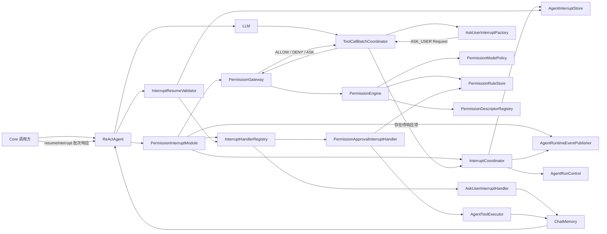
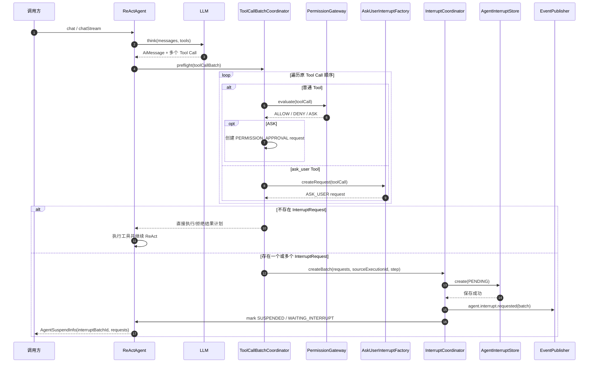
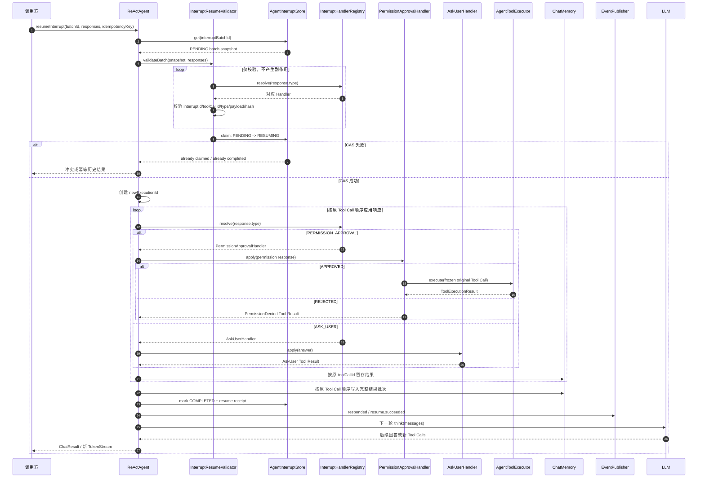

# AgentForge 权限体系与统一中断恢复设计方案

> **首期实现说明：** 当前一个中断批次只允许恢复一次，使用 `batchId` 和
> `PENDING -> RESUMING -> COMPLETED` 状态机防止重复消费，暂不提供 `idempotencyKey`
> 及恢复结果重放。AskUser 只接受结构化 `AskUserResponse`，不再接受旧版纯文本
> `answer`。文中关于幂等回执和旧版 `answer` 的段落为后续演进方案，不代表当前接口。

## 一、背景

### 1.1 设计结论

AgentForge 应先建设一套与具体业务无关的 **统一中断协议（Interrupt Protocol）**。首期的权限审核和询问用户都通过这套协议暂停与恢复；未来若增加外部执行或人工复核，也应复用同一协议。权限系统只是中断生产者之一，不能反过来成为中断系统的宿主。

建议采用三个协作层次：

1. **通用中断内核（Interrupt Runtime）**：负责统一的 request、暂停、事件、快照、response、恢复、幂等和并发控制，不理解具体权限规则或问题表单；
2. **中断类型适配器（Interrupt Handler）**：负责校验某类中断的 request/response，并把 response 应用到冻结的运行现场；
3. **权限策略模块（Permission Policy）**：负责对每个工具调用输出 `ALLOW / DENY / ASK`，`ASK` 仅负责创建 `PERMISSION_APPROVAL` 中断。

首版只支持两类统一中断：

- `PERMISSION_APPROVAL`：确认或拒绝是否执行一个或一批原始 Tool Call；
- `ASK_USER`：等待用户作答，再把答案包装为原 `ask_user` Tool Call 的工具结果。

外部系统执行、多级审批、子 Agent 中断传播属于后续扩展，但不得为它们另建暂停恢复主流程。

核心原则如下：

- **决策与执行分离**：权限系统只决定能否执行，工具执行器只执行已获授权的调用；
- **一种暂停恢复语义**：同一 AI Call 的中断项组成 Batch，统一使用 `InterruptBatchRequest -> SUSPENDED -> InterruptBatchResponse -> resumeInterrupt`；
- **中断对象不可漂移**：请求与恢复必须绑定冻结的原始对象；权限场景绑定原 Tool Call，询问场景绑定原 Question，外部执行绑定原任务；
- **暂停不占线程**：产生任何中断时本次 invocation 正常收口为 `SUSPENDED`，不能用线程或 `CompletableFuture` 长时间阻塞等待；
- **框架与平台解耦**：框架定义协议和 SPI，平台选择内存、数据库或消息系统保存并投递；
- **默认 fail-closed**：权限引擎异常、中断响应类型不匹配、凭证不匹配或快照缺失时禁止恢复；
- **同步与流式同语义**：两条入口共用同一个权限网关、中断状态机和恢复处理器；
- **一次响应只消费一次**：恢复采用版本号和幂等键，防止重复点击或重试造成重复执行；
- **旧执行不可复活**：恢复创建新的 `executionId`，原执行只作为 `sourceExecutionId` 保留。

本文为架构与实现方案，暂不包含代码实现。

### 1.2 JDK 8 技术约束

AgentForge 当前基于 JDK 8，本文所有 Java 接口和模型均以 JDK 8 为实现基线：

- 领域模型使用普通 `class`、构造器、getter/setter 或 Builder，不使用 Java `record`；
- 不使用 switch 表达式、文本块、模式匹配、sealed class；
- 集合构造使用 `Arrays.asList`、`Collections.singletonList` 等 JDK 8 API，不使用 `List.of/Map.of/Set.of`；
- SPI 可使用 JDK 8 interface default method、泛型、lambda、`CompletableFuture`，但中断等待不能靠长期阻塞 Future 实现；
- 文档中的字段型代码为结构示意，实际实现补充构造器、getter/setter、`equals/hashCode` 和序列化配置。

---

### 1.3 AgentForge 现状与参考方案

#### 1.3.1 AgentForge 已有基础

当前 AgentForge 已经具备：

- `IResumableAgent.resume(memoryId, executionId)` 与 `resumeStream(...)`；
- `AgentRunState`、`AgentExecutionStatus`、`AgentRunControl`；
- ChatMemory 持久化和消息链修复；
- 取消、迟到回调隔离、新旧 `executionId` 切换；
- 流式与非流式 ReAct 主循环；
- Agent State 持久化 SPI。

现有“Agent 运行恢复”解决的是异常、重启或步数耗尽后从 ChatMemory 继续推理，尚未解决计划内的人工审核暂停。两者应复用执行身份、持久化和并发保护，但不能共用同一个模糊的 `resume` 语义：

| 能力 | 普通运行恢复 | 统一中断恢复 |
| --- | --- | --- |
| 触发原因 | 异常、取消、重启、步数耗尽 | Agent 主动进入等待态 |
| 是否计划内 | 否 | 是 |
| 恢复输入 | `memoryId + sourceExecutionId` | `interruptBatchId + responses + idempotencyKey` |
| 恢复位置 | 根据消息历史继续推理 | 从中断快照记录的 phase/continuation 继续 |
| 是否允许重新生成等待对象 | 可以重新 think | 不允许，必须消费冻结对象 |
| 关键风险 | 重复模型调用 | 响应错配、篡改、重复消费或副作用 |

#### 1.3.2 参考方案结论

既有材料与 OpenCode 的经验可归纳为：

- 框架输出 `ALLOW / DENY / ASK`；
- 前端提供 `allow once / allow always / reject`；
- 每个待审核操作都需要稳定 ID，并支持 pending 查询；
- `allow always` 应落为可解释、可撤销的规则，而不是把任意前端表达式直接写入权限库；
- ASK 后结束本次运行，由后续显式 resume 恢复；
- 权限事件和审批结果需要进入审计日志。

AgentScope Java 官方当前实现还提供了值得吸收的语义：

- `PermissionMode + PermissionRule + Tool built-in check` 三层决策；
- `RequireUserConfirmEvent` 与 `UserConfirmResultEvent` 通过 `replyId` 关联；
- 权限确认与外部执行分别使用 `RequireUserConfirmEvent`、`RequireExternalExecutionEvent`；
- 一次 invocation 可以以 `SUSPENDED` 正常结束，而持久任务仍处于非终态；
- 所有工具都被拒绝时发出独立事件，由策略决定继续推理还是停止。

本方案借鉴这些语义，但接口命名、状态模型和持久化方式以 AgentForge 现状为准，不照搬其 `Msg.metadata` 恢复方式。

---

### 1.4 本次 agent-core 设计边界

#### 1.4.1 中断内核首期能力

- 统一 `InterruptRequest/Response` 单项模型和 `InterruptBatchRequest/Response` 批次模型；
- `InterruptType` 与类型 Handler 注册机制；
- 通用 requested/responded/resume 事件；
- 显式恢复、进程内幂等、超时/取消状态和类型化运行事件；
- 流式、非流式一致；
- 提供可选 `AgentInterruptStore` SPI，使业务层未来能够持久化并跨重启恢复；
- 首批只内置 `PERMISSION_APPROVAL` 和 `ASK_USER` 两种类型。

#### 1.4.2 权限系统首期能力

- 工具调用前统一权限检查；
- `ALLOW / DENY / ASK` 三态；
- 首期内置 `DEFAULT / BYPASS / DONT_ASK` 运行模式；只读、编辑等模式通过 `PermissionModePolicy` 扩展；
- Tool 级内建安全检查；
- 显式规则与运行时 `allow once / allow always / reject`；
- 通过统一 Interrupt Runtime 创建权限中断；
- 单次 ReAct step 内多个 Tool Call 的批次审核；
- 权限恢复 Handler 将决定应用到冻结 Tool Call。

#### 1.4.3 后续扩展原则

- 首版枚举、请求 DTO 和 Handler 只实现权限审核、`ask_user`；
- 后续外部执行、多级复核、父子 Agent 中断仍复用统一快照和恢复协议；
- 新类型通过新增 Handler 扩展，不修改 Interrupt Runtime 状态机；
- 工具执行账本、跨节点调度和高级规则治理分阶段补充。

#### 1.4.4 不在 Core 中处理

- 登录认证、租户成员关系等业务身份认证；
- 操作系统容器隔离、网络隔离本身；
- 用 Prompt 告诉模型“不要执行危险操作”；
- 依赖人工审核替代工具自身参数校验；
- 对无法保证幂等的外部副作用做自动重放。
- 数据库表、HTTP 接口、SSE/WebSocket、页面卡片与待办列表；
- 审批人身份、租户权限、多级审批工作流和业务审计表；
- 业务层如何持久化规则、中断快照和事件。

权限判断是纵深防御的一层，不能代替沙箱和业务鉴权。

---

## 二、权限系统核心设计

### 2.1 总体架构

```text
LLM 产生 Tool Calls
        |
        v
ToolCallBatchPlanner
  固化顺序、规范化参数、计算 requestHash
        |
        v
PermissionGateway
  +---------------- Tool built-in checks
  +---------------- explicit rules
  +---------------- permission mode
        |
        +-- ALLOW ----------------------+
        |                               |
        +-- DENY -> synthetic result ---+--> ToolBatchExecutor --> ChatMemory
        |
        +-- ASK
              |
              v
        InterruptCoordinator（agent-core）
          1. 冻结原 Tool Call 批次
          2. 保存 InterruptSnapshot（默认内存，可替换 SPI）
          3. 发出 InterruptRequestedEvent
          4. 本次 invocation = SUSPENDED
              |
              v
        调用方取得统一 InterruptRequest
              |
              v
        resumeInterrupt(InterruptBatchResumeCommand)
              |
              v
        InterruptResumeValidator
          校验 interruptBatchId、全部单项映射、版本、hash、状态
              |
              v
        新 executionId 从 TOOL_PERMISSION/TOOL_EXECUTION 恢复
```

建议模块边界：

```text
agentforge-agent-core
├── permission/       # 领域接口、决策模型、Gateway、规则匹配 SPI
├── interrupt/        # 通用中断协议、状态机、恢复协调器
├── event/            # 类型化运行事件
└── component/state/  # 执行态与持久化 SPI 扩展

```

本文只设计 `agentforge-agent-core`。Core 不能依赖 Controller、SSE、数据库实体、当前登录用户，也不规定业务层 API；它只暴露稳定的中断模型、状态、事件、Store SPI 和批次恢复入口。业务层未来只能提交 `InterruptBatchResponse`，不能直接改写 Agent 内部 Tool Call 状态。

---

### 2.2 PermissionMode 与 ALLOW、DENY、ASK 的关系

这两组概念不在同一层：

- `ALLOW / DENY / ASK` 是针对某一次具体 Tool Call 的最终决策结果；
- `DEFAULT / BYPASS / DONT_ASK` 是 Agent 当前采用的全局权限策略，用于参与产生最终决策；更细粒度模式由 `PermissionModePolicy` 提供。

```text
第一阶段：PermissionRule + PermissionRuleHandler
    -> 第一个命中规则直接产生决策
    -> 无规则命中
第二阶段：PermissionModePolicy / PermissionMode
    + 工作区和运行上下文
              |
              v
PermissionDecision
    +-- ALLOW：进入 ToolExecutor
    +-- DENY ：不执行，生成拒绝 Tool Result
    +-- ASK  ：创建 PERMISSION_APPROVAL 中断
```

一句话概括：**规则处理器先做权限判定；只有无规则命中时才由 Mode 作为默认策略兜底，三态是最终输出。** Mode 不参与规则匹配，也不能覆盖已命中的显式规则。

| Mode | 只读操作 | 工作区内普通编辑 | Shell/外部副作用 | 最终出现 ASK 时 |
| --- | --- | --- | --- | --- |
| `DEFAULT` | 默认 ASK | 默认 ASK | 默认 ASK | 保持 ASK |
| `BYPASS` | 默认 ALLOW | 默认 ALLOW | 默认 ALLOW | 转为 ALLOW，仅显式 DENY 保留 |
| `DONT_ASK` | 按规则判断 | 按规则判断 | 按规则判断 | 转为 DENY，仅显式 ALLOW 保留 |

需要特别注意：

- `BYPASS` 不是关闭权限系统：显式 DENY 和不可绕过的安全检查仍有效，但显式 ASK 会放行；
- `DONT_ASK` 不是全部拒绝：显式 ALLOW 仍放行，ASK 和无规则调用都会降级成 DENY；
- 只读、编辑等更细粒度模式不进入首期内置枚举，由 `PermissionModePolicy` 实现；
- Mode 不能覆盖不可绕过的安全限制，也不是第四种权限结果。

### 2.3 原始权限设计组件

#### 2.3.1 三种最终决策

```java
public enum PermissionBehavior {
    ALLOW,
    DENY,
    ASK,
    PASSTHROUGH // 仅限检查链内部，不作为最终结果
}
```

```java
public class PermissionDecision {
    private PermissionBehavior behavior;
    private String reasonCode;
    private String reason;
    private RiskLevel riskLevel;
    private DecisionSource source;
    private boolean nonBypassable;
    private List<PermissionRuleSuggestion> suggestedRules;

    // JDK 8：构造器、getter/setter、Builder 省略
}
```

`reasonCode` 必须稳定可枚举，例如：

- `EXPLICIT_DENY_RULE`
- `DANGEROUS_PATH`
- `DESTRUCTIVE_COMMAND`
- `OUTSIDE_WORKSPACE`
- `NETWORK_HOST_NOT_ALLOWED`
- `MODE_REQUIRES_APPROVAL`
- `PERMISSION_ENGINE_ERROR`

`reason` 用于展示，不能用于程序分支。

#### 2.3.2 权限模式

```java
public enum PermissionMode {
    DEFAULT,
    BYPASS,
    DONT_ASK
}
```

| 模式 | 规则命中 `ASK` | 无规则命中 | 真实场景 |
| --- | --- | --- | --- |
| `DEFAULT` | 保持 `ASK`，进入审核中断 | `ASK` | 在线编码助手：读操作放行，写文件和 Shell 询问用户 |
| `BYPASS` | 转为 `ALLOW` | `ALLOW` | 可信沙箱：除危险命令、敏感路径显式 `DENY` 外自动放行 |
| `DONT_ASK` | 转为 `DENY` | `DENY` | 无人值守巡检：仅白名单只读工具 `ALLOW`，其余拒绝且不暂停 |

真实搭配示例：

```java
// 在线助手：用户在场，读写策略分开。
PermissionInterruptModule module =
        PermissionInterruptModule.safeDefaults()          // DEFAULT
                .allow("read_.*", ".*")
                .ask("(write_.*)|(shell)", ".*")
                .build();

// 可信沙箱：只拦截明确危险操作，其余自动执行。
PermissionInterruptModule module =
        PermissionInterruptModule.builder()
                .activePermissionMode(PermissionMode.BYPASS)
                .deny("shell", "rm\\s+-rf.*")
                .deny("read_.*", ".*secret.*")
                .build();

// 无人值守：只允许白名单只读能力，其余直接拒绝，不等待人工。
PermissionInterruptModule module =
        PermissionInterruptModule.builder()
                .activePermissionMode(PermissionMode.DONT_ASK)
                .allow("read_.*", ".*")
                .build();
```

只读、编辑等模式不进入首期内置枚举，需要时通过 `PermissionModePolicy` 实现。

实现上，内置 `PermissionMode` 也通过 `BuiltinPermissionModePolicy` 适配成统一的 `PermissionModePolicy`：未注入自定义策略时使用内置适配器；注入后自定义策略完全接管，回退顺序不会产生两套判定分支。

`BYPASS` 不是关闭安全系统。显式 `DENY`、不可绕过检查、平台业务鉴权仍然有效。

执行顺序固定为：规则先生成候选决策，Mode/ModePolicy 再结合候选做最终决策；无规则命中时由 Mode 生成兜底决策。

#### 2.3.3 权限规则

```java
public class PermissionRule {
    private String ruleId;
    private String toolName;
    private String matcherType;
    private String matcherValue;
    private PermissionBehavior behavior;
    private PermissionRuleScope scope;
    private String source;
    private int priority;
    private Instant expiresAt;
    private boolean enabled;
    private long version;

    // JDK 8：构造器、getter/setter、Builder 省略
}
```

首期落地采用“规则类型 + 类型处理器”，而不是把匹配逻辑写死在规则对象里：

```java
public interface PermissionRule {
    String getId();
    String getType();
    PermissionDecision getDecision();
}

public interface PermissionRuleHandler {
    String type();
    boolean matches(PermissionRule rule, PermissionContext context);
}
```

- 内置类型由 `PermissionRuleType` 枚举维护，当前只有 `REGEX`：`RegexPermissionRule` + `RegexPermissionRuleHandler`；自定义类型仍使用字符串，保持扩展能力；
- `allow/ask/deny(toolRegex, argumentRegex)` 仍生成内置正则规则；
- 自定义类型通过 `rule(PermissionRule)` 注册规则，通过 `ruleHandler(PermissionRuleHandler)` 注册处理器；
- 同一类型只允许一个处理器，内置 `regex` 不允许被覆盖；
- 构建期校验所有规则类型都有处理器，未知类型直接失败，不会静默放行；
- 执行时仍按规则注册顺序匹配，第一个命中规则决定 `ALLOW / DENY / ASK`。

示例：

```java
PermissionInterruptModule module =
        PermissionInterruptModule.safeDefaults()
                .ruleHandler(new MyRuleHandler())
                .rule(new MyRule("rule-1", "my_type", PermissionDecision.DENY))
                .allow("read_.*", ".*")
                .build();
```

规则作用域建议支持：

```text
SYSTEM > TENANT > PROJECT > AGENT > USER > SESSION
```

这里的 `>` 表示治理层级，不直接表示 allow 可以覆盖上层 deny。合并原则是：

1. 任意不可绕过 `DENY` 立即生效；
2. 命中的显式 `DENY` 优先于 `ASK` 和 `ALLOW`；
3. 命中的显式 `ASK` 优先于 `ALLOW`；
4. 同行为规则再按 scope、priority、specificity、version 选取；
5. 没有规则命中时才进入 Mode 兜底。

不要由权限核心直接解释所有 `matcherValue`。不同工具应通过匹配 SPI 理解自身参数：

```java
public interface ToolPermissionDescriptor {
    PermissionDecision checkBuiltIn(
            ToolExecutionRequest request,
            PermissionEvaluationContext context);

    boolean matches(PermissionRule rule, ToolExecutionRequest request);

    List<PermissionRuleSuggestion> suggestRules(
            ToolExecutionRequest request,
            PermissionEvaluationContext context);

    ToolEffect classifyEffect(ToolExecutionRequest request);
}
```

例如：

- Shell Tool 理解命令、工作目录、管道和重定向；
- File Tool 理解规范化后的真实路径、读写类型和工作区边界；
- HTTP Tool 理解 method、scheme、host、port 和 path；
- MCP Tool 至少理解 server、tool name 和结构化参数；
- 数据库 Tool 理解 datasource、SQL 类型和影响范围。

#### 2.3.4 ToolEffect 分类

只用一个布尔值无法表达真实风险，建议首期至少分类：

```java
public enum ToolEffect {
    READ,
    WRITE_LOCAL,
    EXECUTE,
    NETWORK,
    EXTERNAL_SIDE_EFFECT,
    PRIVILEGED,
    UNKNOWN
}
```

一个调用可以对应多个 effect。`UNKNOWN` 在 `DEFAULT` 下必须 ASK，在 `DONT_ASK` 下必须 DENY。

---

### 2.4 权限评估流水线

建议固定为以下顺序，避免不同 Tool、流式入口产生不同结果：

```text
0. 参数解析、schema 校验、路径/主机规范化
1. Core 内建/调用方注入的硬约束与不可绕过 DENY
2. Tool built-in DENY / safety ASK
3. 显式 DENY 规则
4. 显式 ASK 规则
5. 自定义 ModePolicy（如只读、编辑策略）
6. 显式 ALLOW 规则
7. 普通 built-in 建议
8. Mode 默认值
9. DONT_ASK 将 ASK 降级为 DENY
```

关键点：

- 先规范化再匹配，防止 `../`、软链接、大小写、编码等绕过；
- 安全型 built-in check 必须标记 `nonBypassable=true`；
- 权限引擎内部异常统一得到 `DENY(PERMISSION_ENGINE_ERROR)`；
- 最终决策应携带完整 decision trace，审计时能够回答“哪条规则为什么命中”；
- 同一 Tool Call 在暂停前后不能重新评估成另一组参数；恢复只消费已冻结的 request。

推荐输出：

```java
public class PermissionEvaluation {
    private String toolCallId;
    private PermissionDecision finalDecision;
    private List<PermissionTraceEntry> trace;
    private String canonicalRequestHash;
    private Instant evaluatedAt;
    private String policyVersion;

    // JDK 8：构造器与访问方法省略
}
```

`policyVersion` 用于审计。首期建议：恢复时保持原审批结论，但在真正执行前重新运行“不可绕过硬约束”；如果新策略新增硬拒绝，应阻止执行并结束该 Tool Call。

---

### 2.5 统一中断模型

#### 2.5.1 为什么必须抽象统一 Interrupt

权限 ASK、`ask_user` 和外部执行的共同过程都是：

```text
运行到一个确定位置
  -> 冻结等待输入的对象
  -> 发出带关联 ID 的请求事件
  -> 本次 invocation 结束
  -> 外部稍后提交结构化结果
  -> 校验并从确定位置恢复
```

差别仅在请求 payload、恢复 payload 和恢复处理器。因此需要一个稳定内核，而不是为每类 HITL 重复实现暂停和恢复。

#### 2.5.2 首期中断类型

```java
public enum InterruptType {
    PERMISSION_APPROVAL,
    ASK_USER
}
```

首版严格限定为这两类：

| 类型 | 中断请求 | 外部响应 | 恢复动作 |
| --- | --- | --- | --- |
| `PERMISSION_APPROVAL` | 原 Tool Call、风险原因、可选规则 | 对每个调用批准一次、批准并保存规则或拒绝 | 批准则执行原工具；拒绝则生成权限拒绝 Tool Result |
| `ASK_USER` | `ask_user` 原 Tool Call、问题、选项和回答约束 | 用户选择或文本答案 | 校验答案并包装成 `ask_user` 的 Tool Result，不再执行其他业务工具 |

#### 2.5.3 统一请求与响应

中断内核只识别统一基类；类型 Handler 负责具体 payload。JDK 8 不使用 sealed class，可通过 `type + payload class` 注册表保证配对。

```java
public class InterruptRequest {
    private String interruptId;
    private String toolCallId;
    private InterruptType type;
    private Object payload;

    // 构造器与访问方法省略
}

public class InterruptResponse {
    private String interruptId;
    private String toolCallId;
    private InterruptType type;
    private Object payload;

    // 构造器与访问方法省略
}

public class InterruptBatchRequest {
    private String interruptBatchId;
    private Object memoryId;
    private String sourceExecutionId;
    private int step;
    private List<InterruptRequest> requests;

    // 构造器与访问方法省略
}

public class InterruptBatchResponse {
    private String interruptBatchId;
    private List<InterruptResponse> responses;
    private String idempotencyKey;

    // 构造器与访问方法省略
}
```

`InterruptRequest/Response` 表示单个 Tool Call 的中断请求和回答；`InterruptBatchRequest/Response` 表示同一次 AI Call 产生的整组中断。单中断是 `requests.size() == 1` 的批次特例，不走另一套接口。

首期不再额外引入 `correlationId`。批次通过 `interruptBatchId` 关联，批次内单项通过 `interruptId` 关联，请求与响应无需第三个关联字段。

各 ID 的职责保持单一：

| ID | 唯一标识的对象 | 主要用途 |
| --- | --- | --- |
| `interruptBatchId` | 同一次 AI Call 产生的一组中断 | 关联批次快照、批次响应和恢复操作 |
| `interruptId` | 批次内一个具体 Tool Call 中断 | 关联单项 Request 与 Response |
| `eventId` | 一条运行事件 | 事件去重 |
| `sourceExecutionId` | 产生中断的 Agent 执行 | 追溯中断来源 |
| `resumedExecutionId` | 恢复后新建的 Agent 执行 | 隔离旧执行与恢复执行 |
| `toolCallId` | 模型生成的具体 Tool Call | 将审批决定或 AskUser 答案绑定到原调用 |

如果未来出现“同一个中断项允许多轮往返响应”的复杂协议，再评估增加 message/reply ID；首期一个中断项只接受一个有效响应，不需要该字段。

统一 Handler：

```java
public interface InterruptHandler<REQ, RESP> {
    InterruptType supportType();

    Class<REQ> requestType();

    Class<RESP> responseType();

    void validateResponse(REQ request, RESP response, InterruptContext context);

    InterruptApplyResult applyResponse(
            REQ request,
            RESP response,
            InterruptContext context);
}
```

`InterruptHandlerRegistry` 在启动时检查每个 `InterruptType` 只能注册一个 Handler。恢复时先根据 type 取 Handler，再验证 payload class，禁止依赖不安全的强制类型转换。

#### 2.5.4 中断快照

```java
public class AgentInterruptSnapshot {
    private String interruptBatchId;
    private Object memoryId;
    private String sourceExecutionId;
    private String agentId;
    private int step;
    private AgentLoopPhase phase;
    private InterruptBatchStatus status;
    private String batchRequestHash;
    private InterruptBatchRequest requestBatch;
    private Instant createdAt;
    private Instant expiresAt;
    private Instant resolvedAt;

    // JDK 8：构造器、getter/setter、Builder 省略
}
```

```java
public enum InterruptBatchStatus {
    PENDING,
    RESUMING,
    COMPLETED
}
```

`status` 用于批次级 CAS（`PENDING -> RESUMING -> COMPLETED`），并发恢复只允许一个请求完成 `PENDING -> RESUMING` 的抢占；`batchRequestHash` 绑定规范化后的完整请求批次。快照还会保存直接 DENY 的工具调用，恢复时先写拒绝 Tool Result，再按原顺序处理其余调用。类型专属内容仍放入各个 `InterruptRequest.payload`，快照内核不增加权限或 AskUser 专属字段。身份凭证属于业务层，不进入 agent-core 快照模型。

### 2.6 两种统一中断的抽象场景

权限审核和 AskUser 表面上都是“暂停后等待用户”，但等待的内容不同。两者可以抽象为：

```text
模型产生 Tool Call
      |
      v
Core 判断该调用需要外部响应
      |
      v
冻结本轮 Tool Call Batch
      |
      v
为每个待响应 Tool Call 创建 InterruptRequest
并组成 InterruptBatchRequest
      |
      v
Agent SUSPENDED
      |
      v
调用方一次提交 InterruptBatchResponse
      |
      v
Core 先整批校验，再按 type 路由各个 Handler
      |
      v
按原 Tool Call 顺序写入唯一结果并继续 ReAct
```

两种场景的区别集中在“用户回答什么”以及“Handler 如何形成 Tool Result”：

| 抽象场景 | 用户回答的问题 | Handler 恢复动作 | 典型示例 |
| --- | --- | --- | --- |
| `PERMISSION_APPROVAL` | 能不能执行这个已经生成的工具调用 | 批准则执行原工具并写真实结果；拒绝则写权限拒绝结果 | Workspace 越界、危险命令、敏感路径、外部副作用 |
| `ASK_USER` | 当前任务还需要什么信息或选择 | 校验回答，并直接包装为原 `ask_user` 调用的工具结果 | 选择部署环境、补充工单号、确认方案、填写发布说明 |

统一抽象只解决暂停、关联和恢复，不抹平两者的业务语义。权限中断必须经过权限引擎，AskUser 也不能被用来绕过权限检查。

#### 2.6.1 权限审核场景：确认或拒绝工具执行

##### 用途与典型场景

权限审核中断用于处理以下问题：

> Agent 已经生成了一个明确的 Tool Call，但权限系统不能直接放行，需要用户决定是否执行这个原始调用。

它等待的是“是否允许执行工具”的决定，而不是让用户补充业务答案。典型场景包括：

| 场景 | Tool Call 示例 | 权限结果 | 用户可做的决定 |
| --- | --- | --- | --- |
| 超出 Workspace | 写入 `/workspace` 之外的文件 | `ASK` | 本次允许、接受建议规则、拒绝 |
| 访问敏感路径 | 读取 `.env`、`.ssh`、凭证文件 | `ASK` 或硬 `DENY` | 只有允许询问的风险才能批准 |
| 危险命令 | `rm`、`git push --force`、修改系统配置 | `ASK` 或硬 `DENY` | 确认是否执行原命令 |
| 外部副作用 | 发邮件、发布版本、创建云资源 | `ASK` | 确认是否产生外部影响 |
| 网络越界 | 请求未在允许列表中的主机 | `ASK` 或 `DENY` | 确认本次网络访问 |
| 高风险数据操作 | 删除数据、执行更新类 SQL | `ASK` 或硬 `DENY` | 确认是否执行原操作 |

Workspace 越界不需要增加新的中断类型。File Tool 的权限描述器识别到规范化路径超出 Workspace 后返回 `ASK`，Core 随即创建 `PERMISSION_APPROVAL` 中断；恢复后仍然执行暂停时冻结的原 Tool Call。

权限审核不代表所有风险都可以由用户绕过。必须区分：

- **可确认风险**：返回 `ASK`，用户可以批准或拒绝；
- **不可绕过红线**：返回带 `nonBypassable=true` 的 `DENY`，不创建中断；
- **无人值守模式**：`DONT_ASK` 将 ASK 转成 DENY，不创建中断。

不适用场景：用户尚未提供任务所需信息、需要用户选择方案、需要澄清自然语言意图。这些属于 `ASK_USER`。

##### 请求、响应与待执行调用

```java
public class PermissionApprovalRequest {
    private PendingToolCall toolCall;
    private PermissionMode mode;
    private String policyVersion;

    // 构造器与访问方法省略
}

public class PermissionApprovalResponse {
    private ToolApprovalDecision decision;

    // 构造器与访问方法省略
}

public class ToolApprovalDecision {
    /** 必须对应 PermissionApprovalRequest 中的原始 Tool Call。 */
    private String toolCallId;

    /** 本次允许、允许并接受建议规则、拒绝。 */
    private ApprovalAction action;

    /** 绑定冻结参数，防止审批后替换 Tool arguments。 */
    private String argumentsHash;

    /** APPROVE_ALWAYS 时选择 Core 生成的建议规则；其他动作为空。 */
    private String selectedSuggestionId;

    /** 可选的审核备注，仅用于上下文和审计，不参与权限匹配。 */
    private String comment;

    // 构造器与访问方法省略
}

public enum ApprovalAction {
    APPROVE_ONCE,
    APPROVE_ALWAYS,
    REJECT
}
```

`ApprovalAction` 表示用户对某个处于 `ASKING` 状态的 Tool Call 作出的审核决定：

| Action | 含义 | 当前 Tool Call | 后续同类 Tool Call |
| --- | --- | --- | --- |
| `APPROVE_ONCE` | 只批准当前这一次调用 | 执行冻结的原始调用 | 仍然按权限规则重新判断，可能再次 ASK |
| `APPROVE_ALWAYS` | 批准当前调用，同时接受一条建议允许规则 | 执行冻结的原始调用 | 命中已接受规则时可直接 ALLOW |
| `REJECT` | 用户拒绝当前调用 | 不执行，写入权限拒绝 Tool Result | 不自动创建 DENY 规则，后续仍重新判断 |

例如 Agent 要执行：

```text
shell(command = "npm test")
```

- 选择 `APPROVE_ONCE`：只运行本次 `npm test`；
- 选择 `APPROVE_ALWAYS`：运行本次调用，并接受 Core 建议的类似“允许 shell 的 `npm test`”规则；
- 选择 `REJECT`：不运行命令，并向模型返回用户拒绝结果。

`APPROVE_ALWAYS` 必须满足以下约束：

1. 只能通过 `selectedSuggestionId` 选择 Core 针对本次调用生成的 `PermissionRuleSuggestion`；
2. 调用方不能直接提交任意 matcher、路径或命令规则；
3. 危险路径、破坏性命令和 `nonBypassable` 风险不能提供 always 建议；
4. Core 首期可以把接受的规则写入当前 `PermissionContext`；长期持久化与规则作用域由后续业务层实现；
5. 建议规则保存失败时不能按 always 语义静默放行，可失败或降级为显式的 `APPROVE_ONCE`，但不能由 Core 擅自选择。

##### APPROVE_ALWAYS 如何保存并影响后续调用

`APPROVE_ALWAYS` 不能只保存一个 `approved=true`。它需要把用户选中的建议规则固化为一条 `PermissionRule`，后续 Tool Call 通过规则匹配得到 `ALLOW`。

完整流程：

```text
第一次 Tool Call
  shell(command = "npm test")
        |
        v
PermissionEngine 得到 ASK
        |
        v
PermissionRuleSuggestion
  suggestionId = "suggest_xxx"
  toolName = "shell"
  matcherType = "COMMAND_EXACT"
  matcherValue = "npm test"
  suggestedBehavior = ALLOW
        |
        v
用户选择 APPROVE_ALWAYS + suggest_xxx
        |
        v
PermissionApprovalInterruptHandler 校验 suggestion
        |
        v
转换并保存 PermissionRule(source = USER_APPROVAL)
        |
        v
执行当前冻结 Tool Call
        |
        v
后续 shell("npm test") 命中规则 -> ALLOW
```

Core 需要把“中断快照”和“生效规则”区分开：

| 数据 | 作用 | `APPROVE_ONCE` | `APPROVE_ALWAYS` |
| --- | --- | --- | --- |
| `PermissionApprovalResponse` | 记录本次用户决定 | 保存到中断结果 | 保存到中断结果 |
| `AgentInterruptSnapshot` | 保证本次中断可恢复、不可重复消费 | 最终为 COMPLETED | 最终为 COMPLETED |
| `PermissionRule` | 匹配并影响后续 Tool Call | 不创建 | 创建一条 ALLOW 规则 |

建议增加规则存储 SPI：

```java
public interface PermissionRuleStore {

    List<PermissionRule> findApplicable(PermissionRuleQuery query);

    PermissionRule save(PermissionRule rule);

    boolean disable(String ruleId, long expectedVersion);
}
```

规则持久化属于后续规划，当前代码没有 `PermissionRuleStore`：

- 当前规则只保存在 `PermissionInterruptModule` 实例内存中；
- 进程重启后规则丢失；
- 不承诺多节点共享；
- 下面的 `InMemoryPermissionRuleStore` 是规划中的默认实现。

如果需要“以后一直允许”跨服务重启生效，业务层需要实现持久化 `PermissionRuleStore`，例如使用 MySQL、SQLite 或其他配置存储。agent-core 只定义 SPI 和规则匹配语义，不规定数据库表。

规则作用域不能含糊，建议由调用方构建 `PermissionRuleScopeRef` 并放入运行上下文：

```java
public class PermissionRuleScopeRef {
    private PermissionRuleScope scope;
    private String scopeId;

    // 构造器与访问方法省略
}

public enum PermissionRuleScope {
    SESSION,
    AGENT,
    PROJECT,
    USER
}
```

建议首期默认只支持最安全的 `SESSION` 作用域：

- `scope=SESSION`；
- `scopeId=memoryId`；
- 规则只影响当前会话；
- 不会因为一次点击而放大到其他项目或用户。

`AGENT/PROJECT/USER` 等长期作用域由业务层以后注入明确的 scopeId，并在保存前完成身份和权限校验。Core 不应该从 `memoryId` 猜测项目或用户。

规则保存和当前工具执行的推荐顺序：

```text
1. CAS 抢占中断：PENDING -> RESUMING
2. 校验 selectedSuggestionId 属于原中断快照
3. 将 Suggestion 转换成 PermissionRule
4. PermissionRuleStore.save(rule)
5. 保存成功后执行当前冻结 Tool Call
6. 中断状态变为 COMPLETED
```

如果第 4 步保存失败：

- 当前工具不能按 `APPROVE_ALWAYS` 语义继续执行；
- Core 返回明确失败，让调用方重新选择；
- 调用方可以显式改成 `APPROVE_ONCE` 后重新提交；
- Core 不能自行把 always 降级为 once。

后续权限评估时，`PermissionEngine` 先根据当前 `PermissionContext` 的 scope 查询规则：

```text
PermissionRuleStore.findApplicable(currentScopes)
        |
        v
ToolPermissionDescriptor.matches(rule, toolCall)
        |
        +-- 命中 ALLOW -> 直接 ALLOW
        +-- 未命中       -> 继续正常权限评估
```

“一直允许”实际上是“在指定作用域、匹配条件和有效期内允许”，而不是全局永久放行。每条规则至少应保存：

- `ruleId`；
- `toolName`；
- `matcherType/matcherValue`；
- `behavior=ALLOW`；
- `scope/scopeId`；
- `source=USER_APPROVAL`；
- `createdAt/expiresAt`；
- `enabled/version`。

敏感操作建议不提供永久规则，或者强制短有效期。例如 Workspace 外的某个明确目录可以生成精确路径规则，但 `/`、用户主目录、凭证目录和破坏性命令不应生成宽泛的 `APPROVE_ALWAYS` 建议。

`REJECT` 只拒绝当前调用，不等于创建永久 DENY 规则。如果未来需要“始终拒绝”，应新增明确动作或通过规则管理完成，不能复用 `REJECT` 的语义。

```java

public class PendingToolCall {
    private int index;
    private String toolCallId;
    private String toolName;
    private Map<String, Object> canonicalArguments;
    private String argumentsHash;
    private PermissionEvaluation evaluation;
    private PendingToolStatus status;
    private String resultId;

    // 构造器与访问方法省略
}
```

```java
public enum PendingToolStatus {
    ALLOWED,
    DENIED,
    ASKING,
    APPROVED,
    REJECTED,
    EXECUTING,
    SUCCEEDED,
    FAILED
}
```

`PendingToolStatus` 描述同一个 Tool Call 从权限评估到产生最终结果的过程：

| Status | 阶段 | 含义 | 是否执行工具 | 后续流转 |
| --- | --- | --- | --- | --- |
| `ALLOWED` | 权限评估 | 权限系统已直接允许 | 尚未执行 | `EXECUTING` |
| `DENIED` | 权限评估终态 | 权限规则、Mode 或安全检查直接拒绝 | 不执行 | 生成拒绝 Tool Result |
| `ASKING` | 等待审核 | 权限结果为 ASK，正在等待用户决定 | 不执行 | `APPROVED` 或 `REJECTED` |
| `APPROVED` | 审核完成 | 用户批准了当前调用 | 尚未执行 | `EXECUTING` |
| `REJECTED` | 审核终态 | 用户拒绝了当前调用 | 不执行 | 生成用户拒绝 Tool Result |
| `EXECUTING` | 工具执行 | 已提交 ToolExecutor，正在执行 | 正在执行 | `SUCCEEDED` 或 `FAILED` |
| `SUCCEEDED` | 执行终态 | 工具成功完成并已有结果 | 已执行 | 无 |
| `FAILED` | 执行终态 | 工具执行失败并已有错误结果 | 已尝试执行 | 无，是否重试由其他策略决定 |

最容易混淆的是以下两组：

- `ALLOWED` 与 `APPROVED`：前者由权限引擎直接放行，后者由用户审核后放行；二者都会进入 `EXECUTING`；
- `DENIED` 与 `REJECTED`：前者由规则、Mode 或安全检查拒绝，后者由用户在审核界面拒绝；二者都不会进入 ToolExecutor。

典型状态流转：

```text
直接允许：ALLOWED -> EXECUTING -> SUCCEEDED | FAILED

直接拒绝：DENIED -> 写入权限拒绝 Tool Result

等待审核：ASKING -> APPROVED -> EXECUTING -> SUCCEEDED | FAILED
                  \-> REJECTED -> 写入用户拒绝 Tool Result
```

`DENIED`、`REJECTED` 虽然不执行工具，但仍必须为原 `toolCallId` 写入一个结构化 Tool Result，保证 ChatMemory 的 Function Call 消息链闭合。

原始 Tool Call 必须能够从快照独立还原，不能只依赖进程内对象引用。

#### 2.6.2 AskUser 场景：将用户回答包装为工具结果

##### 用途与典型场景

AskUser 中断用于处理以下问题：

> Agent 无法仅根据现有上下文继续任务，需要用户提供业务信息、选择或确认答案；该答案本身就是 `ask_user` 工具的执行结果。

它不是在审批另一个危险工具，而是在完成 `ask_user` 这个交互工具。典型场景包括：

| 场景 | AskUser 问题示例 | 回答类型 | 恢复结果 |
| --- | --- | --- | --- |
| 单选方案 | “请选择部署环境：测试/生产” | `SINGLE_CHOICE` | 选择 ID 写为 Tool Result |
| 多选目标 | “选择需要更新的模块” | `MULTIPLE_CHOICE` | 多个选择 ID 写为 Tool Result |
| 文本补充 | “请输入发布说明” | `TEXT` | 文本写为 Tool Result |
| 普通确认 | “是否继续生成剩余文件？” | `SINGLE_CHOICE`（是/否） | 选择 ID 写为 Tool Result |
| 参数澄清 | “目标分支是 master 还是 develop？” | 单选或文本 | 回答供模型下一轮继续推理 |
| 信息缺失 | “请提供工单号” | `TEXT` | 补充信息写为 Tool Result |

AskUser 与权限审核的核心区别：

| 维度 | `PERMISSION_APPROVAL` | `ASK_USER` |
| --- | --- | --- |
| 用户回答的问题 | 是否允许执行已有 Tool Call | 任务需要什么信息或选择 |
| 是否存在待审批业务工具 | 是 | 否，当前调用本身就是 `ask_user` |
| 批准后是否执行原业务工具 | 是 | 否 |
| 恢复写入内容 | 真实执行结果或权限拒绝结果 | 用户答案对应的 AskUser Tool Result |
| 典型例子 | Workspace 越界写文件 | 询问要写入哪个目录 |

不适用场景：`rm` 是否允许执行、Workspace 越界是否可以访问、是否允许向外部服务发送数据。这些属于权限审核中断，不能用 AskUser 绕过权限引擎。

##### 请求、响应与工具结果

```java
public class AskUserRequest {
    private String toolCallId;
    private String toolName;
    private List<AskQuestion> questions;
    private String reason;
    private String submitLabel;

    // 构造器与访问方法省略
}

public class AskQuestion {
    private String id;
    private String title;
    private String description;
    private AskUserAnswerType type;
    private Boolean required;
    private List<AskUserOption> options;
    private String customPlaceholder;
    private Integer minSelections;
    private Integer maxSelections;
    private Integer maxLength;
    private String placeholder;

    // 构造器与访问方法省略
}

public enum AskUserAnswerType {
    SINGLE_CHOICE,
    MULTIPLE_CHOICE,
    TEXT
}

public class AskUserOption {
    private String id;
    private String label;
    private String description;

    // 构造器与访问方法省略
}

public class AskUserResponse {
    private List<AskUserAnswer> answers;

    // 构造器与访问方法省略
}

public class AskUserAnswer {
    private String questionId;
    private List<String> selectedOptionIds;
    private String customValue;

    // 构造器与访问方法省略
}
```

##### 配套 AskUser Tool

是的，AskUser 中断必须有一个模型可见的配套工具。否则模型无法通过标准 Function Call 明确表达“这里需要询问用户”，Core 也无法获得稳定的 `toolCallId` 来关联问题和答案。

首期建议在 agent-core 内置 `AskUserTool`，启用 AskUser 能力时把它和普通工具一起注册给 Agent：

```java
public class AskUserTool {

    public static final String TOOL_NAME = "ask_user";

    @Tool(name = TOOL_NAME, value = "Ask the user for missing decisions before continuing.")
    public String ask(
            @P(name = "questions", description = "One to ten questions to present to the user")
                    List<AskQuestion> questions,
            @P(name = "reason", description = "Why these decisions are needed", required = false)
                    String reason,
            @P(name = "submitLabel", description = "Optional confirmation button label", required = false)
                    String submitLabel) {

        // 正常链路会在权限/中断网关中转成 ASK_USER 中断，不会执行到这里。
        throw new IllegalStateException("ask_user must be handled by Interrupt Runtime");
    }
}
```

工具运行契约：

```text
LLM 生成 ask_user Tool Call
      |
      v
PermissionInterruptModule 识别 toolName = ask_user
      |
      v
AskUserSupport 解析并校验 arguments
      |
      v
构造 AskUserRequest，保留原 toolCallId
      |
      v
冻结为 ASK_USER 中断，进入 SUSPENDED
      |
      v
恢复时按 questionId 校验结构化回答，并构造原 toolCallId 的 Tool Result
```

因此 `AskUserTool` 的 Java 方法只是用于生成 `ToolSpecification` 并向模型暴露参数 Schema，不负责阻塞等待，也不负责直接读取用户输入。若执行流真的进入其方法体，说明 Gate 拦截链存在缺陷，应立即失败，不能返回伪造答案。

建议同时提供系统提示词片段，告诉模型：

- 只有任务确实缺少必要信息或需要用户选择时才调用 `ask_user`；
- 能从上下文推断的信息不要重复询问；
- 权限审批不得通过 `ask_user` 发起，必须交给权限网关；
- 一次问题尽量结构化并提供清晰选项。

AskUser 恢复逻辑的职责不是把用户回答追加成一条新的 UserMessage，而是：

1. 按 questionId 校验必填、选择数量、option ID、重复项、customValue 和文本长度；
2. 使用原 `toolCallId` 构造 `ask_user` 工具结果；
3. 把按问题顺序稳定排列的结构化答案写入 `ToolExecutionResultMessage`；
4. 保证该 Tool Call 有且只有一个结果；
5. 从 act 完成位置继续下一轮 think。

推荐的工具结果内容保持稳定结构：

```json
{
  "status": "answered",
  "interactionId": "int_001",
  "answers": [
    {
      "questionId": "env",
      "selectedOptionIds": ["prod"],
      "customValue": null
    },
    {
      "questionId": "modules",
      "selectedOptionIds": ["api", "web"],
      "customValue": null
    },
    {
      "questionId": "note",
      "selectedOptionIds": [],
      "customValue": "灰度发布"
    }
  ]
}
```

模型在下一轮看到的是 `ask_user` 的 Tool Result，而不是一条脱离 Tool Call 上下文的普通用户消息。

### 2.7 中断运行状态与调用结果分离

需要区分：

- **Invocation outcome**：某一次 Java 调用如何结束；
- **Durable run status**：持久任务是否真正终结。

建议扩展：

```java
public enum AgentInvocationOutcome {
    COMPLETED,
    SUSPENDED,
    INTERRUPTED,
    FAILED,
    CANCELLED
}
```

`SUSPENDED` 表示当前调用已正常释放线程和资源，但任务仍等待外部输入；它不能被当成 `FAILED`，也不能被当成业务 `SUCCESS`。

`AgentRunState` 可新增通用的 `WAITING_INTERRUPT` 作为对外原因；具体等待权限还是 AskUser 由 `AgentSuspendInfo.interruptType` 表达。持久执行状态新增 `SUSPENDED`，不要把原因、类型和生命周期状态塞入同一个枚举。

---

### 2.8 统一中断事件协议

#### 2.8.1 事件信封

所有中断事件使用统一 envelope：

```java
public class AgentInterruptEvent<T> {
    private String eventId;
    private String eventType;
    private int schemaVersion;
    private String interruptBatchId;
    private Object memoryId;
    private String executionId;
    private long sequence;
    private Instant occurredAt;
    private T payload;

    // JDK 8：构造器与访问方法省略
}
```

- `eventId`：事件自身幂等 ID；
- `interruptBatchId`：同一次 AI Call 产生的中断批次 ID；
- `sequence`：同一 run 内单调递增，为调用方排序和未来重放提供依据；
- `schemaVersion`：保证未来协议演进。

#### 2.8.2 首期通用事件

```text
agent.interrupt.requested
agent.interrupt.responded
agent.interrupt.expired
agent.interrupt.cancelled
agent.interrupt.resume.started
agent.interrupt.resume.succeeded
agent.interrupt.resume.failed
agent.tools.all_denied
```

`agent.interrupt.requested/responded` 是统一生命周期事件，通过 payload 内的 `type` 区分 `PERMISSION_APPROVAL` 与 `ASK_USER`。权限模块可以额外派生审计事件，但 Core 恢复逻辑不得依赖一套平行的 `permission.*` 主状态机。

当批次中只有一个权限中断时，`agent.interrupt.requested` payload 可表示为：

```json
{
  "interruptBatchId": "batch_xxx",
  "interruptId": "int_xxx",
  "sourceExecutionId": "exec_old",
  "type": "PERMISSION_APPROVAL",
  "mode": "DEFAULT",
  "expiresAt": "2026-11-14T12:00:00Z",
  "toolCalls": [
    {
      "toolCallId": "call_1",
      "toolName": "shell",
      "displayArguments": {"command": "rm demo.txt"},
      "argumentsHash": "sha256:...",
      "reasonCode": "DESTRUCTIVE_COMMAND",
      "reason": "删除操作需要确认",
      "riskLevel": "HIGH",
      "allowedActions": ["APPROVE_ONCE", "APPROVE_ALWAYS", "REJECT"],
      "suggestedRules": []
    }
  ]
}
```

事件里的参数应经过敏感字段脱敏；完整 canonical arguments 只保存在受控快照中。审核 UI 的显示文本不是恢复输入，前端不得修改 Tool 参数。

当批次中只有一个 AskUser 中断时，同一个事件名可表示为：

```json
{
  "interruptBatchId": "batch_ask_xxx",
  "interruptId": "int_ask_xxx",
  "sourceExecutionId": "exec_old",
  "type": "ASK_USER",
  "expiresAt": "2026-11-14T12:00:00Z",
  "request": {
    "toolCallId": "call_ask_1",
    "question": "请选择部署环境",
    "answerType": "SINGLE_CHOICE",
    "required": true,
    "options": [
      {"id": "test", "label": "测试环境"},
      {"id": "prod", "label": "生产环境"}
    ]
  }
}
```

真实模型一次返回多个待响应 Tool Call 时，事件 payload 使用 2.9 定义的 `requests` 数组，不拆成多次 Agent 暂停。两类中断共享 envelope、批次快照、幂等和恢复状态机，仅由 Handler 区分单项 payload 校验与应用动作。

---

### 2.9 批次 Tool Call 处理策略

一次 AI Call 可以返回多个 Tool Call，而且同一批次可能同时出现：

- 多个需要权限审核的 Tool Call；
- 多个 `ask_user` Tool Call；
- 权限审核与 AskUser 混合；
- 可以直接 ALLOW、直接 DENY 和需要中断的 Tool Call 混合。

因此暂停与恢复的最小事务边界不是单个 interrupt，而是本轮 AI Call 的 **Interrupt Batch**。

#### 2.9.1 批次构造

假设模型一次返回：

```text
toolCall[0] = writeFile("/outside/a.txt")  -> 权限 ASK
toolCall[1] = ask_user("选择部署环境")       -> ASK_USER
toolCall[2] = shell("npm test")            -> 权限 ASK
toolCall[3] = readFile("README.md")         -> ALLOW
```

Core 构造：

```text
InterruptBatchRequest(batch_001)
  requests[0]
    interruptId = int_001
    toolCallId   = call_0
    type         = PERMISSION_APPROVAL
  requests[1]
    interruptId = int_002
    toolCallId   = call_1
    type         = ASK_USER
  requests[2]
    interruptId = int_003
    toolCallId   = call_2
    type         = PERMISSION_APPROVAL
```

`readFile` 虽然不生成 InterruptRequest，但原 Tool Call Batch 和顺序仍保存在运行快照中。

构造规则：

1. 一个需要外部响应的 Tool Call 对应一个 `InterruptRequest`；
2. 同一 AI Call 的所有 InterruptRequest 共享一个 `interruptBatchId`；
3. 每个 InterruptRequest 有独立 `interruptId/type/toolCallId/payload`；
4. request 在 batch 中的顺序与原 Tool Call 顺序一致；
5. 单个待响应调用也包装成 requests 数量为 1 的批次。

#### 2.9.2 一次事件携带多个 Interrupt

Core 只发出一次 `agent.interrupt.requested` 事件，payload 携带整个 batch：

```json
{
  "interruptBatchId": "batch_001",
  "sourceExecutionId": "exec_old",
  "step": 2,
  "requests": [
    {
      "interruptId": "int_001",
      "toolCallId": "call_0",
      "type": "PERMISSION_APPROVAL",
      "payload": {}
    },
    {
      "interruptId": "int_002",
      "toolCallId": "call_1",
      "type": "ASK_USER",
      "payload": {}
    },
    {
      "interruptId": "int_003",
      "toolCallId": "call_2",
      "type": "PERMISSION_APPROVAL",
      "payload": {}
    }
  ]
}
```

调用方可以在一个页面或一次交互中展示整组审核项和问题，不需要为每个 Tool Call 建立一条独立 Agent 恢复链路。

#### 2.9.3 一次恢复提交一组结果

调用方通过一次接口调用提交整个批次的响应：

```java
public class InterruptBatchResumeCommand {
    private String interruptBatchId;
    private List<InterruptResponse> responses;
    private String idempotencyKey;

    // 构造器与访问方法省略
}
```

示例：

```json
{
  "interruptBatchId": "batch_001",
  "idempotencyKey": "resume_batch_001_1",
  "responses": [
    {
      "interruptId": "int_001",
      "toolCallId": "call_0",
      "type": "PERMISSION_APPROVAL",
      "payload": {"action": "APPROVE_ONCE"}
    },
    {
      "interruptId": "int_002",
      "toolCallId": "call_1",
      "type": "ASK_USER",
      "payload": {"answers": [{"questionId": "env", "selectedOptionIds": ["test"], "customValue": null}]}
    },
    {
      "interruptId": "int_003",
      "toolCallId": "call_2",
      "type": "PERMISSION_APPROVAL",
      "payload": {"action": "REJECT"}
    }
  ]
}
```

##### 批次状态 CAS 的用途：防止并发和过期响应

首期不再对外暴露 `expectedVersion`。批次状态本身就是并发控制点：

```text
创建批次：PENDING

恢复抢占：
claim(interruptBatchId, idempotencyKey)
  -> 仅当 status = PENDING 时推进为 RESUMING

成功后：RESUMING
完成后：COMPLETED
```

如果两个页面同时提交：

```text
页面 A：PENDING -> RESUMING，抢占成功
页面 B：看到 RESUMING/COMPLETED，抢占失败
```

因此页面 B 的旧决定不会覆盖页面 A，也不会再次执行工具。Core 应返回明确的“批次处理中/已处理”结果，而不是再次恢复。

##### idempotencyKey 的用途：安全重试同一次提交

`idempotencyKey` 由调用方针对“一次逻辑恢复提交”生成。它解决的是调用方没有收到响应时的重试问题：

```text
调用方提交 resume_batch_001_1
  -> Core 已完成恢复
  -> 网络在返回响应前断开
  -> 调用方不知道是否成功
  -> 使用相同 idempotencyKey 和相同 payload 重试
  -> Core 返回第一次恢复的结果，不再次执行 Tool Call
```

处理规则：

| 情况 | Core 行为 |
| --- | --- |
| 新 idempotencyKey | 正常尝试恢复 |
| 相同 key + 相同 responseHash | 返回首次处理结果，不重复应用 Handler |
| 相同 key + 不同 responseHash | 返回幂等键冲突，拒绝处理 |
| 不同 key，但 batch 已 RESUMING/COMPLETED | 返回批次已被处理，不能再次恢复 |

`idempotencyKey` 是批次级字段，不需要给每个 InterruptResponse 单独生成。建议格式可以包含 batchId 和调用方请求序号，但 Core 只把它当作不透明字符串：

```text
resume_batch_001_1
```

为了支持幂等重放，Store 至少需要记录：

```java
public class InterruptResumeReceipt {
    private String interruptBatchId;
    private String idempotencyKey;
    private String responseHash;
    private String resumedExecutionId;
    private InterruptBatchStatus finalStatus;

    // 构造器与访问方法省略
}
```

两者不能互相替代：

- 只有批次状态 CAS：能阻止并发，但成功请求超时后重试需要幂等键返回首次结果；
- 只有 `idempotencyKey`：能去重同一请求，但无法阻止两个不同 key 的审批请求并发抢占；
- 两者同时使用：既保证只有一个恢复者成功，又允许成功请求安全重试。

首期采用 **整批响应、整批恢复**：

1. responses 必须覆盖 batch 中全部 `PENDING` InterruptRequest；
2. 不允许缺少、重复或提交 batch 之外的 interruptId；
3. response 的 `interruptId/toolCallId/type` 必须与 request 完全一致；
4. 任一 response 校验失败，整个批次不应用；
5. 整批校验通过后，才把 batch 从 `PENDING` CAS 为 `RESUMING`；
6. 首期不支持多次接口调用分批补答案，避免半恢复状态。

未来如果要支持“先回答一部分、稍后回答剩余项”，需要增加 item-level status，并且只有全部 item 完成后才能恢复 Agent；这不进入首期。

#### 2.9.4 批次屏障与恢复执行

首期采用批次屏障：

1. 对完整 Tool Call Batch 进行权限和中断预检；
2. 只要存在任意 InterruptRequest，先不执行本批次任何有副作用的 Tool Call；
3. 保存原 Tool Call Batch、Interrupt Batch 和执行顺序；
4. 收到完整 InterruptBatchResponse 后整批校验；
5. 权限批准项进入执行，拒绝项生成拒绝结果；
6. AskUser 项生成用户回答结果；
7. 原本 ALLOW 的工具按既定顺序/并发策略执行；
8. 按原 Tool Call 顺序归并所有 Tool Result；
9. 所有 Tool Call 都有唯一结果后再进入下一轮 think。

批次屏障能避免“前半批已经产生副作用，后半批仍等待审批或回答”的不一致。

并行批次允许权限项部分批准、部分拒绝，也允许多个 AskUser 返回不同答案。全部权限项被拒绝时可以发出 `agent.tools.all_denied`；但如果同批次仍有 AskUser 结果，是否停止应根据整个批次的结果策略判断，不能只看权限项。

---

### 2.10 开发者扩展能力与边界

从开发者视角，扩展点分为两类：

| 类型 | 含义 | 首期是否开放 |
| --- | --- | --- |
| 业务语义扩展 | 新 Tool 的权限判断、规则匹配、Store、事件监听和运行策略 | 开放 SPI |
| 安全内核扩展 | 新中断类型、替换权限/AskUser Handler、改变 DENY 优先级 | 由 agent-core 控制 |

安全相关扩展必须遵守一个原则：

> 外部扩展可以增加限制、补充判断或替换存储实现，但不能把 Core 已经确定的不可绕过 DENY 改成 ALLOW。

#### 2.10.1 扩展 Tool 的权限语义

适用场景：开发者新增数据库、Git、云资源、邮件、知识库或自定义 MCP Tool，希望权限系统理解其真实参数和风险。

实现：为 Tool 注册 `ToolPermissionDescriptor`。

```java
public class DatabaseToolPermissionDescriptor
        implements ToolPermissionDescriptor {

    @Override
    public PermissionDecision checkBuiltIn(
            ToolExecutionRequest request,
            PermissionContext context) {
        // 例如：DROP/TRUNCATE 返回 DENY，UPDATE/DELETE 返回 ASK。
        return PermissionDecision.passthrough("no built-in decision");
    }

    @Override
    public boolean matches(
            PermissionRule rule,
            ToolExecutionRequest request) {
        // 解释 datasource、SQL 类型、schema/table 等结构化 matcher。
        return false;
    }

    @Override
    public List<PermissionRuleSuggestion> suggestRules(
            ToolExecutionRequest request,
            PermissionContext context) {
        return Collections.emptyList();
    }

    @Override
    public Set<ToolEffect> classifyEffects(
            ToolExecutionRequest request) {
        return Collections.singleton(ToolEffect.EXTERNAL_SIDE_EFFECT);
    }
}
```

建议通过注册表绑定 Tool 名称：

```java
permissionDescriptorRegistry.register(
        "database",
        new DatabaseToolPermissionDescriptor());
```

开发者可扩展：

1. Tool 参数解析；
2. 风险识别；
3. ToolEffect 分类；
4. PermissionRule 匹配语义；
5. `APPROVE_ALWAYS` 的窄作用域建议规则。

开发者不可扩展：

1. 绕过 Core 硬 DENY；
2. 在检查异常时默认 ALLOW；
3. 生成比当前调用范围更宽且不可解释的建议规则；
4. 修改冻结 Tool Call 的 arguments。

#### 2.10.2 扩展权限规则存储

适用场景：需要让 `APPROVE_ALWAYS` 跨 Agent 实例或服务重启继续生效。

实现 `PermissionRuleStore`：

```java
public class DatabasePermissionRuleStore
        implements PermissionRuleStore {

    @Override
    public List<PermissionRule> findApplicable(
            PermissionRuleQuery query) {
        // 根据 scope、scopeId、toolName、enabled 和 expiresAt 查询。
        return Collections.emptyList();
    }

    @Override
    public PermissionRule save(PermissionRule rule) {
        // 持久化规则并返回带 ruleId/version 的结果。
        return rule;
    }

    @Override
    public boolean disable(String ruleId, long expectedVersion) {
        // 使用乐观锁禁用规则。
        return false;
    }
}
```

可替换实现包括内存、SQLite、MySQL 或其他配置存储。实现必须保持：

1. scope 隔离；
2. ruleId 唯一；
3. version 乐观锁；
4. enabled/expiresAt 过滤；
5. 同一幂等请求不能重复生成不同规则。

#### 2.10.3 扩展中断快照存储

适用场景：需要让 `PENDING` 中断跨进程重启保存，或在集群中由其他节点恢复。

实现 `AgentInterruptStore`：

```java
public class DatabaseAgentInterruptStore
        implements AgentInterruptStore {

    @Override
    public void save(AgentInterruptSnapshot snapshot) {
        // batchId 唯一插入。
    }

    @Override
    public AgentInterruptSnapshot get(String batchId) {
        return null;
    }

    @Override
    public boolean claim(String batchId, String idempotencyKey) {
        // 必须保证 PENDING -> RESUMING 的状态原子比较更新。
        return false;
    }

    @Override
    public void complete(String batchId, String idempotencyKey) {
        // 标记 COMPLETED 并记录幂等键。
    }
}
```

Store 实现不能改变状态机语义，尤其不能让两个恢复请求同时从 `PENDING` 进入 `RESUMING`。

#### 2.10.4 扩展 Core 运行事件监听

适用场景：日志、Trace、指标、业务事件桥接或未来的 SSE/WebSocket 投递。

开发者实现监听器，而不是修改 InterruptCoordinator：

```java
public interface AgentRuntimeEventListener {

    void onEvent(AgentInterruptEvent<?> event);
}
```

```java
eventPublisher.addListener(new AgentRuntimeEventListener() {
    @Override
    public void onEvent(AgentInterruptEvent<?> event) {
        // 记录日志、指标，或转发给外部消息系统。
    }
});
```

监听器属于旁路观察能力：

- 不能修改中断快照；
- 不能改写 Tool Call；
- 不能返回 ALLOW/DENY；
- 监听器异常不能导致危险操作被放行。

#### 2.10.5 扩展可配置运行策略

##### 开发者自定义 Permission Mode

内置 `PermissionMode` 只覆盖 `DEFAULT / BYPASS / DONT_ASK`。如果业务需要更复杂的场景策略，例如：

- `REVIEW_WRITES`：读取放行，所有写入都要审核；
- `TRUSTED_WORKSPACE`：Workspace 内放行，Workspace 外要求审核；
- `CI_SAFE`：允许测试与构建，禁止交互询问。

不要继续增加枚举值。实现 `PermissionModePolicy` 即可接入同一判定链：

```java
public interface PermissionModePolicy {

    /** 无规则命中时的模式决策。 */
    PermissionDecision decide(PermissionContext context);

    /**
     * 规则阶段产出候选决策后，由策略给出最终决策。
     * 默认实现规则优先；自定义策略可结合 candidate 做场景变换。
     */
    default PermissionDecision decide(
            PermissionContext context, PermissionDecision candidate) {
        return candidate == null ? decide(context) : candidate;
    }
}
```

自定义策略示例：

```java
public final class ReviewWritesPolicy implements PermissionModePolicy {

    @Override
    public PermissionDecision decide(PermissionContext context) {
        return PermissionDecision.ASK;
    }

    @Override
    public PermissionDecision decide(
            PermissionContext context, PermissionDecision candidate) {
        // 显式 DENY 不可绕过。
        if (candidate == PermissionDecision.DENY) {
            return PermissionDecision.DENY;
        }
        if (context.getRequest().name().startsWith("write_")) {
            return PermissionDecision.ASK;
        }
        return candidate == null ? PermissionDecision.ASK : candidate;
    }
}
```

注册：

```java
PermissionInterruptModule module =
        PermissionInterruptModule.builder()
                .permissionModePolicy(new ReviewWritesPolicy())
                .build();
```

使用内置模式时：

```java
PermissionInterruptModule module =
        PermissionInterruptModule.builder()
                .activePermissionMode(PermissionMode.DEFAULT)
                .build();
```

内置 Mode 和自定义策略共用 `PermissionModePolicy` SPI：

- 内置模式由 `BuiltinPermissionModePolicy` 适配；
- 自定义策略注入后完全接管最终决策；
- 规则仍先生成候选决策，并通过 `decide(context, candidate)` 交给策略；
- 当前没有 `ToolEffect` 分类、`PASSTHROUGH` 或 `modeId` 字段，自定义策略只依赖 `PermissionContext` 和候选决策。

##### 其他可配置策略

以下行为可以通过策略接口开放，但应提供安全默认实现：

| 策略 | 可配置内容 | 安全默认值 |
| --- | --- | --- |
| `InterruptTimeoutPolicy` | 不同中断类型的过期时间 | 到期进入 EXPIRED，不自动执行工具 |
| `AllToolsDeniedPolicy` | 全部工具拒绝后停止还是继续 think | 停止当前运行 |
| `RuleSuggestionPolicy` | 是否允许生成 always 建议及最大作用域 | SESSION 且精确匹配 |
| `PermissionEngineFailurePolicy` | 权限组件异常如何处理 | 固定 DENY，不允许改成 ALLOW |

其中 `PermissionEngineFailurePolicy` 即使做成接口，也只能在 DENY、失败终止等安全结果之间选择，不能开放 fail-open。

#### 2.10.6 扩展新的中断类型

首期只内置：

```text
PERMISSION_APPROVAL
ASK_USER
```

首期不建议允许业务代码随意注册新的 `InterruptType`，原因是新类型会影响快照序列化、恢复安全和 ChatMemory 协议。它属于 Core 受控扩展。

未来需要新增例如 `EXTERNAL_TOOL_EXECUTION` 时，Core 开发者至少需要提供：

1. 稳定的 InterruptType；
2. request DTO；
3. response DTO；
4. `InterruptHandler<REQ, RESP>`；
5. 产生该中断的 Gate/Factory；
6. 将响应转换为 Tool Result 的规则；
7. 快照序列化兼容方案；
8. 流式与非流式契约测试；
9. 超时、取消、重复响应和错误恢复测试。

如果未来确实需要第三方动态中断类型，`InterruptType` 不能继续使用不可扩展 enum，应演进为受校验的字符串值对象或类型注册键。首期保持 enum，可以获得更强的类型约束和更小的实现范围。

#### 2.10.7 统一装配入口

装配 API 应优先服务常用场景，开发者不应该为了“启用 AskUser + 给几个工具配置规则”就理解所有 Store、Registry 和 Handler。

建议提供三个使用层级：

| 层级 | 面向场景 | 开发者需要了解的内容 |
| --- | --- | --- |
| 快速默认装配 | 直接启用安全默认权限与 AskUser | 一个静态工厂 |
| 常用 Fluent 装配 | 为少量 Tool 参数配置 allow/ask/deny | Mode、AskUser 开关、规则 DSL |
| 深度 SPI 定制 | 自定义 Store、Mode、Descriptor、事件和策略 | 完整 Core 扩展契约 |

##### 2.10.7.1 最快装配：安全默认值

```java
PermissionInterruptModule module =
        PermissionInterruptModule.safeDefaults();

ReActAgent agent = ReActAgent.builder()
        .permissionInterruptModule(module)
        .build();
```

当前 `safeDefaults()` 等价于：

- `PermissionMode.DEFAULT`；
- 不预置任何权限规则；
- 注册内置 `regex` 规则处理器；
- 使用默认 `InMemoryAgentInterruptStore`；
- AskUser 默认关闭，调用 `enableAskUser()` 后才启用；
- 启用 AskUser 时，`ReActAgent` 自动注册 `AskUserTool`。

##### 2.10.7.2 常用装配：AskUser + 少量 Tool 正则规则

当前 Builder 提供的常用规则方法是 `allow/ask/deny(toolRegex, argumentRegex)`：

```java
PermissionInterruptModule module =
        PermissionInterruptModule.safeDefaults()
                .enableAskUser()
                .allow("read_.*", ".*")
                .allow("search_.*", ".*")
                .ask("(write_.*)|(shell)", ".*")
                .deny("shell", "rm\\s+-rf.*")
                .build();

ReActAgent agent = ReActAgent.builder()
        .permissionInterruptModule(module)
        .build();
```

内置正则规则语义：

1. `toolRegex` 对工具名做全匹配；
2. `argumentRegex` 对原始 JSON 参数做包含匹配；
3. 规则按注册顺序执行，第一个命中规则生效；
4. 没有规则命中时由 Mode 生成最终决策；
5. 非法正则会在规则构造期失败；
6. 正则规则只存在于当前模块内存中，当前没有规则持久化 Store。

如果需要按结构化参数匹配，不要扩展快捷方法，注册自定义规则类型：

```java
PermissionInterruptModule module =
        PermissionInterruptModule.builder()
                .ruleHandler(new ShellCommandRuleHandler())
                .rule(new ShellCommandRule(
                        "rule-shell-rm",
                        "shell_command",
                        PermissionDecision.DENY))
                .build();
```

自定义规则通过 `PermissionRule#getType()` 与 `PermissionRuleHandler#type()` 关联，构建期会校验未知类型和重复处理器。

##### 2.10.7.3 深度定制装配

只有以下场景需要进入深度 SPI：

- 规则或中断需要数据库持久化；
- 新 Tool 需要理解结构化业务风险；
- 需要开发者自定义 Permission Mode；
- 需要对接 Trace、消息系统或运行指标；
- 需要自定义超时、全部拒绝等运行策略；
- 未来由 Core 增加新的中断类型。

不建议把权限和中断的所有配置直接铺到 `ReActAgent.Builder`：

```text
反例（假设）：把 permissionMode、rules、interruptStore、
descriptor、listener、askUser 都直接铺到 ReActAgent.Builder，
Builder 会随着治理能力增长持续膨胀。当前实际只提供 permissionInterruptModule。
```

推荐把整套能力封装为一个可复用的 `PermissionInterruptModule`，Agent Builder 只注入一个模块对象。当前实现装配的是 Mode、规则/规则处理器、中断 Store 和 AskUser：

```java
PermissionInterruptModule module =
        PermissionInterruptModule.safeDefaults()
                .enableAskUser()
                .allow("read_.*", ".*")
                .ask("write_.*", ".*")
                .deny("shell", "rm\\s+-rf.*")
                .ruleHandler(new MyRuleHandler())
                .rule(new MyRule("rule-1", "my_type", PermissionDecision.DENY))
                .build();

ReActAgent agent = ReActAgent.builder()
        .permissionInterruptModule(module)
        .build();
```

模块对象内部只聚合当前真实存在的组件：

```java
public final class PermissionInterruptModule {

    public static final String SUSPEND_INFO_KEY = "agentforge.interrupt.suspendInfo";

    private final PermissionMode mode;
    private final PermissionEngine engine;
    private final AgentInterruptStore store;
    private final boolean askUserEnabled;

    /** APPROVE_ALWAYS 的临时内存授权：工具名 + 参数指纹。 */
    private final Set<String> acceptedCalls =
            Collections.newSetFromMap(new ConcurrentHashMap<String, Boolean>());

    private PermissionInterruptModule(Builder builder) {
        this.mode = builder.mode;
        this.engine =
                new PermissionEngine(
                        builder.rules, builder.ruleHandlers, builder.modePolicy);
        this.store =
                builder.store == null ? new InMemoryAgentInterruptStore() : builder.store;
        this.askUserEnabled = builder.askUserEnabled;
    }

    public static Builder builder() {
        return new Builder();
    }

    public static Builder safeDefaults() {
        return builder().activePermissionMode(PermissionMode.DEFAULT);
    }

    public PermissionPreflightResult preflight(
            int step, List<ToolExecutionRequest> requests, AgentChatContext context) {
        // 规则/AskUser 分流，返回 ALLOW、DENY 工具列表或中断批次。
    }

    public ResolvedInterruptBatch resolve(InterruptBatchResumeCommand command) {
        // 校验响应、状态 CAS 抢占、返回已冻结批次。
    }

    public void complete(ResolvedInterruptBatch batch) {
        store.complete(batch.getSnapshot().getBatchId(), batch.getIdempotencyKey());
    }

    public static final class Builder {
        private PermissionMode mode = PermissionMode.DEFAULT;
        private final List<PermissionRule> rules = new ArrayList<PermissionRule>();
        private final List<PermissionRuleHandler> ruleHandlers =
                new ArrayList<PermissionRuleHandler>();
        private AgentInterruptStore store;
        private PermissionModePolicy modePolicy;
        private boolean askUserEnabled;

        public Builder activePermissionMode(PermissionMode mode) { /* ... */ }

        public Builder enableAskUser() { /* ... */ }

        public Builder allow(String toolRegex, String argumentRegex) { /* ... */ }

        public Builder ask(String toolRegex, String argumentRegex) { /* ... */ }

        public Builder deny(String toolRegex, String argumentRegex) { /* ... */ }

        public Builder rule(PermissionRule rule) { /* 自定义规则类型 */ }

        public Builder ruleHandler(PermissionRuleHandler handler) { /* 对应类型处理器 */ }

        public Builder interruptStore(AgentInterruptStore store) { /* ... */ }

        public Builder permissionModePolicy(PermissionModePolicy policy) { /* ... */ }

        public PermissionInterruptModule build() {
            return new PermissionInterruptModule(this);
        }
    }
}
```

这种设计的好处：

1. `ReActAgent` 只增加一个字段，不随扩展点数量增长；
2. Mode、规则、规则处理器、Store 和 AskUser 统一在模块内装配；
3. 同一个 module 配置可以复用于多个 Agent；
4. 内置正则处理器和默认内存 Store 集中创建；
5. Agent 主循环只依赖 `preflight / resolve / complete` 三个入口；
6. 后续新增 SPI 主要修改 Module Builder，不污染 Agent Builder。

需要注意模块复用与状态边界：

- `PermissionInterruptModule` 构建后 Mode、规则和处理器只读；
- `acceptedCalls` 是模块实例级临时内存，用于 `APPROVE_ALWAYS`，不持久化、不跨节点；
- 自定义 `AgentInterruptStore` 必须线程安全，并实现 `PENDING -> RESUMING -> COMPLETED` 的原子状态推进；
- Agent 运行态不能存放在 module 字段中，应继续放在 `AgentRunControl/ChatContext/InterruptSnapshot`；
- 多 Agent 共享 module 时，中断数据通过 `memoryId` 和批次快照隔离。

建议提供三种构建方式：

```java
// 1. 默认关闭整个模块，兼容现有 Agent 行为。
ReActAgent.builder().build();

// 2. 使用安全默认值快速启用。
PermissionInterruptModule module =
        PermissionInterruptModule.safeDefaults();

// 3. 开发者通过 Builder 完整定制。
PermissionInterruptModule customModule =
        PermissionInterruptModule.builder()
                .activePermissionMode(PermissionMode.DEFAULT)
                .enableAskUser()
                .build();
```

如果没有注入 `PermissionInterruptModule`，保持旧版 Agent 行为以保证兼容；面向工具执行的高权限 Agent 应显式要求模块存在。

Builder/构造期应校验：

1. 每条规则的类型非空且已注册对应 `PermissionRuleHandler`；
2. 同一规则类型只能注册一个处理器，内置 `regex` 不能被覆盖；
3. 规则决策不能为 `null`；
4. 启用 AskUser 时，`ReActAgent` 自动注册 `AskUserTool`；
5. Store 缺失时使用默认 `InMemoryAgentInterruptStore`；
6. 无匹配规则时由 Mode 生成兜底决策，不依赖异常兜底。

以下能力属于后续规划，当前模块没有内置对应字段或配置方法：

| 规划能力 | 说明 |
| --- | --- |
| `PermissionRuleStore` | 规则持久化；当前规则只存在模块内存中 |
| Tool Permission Descriptor | 按路径、host、SQL 等结构化风险匹配；当前只有规则处理器 |
| `AgentRuntimeEventPublisher` | 统一运行事件发布；当前通过 `IAgentMiddleware` 中断回调和 `TokenStream.onSuspended` 观测 |
| `InterruptRuntimePolicies` | 超时、全部拒绝等运行策略 |

这一扩展模型的目标是：开发者能够增加工具和基础设施适配能力，但不能通过扩展点破坏 Core 的权限优先级、中断幂等和 Tool Call/Tool Result 一一对应关系。

---

### 2.11 对接 Core 框架层的审核、AskUser 与恢复

本节只描述业务层如何对接 `agent-core`，不展开内部实现。对接方只需要依赖：

- `PermissionInterruptModule`：装配权限规则、AskUser 和中断 Store；
- `ReActAgent` / `IInterruptibleAgent`：执行、挂起和恢复入口；
- `ChatResult` / `TokenStream`：非流式和流式结果；
- `AgentSuspendInfo`、`InterruptRequest`、`InterruptResponse`、`InterruptBatchResumeCommand`、`AskUserResponse`：中断恢复协议对象。

#### 2.11.1 装配入口

```java
PermissionInterruptModule module =
        PermissionInterruptModule.safeDefaults()
                .enableAskUser()
                .allow("read_.*", ".*")
                .ask("write_.*", ".*")
                .deny("shell", "rm\\s+-rf.*")
                .build();

ReActAgent agent =
        ReActAgent.builder()
                // chatModel / streamingChatModel / toolService / chatMemoryProvider
                .permissionInterruptModule(module)
                .build();
```

对接方不需要直接调用权限引擎；所有审核和 AskUser 都在 Tool Call 批次进入 act 之前由模块统一判定。

#### 2.11.2 对接事件：如何感知中断

| 执行入口 | 中断信号 | 读取挂起信息 |
| --- | --- | --- |
| 非流式 `run` | `ChatResult.getChatResultState() == SUSPENDED` 且 `getRunState() == WAITING_INTERRUPT` | `ChatResult.getSuspendInfo()` |
| 流式 `runStream` | `TokenStream.onSuspended(Consumer<AgentSuspendInfo>)` | 回调参数，或 `TokenStream.suspendInfo()` |
| 中间件 | `IAgentMiddleware.onInterruptRequested(...)` | 回调参数 `AgentSuspendInfo` |

流式挂起时的事件终止规则：

- `onSuspended` 是该次 `TokenStream` 的最后一个事件，返回后不再有任何回调；
- 不触发 `onCompleteResponse`、`onError`、当前轮的 `onIntermediateResponse` 和 `onToolExecuted`；
- 已下发的 partial/thinking 增量保留；恢复要创建新的 stream，不能重启原 stream；
- `onSuspended` 运行在模型回调线程，应快速返回并自行捕获业务异常，不要在此阻塞等待用户输入；
- 需要同时推送事件的中间件重写 `IAgentMiddleware.onInterruptRequested`，它在 `onSuspended` 之前触发。

`DENY` 与中断不同：

- 权限引擎直接 `DENY` 不会产生 `AgentSuspendInfo`，不会触发 `onSuspended`，也不进入 `resumeInterrupt`；
- 非流式：该 Tool Call 写成失败 Tool Result，其余调用继续执行，然后进入下一轮 think；
- 流式：同样写失败 Tool Result，并通过 `onToolExecuted` 回调 `hasFailed=true` 的结果，随后继续下一轮；
- 只有 `ASK` / `ASK_USER` 才会让 Agent 进入 `SUSPENDED`。

`AgentSuspendInfo` 是恢复的唯一入口凭证：

```java
String batchId = suspendInfo.getBatchId();
List<InterruptRequest> interrupts = suspendInfo.getInterrupts();
```

每个 `InterruptRequest` 对接方需要关注：

| 字段/方法 | 用途 |
| --- | --- |
| `getInterruptId()` | UI 表单项 ID，也是恢复时 `InterruptResponse.interruptId` 的来源 |
| `getType()` | `PERMISSION_APPROVAL` 或 `ASK_USER`，决定使用哪种恢复入参 |
| `getToolRequest()` | 原始 Tool Call，展示工具名、参数和审批对象 |
| `getAskUserRequest()` | `ASK_USER` 时返回结构化问题；权限审核时为 `null` |

`ASK_USER` 的问题结构：

```text
AskUserRequest
  questions[]
    id / title / description
    type = SINGLE_CHOICE | MULTIPLE_CHOICE | TEXT
    required
    options[] (id / label / description)
    minSelections / maxSelections
    customPlaceholder / maxLength / placeholder
```

对接层应直接按 `questions` 顺序渲染表单；选择题的 `options` 与文本题的 `customPlaceholder` 都可以直接映射到前端组件。

#### 2.11.3 恢复入参：如何把用户选择映射为 Command

恢复统一使用：

```java
InterruptBatchResumeCommand command =
        new InterruptBatchResumeCommand(
                suspendInfo.getBatchId(),
                idempotencyKey,
                responses);
```

入参映射：

| 业务输入 | 恢复字段 | 说明 |
| --- | --- | --- |
| 挂起批次 | `batchId` | 必须来自 `suspendInfo.getBatchId()` |
| 一次逻辑提交 | `idempotencyKey` | 由对接方生成，同一次提交重试必须复用 |
| 每个中断项 | `responses[]` | 必须覆盖全部 `interrupts`，且每个 `interruptId` 恰好一次 |
| 审批选择 | `InterruptResponse(interruptId, action, null)` | `action = APPROVE_ONCE / APPROVE_ALWAYS / REJECT` |
| AskUser 结构化回答 | `InterruptResponse.askUser(interruptId, response)` | 推荐用法 |
| AskUser 旧版文本 | `InterruptResponse(interruptId, null, text)` | 兼容单文本问题；内部会归一化为 `AskUserResponse` |

审批示例：

```java
InterruptResponse approval =
        new InterruptResponse(
                interrupt.getInterruptId(),
                ApprovalAction.APPROVE_ONCE,
                null);
```

AskUser 结构化回答：

```java
AskUserResponse answer =
        AskUserResponse.of(
                AskUserAnswer.single("env", "prod"),
                AskUserAnswer.multiple("modules", Arrays.asList("api", "web")),
                AskUserAnswer.text("note", "灰度发布"));

InterruptResponse askUser =
        InterruptResponse.askUser(interrupt.getInterruptId(), answer);
```

`AskUserAnswer` 与前端字段对应：

| 前端输入 | `AskUserAnswer` 字段 |
| --- | --- |
| 问题 ID | `questionId` |
| 单选选中项 | `selectedOptionIds = [optionId]` |
| 多选选中项 | `selectedOptionIds = [optionId...]` |
| 文本答案 | `customValue` |
| 选择题“其他/自定义” | `customValue`（可与选中项同时存在，受 `minSelections/maxSelections` 约束） |

整批提交示例：

```java
InterruptBatchResumeCommand command =
        new InterruptBatchResumeCommand(
                suspendInfo.getBatchId(),
                "resume_" + suspendInfo.getBatchId() + "_1",
                Arrays.asList(approval, askUser));
```

#### 2.11.4 恢复结果：如何继续后续链路

非流式：

```java
ChatResult resumed = agent.resumeInterrupt(command);
```

返回新的 `executionId`；原 `executionId` 是来源执行，不应继续复用。恢复成功后按普通 `ChatResult` 处理。

流式：

```java
TokenStream stream = agent.resumeInterruptStream(command);
stream.onCompleteResponse(response -> { /* ... */ })
      .onError(error -> { /* ... */ })
      .start();
```

注意：`resumeInterruptStream` 会在方法调用阶段同步应用冻结批次，然后返回后续 ReAct 的流式句柄；冻结批次的工具执行不会经过该 TokenStream 的 `onToolExecuted` 回调。

如果对接层通过中间件推送事件，恢复时会收到：

```java
onBeforeInterruptResume(InterruptResumeContext context, AgentChatContext chatContext)
onAfterInterruptResume(InterruptResumeContext context, AgentChatContext chatContext)
onInterruptResumeError(InterruptResumeContext context, Throwable error, AgentChatContext chatContext)
```

`InterruptResumeContext` 可直接读取：

```java
context.getBatchId();
context.getSnapshot();
context.getResponses();
context.getApprovalActions();
context.getAskUserAnswers();
context.approvalActionOf(interruptId);
context.askUserAnswerOf(interruptId);
```

#### 2.11.5 错误、幂等与重试

| 场景 | Core 行为 | 对接方处理 |
| --- | --- | --- |
| 缺少、重复、未知 `interruptId` | 抛 `IllegalArgumentException`，批次仍为 `PENDING` | 修正表单后重新提交 |
| AskUser 答案不满足必填、选项、数量或长度约束 | 抛 `IllegalArgumentException`，批次仍为 `PENDING` | 提示具体问题并重新提交 |
| 不同 `idempotencyKey` 并发恢复 | 后到请求看到 `RESUMING/COMPLETED`，抛 `IllegalStateException` | 不要重复提交；刷新批次或等待首个请求结果 |
| 相同 `idempotencyKey` 在完成后重试 | Store 返回 `false`，Core 抛 `IllegalStateException: resume request already completed` | 视为“已处理”，刷新执行结果，不再应用工具 |
| 恢复应用中工具异常 | 触发 `onInterruptResumeError` 后异常上抛，批次停留在 `RESUMING` | 记录故障并人工介入；不要用新 key 盲目重试 |

建议对接层在提交前做两层校验：

1. 前端按 `AskUserRequest.questions` 做必填、选项数量和文本长度校验；
2. Core 仍会重复校验，不能只依赖前端。

#### 2.11.6 最小对接流程

```text
run / runStream
  -> 收到 SUSPENDED + AgentSuspendInfo
  -> 持久化/展示 batchId 与 interrupts
  -> 用户填写审批和 AskUser 回答
  -> 生成 idempotencyKey
  -> resumeInterrupt / resumeInterruptStream
  -> 若成功：使用新的 executionId 继续订阅结果
  -> 若校验失败：修正入参后复用原 batchId 重新提交
```

对接方只负责“展示事件、收集答案、提交命令、消费新执行结果”；冻结工具、权限判定、答案校验、幂等和 Tool Result 写回都由 Core 完成。

---

### 2.12 三种 PermissionMode 单独介绍与真实场景

Mode 不是孤立的开关，而是“场景级策略”。推荐搭配方式是：

```text
PermissionRule + PermissionRuleHandler  ->  候选决策
                    |
                    v
        PermissionMode / PermissionModePolicy
                    |
                    v
             最终 ALLOW / DENY / ASK
```

规则负责细粒度覆盖，Mode 负责决定业务场景如何解释候选决策：

| 模式 | 规则命中 `DENY` | 规则命中 `ASK` | 规则命中 `ALLOW` | 无规则命中 |
| --- | --- | --- | --- | --- |
| `DEFAULT` | `DENY` | `ASK`（进入中断） | `ALLOW` | `ASK` |
| `BYPASS` | `DENY` | `ALLOW` | `ALLOW` | `ALLOW` |
| `DONT_ASK` | `DENY` | `DENY` | `ALLOW` | `DENY` |

三者可以概括为：

- `DEFAULT`：**保守询问**，规则优先，不确定就停下来问；
- `BYPASS`：**只拦红线**，显式 DENY 之外全部放行；
- `DONT_ASK`：**只放白名单**，显式 ALLOW 之外全部拒绝，且不产生任何等待。

#### 2.12.1 DEFAULT：人工在线的安全默认

适用场景：

- IDE 编码助手、桌面 Agent、在线客服/运维助手；
- 用户在页面或终端前，可以处理权限卡片；
- 读操作频繁、写操作和外部副作用需要确认。

规则搭配建议：

- 读、查询、搜索类工具配置 `allow`；
- 写文件、执行 Shell、访问外部网络配置 `ask`；
- 删除、读取密钥、生产数据库写入配置 `deny`。

```java
PermissionInterruptModule module =
        PermissionInterruptModule.safeDefaults()          // PermissionMode.DEFAULT
                .allow("read_.*", ".*")
                .allow("search_.*", ".*")
                .ask("(write_.*)|(shell)", ".*")
                .deny("shell", "rm\\s+-rf.*")
                .build();
```

真实流程：

```text
模型请求 write_file
  -> 规则命中 ASK
  -> DEFAULT 保持 ASK
  -> 返回 SUSPENDED / WAITING_INTERRUPT
  -> 用户批准或拒绝
  -> 批准：执行原工具；拒绝：写拒绝 Tool Result 后继续
```

不适合：夜间批处理、CI、无人值守任务，因为 `ASK` 会等待人工，任务可能长期挂起。

#### 2.12.2 BYPASS：可信环境只保留硬红线

适用场景：

- 本地临时容器、可销毁沙箱；
- 测试环境、预发环境的受控自动化；
- 任务本身可回滚，且不存在密钥泄露、生产删除等高风险操作。

规则搭配建议：

- 只需要配置 `deny`，把真正不可接受的操作拦住；
- 不需要再配置大量 `ask`，因为 `BYPASS` 会把 `ASK` 转成 `ALLOW`；
- 不要把 `DEFAULT` 的 `ask` 规则直接复制过来，否则会误以为仍在人工审核。

```java
PermissionInterruptModule module =
        PermissionInterruptModule.builder()
                .activePermissionMode(PermissionMode.BYPASS)
                .deny("shell", "rm\\s+-rf.*")
                .deny("read_.*", ".*\\.env.*")
                .deny("http_.*", ".*prod.*")
                .build();
```

真实流程：

```text
模型请求 write_file 或 shell
  -> 未命中 DENY
  -> BYPASS 将候选 ASK / ALLOW / 空候选统一放行
  -> 工具直接执行，不产生权限中断
```

注意：

- `BYPASS` 不是关闭权限系统，显式 `DENY` 仍然生效；
- 显式 `ASK` 规则在 `BYPASS` 下会变成 `ALLOW`；
- 必须有可靠的审计、回滚和隔离，否则不应使用。

#### 2.12.3 DONT_ASK：无人值守只走白名单

适用场景：

- 夜间巡检、定时报表、批量数据同步；
- CI 中的静态检查、测试执行、制品构建；
- 只读凭据或最小权限凭据下的自动任务；
- 运行期间没有人工可以处理中断。

规则搭配建议：

- 只配置必须放行的 `allow` 白名单；
- 其余工具不配置规则，统一被拒绝；
- 显式 `DENY` 仍然可以用于强调不可触碰的操作。

```java
PermissionInterruptModule module =
        PermissionInterruptModule.builder()
                .activePermissionMode(PermissionMode.DONT_ASK)
                .allow("read_.*", ".*")
                .allow("search_.*", ".*")
                .deny("shell", ".*")
                .build();
```

真实流程：

```text
模型请求 read_file
  -> 规则命中 ALLOW
  -> DONT_ASK 保持 ALLOW
  -> 直接执行

模型请求 write_file / shell
  -> 命中 ASK、无规则或 DENY
  -> DONT_ASK 统一转为 DENY
  -> 写失败 Tool Result，继续下一轮 think

模型请求 ask_user
  -> DONT_ASK 直接拒绝
  -> 不创建 ASK_USER 中断，避免无人值守任务永久等待
```

注意：

- `DONT_ASK` 不产生任何中断，包括权限审核和 `ask_user`；
- 显式 `ALLOW` 是唯一放行通道，白名单必须尽量小；
- 拒绝结果需要结合日志、指标和告警，否则失败会静默进入模型推理。

#### 2.12.4 选型判断

可以用三个问题快速选择：

1. **运行期间有没有人处理审批？**
   - 没有：优先 `DONT_ASK`；
   - 有：进入下一题。
2. **环境是否可信且可回滚？**
   - 是，且只需要拦住极少数红线：`BYPASS`；
   - 否：`DEFAULT`。
3. **是否希望模型遇到不确定操作就暂停？**
   - 是：`DEFAULT`；
   - 否，但必须保留显式红线：`BYPASS`。

常见反模式：

| 反模式 | 风险 |
| --- | --- |
| `DONT_ASK` 配置大量 `ask` 规则 | 所有 ASK 都会变 DENY，规则意图与运行结果不一致 |
| `BYPASS` 只配置宽松 allow，没有 DENY | 危险操作可能直接执行 |
| `DEFAULT` 用于夜间无人任务 | 任务会停在等待审核状态 |
| 三种模式共用一份规则 | Mode 变换后行为完全不同，难以审计 |

最终原则：**规则描述“什么操作”，Mode 描述“这个场景下如何处理这些操作”**。两者必须一起设计、一起评审。

---

## 三、初步核心设计实现代码模块

### 3.1 agent-core 模块划分

```text
cloud.changlu.agentforge.agent
├── governance/
│   ├── PermissionInterruptModule
│   ├── permission/
│   │   ├── domain/
│   │   │   ├── PermissionDecision
│   │   │   ├── PermissionDenial
│   │   │   ├── PermissionMode
│   │   │   ├── PermissionPreflightResult
│   │   │   ├── PermissionRule
│   │   │   ├── PermissionRuleType
│   │   │   └── RegexPermissionRule
│   │   ├── engine/
│   │   │   ├── PermissionContext
│   │   │   └── PermissionEngine
│   │   ├── spi/
│   │   │   ├── PermissionModePolicy
│   │   │   └── PermissionRuleHandler
│   │   └── support/
│   │       ├── BuiltinPermissionModePolicy
│   │       └── RegexPermissionRuleHandler
│   ├── interrupt/
│   │   ├── domain/
│   │   │   ├── AgentInterruptSnapshot
│   │   │   ├── AgentSuspendInfo
│   │   │   ├── ApprovalAction
│   │   │   ├── InterruptBatchResumeCommand
│   │   │   ├── InterruptBatchStatus
│   │   │   ├── InterruptRequest
│   │   │   ├── InterruptResponse
│   │   │   ├── InterruptResumeContext
│   │   │   └── InterruptType
│   │   ├── spi/
│   │   │   └── AgentInterruptStore
│   │   └── support/
│   │       └── InMemoryAgentInterruptStore
│   └── tool/askuser/
│       ├── AskQuestion
│       ├── AskUserAnswer
│       ├── AskUserAnswerType
│       ├── AskUserOption
│       ├── AskUserRequest
│       ├── AskUserResponse
│       ├── AskUserSupport
│       └── AskUserTool
├── component/middleware/
│   ├── AgentMiddlewareManager
│   └── IAgentMiddleware
├── component/state/
│   └── AgentRunControl                  # 现有组件，增加 SUSPENDED 集成
└── tool/
    └── AgentToolExecutor                # 现有组件，只执行已获准调用
```

| 包 | 当前主要职责 |
| --- | --- |
| `governance` | `PermissionInterruptModule` 统一装配权限、中断和 AskUser |
| `governance.permission.domain` | 权限决策、规则、规则类型、拒绝项和预检结果 |
| `governance.permission.engine` | 规则阶段、Mode 阶段和候选决策编排 |
| `governance.permission.spi` | `PermissionModePolicy`、`PermissionRuleHandler` 扩展点 |
| `governance.permission.support` | 内置 Mode 适配器与内置 regex 规则处理器 |
| `governance.interrupt.domain` | 中断项、批次、状态、快照、恢复命令与恢复上下文 |
| `governance.interrupt.spi` | `AgentInterruptStore` 扩展点 |
| `governance.interrupt.support` | `InMemoryAgentInterruptStore` 默认实现 |
| `governance.tool.askuser` | AskUser Tool、问题/答案模型和解析校验 |
| `component.middleware` | `IAgentMiddleware` 统一中间件生命周期，包含中断/恢复回调 |
| `component.state`、`agent.tool` | 现有运行组件，只增加必要集成，不迁入治理包 |

后续规划但当前代码未实现：`PermissionRuleStore`、`ToolPermissionDescriptor`、`ToolEffect`、`AgentRuntimeEventPublisher`、`InterruptRuntimePolicies`、独立 `InterruptHandlerRegistry`。

#### 3.1.1 包依赖方向

```text
permission.domain <--- permission.spi
        ^                  ^
        |                  |
permission.support   permission.engine

interrupt.domain <--- interrupt.spi
        ^
        |
interrupt.support

governance.PermissionInterruptModule --> permission.*
governance.PermissionInterruptModule --> interrupt.*
governance.PermissionInterruptModule --> tool.askuser

ReActAgent / AgentToolExecutor --> governance.PermissionInterruptModule
```

依赖约束：

1. `domain` 不依赖 Engine、Store 实现、Agent 或业务层；
2. `spi` 只依赖 domain，第三方实现不需要引入 engine 内部类；
3. `support` 实现 SPI，并为 Engine 提供内置处理器和 Mode 适配器；
4. `permission` 不依赖 `interrupt`，权限系统只返回 `ALLOW/DENY/ASK`；
5. `interrupt` 不解析权限规则，只处理冻结批次和恢复状态；
6. `PermissionInterruptModule` 是两套子系统和 AskUser 的唯一装配入口；
7. `PermissionInterruptModule` 不保存单次 Agent 运行状态，运行态仍在 `AgentRunControl/ChatContext/InterruptSnapshot`。

#### 3.1.2 组件关联图

> 说明：本节及后续时序图保留目标架构，用于说明完整扩展方向。当前实现以 3.1 的真实模块树为准，核心组件是 `PermissionInterruptModule + PermissionEngine + AgentInterruptStore + AskUserSupport`。



关联关系说明：

1. `ReActAgent` 只依赖一个 `PermissionInterruptModule`，不直接持有全部 Store、Registry 和策略；
2. `ToolCallBatchCoordinator` 是权限评估、AskUser 识别和批次屏障的汇合点；
3. `PermissionGateway` 只负责产生三态决策，不直接暂停 Agent；
4. `InterruptCoordinator` 负责批次快照、状态和事件，不解释具体 payload；
5. `InterruptHandlerRegistry` 在恢复阶段按每个请求的 type 路由 Handler；
6. `AgentToolExecutor` 只会接收到直接 ALLOW 或恢复后 APPROVED 的调用；
7. 所有 Tool Result 最终统一写回 ChatMemory，再继续 ReAct。

### 3.2 统一暂停流程

```text
ReAct 运行到需要外部响应的位置
  -> 预检完整 Tool Call Batch
  -> 为权限 ASK、ask_user 分别构造 InterruptRequest
  -> 聚合为 InterruptBatchRequest
  -> 构造并保存批次快照(PENDING)
  -> Store 保存快照并发布 agent.interrupt.requested 运行事件
  -> AgentRunControl 标记 SUSPENDED / WAITING_INTERRUPT
  -> 释放模型连接、线程和 Tool Future
  -> 非流式返回 SuspendResult；流式发出事件后正常结束
```

要求：只有快照和事件持久化成功后才能向外宣告 `SUSPENDED`；持久化失败必须 fail-closed，不能执行工具。

#### 3.2.1 中断批次生成时序图



该时序保证一次 AI Call 无论产生多少权限审核或 AskUser，都只形成一个暂停批次和一次 invocation 收口。

### 3.3 统一恢复接口

中断恢复不复用无结构化入参的普通 `resume`，两类中断统一使用一个入口：

```java
public interface IInterruptibleAgent extends IResumableAgent {
    ChatResult resumeInterrupt(InterruptBatchResumeCommand command);
    TokenStream resumeInterruptStream(InterruptBatchResumeCommand command);
}
```

`InterruptBatchResumeCommand.responses` 可以同时包含多个权限响应和多个 AskUser 响应。权限项把 `PermissionApprovalResponse` 放入对应 `response.payload`；AskUser 项把 `AskUserResponse` 放入对应 payload。不得为不同类型或不同 Tool Call 分别创建 Agent 恢复入口。

`idempotencyKey` 是 Core 级重复调用保护，不包含登录用户、租户或审批人语义。业务层未来可在进入 Core 前完成身份认证，再把结构化响应交给该入口。

### 3.4 恢复校验

恢复前必须依次检查：

1. `interruptBatchId` 对应一个存在的批次快照；
2. 批次状态仍为 `PENDING`，未过期、未取消；
3. responses 完整覆盖全部 pending requests；
4. 没有缺失、重复或多余 interruptId；
5. 每项 `interruptId/toolCallId/type` 与原 request 一致；
6. `idempotencyKey` 未被另一个不同批次响应使用；
7. 同一 memoryId 没有另一活跃执行；
8. 对全部 response 只做校验，任一失败时不应用任何 Handler；
9. 全部校验通过后，批次状态 CAS 为 `RESUMING`；
10. 权限项额外校验 argumentsHash 和硬约束；
11. AskUser 项额外校验答案类型、option ID、选择数量和文本约束。

随后 CAS：

```text
PENDING -> RESUMING
```

只有一个批次恢复请求可以成功抢占。首期不允许多次调用逐项补充 response。

### 3.5 按类型应用响应并从原 act 阶段继续

```text
读取冻结的 Tool Call Batch、Interrupt Batch 与 ChatMemory
  -> 生成 newExecutionId
  -> previousExecutionId = sourceExecutionId
  -> 对完整 responses 做无副作用预校验
  -> 批次 CAS：PENDING -> RESUMING
  -> 按原 Tool Call 顺序遍历 response
  -> HandlerRegistry 根据每项 InterruptType 选择 Handler
  -> PERMISSION_APPROVAL：记录批准/拒绝决定
  -> ASK_USER：把已校验答案包装为原 ask_user Tool Result
  -> 执行权限批准项和原本 ALLOW 的 Tool Call
  -> 为权限拒绝项生成 Tool Result
  -> 原顺序写回完整 ToolExecutionResultMessage
  -> batch snapshot = COMPLETED
  -> 发出 interrupt.responded / resume.succeeded
  -> 继续下一轮 think
```

不得执行：

- 把“用户已批准”或 AskUser 答案作为脱离 Tool Call 的普通 UserMessage；
- 从 UI 回传一份可修改的 arguments 并执行；
- 找不到快照时依据 ChatMemory 猜测要执行哪个工具；
- 重用旧 `executionId` 继续运行。

#### 3.5.1 中断批次恢复时序图



关键顺序是“整批无副作用校验 -> 批次 CAS -> 应用各 Handler”。如果在 CAS 前执行任何 Tool，就可能在并发恢复时产生重复副作用。

---

### 3.6 AgentInterruptStore SPI 与一致性边界

#### 3.6.1 Store SPI

```java
public interface AgentInterruptStore {
    void save(AgentInterruptSnapshot snapshot);
    AgentInterruptSnapshot get(String batchId);
    boolean claim(String batchId, String idempotencyKey);
    void complete(String batchId, String idempotencyKey);
}
```

Core 提供 `InMemoryAgentInterruptStore` 作为默认实现，满足单进程运行、单元测试和首期接入。业务层未来可以实现该 SPI，但 Core 不约束 MySQL、Redis、表结构或事务框架。

#### 3.6.2 Core 必须保证的一致性

- 创建中断时先成功写入 Store，再把 invocation 收口为 `SUSPENDED`；
- 恢复使用 `claim(interruptBatchId, idempotencyKey)` 原子推进 `PENDING -> RESUMING`，避免同一批响应被并发消费；
- 同一个 `idempotencyKey` 重试返回同一恢复结果，不重复应用 Handler；
- Handler 应用成功后才把快照标记为 `COMPLETED`；
- Handler 失败时进入 `FAILED` 或退回 `PENDING`，由明确策略决定，禁止静默执行；
- Core 的运行事件在状态变化后同步发布给监听器；监听器异常不得反向导致危险工具被放行；
- 权限批准后的 Tool Call 在当前进程内最多提交一次；
- AskUser 回答在当前进程内最多写入一个对应的 Tool Result。

#### 3.6.3 Core 首期明确不保证

- 不保证数据库事务与事件消息原子提交；
- 不保证服务崩溃在工具执行过程中的副作用恰好一次；
- 不提供跨节点租约、分布式锁和任务扫描器；
- 不设计审批记录表、规则表或 outbox；
- 不提供业务身份认证与授权。

Core 通过可序列化快照、Store SPI、版本号和幂等键为这些能力提供接口基础，具体可靠性方案由后续业务层设计。

---

### 3.7 与 ChatMemory 的关系

ChatMemory 保存模型可见的对话协议；InterruptSnapshot 保存运行时控制信息，二者不能互相替代。

暂停时：

- ChatMemory 已包含带原始 `tool_calls` 的 `AiMessage`；
- 不写伪造的 Tool Result；
- 不把审批卡片或 AskUser 问题重复写成 UserMessage；
- 快照保存统一中断请求、hash、版本和恢复凭证。

恢复后：

- 批准项写真实工具结果；
- 拒绝项写结构化拒绝结果，例如 `PERMISSION_DENIED_BY_USER`；
- AskUser 响应写为原 `ask_user` Tool Call 的结构化工具结果；
- 同一个 AiMessage 中的每个 Tool Call 最终都必须有且仅有一个 Tool Result；
- 写完完整批次后才能继续请求模型。

现有 `MessageChainRepairer` 需要区分两种悬空调用：

1. **存在有效 PENDING Interrupt Batch Snapshot**：不得补 synthetic result，否则会破坏权限审核或 AskUser 的恢复；
2. **没有中断快照的异常悬空调用**：继续按现有逻辑补偿后恢复。

---

### 3.8 流式与非流式 API 语义

#### 3.8.1 非流式

`ChatResult` 建议增加：

```java
private AgentInvocationOutcome outcome;
private AgentRunState runState;
private AgentSuspendInfo suspendInfo;
```

产生任意中断时返回：

```text
outcome = SUSPENDED
runState = WAITING_INTERRUPT
suspendInfo.interruptBatchId = batch_xxx
suspendInfo.requests = [PERMISSION_APPROVAL, ASK_USER, ...]
```

#### 3.8.2 流式

TokenStream 不等待用户在线回复：

1. 已经下发的 partial/thinking 增量保留，不撤回；
2. 冻结本轮工具批次后，先触发中间件 `onInterruptRequested`；
3. 发出一次 `agent.interrupt.requested`，payload 携带完整 requests 数组；
4. 以 `SUSPENDED / WAITING_INTERRUPT` 收口并关闭当前流；
5. 当前轮次不再发出 `onIntermediateResponse`、`onToolExecuted`、`onCompleteResponse` 或 `onError`。

“中断是最后一个事件”的准确含义：

- 对本次 `TokenStream` 而言，`onSuspended(AgentSuspendInfo)` 是终止事件，回调返回后该流不会再有事件；
- `onCompleteResponse` 不会触发；挂起不是正常完成，对接层不能把它当作最终回答；
- `onError` 不会触发；挂起是受控状态，不是异常；
- 当前工具轮尚未执行，因此 `onIntermediateResponse` 与 `onToolExecuted` 都不会发出；
- 中间件 `onInterruptRequested` 在 `onSuspended` 之前触发；单个中间件异常只记录日志，不影响挂起；
- 回调是首选；未注册 `onSuspended` 时，只能在该流收口后读取 `suspendInfo()`，事件本身不会重放；
- 恢复必须调用 `resumeInterruptStream` 获取新的 TokenStream 和新的 `executionId`，不能对原流重新 `start()`。

恢复使用新的 stream 和 `executionId`。Core 使用稳定的 `memoryId` 关联暂停前后的多段 execution，不保持原 TokenStream 长期存活。

#### 3.8.3 Core 对调用方暴露的结果

Core 不负责页面刷新和网络重连，只保证：

- `ChatResult/TokenStream` 能返回 `outcome=SUSPENDED` 和 `AgentSuspendInfo`；
- `AgentSuspendInfo` 包含 `interruptBatchId/requests`；来源 executionId 从 `ChatResult.getExecutionId()` 或 `TokenStream.executionId()` 获取；
- 当前版本通过 `TokenStream.onSuspended` 与 `IAgentMiddleware.onInterruptRequested` 暴露中断事件；统一 `AgentRuntimeEventPublisher` 属于后续扩展；
- `AgentInterruptStore` 可以按 `interruptBatchId` 和 `memoryId` 查询 pending；
- 恢复成功返回新的 `executionId`。

---

### 3.9 Core 安全设计

#### 3.9.1 Core 安全责任

Core 不认识登录用户和租户，但必须验证所有运行时不变量：

- 批次 ID 正确，且每项 interruptId、toolCallId、type 与原请求一致；
- response payload class 与 Handler 声明一致；
- 版本、状态、idempotencyKey 和 requestHash 合法；
- 权限响应只能作用于冻结的 Tool Call；
- AskUser 响应只能作用于冻结的 `ask_user` Tool Call；
- Store 或 Handler 异常一律不放行工具。

#### 3.9.2 防篡改

- canonical JSON 后计算 `argumentsHash`；
- path、host、method 等在 hash 前规范化；
- `interruptBatchId + interruptId + toolCallId + argumentsHash + policyVersion` 进入完整性校验材料；
- 审核事件展示内容脱敏，但执行使用服务端冻结参数；
- 审批规则建议由后端产生，前端只能选择 suggestion ID。

#### 3.9.3 规则安全

`APPROVE_ALWAYS` 最容易导致权限扩大，应限制：

- 只能接受后端生成的候选规则；
- 默认作用域不超过 user/project，不能由普通用户创建 system rule；
- 对 `PRIVILEGED`、危险路径和破坏性命令不提供 always；
- 规则支持过期、禁用、版本、创建人和撤销记录；
- 规则 matcher 必须使用结构化字段，避免直接拼接不受控正则；
- 新规则保存失败时，本次调用也不应按 always 语义继续，可要求用户改为 once。

#### 3.9.4 超时、取消和冲突

- 超时：`PENDING -> EXPIRED`，生成明确结果或保持可人工处理，由策略决定；
- 用户取消 run：`PENDING -> CANCELLED`，之后 resolve 返回 409；
- 会话又启动新 run：默认禁止同 memoryId 并发恢复；
- 重复审批：相同 idempotency key 返回首次结果，不同结果返回 409；
- 服务重启：PENDING 保持等待，RESUMING 依据租约和执行账本恢复或转人工；
- 策略变化：新增硬 DENY 可以阻止已批准但尚未执行的调用。

---

### 3.10 中间件和执行链改造

现有 `beforeToolExecution()` 更适合日志/Trace，不能通过抛异常承担权限控制。建议增加有返回值且不可被普通中间件吞掉的执行闸门：

```java
public interface ToolExecutionGate {
    ToolGateResult evaluate(
            ToolExecutionRequest request,
            AgentChatContext context);
}
```

`ToolGateResult` 是权限与 AskUser 汇入统一中断的关键，不应只返回 boolean：

```java
public class ToolGateResult {
    private ToolGateAction action;
    private ToolExecutionResult deniedResult;
    private InterruptRequest interruptRequest;

    // execute/deny/interrupt 静态工厂与访问方法省略
}

public enum ToolGateAction {
    EXECUTE,
    DENY,
    INTERRUPT
}
```

两类中断生产路径：

```text
普通 Tool Call
  -> PermissionGateway
  -> ALLOW => ToolGateResult.execute()
  -> DENY  => ToolGateResult.deny(...)
  -> ASK   => ToolGateResult.interrupt(PermissionApprovalRequest)

ask_user Tool Call
  -> AskUserInterruptFactory 解析并校验问题参数
  -> ToolGateResult.interrupt(AskUserRequest)
  -> 此时不真正执行 ask_user 工具
  -> 恢复后 AskUserInterruptHandler 直接构造该调用的 Tool Result
```

因此 `ask_user` 在 Core 中是一个“声明式中断工具”：模型通过 Function Call 描述问题，Core 截获调用并暂停；用户响应后 Core 将答案包装成工具结果。它不需要在工具线程中阻塞读取输入。

执行顺序：

```text
ToolExecutionGate（安全控制，可短路）
  +-- DENY      -> 写入拒绝 Tool Result
  +-- INTERRUPT -> InterruptCoordinator -> SUSPENDED
  +-- EXECUTE   -> beforeToolExecution（观测扩展）
                   -> ToolExecutor
  -> afterToolExecution（观测扩展）
```

规则：

- Gate 异常不能被转换成 ALLOW；
- 普通 middleware 不能覆盖不可绕过 DENY；
- Trace middleware 记录 decision trace、interruptBatchId 和 interruptId，但不得记录敏感明文；
- 流式和非流式都调用同一个 `ToolCallBatchCoordinator`。

#### 3.10.1 中断与恢复中间件扩展

中断/恢复是低频的 Agent 生命周期事件，因此直接作为默认方法定义在
`IAgentMiddleware` 中。管理器按已排序的通用中间件链分发，不再维护独立的中断中间件列表：

```java
default void onInterruptRequested(
        int currentStep, AgentSuspendInfo suspendInfo, AgentChatContext chatContext) {}

default void onBeforeInterruptResume(
        InterruptResumeContext resumeContext, AgentChatContext chatContext) {}

default void onAfterInterruptResume(
        InterruptResumeContext resumeContext, AgentChatContext chatContext) {}

default void onInterruptResumeError(
        InterruptResumeContext resumeContext, Throwable error, AgentChatContext chatContext) {}
```

触发顺序：

```text
非流式：act.preflight -> onInterruptRequested -> SUSPENDED
流式：  ReActTokenStream 冻结批次 -> onInterruptRequested -> SUSPENDED 收口
恢复：  校验并 claim -> onBeforeInterruptResume
        -> 按原顺序执行/写入工具结果
        -> complete + onAfterInterruptResume
        -> 继续 ReAct
异常：  应用冻结批次失败 -> onInterruptResumeError -> 异常继续上抛
```

`InterruptResumeContext` 是只读视图，至少暴露：

- `batchId / snapshot / sourceExecutionId / step`；
- 原始 `responses`；
- `approvalActionOf(interruptId)` 与 `getApprovalActions()`；
- `askUserAnswerOf(interruptId)` 与 `getAskUserAnswers()`，其中 AskUser 答案已归一化为 `AskUserResponse`。

因此中间件可以在流式挂起时推送 `interrupt.requested`，在恢复时同步感知 `APPROVE_ONCE / APPROVE_ALWAYS / REJECT` 以及用户单选、多选、文本/customValue 结果，并据此推送 `interrupt.responded` 或审计事件。

规则：

- 中间件回调只用于观测、事件推送和审计，不能改变已冻结批次与审批决定；
- 管理器向所有已排序的 `IAgentMiddleware` 分发中断/恢复回调，未重写时默认方法为空操作；
- 只有高频 token 事件继续通过 `IStreamingIAgentMiddleware` 和预筛选列表分发；
- 单个中间件抛异常只记录日志，不影响挂起、恢复和后续 ReAct；
- 恢复回调运行在调用 `resumeInterrupt / resumeInterruptStream` 的线程上，冻结批次工具在 `onBeforeInterruptResume` 之后同步执行。

建议核心类：

| 类/接口 | 责任 |
| --- | --- |
| `PermissionGateway` | 统一权限评估入口 |
| `PermissionEngine` | 规则、模式、built-in checks 合并 |
| `PermissionContext` | 本次运行的 mode、规则快照、工作区和身份上下文 |
| `ToolPermissionDescriptor` | Tool 自己的匹配、安全检查和建议规则 |
| `ToolCallBatchCoordinator` | 批次预检、屏障、顺序和结果归并 |
| `InterruptCoordinator` | 创建中断、持久化、事件和暂停收口 |
| `InterruptResumeValidator` | 恢复凭证、CAS、hash、身份与决定校验 |
| `InterruptHandlerRegistry` | 管理 `PERMISSION_APPROVAL`、`ASK_USER` Handler |
| `PermissionApprovalInterruptHandler` | 校验权限决定并执行/拒绝原 Tool Call |
| `AskUserInterruptHandler` | 校验用户答案并包装为 ask_user Tool Result |
| `AgentInterruptStore` | 中断快照持久化 SPI |
| `AgentRuntimeEventPublisher` | 类型化事件发布 SPI |

---

### 3.11 推荐实施阶段

#### Phase 1：统一中断内核

- 定义单项与批次 `InterruptRequest / InterruptResponse`；
- 定义 `InterruptType`，首版只包含权限审核和 AskUser；
- InterruptCoordinator、HandlerRegistry 与内存 Store；
- `SUSPENDED / WAITING_INTERRUPT`；
- `resumeInterrupt/resumeInterruptStream`；
- 通用 requested/responded/resume 事件；
- 流式/非流式中断契约测试。

#### Phase 2：权限与 AskUser 两类 Handler

- 定义 permission domain；
- PermissionMode、Rule、Decision、Trace；
- ToolPermissionDescriptor SPI；
- PermissionRuleStore 与 InMemoryPermissionRuleStore；
- 批次权限预检；
- 覆盖 Shell、File、HTTP/MCP 的基础 effect 分类；
- approve once / approve always / reject、批次部分批准；
- 建议规则校验、作用域绑定和后续规则命中；
- PermissionApprovalInterruptHandler；
- AskUserRequest/Response 与 AskUserInterruptHandler；
- 单选、多选、文本、确认问题；
- 单测验证权限 fail-closed 和 AskUser Tool Result 包装。

#### Phase 3：Core 完整性与可扩展性

- InMemoryAgentInterruptStore；
- Store SPI 契约测试；
- 中断超时、取消、重复恢复和并发恢复；
- 流式/非流式共用中断协调器；
- ChatMemory 悬空 Tool Call 与有效中断快照协同；
- 可序列化快照与版本兼容测试；
- 文档和示例只展示 Core 调用，不设计业务层接口。

业务层持久化、页面、消息投递、多级审批和跨节点恢复不进入本轮 agent-core 实现计划。

---

## 四、测试验证场景

### 4.1 权限决策测试

- DENY / ASK / ALLOW 冲突优先级；
- BYPASS 不能绕过硬 DENY；
- DONT_ASK 将 ASK 变 DENY；
- 自定义只读 PermissionModePolicy 阻止写和未知 effect；
- 路径规范化、软链接逃逸、大小写和编码绕过；
- PermissionEngine 异常 fail-closed；
- policy version 和 decision trace 正确。
- `APPROVE_ONCE` 不创建 PermissionRule；
- `APPROVE_ALWAYS` 保存规则后，后续匹配调用得到 ALLOW；
- selectedSuggestionId 不属于原中断时拒绝恢复；
- 规则 scope 不匹配时不能跨会话或跨项目生效；
- PermissionRuleStore 保存失败时不能按 always 继续执行；
- 自定义 PermissionModePolicy 可以产生 ALLOW、DENY、ASK 和默认行为；
- 自定义 Mode 不能覆盖硬 DENY 和显式 DENY；
- 规则类型未注册处理器、重复处理器类型或规则决策为空时，Engine 构建失败；
- 自定义 ModePolicy 可通过 `decide(context, candidate)` 把 ASK 转成 DENY；
- `safeDefaults()` 使用 DEFAULT 模式、内置 regex 处理器和默认内存 Store；
- `enableAskUser()` 不需要开发者手工注册 Tool、Factory、Handler；
- allow/ask/deny 正则快捷规则会转换为标准 PermissionRule；
- 非法正则、未知 Tool 参数和重复规则在 Module 构建期失败；
- 同一参数同时命中多个快捷规则时保持 `DENY > ASK > ALLOW`；

### 4.2 权限与 AskUser 中断恢复测试

- ASK 不执行任何待审批工具；
- 一次 AI Call 返回多个权限 ASK 时只产生一个 Interrupt Batch；
- 同一批次可以同时包含多个权限审核和多个 AskUser；
- 一次 `resumeInterrupt` 可以提交整组混合类型 responses；
- responses 缺少、重复或包含批次外 interruptId 时整批拒绝；
- 任一 response 校验失败时其他 response 也不能被应用；
- 批次 CAS 只能有一个并发恢复调用成功；
- 恢复后按原 Tool Call 顺序写回全部结果；
- 启用 AskUser 能力后，`AskUserTool` 的 ToolSpecification 会注册给模型；
- `ask_user` Tool Call 会被 Gate 转成 `ASK_USER` 中断，不进入 Java 工具方法体；
- AskUser 参数不合法时在创建中断前失败；
- AskUser 回答会写成原 toolCallId 的结构化 Tool Result，而不是 UserMessage；
- 暂停后无线程/连接泄漏；
- 单个、多个、部分批准、全部拒绝；
- 参数 hash 不匹配拒绝恢复；
- 过期、取消、重复提交、并发提交；
- 旧 execution 的迟到回调不能污染新 execution；
- 恢复不重新调用模型生成 Tool Call；
- 每个 Tool Call 最终恰好一个结果。

### 4.3 Store SPI 与异常测试

- Store 创建快照失败时 invocation 不得伪装成已成功暂停；
- claim 失败时不得应用 Handler；
- 内存 Store 的并发恢复只有一个调用成功；
- 事件监听器异常不会导致权限调用被放行；
- Handler 应用失败时状态可观测且不产生重复 Tool Result；
- 自定义 Store 通过同一套契约测试。

### 4.4 契约兼容测试

- 非流式和流式产生相同权限结论；
- schemaVersion 向后兼容；
- 普通 `resume` 不得错误恢复审批快照；
- 同一个 `resumeInterrupt` 能分别路由权限和 AskUser Handler；
- 权限响应不能提交给 AskUser 中断，反之亦然；
- AskUser 响应必须形成原 toolCallId 对应的唯一 Tool Result；
- MessageChainRepairer 不修补仍有有效中断的 Tool Call；
- 不支持中断能力的 Agent 保持原 API 行为。

---

### 4.5 测试需要验证的关键设计结论

#### 4.5.1 不阻塞等待中断响应

权限审核或用户回答可能持续分钟甚至数天。阻塞会长期占用线程、连接和内存对象，也无法可靠跨重启或跨节点。`SUSPENDED + 显式恢复` 是更稳定的任务模型。

#### 4.5.2 不只保存 ChatContext

进程内 MVP 可以暂存 ChatContext，但可靠恢复还需要批次状态、参数 hash、事件 sequence、过期状态和 CAS。它们属于 Core 控制面，不应混入模型可见的 ChatMemory，也不能只放在任意 extensions map 中。

#### 4.5.3 中断恢复使用独立接口

普通 `resume(memoryId, executionId)` 的含义是“基于历史继续推理”；中断恢复的含义是“消费一次与冻结请求严格配对的结构化响应”。权限响应决定是否执行原工具，AskUser 响应形成原工具结果，两者都必须使用统一且受校验的 `resumeInterrupt`。

#### 4.5.4 Tool 批次采用屏障

批次中先执行 ALLOW、再等待 ASK，会导致部分副作用已经发生，用户却可能拒绝剩余操作。首期牺牲少量并行度，换取简单、可解释的一致性。

#### 4.5.5 权限与 AskUser 共用中断内核

权限审核和 AskUser 是首批两种 HITL。如果两者分别实现暂停、持久化、事件和恢复逻辑，状态机会从第一版开始分叉。通用内核使差异只存在于 request/response payload 和 Handler。

---

### 4.6 最终验收模型

agent-core 最终应形成如下关系：

```text
Permission Policy -------- ASK --------+
  负责：工具权限判断                  |
                                       v
AskUserInterruptFactory -- 问题 ------> Interrupt Runtime
  负责：把 ask_user 调用转为请求          负责：冻结、Store、事件、等待、
                                       关联、幂等和恢复路由
                                       |
                  +--------------------+
                  v
       InterruptHandlerRegistry
         +-- PermissionApprovalInterruptHandler
         +-- AskUserInterruptHandler
                  |
                  v
       Agent Runtime / Tool Executor
         执行获准调用或写入 AskUser/拒绝结果，继续 ReAct
```

首期落地时最重要的不是一次性实现所有高级规则，而是先把以下四个不变量建立起来：

1. **未经允许的工具调用永远不会到达 ToolExecutor；**
2. **权限 ASK 与 ask_user 都只能通过统一 Interrupt Runtime 暂停和恢复；**
3. **恢复的永远是同一个 Tool Call，AskUser 回答必须包装成它的 Tool Result；**
4. **同一个中断批次响应最多被有效消费一次，并且状态始终可查询、可收口。**

首期 agent-core 只实现 `PERMISSION_APPROVAL` 与 `ASK_USER`。业务层如何展示、持久化和投递不在本文设计范围内。

---

## 五、外部 SDK 快速对接与最佳实践

### 5.1 桌面 Workspace 运行时的推荐边界

桌面端、IDE 插件或本地 Workspace 宿主通常需要同时支持两类人机交互：

1. **AskUser**：Agent 缺少任务信息，需要用户选择环境、模块或补充文本；
2. **Workspace 权限审核**：Agent 已经生成了一个 Tool Call，但写文件、删除、执行 Shell、访问 Workspace 外路径等操作需要审批。

外部 SDK 不应自己停住 Agent 线程，也不应修改已冻结的 Tool Call。推荐对接边界是：

```text
Desktop / IDE UI
  -> 创建 AgentRequest
  -> ReActAgent.run(...) 或 runStream(...)
  <- FINISHED / SUSPENDED
  -> 将 AgentSuspendInfo 映射成审批卡片或 AskUser 表单
  -> 收集完整 responses
  -> resumeInterrupt(...) 或 resumeInterruptStream(...)
  <- 继续运行直到 FINISHED 或产生下一个 SUSPENDED
```

执行模式有两种：

| 模式 | 首次运行 | 中断恢复 | 适用场景 |
| --- | --- | --- | --- |
| 非流式 | `run` | `resumeInterrupt` | 后台任务、CLI、简单对话框 |
| 流式 | `runStream` | `resumeInterruptStream` | 桌面聊天窗口、IDE 侧边栏、需要实时 token 的 UI |

两种执行模式共用同一个 `PermissionInterruptModule`、`AgentSuspendInfo` 和
`InterruptBatchResumeCommand`，不要为流式另建一套审批协议。

### 5.2 一次构造 Workspace ReActAgent

建议在一个 Workspace Session 内复用同一个 `ReActAgent` 和
`ChatMemoryProvider`。`memoryId` 表示稳定的会话，`executionId` 表示单次执行，两者不要混用。

```java
ToolService toolService = new ToolService();
toolService.tools(new WorkspaceFileTools(workspaceRoot));
toolService.tools(new WorkspaceShellTools(workspaceRoot));

PermissionInterruptModule interruptModule =
        PermissionInterruptModule.safeDefaults()
                .enableAskUser()

                // 规则按注册顺序首个命中生效：具体黑名单必须放在宽泛 ASK 之前。
                .deny("shell", "(?i).*(rm\\s+-rf|git\\s+push\\s+--force).*")

                // 允许无副作用的工具直接执行。
                .allow("(read_file|list_files|search_files)", ".*")

                // 写入、修改、删除和 Shell 需要用户审核。
                .ask("(write_file|edit_file|delete_file|shell)", ".*")
                .build();

ReActAgent agent =
        ReActAgent.builder()
                .agentName("desktop-workspace-agent")
                .description("桌面 Workspace 编码助手")
                .systemPrompt(
                        "你是 Workspace 编码助手。"
                                + "缺少必要信息时使用 ask_user；"
                                + "不得伪造用户答案，不得绕过工具权限。")
                .chatModel(chatModel)
                .streamingChatModel(streamingChatModel)
                .chatMemoryProvider(chatMemoryProvider)
                .toolService(toolService)
                .agentSettings(agentSettings)
                .permissionInterruptModule(interruptModule)
                .build();
```

> 上例的 `.allow/.ask/.deny` 是快速起步配置。`RegexPermissionRule` 对工具名做全匹配，
> 对原始 JSON arguments 做包含匹配。不要仅靠 JSON 字符串正则判断路径是否越界。

### 5.3 Workspace 路径权限的最佳实践

Workspace 安全不能只依赖 Agent 提示词或 Core 中的 arguments 正则。每个文件工具在执行前都应自己完成：

```java
Path root = workspaceRoot.toRealPath();
Path target = root.resolve(userPath).normalize();

// 对已存在目标还需要 toRealPath()，防止软链接逃逸。
if (!target.startsWith(root)) {
    throw new SecurityException("path escapes workspace: " + userPath);
}
```

推荐将操作分为三级：

| 操作 | 建议决策 | 说明 |
| --- | --- | --- |
| Workspace 内读取、搜索、列目录 | `ALLOW` | 工具仍要做路径规范化 |
| Workspace 内写入、覆盖、删除、Shell | `ASK` | UI 展示冻结的工具名和参数 |
| Workspace 外访问、敏感路径、不可逆高危命令 | `DENY` 或不可绕过的工具校验 | 不要把所有风险都交给人工确认 |

如果希望 Core 在执行前根据规范化路径输出 `ALLOW / ASK / DENY`，应实现自定义
`PermissionRule + PermissionRuleHandler`，在 Handler 内解析 Tool arguments 并完成路径计算，然后通过
`.rule(...)` 和 `.ruleHandler(...)` 注册。工具自身的越界拒绝仍然必须保留，作为最后一道安全边界。

### 5.4 非流式模式快速对接

```java
AgentRequest request =
        AgentRequest.builder()
                .memoryId("workspace:" + workspaceId + ":conversation:" + conversationId)
                .executionId(UUID.randomUUID().toString())
                .question(userMessage)
                .build();

ChatResult result = agent.run(request);
if (result.getChatResultState() == ChatResultState.SUSPENDED) {
    // 保存 batchId，将 interrupts 转成桌面端审批卡片 / AskUser 表单。
    desktopBridge.showInterrupt(result.getSuspendInfo());
} else {
    desktopBridge.showFinalAnswer(result.getRes());
}
```

UI 提交时必须完整回答该批次的所有 `InterruptRequest`：

```java
List<InterruptResponse> responses = new ArrayList<InterruptResponse>();
for (InterruptRequest item : suspendInfo.getInterrupts()) {
    if (item.getType() == InterruptType.PERMISSION_APPROVAL) {
        ApprovalAction action = desktopBridge.readApproval(item.getInterruptId());
        responses.add(new InterruptResponse(item.getInterruptId(), action, null));
    } else if (item.getType() == InterruptType.ASK_USER) {
        AskUserResponse answer = desktopBridge.readAskUserAnswer(item.getInterruptId());
        responses.add(InterruptResponse.askUser(item.getInterruptId(), answer));
    }
}

ChatResult resumed =
        agent.resumeInterrupt(
                new InterruptBatchResumeCommand(suspendInfo.getBatchId(), responses));

if (resumed.getChatResultState() == ChatResultState.SUSPENDED) {
    // 一次恢复后仍可能在新的 ReAct step 产生下一批中断。
    desktopBridge.showInterrupt(resumed.getSuspendInfo());
} else {
    desktopBridge.showFinalAnswer(resumed.getRes());
}
```

首期恢复是一次性的：同一 `batchId` 不能再次调用恢复入口。如果 SDK 在恢复时遇到网络超时，应刷新执行或批次状态，不要盲目重复提交。

### 5.5 流式模式快速对接

```java
agent.runStream(request)
        .onPartialResponse(desktopBridge::appendText)
        .onPartialThinking(desktopBridge::showThinking)
        .onToolExecuted(desktopBridge::showToolExecution)
        .onSuspended(desktopBridge::showInterrupt)
        .onCompleteResponse(desktopBridge::showCompleteResponse)
        .onError(desktopBridge::showError)
        .start();
```

收到 `onSuspended` 后，本次流已正常收口，不会同时触发最终回答。用户提交完整批次后，创建新的恢复流：

```java
InterruptBatchResumeCommand command =
        new InterruptBatchResumeCommand(suspendInfo.getBatchId(), responses);

agent.resumeInterruptStream(command)
        .onPartialResponse(desktopBridge::appendText)
        .onPartialThinking(desktopBridge::showThinking)
        .onToolExecuted(desktopBridge::showToolExecution)
        .onSuspended(desktopBridge::showInterrupt)
        .onCompleteResponse(desktopBridge::showCompleteResponse)
        .onError(desktopBridge::showError)
        .start();
```

对桌面 SDK 来说，最简单的状态机是：

```text
IDLE
  -> RUNNING
  -> COMPLETED
  -> SUSPENDED -> WAITING_USER -> RESUMING -> RUNNING
  -> FAILED
```

SDK 应以 `batchId` 索引待处理 UI，而不是以工具名或页面元素索引。一个批次可能同时包含多个中断项。

### 5.6 AskUser UI 映射

AskUser 中断不是一个普通字符串问题。外部 SDK 应读取
`InterruptRequest.getAskUserRequest()` 并按问题类型渲染：

| AskUser 类型 | UI 控件 | 回复构造 |
| --- | --- | --- |
| `SINGLE_CHOICE` | 单选框 / 下拉框 | `AskUserAnswer.single(questionId, optionId)` |
| `MULTIPLE_CHOICE` | 多选框 | `AskUserAnswer.multiple(questionId, optionIds)` |
| `TEXT` | 单行或多行输入框 | `AskUserAnswer.text(questionId, text)` |

```java
AskUserResponse answer =
        AskUserResponse.of(
                AskUserAnswer.single("env", "prod"),
                AskUserAnswer.multiple("modules", Arrays.asList("api", "web")),
                AskUserAnswer.text("note", "先灰度发布"));

InterruptResponse response =
        InterruptResponse.askUser(interrupt.getInterruptId(), answer);
```

必须回传 option ID，不要回传界面展示 label。Core 会校验必填、选择数量、选项 ID、重复项和文本长度。

### 5.7 审批 UI 与中间件对接

权限审批卡片至少展示：

- `batchId` 和 `interruptId`；
- 工具名、冻结参数和风险提示；
- `APPROVE_ONCE / APPROVE_ALWAYS / REJECT` 三种操作；
- 所属 Workspace 和会话，这两项由外部平台绑定，不要从 Tool arguments 猜测。

如果桌面宿主希望在不侵入业务调用的情况下统一推送中断事件，可注册
`IAgentMiddleware`：

```java
IAgentMiddleware desktopInterruptMiddleware =
        new IAgentMiddleware() {
            @Override
            public void onInterruptRequested(
                    int currentStep,
                    AgentSuspendInfo suspendInfo,
                    AgentChatContext chatContext) {
                desktopEventBus.publishInterrupt(
                        chatContext.getMemoryId(), currentStep, suspendInfo);
            }
        };

ReActAgent agent =
        ReActAgent.builder()
                // 其他配置省略
                .middleware(desktopInterruptMiddleware)
                .permissionInterruptModule(interruptModule)
                .build();
```

`onInterruptRequested` 只用于观察和推送。真正的恢复必须仍然调用
`resumeInterrupt` 或 `resumeInterruptStream`，不要在中间件内直接执行冻结工具。

### 5.8 权限模式选择

执行模式（流式/非流式）与 `PermissionMode` 是两个不同维度。Workspace 场景建议：

| PermissionMode | 行为 | 推荐用途 |
| --- | --- | --- |
| `DEFAULT` | 显式规则优先，未命中时 ASK | 默认桌面交互模式，最推荐 |
| `DONT_ASK` | 只有显式 ALLOW 才执行，其余 DENY | 无人值守、后台自动化 |
| `BYPASS` | 保留显式 DENY，其余 ALLOW | 受控调试或已隔离沙箱，不建议作为桌面默认值 |

AskUser 是交互工具，不是权限 ASK；启用 `.enableAskUser()` 后，它不应被
`DONT_ASK` 或 `BYPASS` 改写成普通权限结果。

### 5.9 外部 SDK 最小持久化与检查清单

即使首期使用进程内 `InMemoryAgentInterruptStore`，SDK 也应至少保留：

- `workspaceId / conversationId / memoryId`；
- 本次 `executionId`；
- 待处理 `batchId`；
- 用于重建 UI 的 `AgentSuspendInfo`；
- 用户最终提交的审批动作或 AskUser 结构化回答，供业务审计。

上线前建议检查：

1. 同一 Workspace 会话是否稳定复用 `memoryId`；
2. 新运行是否使用新 `executionId`；
3. 流式和非流式是否共用同一个中断映射器；
4. 恢复时是否覆盖批次内全部 `interruptId`，无缺失、重复或额外项；
5. AskUser 是否使用 option ID 和结构化 `AskUserResponse`；
6. Workspace 路径是否在工具层完成 normalize / real-path / symlink 校验；
7. `DENY` 规则是否放在更宽泛的 `ASK/ALLOW` 规则之前；
8. UI 是否把 `SUSPENDED` 当作正常等待态，而不是执行失败；
9. 同一 `batchId` 是否只恢复一次；
10. 中间件是否只做事件推送，不自行执行工具。

### 5.10 推荐的 SDK 领域对象

不建议把 Core 内部对象直接序列化给 Electron、WebView 或 IDE 前端。外部 SDK 应定义一层稳定协议，屏蔽 Java 实现类、内部 payload 和后续版本变化。

推荐的最小输出对象：

```java
public final class WorkspaceAgentEvent {
    private String type;          // partial_text / tool / suspended / completed / failed
    private String workspaceId;
    private String conversationId;
    private String executionId;
    private Object payload;
}

public final class WorkspaceInterruptBatchView {
    private String batchId;
    private List<WorkspaceInterruptItemView> items;
}

public final class WorkspaceInterruptItemView {
    private String interruptId;
    private String type;          // permission_approval / ask_user
    private String toolCallId;
    private String toolName;
    private String argumentsPreview;
    private Object form;          // AskUser 问题或权限审批表单
}
```

推荐的恢复输入：

```java
public final class WorkspaceResumeRequest {
    private String workspaceId;
    private String conversationId;
    private String batchId;
    private List<WorkspaceInterruptAnswer> answers;
}

public final class WorkspaceInterruptAnswer {
    private String interruptId;
    private String approvalAction;       // approve_once / approve_always / reject
    private List<WorkspaceQuestionAnswer> questionAnswers;
}
```

SDK 映射层负责将这些外部 DTO 转成 `InterruptResponse`。这一层应完成如下校验，再调用 Core：

1. `workspaceId / conversationId / batchId` 与待恢复记录一致；
2. `answers` 数量与冻结批次的 `interrupts` 数量一致；
3. 每个 `interruptId` 只出现一次；
4. 权限项只接受 `approvalAction`，AskUser 项只接受结构化问题答案；
5. UI 不能回传或改写 Tool arguments，恢复始终使用 Core 中冻结的原始 Tool Call。

### 5.11 统一的 WorkspaceAgentClient 门面

推荐外部 SDK 不直接把 `ReActAgent` 暴露给 UI，而是提供一个 Workspace 级门面：

```java
public interface WorkspaceAgentClient {

    WorkspaceRunResult run(WorkspaceRunRequest request);

    WorkspaceRunResult resume(WorkspaceResumeRequest request);

    WorkspaceStreamHandle runStream(
            WorkspaceRunRequest request, WorkspaceAgentEventListener listener);

    WorkspaceStreamHandle resumeStream(
            WorkspaceResumeRequest request, WorkspaceAgentEventListener listener);
}
```

非流式结果建议只暴露三种稳定结果：

```java
public final class WorkspaceRunResult {
    private WorkspaceRunStatus status; // COMPLETED / SUSPENDED / FAILED
    private String executionId;
    private String answer;
    private WorkspaceInterruptBatchView interruptBatch;
    private WorkspaceAgentError error;
}
```

门面实现的核心映射：

```java
public WorkspaceRunResult run(WorkspaceRunRequest input) {
    ReActAgent agent = sessions.agentOf(input.getWorkspaceId(), input.getConversationId());
    AgentRequest request =
            AgentRequest.builder()
                    .memoryId(memoryIdOf(input))
                    .executionId(UUID.randomUUID().toString())
                    .question(input.getMessage())
                    .extensions(workspaceExtensions(input))
                    .build();

    ChatResult result = agent.run(request);
    return mapResult(input, result);
}

public WorkspaceRunResult resume(WorkspaceResumeRequest input) {
    PendingInterrupt pending = pendingStore.require(input.getBatchId());
    pending.assertOwner(input.getWorkspaceId(), input.getConversationId());

    List<InterruptResponse> responses = responseMapper.map(pending, input.getAnswers());
    InterruptBatchResumeCommand command =
            new InterruptBatchResumeCommand(input.getBatchId(), responses);

    ChatResult result = pending.getAgent().resumeInterrupt(command);
    pendingStore.markConsumed(input.getBatchId());
    return mapResult(pending, result);
}
```

`mapResult(...)` 至少需要处理：

```java
private WorkspaceRunResult mapResult(Object owner, ChatResult result) {
    if (result.getChatResultState() == ChatResultState.SUSPENDED) {
        PendingInterrupt pending = PendingInterrupt.from(owner, result.getSuspendInfo());
        pendingStore.save(pending);
        return WorkspaceRunResult.suspended(
                result.getExecutionId(), interruptViewMapper.map(result.getSuspendInfo()));
    }
    return WorkspaceRunResult.completed(result.getExecutionId(), result.getRes());
}
```

这样 UI 只处理外部 SDK 的 `COMPLETED / SUSPENDED / FAILED`，不需要知道 `ChatResultState`、`AgentRunState` 或 Store 实现细节。

### 5.12 流式事件适配器的完整示例

桌面端建议将 `TokenStream` 回调统一转为一个有序事件流：

```java
private WorkspaceStreamHandle bindStream(
        TokenStream stream,
        WorkspaceSession session,
        WorkspaceAgentEventListener listener) {

    AtomicBoolean terminal = new AtomicBoolean(false);

    stream.onPartialResponse(
                    text -> listener.onEvent(event("partial_text", stream.executionId(), text)))
            .onPartialThinking(
                    thinking ->
                            listener.onEvent(
                                    event("partial_thinking", stream.executionId(), thinking)))
            .onToolExecuted(
                    tool -> listener.onEvent(event("tool_executed", stream.executionId(), tool)))
            .onSuspended(
                    suspendInfo -> {
                        if (!terminal.compareAndSet(false, true)) return;
                        PendingInterrupt pending =
                                PendingInterrupt.from(session, stream.executionId(), suspendInfo);
                        pendingStore.save(pending);
                        listener.onEvent(
                                event(
                                        "suspended",
                                        stream.executionId(),
                                        interruptViewMapper.map(suspendInfo)));
                    })
            .onCompleteResponse(
                    response -> {
                        if (!terminal.compareAndSet(false, true)) return;
                        listener.onEvent(event("completed", stream.executionId(), response));
                    })
            .onError(
                    error -> {
                        if (!terminal.compareAndSet(false, true)) return;
                        listener.onEvent(
                                event(
                                        "failed",
                                        stream.executionId(),
                                        errorMapper.toExternal(error)));
                    });

    stream.start();
    return new WorkspaceStreamHandle(stream.executionId());
}
```

这里使用 `AtomicBoolean terminal` 是外部 SDK 的防御性编程，保证 UI 只看到一个终态事件。Core 当前已保证挂起和完成语义互斥，但 SDK 适配器仍应避免未来事件演进或重复订阅导致 UI 重复收口。

如果 UI 线程有严格要求，不要在 Core 回调线程直接操作 Swing、JavaFX、SWT 或 Electron 窗口；应通过 UI Dispatcher 切换线程：

```java
stream.onPartialResponse(text -> uiDispatcher.execute(() -> view.append(text)));
```

### 5.13 Session、Agent 和 Store 的生命周期

当前默认 `InMemoryAgentInterruptStore` 是进程内存储。恢复成功需要找到创建中断时的：

- `PermissionInterruptModule`；
- `AgentInterruptStore` 内批次快照；
- `ChatMemoryProvider` 中对应 `memoryId` 的消息；
- 同一套工具实例和 Workspace 安全边界。

因此首期桌面 SDK 推荐使用如下实例粒度：

```text
WorkspaceRuntimeRegistry
  workspaceId
    -> WorkspaceRuntime
         -> ToolService(workspaceRoot)
         -> PermissionInterruptModule
         -> ReActAgent
         -> ChatMemoryProvider
         -> conversations[memoryId]
```

不要在每次 `resume` 时新建一个空的 `ReActAgent`，否则默认内存 Store 无法找到 `batchId`。关闭 Workspace 时，需要明确处理待审批批次：

1. 禁止新运行；
2. 将待审批 UI 标记为已取消或已过期；
3. 清理 WorkspaceRuntime、工具引用和监听器；
4. 不允许旧 `batchId` 在 Workspace 重开后恢活。

当需要跨进程重启、多窗口共享待办或集群部署时，必须替换为持久化 `AgentInterruptStore`，并且持久化 ChatMemory。仅在 UI 保存 `AgentSuspendInfo` 不足以重建可安全恢复的 Core 现场。

### 5.14 并发、多窗口与重复点击

首期一个批次只允许恢复一次。SDK 需要在 Core 状态机之外再做一层 UI 防重：

```text
PENDING_UI
  -> SUBMITTING      点击后立即禁用该批次所有按钮
  -> CONSUMED        Core 接受并恢复
  -> UNKNOWN         调用超时，禁止自动重试，先查询或人工确认
  -> REJECTED        入参校验失败，修正后在批次仍为 PENDING 时再提交
```

多窗口同时展示一个批次时：

- 服务端或 SDK 宿主是状态权威方，不以某个窗口的本地状态为准；
- 任一窗口开始提交后，应广播 `batch.submitting`；
- Core 进入 `RESUMING/COMPLETED` 后，其他窗口立即关闭审批控件；
- 后到的恢复请求被 Core 拒绝时，SDK 将其映射为 `BATCH_ALREADY_CONSUMED`，不要显示为工具执行失败。

一个 `memoryId` 同时发起多个新运行还可能产生消息顺序竞争。桌面 SDK 建议对同一会话串行化 `run/resume`；不同会话可并行。

### 5.15 `APPROVE_ONCE` 与 `APPROVE_ALWAYS` 的当前边界

`APPROVE_ONCE` 只作用于当前冻结 Tool Call。

当前 `APPROVE_ALWAYS` 的实现是在 `PermissionInterruptModule` 实例内保存“工具名 + 原始参数指纹”，之后遇到完全一致的调用时直接放行。这意味着：

- 授权只在当前进程和 Module 实例生命周期内有效；
- 它不是持久化的用户规则；
- 它没有独立的 Workspace/User 作用域；
- 参数发生任何变化都会产生新指纹，再次进入权限判定。

因此，如果多个 Workspace 共享同一个 `PermissionInterruptModule`，可能导致临时授权跨 Workspace 泄漏。最佳实践是每个 WorkspaceRuntime 使用独立 Module。在引入带明确 scope 的 `PermissionRuleStore` 前，UI 上可以：

- 仅对受控工具开放 `APPROVE_ALWAYS`；
- 对删除、Shell、Workspace 外访问只展示 `APPROVE_ONCE / REJECT`；
- 在 Workspace 关闭时连同 Module 实例一起释放授权。

### 5.16 错误分类与 UI 建议

SDK 不应把所有异常都显示为“Agent 运行失败”。建议映射为稳定错误码：

| 类型 | 典型原因 | SDK/UI 行为 |
| --- | --- | --- |
| `INVALID_INTERRUPT_RESPONSE` | 缺失、重复、未知 `interruptId`，AskUser 答案不合法 | 保留表单，标注字段错误，批次仍可提交 |
| `BATCH_NOT_FOUND` | 进程重启、错误实例、过期批次 | 关闭待办，提示重新发起任务 |
| `BATCH_ALREADY_CONSUMED` | 重复点击、其他窗口已处理 | 刷新状态，不重复执行 |
| `BATCH_RESUMING` | 另一请求正在恢复 | 显示处理中并禁用按钮 |
| `TOOL_EXECUTION_FAILED` | 获批工具执行异常 | 展示工具失败，不自动再恢复同一批次 |
| `WORKSPACE_CLOSED` | WorkspaceRuntime 已销毁 | 取消待办，禁止恢复 |
| `AGENT_FAILED` | 模型、内存或其他运行异常 | 按普通 Agent 错误处理 |

输出给 UI 的错误不要包含 API Key、本地绝对路径、完整命令环境变量或未脱敏 Tool arguments。详细堆栈只写入受控日志。

### 5.17 端到端时序

一次 AskUser 的完整时序：

```text
User -> Desktop UI: 请帮我部署
Desktop UI -> SDK: runStream(request)
SDK -> ReActAgent: runStream(AgentRequest)
ReActAgent -> Model: think
Model -> ReActAgent: ask_user Tool Call
ReActAgent -> InterruptStore: save(snapshot)
ReActAgent -> SDK: onSuspended(AgentSuspendInfo)
SDK -> Desktop UI: render AskUser form
User -> Desktop UI: env=prod, modules=[api, web]
Desktop UI -> SDK: resumeStream(batchId, structured answers)
SDK -> ReActAgent: resumeInterruptStream(command)
ReActAgent -> ChatMemory: write ask_user Tool Result
ReActAgent -> Model: continue think
ReActAgent -> SDK: partial_text ... completed
SDK -> Desktop UI: update message
```

一次 Workspace 写入审批的完整时序：

```text
Model -> ReActAgent: write_file(path, content)
ReActAgent -> PermissionEngine: decide(frozen Tool Call)
PermissionEngine -> ReActAgent: ASK
ReActAgent -> InterruptStore: save(snapshot)
ReActAgent -> SDK/UI: SUSPENDED + approval card
User -> SDK/UI: APPROVE_ONCE
SDK -> ReActAgent: resumeInterrupt(batchId, responses)
ReActAgent -> InterruptStore: claim PENDING -> RESUMING
ReActAgent -> WorkspaceFileTool: execute frozen Tool Call
WorkspaceFileTool -> WorkspaceFileTool: re-check normalized path
WorkspaceFileTool -> ChatMemory: Tool Result
ReActAgent -> InterruptStore: COMPLETED
ReActAgent -> Model: continue think
```

### 5.18 SDK 验收用例

外部 SDK 至少应自动化验证以下场景：

1. Workspace 内只读工具直接执行，不展示审批；
2. 写入工具产生权限审批，`APPROVE_ONCE` 后只执行一次；
3. `REJECT` 不执行工具，但会向 ChatMemory 写入拒绝 Tool Result 并继续 ReAct；
4. AskUser 单选、多选和文本答案正确映射；
5. AskUser 缺少必填项时不消费批次；
6. 同一批次内多个中断项必须一次性完整提交；
7. 重复点击恢复不会再次执行工具；
8. 流式挂起后只收到 `suspended`，不同时收到 `completed`；
9. 一次恢复后产生新中断时，UI 能用新 `batchId` 再次进入等待态；
10. Workspace 外路径、`..` 越界和软链接逃逸被工具层拒绝；
11. 两个 Workspace 之间的内存、临时 `APPROVE_ALWAYS` 授权和待审批批次完全隔离；
12. Workspace 关闭后旧批次无法恢复。

## 六、参考资料

- AgentForge：《AgentForge Agent State 持久化设计实现》与《AgentForge Agent 运行恢复设计方案》（本仓库同级文档）。
- 既有审核权限资料：可行性评审、权限概念、Sandbox 模式、页面审核规则、OpenCode 与 AgentScope 调研材料。
- [AgentScope Java Permission System（官方文档）](https://github.com/agentscope-ai/agentscope-java/blob/a4306d63d8ac737b535657f56a0ad5496503d4d8/docs/dev/en/docs/building-blocks/permission-system.md)
- [AgentScope Java Message and Event / HITL Events（官方文档）](https://github.com/agentscope-ai/agentscope-java/blob/a4306d63d8ac737b535657f56a0ad5496503d4d8/docs/dev/en/docs/building-blocks/message-and-event.md)
- [AgentScope Java RunOutcome（官方源码）](https://github.com/agentscope-ai/agentscope-java/blob/a4306d63d8ac737b535657f56a0ad5496503d4d8/agentscope-core/src/main/java/io/agentscope/core/agent/RunOutcome.java)
- [AgentScope Java PermissionEngine（官方源码）](https://github.com/agentscope-ai/agentscope-java/blob/a4306d63d8ac737b535657f56a0ad5496503d4d8/agentscope-core/src/main/java/io/agentscope/core/permission/PermissionEngine.java)

> 联网调研基于 AgentScope Java 仓库提交 `a4306d63d8ac737b535657f56a0ad5496503d4d8`，便于后续对照其当时的官方实现，避免文档随默认分支变化而失去可复现性。
