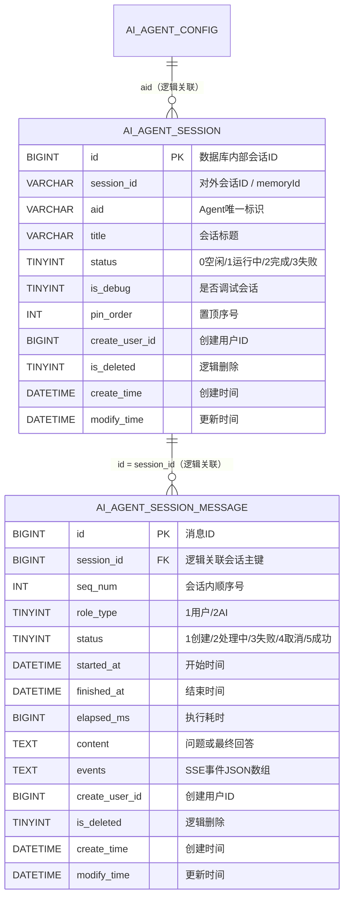

# AgentForge 标准 Agent 会话与消息核心表设计

本文档描述 AgentForge 第一版页面会话与消息记录持久化设计。第一阶段采用“会话主表 + 消息明细表”的 1:N 模型：

- `ai_agent_session` 保存页面可见的会话元数据。
- `ai_agent_session_message` 保存用户消息、AI 最终回答和前端事件快照。
- `ai_agent_memrory` 只保存模型上下文窗口，不承担会话列表和历史消息展示职责。

三者职责分离，避免模型记忆裁剪、清空或格式升级影响用户可见的历史记录。

## 一、核心模型

```text
ai_agent_config
  └── ai_agent_session
        └── ai_agent_session_message

ai_agent_session.session_id
  └── ai_agent_memrory.memory_id
```

`ai_agent_session.id` 是数据库内部关联键；`ai_agent_session.session_id` 是页面和聊天 API 使用的稳定字符串标识，同时作为 Agent 运行时的 `memoryId`。

## 二、表结构设计

### 2.1 `ai_agent_session` Agent 会话表

用于保存某个 Agent 下的一次连续对话。页面的会话列表、标题、置顶和状态均来自该表。

| 字段名 | MySQL 类型 | 允许为空 | 默认值 | 键/约束 | 说明 |
| --- | --- | --- | --- | --- | --- |
| `id` | `BIGINT` | 否 | 自增 | 主键 | 数据库内部会话 ID |
| `session_id` | `VARCHAR(64)` | 否 | 无 | 无 | 对外会话标识，同时作为 Agent `memoryId` |
| `aid` | `VARCHAR(64)` | 否 | 无 | 逻辑外键 | 关联 `ai_agent_config.aid` |
| `title` | `VARCHAR(255)` | 否 | `新会话` | 无 | 会话标题，可由首条用户消息生成 |
| `status` | `TINYINT` | 否 | `0` | 枚举 | `0` 空闲、`1` 运行中、`2` 完成、`3` 失败 |
| `is_debug` | `TINYINT` | 否 | `0` | 枚举 | `0` 正式会话、`1` 调试会话 |
| `pin_order` | `INT` | 否 | `0` | 排序字段 | `0` 未置顶；正数越大越靠前 |
| `create_user_id` | `BIGINT` | 否 | `1` | 无 | 会话创建用户 ID |
| `is_deleted` | `TINYINT` | 否 | `0` | 逻辑删除 | `0` 未删除、`1` 已删除 |
| `create_time` | `DATETIME` | 否 | `CURRENT_TIMESTAMP` | 无 | 创建时间 |
| `modify_time` | `DATETIME` | 否 | `CURRENT_TIMESTAMP` | 无 | 最后消息或元数据变更时间 |

第一阶段只保留主键索引，待会话列表查询和数据规模稳定后，再根据实际执行计划补充组合索引。

### 2.2 `ai_agent_session_message` Agent 会话消息表

按稳定顺序保存会话中的用户消息与 AI 消息。一轮问答通常写入一条 USER 消息和一条 AI 消息。

| 字段名 | MySQL 类型 | 允许为空 | 默认值 | 键/约束 | 说明 |
| --- | --- | --- | --- | --- | --- |
| `id` | `BIGINT` | 否 | 自增 | 主键 | 消息 ID |
| `session_id` | `BIGINT` | 否 | 无 | 逻辑外键 | 关联 `ai_agent_session.id` |
| `seq_num` | `INT` | 否 | 无 | 顺序字段 | 从 `1` 开始递增的稳定顺序号 |
| `role_type` | `TINYINT` | 否 | 无 | 枚举 | `1` 用户、`2` AI |
| `status` | `TINYINT` | 否 | `1` | 枚举 | `1` 创建、`2` 处理中、`3` 失败、`4` 取消、`5` 成功 |
| `started_at` | `DATETIME` | 是 | `NULL` | 无 | AI 消息开始处理时间 |
| `finished_at` | `DATETIME` | 是 | `NULL` | 无 | 消息完成、失败或取消时间 |
| `elapsed_ms` | `BIGINT` | 是 | `NULL` | 无 | AI 执行耗时，单位毫秒 |
| `content` | `LONGTEXT` | 是 | `NULL` | 无 | 用户问题或 AI 最终回答 |
| `events` | `LONGTEXT` | 是 | `NULL` | JSON 数组 | 实际推送给页面的 SSE 事件，用于历史重放 |
| `create_user_id` | `BIGINT` | 否 | `1` | 无 | 消息创建用户 ID |
| `is_deleted` | `TINYINT` | 否 | `0` | 逻辑删除 | `0` 未删除、`1` 已删除 |
| `create_time` | `DATETIME` | 否 | `CURRENT_TIMESTAMP` | 无 | 创建时间 |
| `modify_time` | `DATETIME` | 否 | `CURRENT_TIMESTAMP` | 无 | 更新时间 |

第一阶段只保留主键索引，消息顺序和会话归属一致性暂由 Service 层维护。

## 三、核心建表 SQL

```sql
CREATE TABLE IF NOT EXISTS `ai_agent_session` (
    `id`             BIGINT       NOT NULL AUTO_INCREMENT COMMENT '主键ID',
    `session_id`     VARCHAR(64)  NOT NULL COMMENT '对外会话标识，同时作为 Agent memoryId',
    `aid`            VARCHAR(64)  NOT NULL COMMENT '关联 ai_agent_config.aid（逻辑外键）',
    `title`          VARCHAR(255) NOT NULL DEFAULT '新会话' COMMENT '会话标题',
    `status`         TINYINT      NOT NULL DEFAULT 0 COMMENT '会话状态：0空闲、1运行中、2完成、3失败',
    `is_debug`       TINYINT      NOT NULL DEFAULT 0 COMMENT '是否调试会话：0否、1是',
    `pin_order`      INT          NOT NULL DEFAULT 0 COMMENT '置顶序号：0未置顶，正数越大越靠前',
    `create_user_id` BIGINT       NOT NULL DEFAULT 1 COMMENT '创建用户ID',
    `is_deleted`     TINYINT      NOT NULL DEFAULT 0 COMMENT '逻辑删除：0未删除、1已删除',
    `create_time`    DATETIME     NOT NULL DEFAULT CURRENT_TIMESTAMP COMMENT '创建时间',
    `modify_time`    DATETIME     NOT NULL DEFAULT CURRENT_TIMESTAMP ON UPDATE CURRENT_TIMESTAMP COMMENT '更新时间',
    PRIMARY KEY (`id`)
) ENGINE=InnoDB DEFAULT CHARSET=utf8mb4 COLLATE=utf8mb4_general_ci COMMENT='Agent会话表';

CREATE TABLE IF NOT EXISTS `ai_agent_session_message` (
    `id`             BIGINT   NOT NULL AUTO_INCREMENT COMMENT '主键ID',
    `session_id`     BIGINT   NOT NULL COMMENT '关联 ai_agent_session.id（逻辑外键）',
    `seq_num`        INT      NOT NULL COMMENT '会话内稳定顺序号，从1开始递增',
    `role_type`      TINYINT  NOT NULL COMMENT '消息角色：1用户、2AI',
    `status`         TINYINT  NOT NULL DEFAULT 1 COMMENT '消息状态：1创建、2处理中、3失败、4取消、5成功',
    `started_at`     DATETIME DEFAULT NULL COMMENT 'AI消息开始处理时间',
    `finished_at`    DATETIME DEFAULT NULL COMMENT '消息完成、失败或取消时间',
    `elapsed_ms`     BIGINT   DEFAULT NULL COMMENT 'AI执行耗时，单位毫秒',
    `content`        LONGTEXT DEFAULT NULL COMMENT '用户问题或AI最终回答文本',
    `events`         LONGTEXT DEFAULT NULL COMMENT '实际推送到页面的SSE事件JSON数组，用于历史重放',
    `create_user_id` BIGINT   NOT NULL DEFAULT 1 COMMENT '创建用户ID',
    `is_deleted`     TINYINT  NOT NULL DEFAULT 0 COMMENT '逻辑删除：0未删除、1已删除',
    `create_time`    DATETIME NOT NULL DEFAULT CURRENT_TIMESTAMP COMMENT '创建时间',
    `modify_time`    DATETIME NOT NULL DEFAULT CURRENT_TIMESTAMP ON UPDATE CURRENT_TIMESTAMP COMMENT '更新时间',
    PRIMARY KEY (`id`)
) ENGINE=InnoDB DEFAULT CHARSET=utf8mb4 COLLATE=utf8mb4_general_ci COMMENT='Agent会话消息明细表';
```

以上 SQL 不创建物理外键，关联完整性由 Service 层维护。实际增量脚本位于 `agentforge-service/sql/increment/1.0.x/20261025010000_v1.0.x.sql`。

## 四、ER 图



数据库不创建物理外键，由 Service 层维护逻辑关联和删除一致性。

## 五、写入生命周期

1. 页面发起首轮对话时，以 `session_id + aid + create_user_id` 创建会话；已有会话则校验归属。
2. 用户问题写入 USER 消息，状态直接记为成功。
3. 同一事务内创建 AI 消息占位记录，状态设置为处理中并写入 `started_at`。
4. SSE 推送期间在服务内聚合事件；响应结束后一次性写入 `content`、`events`、`finished_at` 和 `elapsed_ms`。
5. 执行异常或用户取消时，分别将 AI 消息收口为失败或取消状态，保留已产生的事件快照。
6. 每次消息状态变化都刷新会话 `modify_time`；会话列表据此展示最近活跃顺序。

## 六、关键约定

1. `ai_agent_session.session_id` 对外暴露，消息表只保存内部主键 `ai_agent_session.id`。
2. `aid` 与 `ai_agent_config.aid` 为逻辑关联，不创建物理外键。
3. 删除会话时，会话和所属消息统一设置 `is_deleted=1`；模型记忆是否删除由业务动作单独决定。
4. 消息查询必须同时过滤会话和消息的逻辑删除状态，并按 `seq_num ASC` 返回。
5. `events` 保存 AgentForge 统一 SSE 协议事件，不保存模型厂商原始流片段。
6. `content` 是快速展示字段；复杂思考、工具调用及执行时间线以 `events` 为准。
7. `seq_num` 由 Service 层在事务中分配；第一阶段不增加唯一索引，并发一致性由 Service 层控制。
8. 页面会话记录与 `ai_agent_memrory` 模型上下文职责独立，不能使用其中一张表替代另一张表。
9. 会话列表按 `pin_order DESC, modify_time DESC` 排序；`pin_order=0` 表示未置顶，正数越大表示越新置顶。

## 七、核心接口设计

接口全部围绕上文两张表展开：会话表驱动左侧会话列表（普通列表、置顶列表、重命名、置顶、删除），消息表驱动右侧对话窗口（实时 SSE、历史明细与事件重放）。

当前代码事实（本章的落地基线）：

- 对话链路已实现：`ChatController#stream`（`/api/chat/stream`）与 `#stop`（`/api/chat/stop`）。
- 协议层已实现：`StreamEventResponse` + `StreamEventEnums`（`session`/`think`/`resp`/`tool_call`/`resp_end`/`error`）。
- 现有字段支撑情况：`ai_agent_session.session_id` 由 `ChatController` 生成 UUID 并作为 `AgentRequest.memoryId` 写入，属于本表唯一的外部会话键；`ai_agent_session` 与 `ai_agent_session_message` 的业务读写尚未实现，`SessionVo`/`SessionMessageVo` 与对应 Mapper 属于本章待补齐部分。

因此本章分两类描述：已实现接口按现有代码约束描述；待实现接口只给出与表字段一一对应的必要设计，不引入表中不存在的字段。

### 7.1 接口总览

| 分组 | 方法 | 路径 | 用途 | 响应类型 |
| --- | --- | --- | --- | --- |
| 对话 | `POST` | `/api/chat/stream` | 发起或继续流式对话 | `text/event-stream` |
| 对话 | `POST` | `/api/chat/stop` | 发送停止信号（`sessionId` 查询参数） | 无 |
| 会话 | `POST` | `/api/agent/sessions/sessionList` | 查询普通历史会话 | `R<SessionVo[]>` |
| 会话 | `POST` | `/api/agent/sessions/topList` | 查询当前用户置顶会话 | `R<SessionVo[]>` |
| 会话 | `POST` | `/api/agent/sessions/setTop` | 添加或取消置顶 | `R<Boolean>` |
| 会话 | `POST` | `/api/agent/sessions/changeTitle` | 重命名会话 | `R<SessionVo>` |
| 会话 | `POST` | `/api/agent/sessions/delete` | 逻辑删除会话及消息 | `R<Boolean>` |
| 消息 | `POST` | `/api/agent/session-messages/detail` | 查询会话消息明细 | `R<SessionMessageVo[]>` |

统一约定：

- 普通接口使用 `R<T>` 包装（`code`/`success`/`message`/`data`），流式接口不包装，每个 `data: {...}` 都是一条独立的 `StreamEventResponse`。
- 会话标识在流式接口与消息明细中使用 `sessionId` 字符串；会话管理接口统一使用 `Long sessionId`，两者指向同一 `ai_agent_session.id`。
- 所有查询必须校验 `create_user_id` 归属，并过滤 `is_deleted=0`。

### 7.2 会话列表

`sessionList` 只返回未置顶会话（`pin_order=0`），按 `modify_time DESC` 截取；`topList` 只返回 `pin_order>0` 的会话，按 `pin_order DESC` 全量返回，最近置顶排在最前。

请求参数（`sessionList`）：

| 字段 | 类型 | 必填 | 说明 |
| --- | --- | --- | --- |
| limit | Integer | 否 | 返回数量；未传或 `<=0` 默认 `20`，最大 `50` |

请求参数（`topList`）：无，用户 ID 从登录态获取，请求体可为 `{}`。

`SessionVo` 为两张表联合视图，字段与表字段的映射关系：

| VO 字段 | 类型 | 数据来源 |
| --- | --- | --- |
| id | Long | `ai_agent_session.id` |
| sessionId | String | `ai_agent_session.session_id` |
| aid | String | `ai_agent_session.aid` |
| title | String | `ai_agent_session.title` |
| status | Integer | `ai_agent_session.status` |
| isDebug | Integer | `ai_agent_session.is_debug` |
| topOrder | Integer | `ai_agent_session.pin_order` |
| createUserId | Long | `ai_agent_session.create_user_id` |
| createTime / modifyTime | String | 对应字段，格式 `yyyy-MM-dd HH:mm:ss` |
| messageCount | Integer | `COUNT(ai_agent_session_message)`，过滤 `is_deleted=0` |
| running | Boolean | `status=1` 的派生值 |
| lastMessageAt | String | 消息表 `MAX(modify_time)` |

响应示例：

```json
{
  "code": 0,
  "success": true,
  "message": "success",
  "data": [
    {
      "id": 12,
      "sessionId": "12",
      "aid": "agent_xxx",
      "title": "如何创建数据源",
      "status": 2,
      "topOrder": 0,
      "messageCount": 2,
      "running": false,
      "lastMessageAt": "2026-10-25 16:00:00"
    }
  ]
}
```

### 7.3 置顶、重命名、删除

| 接口 | 入参 | 行为 |
| --- | --- | --- |
| `setTop` | `sessionId: Long`、`isTop: Boolean` | 置顶时取当前用户 `MAX(pin_order)+1`；取消置顶置 `0`；操作幂等 |
| `changeTitle` | `sessionId: Long`、`title: String` | 校验标题非空，更新后返回最新 `SessionVo` |
| `delete` | `sessionId: Long` | 会话与其消息同一事务内置 `is_deleted=1`，并按约定决定是否清理 `ai_agent_memrory` |

`setTop` 依赖 `pin_order` 的有序语义：正数越大越靠前，因此新置顶只需取当前用户最大值加一，无需重排其余记录；取消置顶直接归零，不影响其他会话相对顺序。

### 7.4 消息明细与事件重放

`session-messages/detail` 按 `seq_num ASC` 返回会话内全部未删除消息，是页面刷新和重新生成后的唯一历史数据源。

| 字段 | 类型 | 来源 |
| --- | --- | --- |
| id | Long | `ai_agent_session_message.id` |
| sessionId | String | `ai_agent_session.session_id` |
| seqNum | Integer | `ai_agent_session_message.seq_num` |
| roleType | Integer | `1` 用户、`2` AI |
| status | Integer | `1` 创建、`2` 处理中、`3` 失败、`4` 取消、`5` 成功 |
| startedAt / finishedAt | String | 对应字段，`yyyy-MM-dd HH:mm:ss` |
| elapsedMs | Long | AI 执行耗时 |
| contentText | String | `content` |
| events | String | `events`，SSE 事件 JSON 数组字符串 |

重放规则：

- 前端先解析外层 `R<T>`，再对 `events` 做一次 JSON 解析，得到与实时推送同构的事件数组。
- `contentText` 用于快速渲染正文；思考、工具卡片、执行时间线一律以 `events` 为准，避免正文与过程不一致。
- AI 消息 `status=2` 表示该轮未收口（进程中断或仍在执行），前端按“执行中”降级渲染，不允许再次对该会话并发发起对话。

```json
{
  "code": 0,
  "success": true,
  "message": "success",
  "data": [
    { "id": 101, "sessionId": "12", "seqNum": 1, "roleType": 1, "status": 5, "contentText": "如何创建数据源" },
    {
      "id": 102,
      "sessionId": "12",
      "seqNum": 2,
      "roleType": 2,
      "status": 5,
      "elapsedMs": 6400,
      "contentText": "创建数据源的步骤如下……",
      "events": "[{\"event\":\"think\",\"type\":\"text\",\"content\":\"……\",\"isFinish\":true},{\"event\":\"tool_call\",\"type\":\"tool_card\",\"content\":{},\"isFinish\":false},{\"event\":\"resp\",\"type\":\"text\",\"content\":\"……\",\"isFinish\":false}]"
    }
  ]
}
```

### 7.5 流式对话与事件协议

`/api/chat/stream` 请求体包含 `aid`、`sessionId`、`message`、`isDebug`。`sessionId` 为空时由服务端生成 UUID 并同时作为 Agent `memoryId`；非空时表示继续该会话，必须先落一条 USER 消息再启动 Agent。

推进顺序与落库动作：

1. 校验 `aid` 对应 Agent 存在；`isDebug=false` 时要求 `publish=1`。
2. 校验会话归属（`session_id + aid + create_user_id`），不存在则创建会话：`status=0`，`title` 取首条消息截断。
3. 写入 USER 消息：`role_type=1`、`status=5`、`content=message`，`seq_num` 由 Service 在事务内分配。
4. 建立 `SseEmitter` 绑定 `memoryId`，异步启动 `agentManager.stream`，中间件在 `onInitComplete` 推送 `session/created`。
5. SSE 期间按生命周期回调推送 `think`/`resp`/`tool_call`，同时把事件写入内存集合。
6. 会话状态 `0/2/3 → 1`，AI 消息先以 `status=2` 占位并写 `started_at`。
7. 正常结束（`resp_end`）时一次性写 `content`、`events`、`elapsed_ms`、`finished_at`，AI 消息转 `5`、会话转 `2`；异常写 `error` 事件，AI 消息转 `3`；用户主动 `/stop` 转 `4`。

`/api/chat/stop` 只是取消信号，不承担终态写入，二者职责必须分开：

- `ChatController#stop` 只做两件事：调用 `agentManager.cancel(agent, sessionId)` 置取消标记，并解绑当前 `SseEmitter`；不直接改任何表字段。
- 取消标记由 `BaseAgent#cancel` 写入 `memoryId -> AtomicBoolean`，正在执行的 loop 在下一步 think/act 前检查到标记即抛出取消异常。
- `Agent#runStream` 捕获到取消后统一走 `triggerOnStop(StopResultState.CANCEL)`，由 `ServiceStreamingMiddleware#onStop` 补发 `resp_end` 并解绑；此时才由会话/消息中间件把 AI 消息收口为 `4`、会话收口为 `2`。
- 因此停止接口本身无返回体、不写库；会话状态收敛只依赖中间件回调，避免 Controller 与中间件对同一行重复更新。
- 若停止信号到达时 AI 消息尚未创建（Agent 未启动），取消标记会被保留，下一轮正式启动前清理，不会遗留“处理中”消息。

事件协议当前阶段只包含 `session`、`think`、`resp`、`tool_call`、`resp_end`、`error`，由 `StreamEventEnums` 约束 event/type 组合；工作流步骤类事件（`step`）属于后续扩展，不影响表结构：

| event | type | isFinish | content | 前端处理 |
| --- | --- | --- | --- | --- |
| session | created | false | `sessionId` 字符串 | 新会话时缓存本地会话 ID |
| think | text | false | 思考文本增量 | 追加到思考区 |
| resp | text | false | 回答文本增量 | 按到达顺序拼接正文 |
| tool_call | tool_card | false/true | `ToolCallResult` | 执行中创建卡片，完成时按 `toolCallId` 原位更新 |
| resp_end | 无 | true | 无 | 本轮正常结束 |
| error | text | true | 错误信息 | 结束本轮并展示错误 |

### 7.6 表字段与接口写入一致性

| 时点 | `ai_agent_session.status` | USER 消息 | AI 消息 |
| --- | --- | --- | --- |
| 首次请求进入 | `0` | 立即写入 `5` | 尚未创建 |
| 继续提问 | 保持原状态 | 立即写入 `5` | 尚未创建 |
| Agent 启动 | `1` | 不变 | 创建为 `2`，写 `started_at` |
| 流式执行中 | `1` | 不变 | 保持 `2`，事件仅在内存聚合 |
| `resp_end` | `2` | 不变 | `5`，补齐 `content/events/elapsed_ms/finished_at` |
| 异常 | `2` | 不变 | `3`，保留异常前已收集数据 |
| 用户停止（`/api/chat/stop`） | `2` | 不变 | `4`，保留已产生事件 |

关键一致性约束：

- 先写 USER 消息再启动 Agent，保证上游失败时问题与失败状态仍可追溯。
- 流式过程不持有长事务、不逐片更新数据库，开始、结束、异常分别短事务落库。
- `events` 与前端实时事件同源：推送前先收集，结束后一次保存，历史重放与实时展示一致。
- AI 消息创建与最终收口使用 `sessionId + seq_num` 幂等，避免重复回调重复写库。
- 会话 `status` 只由消息生命周期驱动，列表接口的 `running` 字段是 `status=1` 的派生值，不单独存储。
- 停止接口只发信号不落库，`4 取消` 状态只能由 `onStop` 回调写入，保证“同一终态只有一个写入方”。

### 7.7 核心落地实现：请求初始化 + 单一 Session 生命周期中间件

会话/消息两条链路只允许一个写入方，避免 Controller、流式中间件、会话中间件各自改表：

| 职责 | 落点 | 说明 |
| --- | --- | --- |
| 会话与 USER 消息初始化 | `ChatController#stream`（请求进入、启动 Agent 之前） | 只做一次 INSERT，属于请求准备阶段 |
| AI 消息创建、状态推进、events 临时收集与入库 | `SessionLifecycleMiddleware` | 单实例固定挂载，覆盖全生命周期 |
| 前端事件推送 | `ServiceStreamingMiddleware` | 只发事件，不碰会话/消息表 |

#### 7.7.1 请求初始化阶段

`ChatController#stream` 在拿到 `aid`、`sessionId`、`message` 之后、`agentManager.stream(...).start()` 之前完成初始化，顺序固定：

1. 解析 `sessionId`：为空则生成 UUID（同时作为 `AgentRequest.memoryId`），非空则在 `ai_agent_session` 中按 `session_id + aid` 查询。
2. 会话不存在则 `INSERT ai_agent_session`：`session_id`、`aid`、`title`（取 `message` 前 30 字）、`status=0`、`is_debug`、`create_user_id`；存在则校验归属并刷新 `modify_time`。
3. `INSERT ai_agent_session_message` 写入 USER 消息：`role_type=1`、`status=5`、`content=message`、`seq_num = MAX(seq_num)+1`，事务内分配。
4. `INSERT ai_agent_session_message` 写入 AI 占位消息：`role_type=2`、`status=1`、`started_at=NULL`，这样即使 Agent 启动前就异常，也能定位到一条待收口记录。
5. 把 `sessionId`（=`memory_id`）、`aiMessageId`、`seqNum` 通过 `AgentChatContext#putExtension` 传入运行期，key 统一 `session.*` 前缀。

初始化只发生在请求入口，中间件不重复建会话；`session_id` 是唯一贯穿键，`ai_agent_session.id` 只在 Service/Mapper 内部使用。

#### 7.7.2 SessionLifecycleMiddleware 设计

`SessionLifecycleMiddleware` 实现 `IAgentMiddleware`（需要片段级内容时再实现 `IStreamingIAgentMiddleware`），在 `ReActAgentFactory` 中与 `LoggingIAgentMiddleware`、`ServiceStreamingMiddleware` 一起注册，顺序保证它先于流式中间件，以便先落库再推送。

运行期状态（`memoryId -> RunState`，`ConcurrentHashMap`）：

| 字段 | 用途 |
| --- | --- |
| `aiMessageId` / `seqNum` | 本轮 AI 消息定位 |
| `events`（`List<StreamEventResponse>` 或序列化后的快照列表） | events 临时收集容器 |
| `lastContent`（`StringBuilder`） | 拼接最终 `content` |
| `startedAt` | 本轮开始时间，用于 `elapsed_ms` |
| `finished`（`AtomicBoolean`） | 收口幂等标记 |

生命周期钩子映射：

| 钩子 | 表内动作 |
| --- | --- |
| `onInitComplete` | AI 消息 `1 -> 2`，写 `started_at`；会话 `status=1` |
| `onPartialThinking` / `onPartialResponse` | 只把生成的事件放进 `events`，同时累积 `lastContent`，不写库 |
| `beforeToolExecution` / `afterToolExecution` / `onToolExecutionError` | 同上，工具卡片事件进 `events` |
| `onStop(NORMAL)` | 一次性 UPDATE AI 消息：`content`、`events`（JSON 数组）、`elapsed_ms`、`finished_at`、`status=5`；会话 `status=2` |
| `onStop(CANCEL)` | 同上，`status=4` |
| `onStop(MAX_STEPS)` / `onLoopError` / `onStopWithError` | 同上，`status=3`，保留已收集 `events` |

写入约束：

- **流式过程零写库**：`think`/`resp`/`tool_call` 只在内存追加，避免每帧一次 UPDATE。
- **一次收口**：`finished.compareAndSet(false, true)` 守住，`onStop` 与异常分支只可能有一个生效。
- **events 与前端同源**：中间件收集的就是 `StreamEventResponse` 同一对象，序列化后写入 `events`，历史重放与实时展示天然一致。
- **收口后清理**：`finally` 中从 `RunState` map 移除 `memoryId`，避免内存泄漏；数据库异常只记录日志，不阻断 SSE 关闭。
- **与记忆表解耦**：`ai_agent_memrory` 仍由 `MysqlChatMemoryStore` 独立维护，`SessionLifecycleMiddleware` 不读写模型上下文。

#### 7.7.3 与停止信号、流式中间件的协作

```text
ChatController#stream
  ├─ 初始化 session + USER + AI 占位（唯一一次建记录）
  ├─ bind(memoryId, emitter)
  └─ agentManager.stream(...).start()
        ├─ SessionLifecycleMiddleware.onInitComplete   → AI 2 / session 1
        ├─ ServiceStreamingMiddleware                   → 推送 session/think/resp/tool_call
        ├─ SessionLifecycleMiddleware                   → 收集 events
        └─ onStop
              ├─ SessionLifecycleMiddleware → 写 content/events/elapsed/状态（唯一一次收口）
              └─ ServiceStreamingMiddleware → resp_end + unbind
ChatController#stop
  └─ agentManager.cancel(memoryId) + unbind（不写库）
```

由此形成三段式：请求入口建记录、中间件推进与收口、停止接口只发信号。

## 八、第一阶段实施边界

本阶段只落地两个核心表及本章接口约定，不在表中引入厂商会话 ID、附件、评价、Token 用量等扩展字段。后续演进：

- 会话分页（游标分页替代 `limit` 截取）与列表组合索引；
- 消息增量拉取与事件分片存储，降低超大 `events` 的单行压力；
- 重新生成最近一轮 AI 回答（逻辑删除旧 AI 消息后重跑）；
- 删除会话时同步清理对应 `ai_agent_memrory` 模型上下文。
