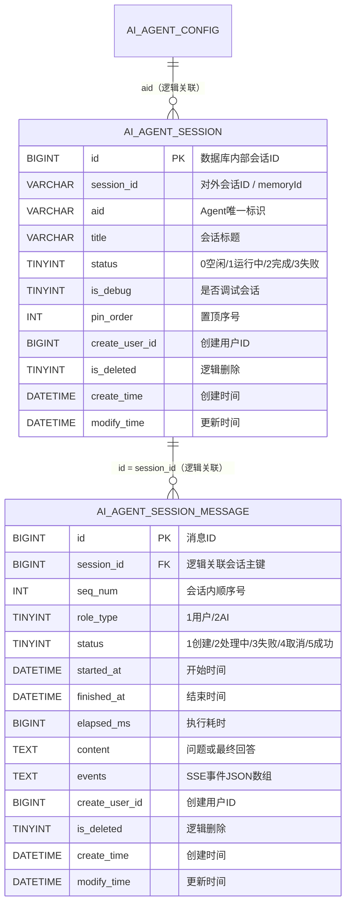

# AgentForge 标准 Agent 会话与消息核心表设计

本文档描述 AgentForge 第一版页面会话与消息记录持久化设计。第一阶段采用“会话主表 + 消息明细表”的 1:N 模型：

- `ai_agent_session` 保存页面可见的会话元数据。
- `ai_agent_session_message` 保存用户消息、AI 最终回答和前端事件快照。
- `ai_agent_memrory` 只保存模型上下文窗口，不承担会话列表和历史消息展示职责。

三者职责分离，避免模型记忆裁剪、清空或格式升级影响用户可见的历史记录。

## 一、核心模型

```text
ai_agent_config
  └── ai_agent_session
        └── ai_agent_session_message

ai_agent_session.session_id
  └── ai_agent_memrory.memory_id
```

`ai_agent_session.id` 是数据库内部关联键；`ai_agent_session.session_id` 是页面和聊天 API 使用的稳定字符串标识，同时作为 Agent 运行时的 `memoryId`。

## 二、表结构设计

### 2.1 `ai_agent_session` Agent 会话表

用于保存某个 Agent 下的一次连续对话。页面的会话列表、标题、置顶和状态均来自该表。

| 字段名 | MySQL 类型 | 允许为空 | 默认值 | 键/约束 | 说明 |
| --- | --- | --- | --- | --- | --- |
| `id` | `BIGINT` | 否 | 自增 | 主键 | 数据库内部会话 ID |
| `session_id` | `VARCHAR(64)` | 否 | 无 | 无 | 对外会话标识，同时作为 Agent `memoryId` |
| `aid` | `VARCHAR(64)` | 否 | 无 | 逻辑外键 | 关联 `ai_agent_config.aid` |
| `title` | `VARCHAR(255)` | 否 | `新会话` | 无 | 会话标题，取首条用户消息前 `TITLE_MAX_LENGTH` 个字符 |
| `status` | `TINYINT` | 否 | `0` | 枚举 | `0` 空闲、`1` 运行中、`2` 完成、`3` 失败 |
| `is_debug` | `TINYINT` | 否 | `0` | 枚举 | `0` 正式会话、`1` 调试会话 |
| `pin_order` | `INT` | 否 | `0` | 排序字段 | `0` 未置顶；正数越大越靠前 |
| `create_user_id` | `BIGINT` | 否 | `1` | 无 | 会话创建用户 ID |
| `is_deleted` | `TINYINT` | 否 | `0` | 逻辑删除 | `0` 未删除、`1` 已删除 |
| `create_time` | `DATETIME` | 否 | `CURRENT_TIMESTAMP` | 无 | 创建时间 |
| `modify_time` | `DATETIME` | 否 | `CURRENT_TIMESTAMP` | 无 | 最后消息或元数据变更时间 |

第一阶段只保留主键索引，待会话列表查询和数据规模稳定后，再根据实际执行计划补充组合索引。

### 2.2 `ai_agent_session_message` Agent 会话消息表

按稳定顺序保存会话中的用户消息与 AI 消息。一轮问答通常写入一条 USER 消息和一条 AI 消息。

| 字段名 | MySQL 类型 | 允许为空 | 默认值 | 键/约束 | 说明 |
| --- | --- | --- | --- | --- | --- |
| `id` | `BIGINT` | 否 | 自增 | 主键 | 消息 ID |
| `session_id` | `BIGINT` | 否 | 无 | 逻辑外键 | 关联 `ai_agent_session.id` |
| `seq_num` | `INT` | 否 | 无 | 顺序字段 | 从 `1` 开始递增的稳定顺序号 |
| `role_type` | `TINYINT` | 否 | 无 | 枚举 | `1` 用户、`2` AI |
| `status` | `TINYINT` | 否 | `1` | 枚举 | `1` 创建、`2` 处理中、`3` 失败、`4` 取消、`5` 成功 |
| `started_at` | `DATETIME` | 是 | `NULL` | 无 | AI 消息开始处理时间 |
| `finished_at` | `DATETIME` | 是 | `NULL` | 无 | 消息完成、失败或取消时间 |
| `elapsed_ms` | `BIGINT` | 是 | `NULL` | 无 | AI 执行耗时，单位毫秒 |
| `content` | `LONGTEXT` | 是 | `NULL` | 无 | 用户问题或 AI 最终回答 |
| `events` | `LONGTEXT` | 是 | `NULL` | JSON 数组 | 实际推送给页面的 SSE 事件，用于历史重放 |
| `create_user_id` | `BIGINT` | 否 | `1` | 无 | 消息创建用户 ID |
| `is_deleted` | `TINYINT` | 否 | `0` | 逻辑删除 | `0` 未删除、`1` 已删除 |
| `create_time` | `DATETIME` | 否 | `CURRENT_TIMESTAMP` | 无 | 创建时间 |
| `modify_time` | `DATETIME` | 否 | `CURRENT_TIMESTAMP` | 无 | 更新时间 |

第一阶段只保留主键索引，消息顺序和会话归属一致性暂由 Service 层维护。

### 2.3 表字段枚举定义

两张表所有 `TINYINT`/`INT` 语义字段在实现前统一定义为枚举，禁止散落的魔法值。落地位置：`modules/session/enums`（会话与消息作为独立业务模块，与 `modules/agent`、`modules/model` 平级）。

#### 2.3.1 `SessionStatusEnum`（对应 `ai_agent_session.status`）

| code | 枚举名 | 含义 | 进入条件 | 是否终态 |
| --- | --- | --- | --- | --- |
| 0 | `IDLE` | 空闲 | 会话创建后尚未发起 Agent | 否 |
| 1 | `RUNNING` | 运行中 | `onInitComplete` 启动 Agent | 否 |
| 2 | `FINISHED` | 完成 | 正常/取消/异常收口后统一回到该状态 | 是 |
| 3 | `FAILED` | 失败 | 预留：会话级失败（第一阶段与 `2` 表现一致） | 是 |

说明：第一阶段只区分“能否继续提问”，因此失败与完成都用 `2`；`3` 预留会话级不可恢复异常。

#### 2.3.2 `SessionMessageRoleEnum`（对应 `ai_agent_session_message.role_type`）

| code | 枚举名 | 含义 | `content` 语义 | `events`/`elapsed_ms` |
| --- | --- | --- | --- | --- |
| 1 | `USER` | 用户消息 | 用户原始问题 | 均为空 |
| 2 | `AI` | AI 消息 | 最终回答正文 | 有值 |

#### 2.3.3 `SessionMessageStatusEnum`（对应 `ai_agent_session_message.status`）

| code | 枚举名 | 含义 | 写入方 | `finished_at` |
| --- | --- | --- | --- | --- |
| 1 | `CREATED` | 已创建 | 请求初始化插入 AI 占位 | 空 |
| 2 | `RUNNING` | 处理中 | `onInitComplete` | 空 |
| 3 | `FAILED` | 失败 | `onStopWithError` / `onLoopError` | 写入 |
| 4 | `CANCELLED` | 已取消 | `onStop(CANCEL)` | 写入 |
| 5 | `SUCCEEDED` | 成功 | `onStop(NORMAL)`；USER 消息直接写 5 | 写入 |

允许的状态迁移（其余组合一律视为非法）：`1 → 2`、`2 → 3|4|5`、`1 → 3|4`（Agent 启动前即失败/取消）。`5` 不可回退，重新生成通过新消息行实现，不改旧行。

#### 2.3.4 `SessionDebugEnum`（对应 `ai_agent_session.is_debug`）

| code | 枚举名 | 含义 |
| --- | --- | --- |
| 0 | `FORMAL` | 正式会话（页面历史可见） |
| 1 | `DEBUG` | 调试会话（调试面板，默认不进正式列表） |

#### 2.3.5 `DeletedEnum`（对应两表 `is_deleted`）

| code | 枚举名 | 含义 |
| --- | --- | --- |
| 0 | `NOT_DELETED` | 未删除 |
| 1 | `DELETED` | 已逻辑删除 |

#### 2.3.6 `PinOrder` 常量约定（对应 `ai_agent_session.pin_order`）

`pin_order` 不建枚举，只有两种取值语义，用常量表达：

| 取值 | 含义 |
| --- | --- |
| `0` | 未置顶（`PIN_NONE = 0`） |
| `> 0` | 已置顶，数值越大越靠前；新置顶 = 当前用户 `MAX(pin_order) + 1` |

#### 2.3.7 与框架枚举的映射（保留原值，只做转换）

| 表字段 | 框架枚举 | 映射规则 |
| --- | --- | --- |
| `ai_agent_session_message.status` | `StopResultState` | `NORMAL → 5`、`CANCEL → 4`、`MAX_STEPS → 3` |
| `ai_agent_session_message.status` | `AgentRunState` | `SUCCESS → 5`、`CANCEL → 4`、`MODEL_CALL_ERROR/MAX_STEPS → 3` |
| `ai_agent_session_message.content`（失败时） | `StopResultState` / 异常信息 | `MAX_STEPS` 与异常把提示文本写入 `content`，便于历史展示 |
| 会话/消息状态来源 | `ChatResultState` | `RUNNING → 2`、`FINISHED → 5`、`FAILED → 3`（仅当需要从 `ChatResult` 回填时使用） |

映射统一收敛到 `SessionStatusTransfer`，中间件不直接写数字。

#### 2.3.8 不建议入库的枚举

`StreamEventEnums.EventEnum`（`session`/`think`/`resp`/`tool_call`/`resp_end`/`error`）与 `TypeEnum` 只存在于 `events` JSON 内部，不在表中单独建列；`AgentConfigPojo.type`、`publish` 属于 Agent 配置表，仅作为会话归属校验条件，不冗余进会话表。

## 三、核心建表 SQL

```sql
CREATE TABLE IF NOT EXISTS `ai_agent_session` (
    `id`             BIGINT       NOT NULL AUTO_INCREMENT COMMENT '主键ID',
    `session_id`     VARCHAR(64)  NOT NULL COMMENT '对外会话标识，同时作为 Agent memoryId',
    `aid`            VARCHAR(64)  NOT NULL COMMENT '关联 ai_agent_config.aid（逻辑外键）',
    `title`          VARCHAR(255) NOT NULL DEFAULT '新会话' COMMENT '会话标题：取首条用户消息前 TITLE_MAX_LENGTH（20）个字符',
    `status`         TINYINT      NOT NULL DEFAULT 0 COMMENT '会话状态：0空闲、1运行中、2完成、3失败',
    `is_debug`       TINYINT      NOT NULL DEFAULT 0 COMMENT '是否调试会话：0否、1是',
    `pin_order`      INT          NOT NULL DEFAULT 0 COMMENT '置顶序号：0未置顶，正数越大越靠前',
    `create_user_id` BIGINT       NOT NULL DEFAULT 1 COMMENT '创建用户ID',
    `is_deleted`     TINYINT      NOT NULL DEFAULT 0 COMMENT '逻辑删除：0未删除、1已删除',
    `create_time`    DATETIME     NOT NULL DEFAULT CURRENT_TIMESTAMP COMMENT '创建时间',
    `modify_time`    DATETIME     NOT NULL DEFAULT CURRENT_TIMESTAMP ON UPDATE CURRENT_TIMESTAMP COMMENT '更新时间',
    PRIMARY KEY (`id`)
) ENGINE=InnoDB DEFAULT CHARSET=utf8mb4 COLLATE=utf8mb4_general_ci COMMENT='Agent会话表';

CREATE TABLE IF NOT EXISTS `ai_agent_session_message` (
    `id`             BIGINT   NOT NULL AUTO_INCREMENT COMMENT '主键ID',
    `session_id`     BIGINT   NOT NULL COMMENT '关联 ai_agent_session.id（逻辑外键）',
    `seq_num`        INT      NOT NULL COMMENT '会话内稳定顺序号，从1开始递增',
    `role_type`      TINYINT  NOT NULL COMMENT '消息角色：1用户、2AI',
    `status`         TINYINT  NOT NULL DEFAULT 1 COMMENT '消息状态：1创建、2处理中、3失败、4取消、5成功',
    `started_at`     DATETIME DEFAULT NULL COMMENT 'AI消息开始处理时间',
    `finished_at`    DATETIME DEFAULT NULL COMMENT '消息完成、失败或取消时间',
    `elapsed_ms`     BIGINT   DEFAULT NULL COMMENT 'AI执行耗时，单位毫秒',
    `content`        LONGTEXT DEFAULT NULL COMMENT '用户问题或AI最终回答文本',
    `events`         LONGTEXT DEFAULT NULL COMMENT '实际推送到页面的SSE事件JSON数组，用于历史重放',
    `create_user_id` BIGINT   NOT NULL DEFAULT 1 COMMENT '创建用户ID',
    `is_deleted`     TINYINT  NOT NULL DEFAULT 0 COMMENT '逻辑删除：0未删除、1已删除',
    `create_time`    DATETIME NOT NULL DEFAULT CURRENT_TIMESTAMP COMMENT '创建时间',
    `modify_time`    DATETIME NOT NULL DEFAULT CURRENT_TIMESTAMP ON UPDATE CURRENT_TIMESTAMP COMMENT '更新时间',
    PRIMARY KEY (`id`)
) ENGINE=InnoDB DEFAULT CHARSET=utf8mb4 COLLATE=utf8mb4_general_ci COMMENT='Agent会话消息明细表';
```

以上 SQL 不创建物理外键，关联完整性由 Service 层维护。实际增量脚本位于 `agentforge-service/sql/increment/1.0.x/20261025010000_v1.0.x.sql`。

## 四、ER 图



数据库不创建物理外键，由 Service 层维护逻辑关联和删除一致性。

## 五、写入生命周期

1. 页面发起对话时，以 `session_id + aid + create_user_id` 查询会话；不存在则创建（`status=0`，`title` 按统一规则生成），已存在则校验归属并刷新 `modify_time`。
2. 用户问题写入 USER 消息，`status` 直接记为 `5`。
3. 同一事务内创建 AI 消息占位记录：`status=1`、`started_at=NULL`，保证 Agent 启动前异常也有收口目标。
4. Agent 初始化完成时（`onInitComplete`）AI 消息 `1 → 2` 并写 `started_at`，会话 `→ 1`。
5. SSE 推送期间在服务内聚合事件，不写库；响应结束后一次性写入 `content`、`events`、`finished_at` 和 `elapsed_ms`。
6. 执行异常或用户取消时，分别将 AI 消息收口为 `3` 或 `4`，保留已产生的事件快照。
7. 会话状态只由消息生命周期驱动：启动置 `1`，收口统一回 `2`；列表的 `running` 字段是 `status=1` 的派生值。

## 六、关键约定

1. `ai_agent_session.session_id` 对外暴露，消息表只保存内部主键 `ai_agent_session.id`。
2. `aid` 与 `ai_agent_config.aid` 为逻辑关联，不创建物理外键。
3. 删除会话时，会话和所属消息统一设置 `is_deleted=1`；模型记忆是否删除由业务动作单独决定。
4. 消息查询必须同时过滤会话和消息的逻辑删除状态，并按 `seq_num ASC` 返回。
5. `events` 保存 AgentForge 统一 SSE 协议事件，不保存模型厂商原始流片段。
6. `content` 是快速展示字段；复杂思考、工具调用及执行时间线以 `events` 为准。
7. `seq_num` 由 Service 层在事务中分配；第一阶段不增加唯一索引，并发一致性由 Service 层控制。
8. 页面会话记录与 `ai_agent_memrory` 模型上下文职责独立，不能使用其中一张表替代另一张表。
9. 会话列表按 `pin_order DESC, modify_time DESC` 排序；`pin_order=0` 表示未置顶，正数越大表示越新置顶。
10. 会话标题前后端统一规则：取用户本轮发送内容的前 `TITLE_MAX_LENGTH`（默认 `20`）个字符，去掉首尾空白、合并连续空白；不足则全取，为空时回退 `新会话`。前端新建会话先用同一规则本地占位，会话列表刷新后以服务端 `title` 覆盖。
11. 第一阶段两张表只建主键索引，不建二级索引；列表排序与明细查询的索引待真实执行计划稳定后再补。

## 七、核心接口设计

接口全部围绕上文两张表展开：会话表驱动左侧会话列表（普通列表、置顶列表、重命名、置顶、删除），消息表驱动右侧对话窗口（实时 SSE、历史明细与事件重放）。

本章接口均已落地并通过本地实测，代码位置：

| 层次 | 类 |
| --- | --- |
| Controller | `ChatController`、`AgentSessionController`、`AgentSessionMessageController` |
| Service | `IAgentSessionService` / `AgentSessionServiceImpl` |
| Mapper | `AgentSessionMapper` / `AgentSessionMessageMapper`（均配 XML） |
| 枚举 | `SessionStatusEnum`、`SessionMessageRoleEnum`、`SessionMessageStatusEnum`、`SessionDebugEnum`、`DeletedEnum`、`SessionStatusTransfer` |
| 中间件 | `SessionLifecycleMiddleware` |
| 工具 | `SessionTitleUtil` |

模块目录统一放在 `modules/session` 下，与 `modules/agent`、`modules/model` 平级，不挂在 `modules/agent/session` 里。

### 7.1 接口总览

| 分组 | 方法 | 路径 | 用途 | 响应类型 |
| --- | --- | --- | --- | --- |
| 对话 | `POST` | `/api/chat/stream` | 发起或继续流式对话 | `text/event-stream` |
| 对话 | `POST` | `/api/chat/stop` | 发送停止信号（`sessionId` 查询参数） | 无 |
| 会话 | `POST` | `/api/agent/sessions/sessionList` | 查询普通历史会话 | `List<SessionVo>` |
| 会话 | `POST` | `/api/agent/sessions/topList` | 查询当前用户置顶会话 | `List<SessionVo>` |
| 会话 | `POST` | `/api/agent/sessions/setTop` | 添加或取消置顶 | `Boolean` |
| 会话 | `POST` | `/api/agent/sessions/changeTitle` | 重命名会话 | `SessionVo` |
| 会话 | `POST` | `/api/agent/sessions/delete` | 逻辑删除会话及消息 | `Boolean` |
| 消息 | `POST` | `/api/agent/session-messages/detail` | 查询会话消息明细 | `List<SessionMessageVo>` |

统一约定：

- 普通接口直接返回业务数据，不使用 `R<T>` 包装（与 `AgentConfigController`、`ModelConfigController` 保持一致）；异常由 `GlobalExceptionHandler` 统一转成 `{"status": 400, "message": "..."}`。
- 流式接口每个 `data: {...}` 都是一条独立的 `StreamEventResponse`。
- 会话标识分两种形态：`Chat` 与 `detail` 的入参 `sessionId` 为字符串或 `Long` 主键，`SessionVo` 同时返回 `id`（主键）与 `sessionId`（对外字符串）；前端以 `id` 调用会话管理接口，以 `sessionId` 调用 `chat`。
- 所有查询必须校验 `create_user_id` 归属，并过滤 `is_deleted=0`；当前阶段未接入登录态，`currentUserId()` 固定返回 `1`，后续替换为登录上下文。

### 7.2 会话列表

`sessionList` 只返回未置顶会话（`pin_order=0`），按 `modify_time DESC` 截取；`topList` 只返回 `pin_order>0` 的会话，按 `pin_order DESC` 全量返回，最近置顶排在最前。

请求参数（`sessionList`）：

| 字段 | 类型 | 必填 | 说明 |
| --- | --- | --- | --- |
| aid | String | 否 | Agent 唯一标识；传入时只返回该 Agent 下的会话，不传则返回当前用户全部会话 |
| limit | Integer | 否 | 返回数量；未传或 `<=0` 默认 `20`，最大 `50` |

请求参数（`topList`）：仅支持可选 `aid`，用户 ID 从登录态获取，请求体可为 `{}`。

`SessionVo` 为两张表联合视图，字段与表字段的映射关系：

| VO 字段 | 类型 | 数据来源 |
| --- | --- | --- |
| id | Long | `ai_agent_session.id` |
| sessionId | String | `ai_agent_session.session_id` |
| aid | String | `ai_agent_session.aid` |
| title | String | `ai_agent_session.title`；新建时为发送内容前 `TITLE_MAX_LENGTH` 个字符 |
| status | Integer | `ai_agent_session.status` |
| isDebug | Integer | `ai_agent_session.is_debug` |
| topOrder | Integer | `ai_agent_session.pin_order` |
| createUserId | Long | `ai_agent_session.create_user_id` |
| createTime / modifyTime | String | 对应字段，格式 `yyyy-MM-dd HH:mm:ss` |
| messageCount | Integer | `COUNT(ai_agent_session_message)`，过滤 `is_deleted=0` |
| running | Boolean | `status=1` 的派生值 |
| lastMessageAt | String | 消息表 `MAX(modify_time)` |

响应示例（实测返回）：

```json
[
  {
    "id": 1,
    "sessionId": "28dcaf0c-db07-4b45-9612-3419f9c5d049",
    "aid": "4v7qri4t4vo0",
    "title": "新标题测试",
    "status": 2,
    "isDebug": 1,
    "topOrder": 0,
    "createUserId": 1,
    "messageCount": 8,
    "running": false,
    "lastMessageAt": "2026-10-26 08:01:18",
    "createTime": "2026-10-26 07:56:23",
    "modifyTime": "2026-10-26 08:01:18"
  }
]
```

时间字段统一用 `@JsonFormat(pattern = "yyyy-MM-dd HH:mm:ss", timezone = "Asia/Shanghai")` 输出，避免 JDBC 时区转换导致前端拿到 UTC 时间。

### 7.3 置顶、重命名、删除

| 接口 | 入参 | 行为 |
| --- | --- | --- |
| `setTop` | `sessionId: Long`、`isTop: Boolean` | 置顶时取当前用户 `MAX(pin_order)+1`；取消置顶置 `0`；操作幂等 |
| `changeTitle` | `sessionId: Long`、`title: String` | 校验标题非空，更新后返回最新 `SessionVo` |
| `delete` | `sessionId: Long` | 会话与其消息同一事务内置 `is_deleted=1`，并按约定决定是否清理 `ai_agent_memrory` |

`setTop` 依赖 `pin_order` 的有序语义：正数越大越靠前，因此新置顶只需取当前用户最大值加一，无需重排其余记录；取消置顶直接归零，不影响其他会话相对顺序。

### 7.4 消息明细与事件重放

`session-messages/detail` 按 `seq_num ASC` 返回会话内全部未删除消息，是页面刷新、会话切换后的唯一历史数据源。

| 字段 | 类型 | 来源 |
| --- | --- | --- |
| id | Long | `ai_agent_session_message.id` |
| sessionId | String | `ai_agent_session.session_id` |
| seqNum | Integer | `ai_agent_session_message.seq_num` |
| roleType | Integer | `1` 用户、`2` AI |
| status | Integer | `1` 创建、`2` 处理中、`3` 失败、`4` 取消、`5` 成功 |
| startedAt / finishedAt | String | 对应字段，`yyyy-MM-dd HH:mm:ss` |
| elapsedMs | Long | AI 执行耗时 |
| contentText | String | `content` |
| events | String | `events`，SSE 事件 JSON 数组字符串 |

补充字段：

| 字段 | 类型 | 说明 |
| --- | --- | --- |
| sessionRefId | Long | 消息归属的会话主键，等价于表内 `session_id` 列 |
| contentJson | String | 预留的结构化内容，当前恒为 `null` |
| isDeleted / createUserId / createTime / modifyTime | - | 表字段直出，便于排查 |

重放规则：

- 前端对 `events` 做一次 JSON 解析，得到与实时推送同构的事件数组（`session` 事件不落库，重放时无需处理）。
- `contentText` 用于快速渲染正文；思考、工具卡片、执行时间线一律以 `events` 为准，避免正文与过程不一致。
- AI 消息 `status=2` 表示该轮未收口（进程中断或仍在执行），前端按“执行中”降级渲染，不允许再次对该会话并发发起对话。

```json
[
  {
    "id": 1,
    "sessionRefId": 1,
    "sessionId": "28dcaf0c-db07-4b45-9612-3419f9c5d049",
    "seqNum": 1,
    "roleType": 1,
    "status": 5,
    "contentText": "你好，请用一句话介绍你自己",
    "contentJson": null,
    "events": null
  },
  {
    "id": 2,
    "sessionRefId": 1,
    "sessionId": "28dcaf0c-db07-4b45-9612-3419f9c5d049",
    "seqNum": 2,
    "roleType": 2,
    "status": 5,
    "startedAt": "2026-10-26 07:56:23",
    "finishedAt": "2026-10-26 07:56:26",
    "elapsedMs": 2425,
    "contentText": "我是一名专业 AI 助手，可以帮你检索最新信息……",
    "events": "[{\"event\":\"resp\",\"type\":\"text\",\"content\":\"我\",\"isFinish\":false},{\"event\":\"resp\",\"type\":\"text\",\"content\":\"是一名\",\"isFinish\":false}]"
  }
]
```

### 7.5 流式对话与事件协议

`/api/chat/stream` 请求体包含 `aid`、`sessionId`、`message`、`isDebug`。`sessionId` 为空时由服务端生成 UUID 并同时作为 Agent `memoryId`；非空时表示继续该会话，必须先落一条 USER 消息再启动 Agent。

推进顺序与落库动作：

1. 校验 `aid` 对应 Agent 存在；`isDebug=false` 时要求 `publish=1`。
2. 校验会话归属（`session_id + aid + create_user_id`），不存在则创建会话：`status=0`，`title` 取本轮 `message` 前 `TITLE_MAX_LENGTH` 个字符。
3. 写入 USER 消息：`role_type=1`、`status=5`、`content=message`，`seq_num` 由 Service 在事务内分配。
4. 写入 AI 占位消息：`role_type=2`、`status=1`、`started_at=NULL`，保证 Agent 启动前异常也有收口目标。
5. 建立 `SseEmitter` 绑定 `memoryId`，异步启动 `agentManager.stream`，中间件在 `onInitComplete` 推送 `session/created` 并把 AI 消息推进为 `status=2`、写 `started_at`，会话转 `1`。
6. SSE 期间按生命周期回调推送 `think`/`resp`/`tool_call`，同时由 `SessionLifecycleMiddleware` 在内存聚合事件，不写库。
7. 正常结束（`resp_end`）时一次性写 `content`、`events`、`elapsed_ms`、`finished_at`，AI 消息转 `5`、会话转 `2`；异常写 `error` 事件，AI 消息转 `3`；用户主动 `/stop` 转 `4`。

`/api/chat/stop` 只是取消信号，不承担终态写入，二者职责必须分开：

- `ChatController#stop` 只做两件事：调用 `agentManager.cancel(agent, sessionId)` 置取消标记，并解绑当前 `SseEmitter`；不直接改任何表字段。
- 取消标记由 `BaseAgent#cancel` 写入 `memoryId -> AtomicBoolean`，正在执行的 loop 在下一步 think/act 前检查到标记即抛出取消异常。
- `Agent#runStream` 捕获到取消后统一走 `triggerOnStop(StopResultState.CANCEL)`，由 `ServiceStreamingMiddleware#onStop` 补发 `resp_end` 并解绑；此时才由会话/消息中间件把 AI 消息收口为 `4`、会话收口为 `2`。
- 因此停止接口本身无返回体、不写库；会话状态收敛只依赖中间件回调，避免 Controller 与中间件对同一行重复更新。
- 若停止信号到达时 Agent 尚未启动，取消标记会保留到 `prepareForNewRun` 清理；占位 AI 消息此时仍为 `1`，本次运行不会产生 `onStop` 回调，该行保持在 `1`，由消息明细接口按“未完成”降级展示，不做额外兜底写入，避免出现第二个写入方。

事件协议当前阶段只包含 `session`、`think`、`resp`、`tool_call`、`resp_end`、`error`，由 `StreamEventEnums` 约束 event/type 组合；工作流步骤类事件（`step`）属于后续扩展，不影响表结构：

| event | type | isFinish | content | 前端处理 |
| --- | --- | --- | --- | --- |
| session | created | false | `sessionId` 字符串 | 新会话时缓存本地会话 ID |
| think | text | false | 思考文本增量 | 追加到思考区 |
| resp | text | false | 回答文本增量 | 按到达顺序拼接正文 |
| tool_call | tool_card | false/true | `ToolCallResult` | 执行中创建卡片，完成时按 `toolCallId` 原位更新 |
| resp_end | 无 | true | 无 | 本轮正常结束 |
| error | text | true | 错误信息 | 结束本轮并展示错误 |

### 7.6 表字段与接口写入一致性

| 时点 | `ai_agent_session.status` | USER 消息 | AI 消息 |
| --- | --- | --- | --- |
| 首次请求进入 | `0` | 立即写入 `5` | 立即插入占位 `1` |
| 继续提问 | 保持原状态 | 立即写入 `5` | 立即插入占位 `1` |
| Agent 启动（`onInitComplete`） | `1` | 不变 | `1 → 2`，写 `started_at` |
| 流式执行中 | `1` | 不变 | 保持 `2`，事件仅在内存聚合 |
| `resp_end` | `2` | 不变 | `5`，补齐 `content/events/elapsed_ms/finished_at` |
| 异常 | `2` | 不变 | `3`，保留异常前已收集数据 |
| 用户停止（`/api/chat/stop`） | `2` | 不变 | `4`，保留已产生事件 |

关键一致性约束：

- 先写 USER 消息再启动 Agent，保证上游失败时问题与失败状态仍可追溯。
- 流式过程不持有长事务、不逐片更新数据库，开始、结束、异常分别短事务落库。
- `events` 与前端实时事件同源：推送前先收集，结束后一次保存，历史重放与实时展示一致。
- AI 消息创建与最终收口使用 `sessionId + seq_num` 幂等，避免重复回调重复写库。
- 会话 `status` 只由消息生命周期驱动，列表接口的 `running` 字段是 `status=1` 的派生值，不单独存储。
- 停止接口只发信号不落库，`4 取消` 状态只能由 `onStop` 回调写入，保证“同一终态只有一个写入方”。

### 7.7 核心落地实现：请求初始化 + 单一 Session 生命周期中间件

会话/消息两条链路只允许一个写入方，避免 Controller、流式中间件、会话中间件各自改表：

| 职责 | 落点 | 说明 |
| --- | --- | --- |
| 会话与 USER 消息初始化 | `ChatController#stream`（请求进入、启动 Agent 之前） | 只做一次 INSERT，属于请求准备阶段 |
| AI 消息创建、状态推进、events 临时收集与入库 | `SessionLifecycleMiddleware` | 单实例固定挂载，覆盖全生命周期 |
| 前端事件推送 | `ServiceStreamingMiddleware` | 只发事件，不碰会话/消息表 |

#### 7.7.1 请求初始化阶段

`ChatController#stream` 在拿到 `aid`、`sessionId`、`message` 之后、`agentManager.stream(...).start()` 之前完成初始化，顺序固定：

1. 解析 `sessionId`：为空则生成 UUID（同时作为 `AgentRequest.memoryId`），非空则在 `ai_agent_session` 中按 `session_id + aid` 查询。
2. 会话不存在则 `INSERT ai_agent_session`：`session_id`、`aid`、`title`（`SessionTitleUtil.resolve(message)`：去首尾空白、合并连续空白后取前 `TITLE_MAX_LENGTH` 字符，空则 `新会话`）、`status=0`、`is_debug`、`create_user_id`；存在则校验归属并刷新 `modify_time`。
3. `INSERT ai_agent_session_message` 写入 USER 消息：`role_type=1`、`status=5`、`content=message`、`seq_num = MAX(seq_num)+1`，事务内分配。
4. `INSERT ai_agent_session_message` 写入 AI 占位消息：`role_type=2`、`status=1`、`started_at=NULL`，这样即使 Agent 启动前就异常，也能定位到一条待收口记录。
5. 把运行期定位信息透传给中间件：`ChatController` 写入 `AgentChatReq.aiMessageId / sessionPk`，`StandardReActAgentManager#toAgentRequest` 组装成 `AgentRequest.extensions`，`BaseAgent#initParams` 再拷贝进 `AgentChatContext.extensions`。key 统一 `session.*` 前缀：

| key | 含义 |
| --- | --- |
| `session.sessionId` | 对外会话标识，等于 `AgentRequest.memoryId` |
| `session.aiMessageId` | 本轮 AI 消息主键 |
| `session.sessionPk` | `ai_agent_session.id` |

为此在框架侧做了两处最小改动：`AgentRequest` 新增 `extensions` 字段与 builder 方法，`BaseAgent#initParams` 把 `request.extensions` 复制进 `AgentChatContext`（复制而非共享引用，避免多次请求互相污染）。Agent 内部不解释这些 key，只负责透传。

初始化只发生在请求入口，中间件不重复建会话；`session_id` 是唯一贯穿键，`ai_agent_session.id` 只在 Service/Mapper 内部使用。

#### 7.7.2 SessionLifecycleMiddleware 设计

`SessionLifecycleMiddleware` 实现 `IAgentMiddleware`（需要片段级内容时再实现 `IStreamingIAgentMiddleware`），在 `ReActAgentFactory` 中与 `LoggingIAgentMiddleware`、`ServiceStreamingMiddleware` 一起注册，顺序保证它先于流式中间件，以便先落库再推送。

运行期状态（`memoryId -> RunState`，`ConcurrentHashMap`）：

| 字段 | 用途 |
| --- | --- |
| `memoryId` | 运行期键，收口后从 map 移除 |
| `sessionId` / `sessionPk` | 会话对外标识与主键，收口时更新会话状态 |
| `aiMessageId` | 本轮 AI 消息主键，收口时更新该行 |
| `startedAt` | 本轮开始时间，用于计算 `elapsed_ms` |
| `content`（`StringBuilder`） | 累积 `resp` 增量，作为最终 `content` |
| `events`（`List<StreamEventResponse>`） | events 临时收集容器，收口时序列化为 JSON 数组 |
| `toolStartTimes`（`Map<toolCallId, Long>`） | 计算单个工具耗时，与推送的 `ToolCallResult.duration` 同源 |
| `finished`（`AtomicBoolean`） | 收口幂等标记 |

生命周期钩子映射：

| 钩子 | 表内动作 |
| --- | --- |
| `onInitComplete` | AI 消息 `1 -> 2`，写 `started_at`；会话 `status=1` |
| `onPartialThinking` / `onPartialResponse` | 只把生成的事件放进 `events`，同时累积 `lastContent`，不写库 |
| `beforeToolExecution` / `afterToolExecution` / `onToolExecutionError` | 同上，工具卡片事件进 `events`；失败时 `outputResult` 写异常信息 |
| `beforeConcurrentToolExecution` / `onConcurrentToolExecutionComplete` | 并发工具批次逐工具发卡片，各自记录耗时，失败项跳过（由 `onToolExecutionError` 统一发出） |
| `onStop(NORMAL)` | 一次性 UPDATE AI 消息：`content`、`events`（JSON 数组）、`elapsed_ms`、`finished_at`、`status=5`；会话 `status=2` |
| `onStop(CANCEL)` | 同上，`status=4` |
| `onStop(MAX_STEPS)` / `onLoopError` / `onStopWithError` | 同上，`status=3`，保留已收集 `events` |

写入约束：

- **流式过程零写库**：`think`/`resp`/`tool_call` 只在内存追加，避免每帧一次 UPDATE。
- **一次收口**：`finished.compareAndSet(false, true)` 守住，`onStop` 与异常分支只可能有一个生效。
- **events 与前端同源**：中间件收集的就是 `StreamEventResponse` 同一对象，序列化后写入 `events`，历史重放与实时展示天然一致。
- **收口后清理**：`finally` 中从 `RunState` map 移除 `memoryId`，避免内存泄漏；数据库异常只记录日志，不阻断 SSE 关闭。
- **与记忆表解耦**：`ai_agent_memrory` 仍由 `MysqlChatMemoryStore` 独立维护，`SessionLifecycleMiddleware` 不读写模型上下文。

#### 7.7.3 与停止信号、流式中间件的协作

```text
ChatController#stream
  ├─ 初始化 session + USER + AI 占位（唯一一次建记录）
  ├─ bind(memoryId, emitter)
  └─ agentManager.stream(...).start()
        ├─ SessionLifecycleMiddleware.onInitComplete   → AI 2 / session 1
        ├─ ServiceStreamingMiddleware                   → 推送 session/think/resp/tool_call
        ├─ SessionLifecycleMiddleware                   → 收集 events
        └─ onStop
              ├─ SessionLifecycleMiddleware → 写 content/events/elapsed/状态（唯一一次收口）
              └─ ServiceStreamingMiddleware → resp_end + unbind
ChatController#stop
  └─ agentManager.cancel(memoryId) + unbind（不写库）
```

由此形成三段式：请求入口建记录、中间件推进与收口、停止接口只发信号。

#### 7.7.4 标题生成规则（前后端一致）

首次创建会话时 `title` 只由本轮发送内容决定，生成逻辑收敛为单一方法，前后端共用同一规则：

后端实现 `modules/session/util/SessionTitleUtil`：

```java
public static final int TITLE_MAX_LENGTH = 20;
public static final String DEFAULT_TITLE = "新会话";

public static String resolve(String message) {
    if (message == null) {
        return DEFAULT_TITLE;
    }
    String normalized = message.trim().replaceAll("\\s+", " ");
    if (normalized.isEmpty()) {
        return DEFAULT_TITLE;
    }
    // 按 code point 截取，避免中文/emoji 被切成半个字符
    if (normalized.codePointCount(0, normalized.length()) <= TITLE_MAX_LENGTH) {
        return normalized;
    }
    return normalized.substring(0, normalized.offsetByCodePoints(0, TITLE_MAX_LENGTH));
}
```

前端实现 `utils/sessionApi.js#resolveSessionTitle`，规则完全一致（`Array.from` 按 code point 切分）。

约定：

- 后端在 `INSERT ai_agent_session` 时调用 `resolve(message)`，`title` 不依赖 AI 回答，也不做二次摘要，保证首帧即可展示。
- `session/created` 事件的 `content` 只携带 `sessionId` 字符串；前端新建会话时先用同一规则本地占位标题，会话列表刷新后再以服务端 `title` 覆盖，避免两边截断不一致。
- 只有首轮创建会生成标题；后续提问不改 `title`，仅刷新 `modify_time`；用户手动改标题走 `changeTitle`，此后不再被自动覆盖。
- 实测：35 字符输入得到 20 字符标题，空白输入得到 `新会话`，`" 你好  世界 "` 归一化为 `你好 世界`。

#### 7.7.5 前端接入

前端只消费三个文件，不直接拼 URL：

| 文件 | 职责 |
| --- | --- |
| `utils/sessionApi.js` | 六个会话/消息接口封装 + `resolveSessionTitle` 标题规则 |
| `utils/sessionReplay.js` | `events` JSON 数组 → 渲染用 `message`（`parts`/`content`/`status`） |
| `pages/published/PublishedAgentChatPage.vue` | 侧边栏会话列表、置顶、改名、删除、历史加载 |

关键行为：

- 页面初始化并行拉取 `topList` 与 `sessionList(aid, 20)`，分别渲染「置顶会话」与「历史会话」两个分组。
- 点击会话项调用 `detail`，用 `replaySessionMessages(records)` 还原为 `messages` 数组；`roleType=1` 转用户气泡，`roleType=2` 走事件重放。
- 重放与实时共用同一套语义：`think` 连续增量合并成一段思考块、`tool_call` 按 `toolCallId` 原位更新、`resp` 顺序拼接正文；`status=3/4` 的消息重放为失败态并展示 `contentText` 或「本轮已取消」。
- 每轮对话结束（`finally`）刷新会话列表，用 `sessionId` 反查并高亮当前会话。
- 支持 `?sessionId=` 直接恢复历史会话（刷新、分享链接场景）。
- 会话项 hover 显示重命名 / 置顶 / 删除三个操作，删除使用 `$confirm` 二次确认，操作成功后重新拉取列表。

## 八、实施落地与验证

### 8.1 增量 SQL

`agentforge-service/sql/increment/1.0.x/20261025010000_v1.0.x.sql` 一次建完两张表，第一阶段只保留主键索引，不建其他二级索引：

| 表 | 索引 |
| --- | --- |
| `ai_agent_session` | `PRIMARY KEY (id)` |
| `ai_agent_session_message` | `PRIMARY KEY (id)` |

不建二级索引的理由：初版会话与消息量级小，列表与明细查询依赖的过滤列选择性有限，过早建索引会拖慢写入并增加后续调整成本；等会话列表、置顶排序和消息明细的实际执行计划稳定后，再按真实慢查询补 `(create_user_id, is_deleted, pin_order, modify_time)`、`(session_id)`、`(session_id, is_deleted, seq_num)` 等组合索引。

### 8.2 实测验证结果

后端（`java -jar ... --server.port=8099`，MySQL 本地 `agentforge`，仅主键索引）：

| 场景 | 结果 |
| --- | --- |
| 建表脚本 | 两张表只有 `PRIMARY`，`show create table` 与文档一致 |
| 新建会话对话 | 会话 `status=2`、USER `5`、AI `5`、`events` 落库 5361 字节、`elapsed_ms=1750` |
| 长任务对话 | `events` 112854 字节、`elapsed_ms=12302`，单行 `LONGTEXT` 无压力 |
| 继续对话（传 `sessionId`） | 不新建会话，`seq_num` 递增，标题不变 |
| 标题截断 | 35 字符输入 → 20 字符标题；空白 → `新会话` |
| `sessionList` / `topList` | 未置顶与置顶分组正确，`messageCount`、`running`、`lastMessageAt` 正确 |
| `setTop` / 重复置顶 | 首次置顶 `topOrder=1`，重复执行不累加序号 |
| `changeTitle` | 返回更新后的完整 `SessionVo` |
| `delete` | 会话与消息同时 `is_deleted=1`，随后 `detail` 返回「会话不存在或已被删除」 |
| `/api/chat/stop` | AI 消息收口为 `4`、`elapsed_ms=6397`、会话 `2`，已产生的 `events` 保留 |
| 边界入参 | 空 `sessionId`、不存在会话、空标题、空消息、不存在 Agent 均返回 400 与可读 message |

前端（`vite` + 无头 Chrome 实测）：

- 侧边栏渲染「历史会话」分组与当前会话高亮；
- `?sessionId=` 恢复会话后 4 轮用户消息、4 个 AI 区块、思考块与耗时（4.2s）均正常渲染；
- `resolveSessionTitle` 与后端 `SessionTitleUtil` 输出一致（20 字符 / `新会话` / 空白归一化）。

### 8.3 落地文件清单

后端新增：

| 文件 | 说明 |
| --- | --- |
| `modules/session/enums/*` | 5 个枚举 + `SessionStatusTransfer` |
| `modules/session/domain/AgentSessionPojo`、`AgentSessionMessagePojo` | 表映射对象 |
| `modules/session/domain/vo/SessionVo`、`SessionMessageVo` | 列表与明细返回对象 |
| `modules/session/domain/req/*` | 5 个请求对象 |
| `modules/session/dao/*Mapper` + `resources/.../session/mapper/*.xml` | MyBatis 接口与 SQL |
| `modules/session/service/IAgentSessionService`、`impl/AgentSessionServiceImpl` | 业务实现 |
| `modules/session/controller/AgentSessionController`、`AgentSessionMessageController` | 6 个接口 |
| `modules/session/middleware/SessionLifecycleMiddleware` | 生命周期收口 |
| `modules/session/util/SessionTitleUtil` | 标题规则 |

后端修改：

| 文件 | 改动 |
| --- | --- |
| `ChatController` | 请求入口初始化会话与消息，异常时 `finishWithError` 兜底 |
| `AgentConfiguration` | 注册 `SessionLifecycleMiddleware` Bean |
| `ReActAgentFactory` | 中间件顺序：`Logging` → `SessionLifecycle` → `Streaming` |
| `AgentChatReq` / `StandardReActAgentManager` | 透传 `aiMessageId`、`sessionPk` 到 `AgentRequest.extensions` |
| `AgentRequest`、`BaseAgent`（framework） | 新增 `extensions` 字段并在 `initParams` 复制进 `ChatContext` |

前端：

| 文件 | 说明 |
| --- | --- |
| `utils/sessionApi.js` | 6 个接口封装 + `resolveSessionTitle` |
| `utils/sessionReplay.js` | `events` → 渲染结构 |
| `pages/published/PublishedAgentChatPage.vue` | 会话列表、置顶、改名、删除、历史加载、`?sessionId=` 恢复 |
| `styles.css` | 会话项 hover 操作样式 |
| `vite.config.js` | 代理地址支持 `VITE_PROXY_TARGET` 覆盖 |

### 8.4 后续演进

- 会话分页改为游标分页，替代 `limit` 截取；
- 消息增量拉取与事件分片存储，降低超大 `events` 单行压力；
- 重新生成最近一轮 AI 回答（逻辑删除旧 AI 消息后重跑）；
- 删除会话时按业务动作同步清理 `ai_agent_memrory` 模型上下文；
- 接入登录态，替换 `currentUserId()` 的固定返回值。
