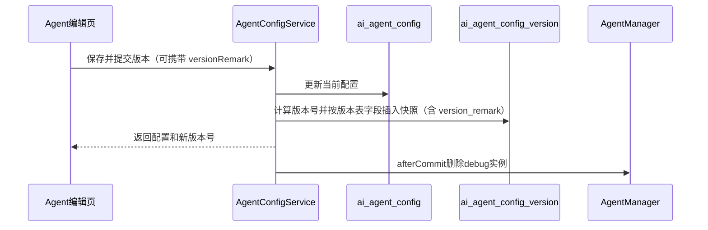
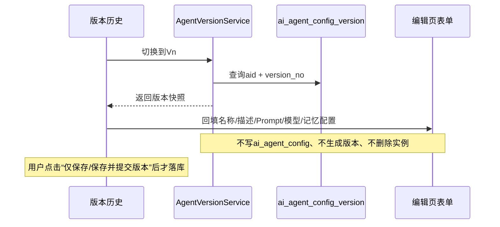
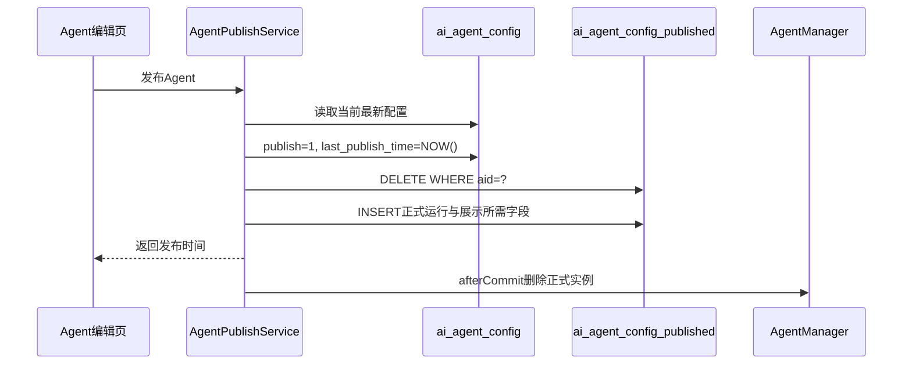

# AgentForge Agent 版本设计与 Agent 发布方案

## 一、背景

AgentForge 当前使用 `ai_agent_config` 保存 Agent 的当前配置。该表同时被 Agent 编辑页、调试对话和正式发布页使用。

随着 Agent 持续编辑和反复发布，单表设计存在两个核心问题：

1. 每次保存都会覆盖原配置，无法查看和切换到历史配置。
2. 正式 Agent 与编辑中的 Agent 共用配置，发布后继续编辑可能影响线上对话。

本方案在保留 `ai_agent_config` 的基础上，新增：

- `ai_agent_config_version`：保存 Agent 历史配置快照。
- `ai_agent_config_published`：保存 Agent 当前已发布配置快照。

最终形成“当前编辑配置、历史版本、正式发布配置”三份数据职责分离。

## 二、总体设计

```text
ai_agent_config
  当前编辑配置
       |
       | 保存并提交版本
       v
ai_agent_config_version
  历史配置快照

ai_agent_config
       |
       | 按发布表字段复制当前最新配置
       v
ai_agent_config_published
  当前正式配置快照
```

| 表 | 核心定位 | 主要使用场景 |
| --- | --- | --- |
| `ai_agent_config` | Agent 当前最新工作副本 | 编辑页、调试对话 |
| `ai_agent_config_version` | Agent 历史版本快照 | 版本列表、版本详情、切换历史版本 |
| `ai_agent_config_published` | Agent 当前正式发布快照 | 发布页 basicConfig、正式 Chat/Stream |

核心原则：

- 编辑页及调试对话始终使用 `ai_agent_config`。
- 历史版本只用于回看和切换，不直接作为正式 Agent 的运行配置。
- 正式发布页和正式对话始终使用 `ai_agent_config_published`。
- 发布默认以发布时 `ai_agent_config` 的最新数据为准，不指定、不关联历史版本号。
- 发布表只通过 `last_publish_time` 表示当前正式 Agent 的最新发布时间。

## 三、核心表结构

### 3.1 `ai_agent_config`：当前 Agent 配置表

现有表继续保留，表示 Agent 当前正在编辑和调试的最新配置。

| 核心字段 | 说明 |
| --- | --- |
| `id` | Agent 配置主键 |
| `aid` | Agent 对外稳定标识 |
| `name/type` | Agent 名称和类型 |
| `agent_config` | Agent 运行配置 JSON |
| `exper_config` | Agent 体验配置 JSON |
| `publish` | `0` 未发布、`1` 已发布 |
| `last_publish_time` | 该 Agent 最后一次成功发布时间 |
| `is_public/avatar/description` | 对外展示配置 |
| `is_deleted` | 逻辑删除标记 |
| `create_user_id/create_time/modify_time` | 归属及时间字段 |

`ai_agent_config.publish` 是管理端的发布状态标识；正式运行配置仍必须从发布表读取。`is_public` 也继续由当前配置表管理，不复制到发布表。

### 3.2 `ai_agent_config_version`：Agent 历史版本表

历史版本表保存 Agent 的版本号、业务配置快照、版本备注和版本审计字段。它不保存 `ai_agent_config` 中的发布状态、最后发布时间和公开状态，因此 `publish`、`last_publish_time`、`is_public` 不写入历史版本快照。

除自增主键 `id` 外，版本表实际保存 `version_no`、`name`、`type`、`agent_config`、`exper_config`、`aid`、`avatar`、`description`、`version_remark`，并保留 `is_deleted`、`create_user_id`、`create_time`、`modify_time` 等审计字段。

`version_remark` 是版本的可编辑说明字段：提交版本时可以由用户填写，提交后也允许再次编辑或清空；除它之外，版本快照的其它字段一旦生成即不可变更。

```sql
CREATE TABLE IF NOT EXISTS `ai_agent_config_version` (
    `id`                BIGINT       NOT NULL AUTO_INCREMENT COMMENT '版本记录主键ID',
    `version_no`        BIGINT       NOT NULL COMMENT '同一Agent内递增版本号',
    `name`              VARCHAR(255) NOT NULL COMMENT 'Agent名称快照',
    `type`              INT          NOT NULL COMMENT 'Agent类型：1=ReActAgent',
    `agent_config`      LONGTEXT              DEFAULT NULL COMMENT 'Agent配置JSON快照',
    `exper_config`      LONGTEXT              DEFAULT NULL COMMENT '对话体验配置JSON快照',
    `aid`               VARCHAR(64)  NOT NULL COMMENT 'Agent唯一标识ID',
    `avatar`            VARCHAR(255)          DEFAULT '' COMMENT '头像URL快照',
    `description`       VARCHAR(1024)         DEFAULT '' COMMENT 'Agent描述快照',
    `version_remark`    VARCHAR(1024)         DEFAULT '' COMMENT '版本备注：用户补充的版本说明，创建后可再次编辑',
    `is_deleted`        INT          NOT NULL DEFAULT 0 COMMENT '逻辑删除标记',
    `create_user_id`    BIGINT       NOT NULL DEFAULT 1 COMMENT '版本提交人ID',
    `create_time`       DATETIME              DEFAULT CURRENT_TIMESTAMP COMMENT '版本生成时间',
    `modify_time`       DATETIME              DEFAULT CURRENT_TIMESTAMP COMMENT '快照时间',
    PRIMARY KEY (`id`)
) ENGINE=InnoDB
  DEFAULT CHARSET=utf8mb4
  COLLATE=utf8mb4_general_ci
  COMMENT='Agent配置历史版本表';
```

版本规则：

- 每个 `aid` 独立维护版本号。
- 无历史版本时创建 `V1`；已存在版本时使用 `MAX(version_no) + 1`。
- 版本列表默认按 `version_no DESC` 排序。
- 已生成的版本记录不覆盖、不更新，只有 `version_remark` 备注字段允许后续补充和修改。
- 版本备注（`version_remark`）最长 1024 个字符，允许为空；提交时填写，提交后仍可编辑。
- 切换历史版本不会创建新版本，也不会更新 `ai_agent_config`，只把版本快照回填到编辑页表单。
- 切换后如果再次提交新版本，才从历史最大版本号继续递增。

### 3.3 `ai_agent_config_published`：Agent 发布表

发布表不需要完整复制 `ai_agent_config` 的所有字段，只保留正式 Agent 初始化、发布页展示和基本审计需要的字段。每个 `aid` 在业务上只保留一份当前发布配置。

除自增主键 `id` 外，发布表实际保存 `name`、`type`、`agent_config`、`exper_config`、`last_publish_time`、`aid`、`avatar`、`description`，并保留 `is_deleted`、`create_user_id`、`create_time`、`modify_time` 等审计字段。

发布表不保存 `version_no`、`source_version_id` 或其他版本关联字段。从业务语义上，它只需要表达两件事：

1. 当前正式 Agent 运行和页面展示需要的配置。
2. 这份配置的最新发布时间 `last_publish_time`。

`publish` 和 `is_public` 不进入发布表：

- 发布表中存在 `is_deleted=0` 的 `aid` 记录，已经表示该 Agent 处于发布状态，无需再冗余保存 `publish=1`。
- `is_public` 属于 Agent 管理和广场可见性字段，不参与已知 `aid` 的正式 Agent 初始化。

```sql
CREATE TABLE IF NOT EXISTS `ai_agent_config_published` (
    `id`                BIGINT       NOT NULL AUTO_INCREMENT COMMENT '发布配置主键ID',
    `name`              VARCHAR(255) NOT NULL COMMENT '已发布Agent名称',
    `type`              INT          NOT NULL COMMENT 'Agent类型：1=ReActAgent',
    `agent_config`      LONGTEXT              DEFAULT NULL COMMENT '已发布Agent配置JSON',
    `exper_config`      LONGTEXT              DEFAULT NULL COMMENT '已发布对话体验配置JSON',
    `last_publish_time` DATETIME     NOT NULL COMMENT '当前配置最新发布时间',
    `aid`               VARCHAR(64)  NOT NULL COMMENT 'Agent唯一标识ID',
    `avatar`            VARCHAR(255)          DEFAULT '' COMMENT '已发布头像URL',
    `description`       VARCHAR(1024)         DEFAULT '' COMMENT '已发布Agent描述',
    `is_deleted`        INT          NOT NULL DEFAULT 0 COMMENT '逻辑删除标记',
    `create_user_id`    BIGINT       NOT NULL DEFAULT 1 COMMENT '创建者ID',
    `create_time`       DATETIME              DEFAULT CURRENT_TIMESTAMP COMMENT '发布记录创建时间',
    `modify_time`       DATETIME              DEFAULT CURRENT_TIMESTAMP ON UPDATE CURRENT_TIMESTAMP COMMENT '发布记录更新时间',
    PRIMARY KEY (`id`)
) ENGINE=InnoDB
  DEFAULT CHARSET=utf8mb4
  COLLATE=utf8mb4_general_ci
  COMMENT='Agent当前已发布配置表';
```

第一阶段两张新表均只保留自增主键 `id` 索引，暂不添加唯一索引或普通索引。`aid` 下的版本号唯一性、以及发布表每个 `aid` 只有一条有效记录，暂由 Service 事务逻辑保证。后续再根据真实数据量、查询频率和执行计划增加索引。

## 四、Agent 编辑页设计

### 4.1 进入编辑页

进入 Agent 编辑页时，根据 Agent `id` 查询 `ai_agent_config`。页面始终展示 Agent 当前最新的编辑配置。

```text
Agent 编辑页
  → SELECT ai_agent_config WHERE id = ? AND is_deleted = 0
```

### 4.2 版本历史

编辑页右上角增加“版本历史”入口。版本列表顶部展示一条提示，说明“切换版本只回填表单，不会保存”，提醒用户切换后如需生效必须点击右上角的“仅保存”或“保存并提交版本”。版本列表展示：

- 版本号：`V1`、`V2`、`V3`...
- 版本提交时间。
- 版本备注：展示 `version_remark` 内容；未填写时展示“暂无备注”。
- 每个版本右侧依次展示“添加备注/编辑备注”、“切换版本”和“对比版本”按钮。

版本备注通过独立的备注弹窗编辑（不使用行内输入框，便于书写较长的说明）：

1. 点击“添加备注”或“编辑备注”，弹出独立窗口，标题为“添加/编辑 Vn 版本备注”，窗口内展示该版本名称，并提供 8 行高度的多行文本域与字数统计（上限 1024 字符）。
2. 窗口底部“取消”与“保存备注”左右分列；保存时调用备注接口，只更新该版本的 `version_remark` 与 `modify_time`。
3. 列表中的备注按多行文本展示（保留换行、自动折行），未填写时展示“暂无备注”。
4. 备注编辑不产生新版本、不修改版本快照的配置字段、不影响 `ai_agent_config` 与 `ai_agent_config_published`，也不清理 Agent 实例。

点击“切换版本”后：

1. 根据 `aid + version_no` 查询 `ai_agent_config_version`。
2. 读取该版本快照，回填到编辑页表单（名称、描述、Prompt、对话模型、记忆配置）。
3. **不更新 `ai_agent_config`，不产生新版本号，不新增版本记录。**
4. 不删除调试实例，不修改 `ai_agent_config_published`，也不影响正式运行中的 Agent。
5. 编辑页保留当前 Agent 的 `id`、`aid`、发布状态等身份信息，仅表单内容被替换。
6. 页面提示“已载入 Vn 配置，尚未保存”。

切换历史版本只是“把历史配置载入到编辑页”，属于纯读取 + 前端回填操作。只有用户随后点击“仅保存”或“保存并提交版本”时，才会将表单内容写入 `ai_agent_config`，并按对应规则决定是否生成历史版本。

### 4.3 版本对比

点击历史版本右侧的“对比版本”后，打开独立的大尺寸对比窗口。对比窗口接近全屏展示，左右两侧分别复刻 Agent 编辑页的配置面板：左侧为选中的 `Vn` 历史版本，右侧为 `ai_agent_config` 中已经保存的当前最新配置。

`V3 与当前最新配置对比` 窗口中，两侧均按编辑页结构展示：

- `Prompt 提示词`栏目。
- `详细配置`栏目，按编辑页顺序展示 Agent 名称、Agent 描述、对话模型、记忆类型和最大记忆消息数。

两侧 Prompt 面板固定为同一高度，详细配置字段采用统一的行高和间距，左右逐项水平对齐，形成“镜像复刻”的阅读方式。

对比数据通过以下两个接口并行获取：

```text
历史版本：GET /api/agent-config/{id}/versions/{versionNo}
当前配置：GET /api/agent-config/{id}
```

对比范围：

| 对比项 | 历史版本数据来源 | 当前配置数据来源 |
| --- | --- | --- |
| Agent 名称 | `ai_agent_config_version.name` | `ai_agent_config.name` |
| Agent 描述 | `ai_agent_config_version.description` | `ai_agent_config.description` |
| Prompt 提示词 | `agent_config.systemPrompt` | `agent_config.systemPrompt` |
| 对话模型 | `agent_config.chatModel.llm_model_id` | `agent_config.chatModel.llm_model_id` |
| 记忆类型 | `agent_config.chatMemoryConfig.type` | `agent_config.chatMemoryConfig.type` |
| 最大记忆消息数 | `agent_config.chatMemoryConfig.memoryConfig.maxMessage` | `agent_config.chatMemoryConfig.memoryConfig.maxMessage` |

任一项不一致时：

- 左右两侧对应字段卡片同时使用红色边框，并展示“存在差异”标记。
- Prompt 面板整体使用红色边框并展示“存在差异”标记。
- 窗口顶部展示差异总数；全部一致时展示“两侧配置完全一致”。

相同项保持普通边框。这里的“当前最新配置”特指数据库中已经保存的 `ai_agent_config`，不包含页面尚未保存的输入内容，也不读取 `ai_agent_config_published`。版本对比是纯只读操作，不更新任何表、不生成新版本，也不清理 Agent 实例。

### 4.4 编辑页调试对话

调试对话必须使用 `ai_agent_config`：

```text
isDebug=true
  → 查询 ai_agent_config
  → 初始化调试 Agent
```

配置保存后，删除调试实例：

```java
agentManager.removeAgent(aid, true);
```

切换历史版本不落库、不改变运行配置，因此不删除调试实例。

后续调试对话通过 `getAgentAndInitAgent(...)` 使用 `ai_agent_config` 的最新配置自动重建。

### 4.5 保存方式

编辑页在现有“保存”操作上额外增加一个选项，最终形成两种明确的保存方式：

| 操作 | 更新当前配置 | 新增历史版本 | 删除调试实例 |
| --- | --- | --- | --- |
| 仅保存 | 是 | 否 | 是 |
| 保存并提交版本 | 是 | 是，版本号 `+1` | 是 |

交互上使用两个相邻按钮：

```text
[仅保存] [保存并提交版本]
```

- 用户直接点击主按钮时执行“仅保存”，用于频繁保存当前编辑进度。
- 用户从额外选项选择“保存并提交版本”时，才产生一条可回看的历史版本。
- 点击“保存并提交版本”后先弹出二次确认窗口，窗口内提供“版本备注（选填）”输入框，明确提示“将保存当前配置并生成新的历史版本；只保存编辑进度请使用仅保存”；用户确认后才真正提交，取消则不产生任何变更。
- 确认窗口底部“取消”与“确认保存并提交版本”左右分列，取消在左、确认在右。
- 填入的版本备注随提交一并写入 `ai_agent_config_version.version_remark`；不填写时写入空字符串，之后仍可在版本历史中补充。
- 两种操作都会保存当前配置并让调试 Agent 缓存失效，区别仅在于是否生成历史版本。

> 本方案中“仅保存”不生成版本。文档中提到的“版本递增”均特指“保存并提交版本”，不能将两种保存语义合并。

“保存并提交版本”必须在同一事务中：

1. 锁定当前 Agent 配置。
2. 更新 `ai_agent_config`。
3. 计算 `nextVersion = MAX(version_no) + 1`；无历史版本时为 `1`。
4. 按 `ai_agent_config_version` 的实际字段插入版本快照，不复制 `publish`、`last_publish_time`、`is_public`。
5. 提交事务。
6. 事务提交成功后删除 `isDebug=true` 的 Agent 实例。

## 五、Agent 发布设计

### 5.1 发布语义

发布始终以当前 `ai_agent_config` 的最新配置为准。用户不需要选择版本，发布表也不需要记录对应版本号。

发布后，页面只需要向用户展示最新发布时间：

```text
已发布
最新发布时间：2026-10-27 15:30:00
```

编辑页右上角的“访问发布页面”按钮同时承载该信息：按钮分为两行，第一行为“访问发布页面 ↗”，第二行展示“最新发布 2026-10-27 15:30:00”，数据取自 `ai_agent_config.last_publish_time`，让用户在不进入发布页的情况下也能确认当前线上快照的生成时间。已发布状态下按钮旁同时提供“重新发布”和“停止发布”两个独立按钮。

发布时间来自 `last_publish_time`，用于说明当前线上快照是什么时候生成的，不用于关联历史版本。

### 5.2 发布流程

1. 根据 Agent `id` 锁定并查询 `ai_agent_config`。
2. 校验 Agent 存在、未删除且配置完整。
3. 更新 `ai_agent_config.publish = 1`。
4. 更新 `ai_agent_config.last_publish_time = NOW()`。
5. 按 `aid` 删除 `ai_agent_config_published` 的旧记录。
6. 将 `name`、`type`、`agent_config`、`exper_config`、`aid`、`avatar`、`description` 等业务字段写入 `ai_agent_config_published`；将 `last_publish_time` 设置为本次发布时间，`is_deleted` 置为 `0`，并按发布表定义写入 `create_user_id`、`create_time`、`modify_time`；不写入 `publish` 和 `is_public`。
7. 上述数据库操作必须处于同一事务。
8. 事务提交成功后，删除 `isDebug=false` 的正式 Agent 实例：

```java
agentManager.removeAgent(aid, false);
```

后续正式对话会通过 `getAgentAndInitAgent(...)` 从发布表读取最新快照并自动重建 Agent。

### 5.3 为什么采用“删除后重新插入”

`ai_agent_config_published` 只表示当前线上配置，不承担发布历史。采用整体删除后复制的方式，可以：

- 直接表达“当前工作副本按发布表字段整体覆盖正式配置”。
- 避免发布表中残留上一次发布的字段。
- 发布表只保留明确的运行、展示和审计字段，避免把管理态字段重复带入正式快照。

“删除 + 插入”必须在同一事务中完成，避免正式请求在中间状态查询不到发布配置。

### 5.4 取消发布

取消发布时：

1. 更新 `ai_agent_config.publish = 0`。
2. 按 `aid` 删除 `ai_agent_config_published` 记录。
3. 事务提交后删除 `isDebug=false` 的 Agent 实例。
4. 当前编辑配置和历史版本保持不变。

## 六、正式发布页设计

### 6.1 基本配置接口

`GET /api/agent-config/published/{aid}/basic` 必须改为读取 `ai_agent_config_published`：

```text
SELECT ai_agent_config_published
 WHERE aid = ?
   AND is_deleted = 0
```

页面使用发布快照中的 `name`、`avatar`、`description`、`exper_config` 和 `last_publish_time`。

发布后再修改 `ai_agent_config` 不会影响正式页；只有再次发布，发布表才会被新快照替换。

### 6.2 Chat 与 Stream 接口

```text
isDebug=true
  → ai_agent_config
  → 初始化调试 Agent

isDebug=false
  → ai_agent_config_published
  → 初始化正式 Agent
```

同步 Chat 与 SSE Stream 的配置选择必须保持一致。建议抽取统一运行时配置解析服务：

```java
AgentRuntimeConfig resolve(String aid, boolean isDebug);
```

正式对话不允许回退到 `ai_agent_config`，否则会破坏编辑态和发布态的隔离。

### 6.3 Agent 不可用时的对话表现

当 Agent 未发布、已停止发布或已被删除时，对话接口不能以 500 异常和堆栈返回：

- `AgentRuntimeConfigResolver` 抛出业务异常 `AgentUnavailableException`（继承统一基类 `AgentForgeException`，错误码 `AGENT_UNAVAILABLE`），message 直接面向用户，例如“该 Agent 尚未发布或已停止发布，暂时无法对话。请联系创建者重新发布后再试。”
- `POST /api/chat/stream` 捕获该异常后不建立会话、不写消息表，直接以 SSE 返回一条普通 AI 回答（`resp` 文本事件 + `resp_end` 结束事件），HTTP 状态保持 200，前端按正常回答渲染。
- `POST /api/agent/chat` 捕获该异常后返回 `ChatResult`，`res` 字段为该提示文案。
- 其他业务异常统一继承 `AgentForgeException`，由 `GlobalExceptionHandler` 转换为带 `code` 的 400 响应（`{ "status": 400, "code": "...", "message": "..." }`）。

`text/event-stream` 接口的异常不能交给全局处理器兜底：响应协商已固定为 `text/event-stream`，JSON 错误体无法写回，会退化成 500 并打印堆栈，因此必须在 Controller 内部转换。

## 七、运行时实例清理

Agent 实例缓存已根据 `isDebug` 区分两种运行态：

```text
调试：temp_{aid}::{channelId}
正式：{aid}::{channelId}
```

| 操作 | 需清理的实例 |
| --- | --- |
| 仅保存 | `isDebug=true` |
| 保存并提交版本 | `isDebug=true` |
| 发布/重新发布 | `isDebug=false` |
| 取消发布 | `isDebug=false` |

配置操作后只删除对应运行态，不立即重建。后续对话请求通过 `getAgentAndInitAgent(...)` 从对应数据源懒加载重建。

Agent 实例必须在数据库事务提交成功后再删除，避免事务回滚但缓存已提前失效。

## 八、核心业务流程

### 8.1 保存并提交版本



### 8.2 切换历史版本



### 8.3 发布 Agent



## 九、核心接口规划

| 接口 | 作用 | 数据源 |
| --- | --- | --- |
| `GET /api/agent-config/{id}` | 获取当前编辑配置 | `ai_agent_config` |
| `POST /api/agent-config/upsert` | 保存当前配置，可通过参数选择是否提交版本 | 当前表/版本表 |
| `GET /api/agent-config/{id}/versions` | 获取版本列表 | `ai_agent_config_version` |
| `GET /api/agent-config/{id}/versions/{versionNo}` | 获取版本详情，用于版本对比左侧数据 | `ai_agent_config_version` |
| `POST /api/agent-config/{id}/versions/{versionNo}/switch` | 读取版本快照回填编辑页，不写当前表、不创建新版本 | `ai_agent_config_version` |
| `POST /api/agent-config/{id}/versions/{versionNo}/remark` | 更新版本备注 `version_remark`，不改快照配置、不产生新版本 | `ai_agent_config_version` |
| `POST /api/agent-config/{id}/publish` | 发布当前最新配置 | 当前表 → 发布表 |
| `POST /api/agent-config/{id}/unpublish` | 取消发布 | 当前表 + 发布表 |
| `GET /api/agent-config/published/{aid}/basic` | 获取正式页基本信息 | `ai_agent_config_published` |
| `POST /api/agent/chat` | 根据 `isDebug` 选择当前表或发布表 | 动态选择 |
| `POST /api/chat/stream` | 根据 `isDebug` 选择当前表或发布表；Agent 不可用时返回普通 AI 提示回答 | 动态选择 |

`upsert` 请求可增加：

```json
{
  "submitVersion": true,
  "versionRemark": "优化系统提示词，补充 MCP 工具调用说明"
}
```

`submitVersion` 为 `false` 表示仅保存，为 `true` 表示保存并提交版本。为兼容已有调用方，`submitVersion` 未传时按 `false` 处理。

`versionRemark` 为版本备注，仅在 `submitVersion=true` 时写入 `ai_agent_config_version.version_remark`，最长 1024 个字符，允许为空；`submitVersion=false` 时忽略该字段。

版本备注更新请求：

```json
{
  "versionRemark": "V3 的补充说明"
}
```

## 十、数据迁移

引入新表时：

1. 创建 `ai_agent_config_version`。
2. 创建 `ai_agent_config_published`。
3. 为每条未删除的 `ai_agent_config` 按版本表字段生成 `V1` 快照。
4. 对 `publish=1` 的 Agent，按发布表字段将当前配置复制到 `ai_agent_config_published`，并保留其 `last_publish_time`。
5. 将正式 basicConfig、Chat 和 Stream 读取链路切换到发布表。
6. 验证后移除正式链路对 `ai_agent_config` 的兜底读取。

迁移脚本必须可重复执行，不能重复生成 `V1` 或发布快照。

## 十一、最终约定

1. `ai_agent_config` 永远表示 Agent 当前最新编辑配置。
2. `ai_agent_config_version` 保存 `version_no`、Agent 业务配置快照、版本备注 `version_remark` 和版本审计字段，不保存 `publish`、`last_publish_time`、`is_public`。
3. “仅保存”只更新当前表；“保存并提交版本”额外新增递增版本快照，并可在确认窗口填写版本备注。
   - 版本快照生成后不可修改，只有 `version_remark` 备注字段允许后续编辑；编辑备注不产生新版本，也不影响 `ai_agent_config`、`ai_agent_config_published` 和运行中的 Agent 实例。
4. 切换历史版本只读取历史快照并回填编辑页表单，不更新 `ai_agent_config`，也不会产生新版本；需用户再次保存才落库。
5. 版本对比只读历史版本和当前已保存配置，左右复刻编辑页配置结构并逐项对齐，覆盖名称、描述、Prompt、模型与记忆配置；差异项在左右两侧使用红色边框提示。
6. `ai_agent_config_published` 只保存每个 Agent 当前最新发布快照。
7. 发布默认按 `ai_agent_config_published` 的字段复制 `ai_agent_config` 当前最新配置，不需要指定或记录版本号。
8. 发布时间通过 `last_publish_time` 表示，用户只需关注当前 Agent 的最新发布时间；编辑页“访问发布页面”按钮第二行直接展示该时间。
9. 编辑页和调试对话只读当前表；发布页 basicConfig 和正式对话只读发布表。
10. 保存后只删除 `isDebug=true` 实例；切换历史版本不落库，不删除实例。
11. 发布和取消发布后只删除 `isDebug=false` 实例。
12. 数据库事务提交后再清理 Agent 实例，后续对话按对应数据源懒加载重建。
13. Agent 未发布、已停止发布或已删除时，对话接口返回一条普通 AI 提示回答（HTTP 200），不使用 500 异常；业务异常统一继承 `AgentForgeException` 并携带错误码。
