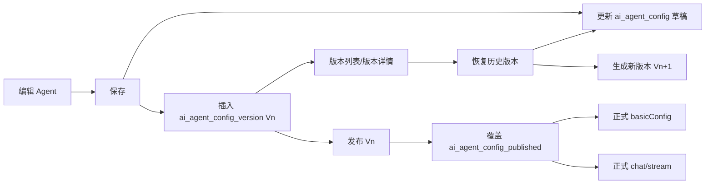

# AgentForge Agent 版本设计与发布方案

## 一、背景与目的

当前 AgentForge 使用 `ai_agent_config` 保存 Agent 的最新配置。该表同时承担了以下职责：

1. Agent 编辑页的当前配置（草稿）。
2. Agent 是否发布及最后发布时间等发布状态。
3. 正式发布页的基础信息查询。
4. 正式 Agent 对话运行时的配置来源。
5. 调试对话运行时的配置来源。

当前实现中的主要读取链路如下：

| 场景 | 当前入口 | 当前配置来源 |
| --- | --- | --- |
| 编辑页查询/保存 | `/api/agent-config/{id}`、`/api/agent-config/upsert` | `ai_agent_config` |
| 发布页基础信息 | `/api/agent-config/published/{aid}/basic` | `ai_agent_config` |
| 普通 Agent 对话 | `/api/agent/chat` | `ai_agent_config` |
| SSE 正式/调试对话 | `/api/chat/stream` | `ai_agent_config` |
| 发布/取消发布 | `/api/agent-config/{id}/publish|unpublish` | 修改 `ai_agent_config.publish` |

这种设计在第一阶段足够简单，但随着 Agent 持续编辑，会产生以下问题：

- 每次保存会覆盖旧配置，无法查看 Agent 的历史演进过程。
- 已发布 Agent 与正在编辑的 Agent 共用一行数据，线上版本和草稿缺少物理隔离。
- Agent 发布后继续保存草稿，正式运行时可能读取到尚未重新发布的配置。
- 保存配置会同时清理调试和正式 Agent 缓存，正式 Agent 可能被草稿配置重新构建。
- 会话只记录 `aid`，无法确认一次正式会话究竟使用了哪个发布版本。
- 发布、回滚、审计和故障追溯缺少稳定的数据依据。

因此，本次设计将 Agent 配置拆分为三个职责明确的数据模型：

```text
ai_agent_config
  当前工作副本（Draft / Working Copy）
          │ 每次保存生成不可变快照
          ▼
ai_agent_config_version
  完整历史版本（Immutable Versions）
          │ 选择一个已保存版本发布
          ▼
ai_agent_config_published
  当前线上快照（Published Snapshot）
```

设计目标如下：

1. **保存即留痕**：每次成功保存都生成一个单调递增的版本。
2. **草稿与线上隔离**：保存草稿不影响当前已发布 Agent。
3. **发布结果稳定**：正式页面和正式对话只读取发布快照。
4. **快速回看与恢复**：支持分页查看、查看详情，以及把历史版本恢复为新草稿。
5. **发布可追溯**：能够确定线上快照来源于哪个历史版本。
6. **兼容现有调用**：保留 `aid` 作为外部稳定标识，逐步迁移现有接口和缓存。

---

## 二、总体设计

### 2.1 三张表的职责

| 表 | 定位 | 是否可变 | 主要使用方 |
| --- | --- | --- | --- |
| `ai_agent_config` | 当前工作副本 | 可更新 | Agent 编辑页、调试对话 |
| `ai_agent_config_version` | 每次保存后的历史快照 | 插入后不可更新 | 版本列表、版本详情、历史恢复、发布来源 |
| `ai_agent_config_published` | 当前线上配置快照 | 发布时整体覆盖，取消发布时下线 | 正式发布页、正式对话 |

核心原则：

- `ai_agent_config` 是“现在正在编辑什么”。
- `ai_agent_config_version` 是“曾经保存过什么”。
- `ai_agent_config_published` 是“线上现在运行什么”。
- 三张表之间通过 `agent_config_id`、`aid` 和 `version_no` 建立逻辑关联，不建立物理外键。
- 发布表必须保存完整配置快照，正式运行时不能再回查草稿表拼装配置。

### 2.2 版本号规则

- 每个 Agent 独立编号，版本从 `1` 开始递增。
- 数据库字段使用 `BIGINT`，接口展示为 `V1`、`V2`、`V3`。
- 每次新增 Agent、修改并成功保存，都生成一个新版本。
- 即使两次保存内容相同，也生成新版本，保证“保存动作”完整可审计。
- 历史版本不可覆盖、不可修改、默认不可删除。
- 恢复历史版本不是把当前版本号倒退，而是将旧快照复制为当前草稿并生成一个新的版本。例如当前为 `V8`，恢复 `V3` 后生成 `V9`。
- 删除 Agent 时，三张表统一逻辑删除；历史版本不单独删除。

### 2.3 保存、发布、回看与恢复流程



---

## 三、关键业务语义

### 3.1 新建 Agent

新建也是一次保存，应在同一个事务内：

1. 插入 `ai_agent_config`，生成 `id` 和 `aid`。
2. 以完整草稿数据插入 `ai_agent_config_version`，版本号为 `1`。
3. Agent 初始为未发布状态，不写 `ai_agent_config_published`。
4. 事务提交后只清理或构建调试运行时缓存，不影响正式缓存。

### 3.2 保存 Agent

保存必须在同一个数据库事务内完成“更新草稿 + 创建版本”：

1. 使用 `SELECT ... FOR UPDATE` 锁定目标 `ai_agent_config` 行。
2. 校验 Agent 存在、未删除且属于当前用户。
3. 计算 `nextVersion = MAX(version_no) + 1`。由于同一 Agent 的草稿行已加锁，同一 Agent 的保存请求会串行执行。
4. 更新 `ai_agent_config` 当前工作副本。
5. 将更新后的完整配置插入 `ai_agent_config_version`。
6. 提交事务。
7. 事务提交后仅清除该 Agent 的调试实例缓存。

如果第 4 或第 5 步失败，事务整体回滚，不能出现“草稿已更新但没有版本”或“版本已生成但草稿未更新”的中间状态。

> 不建议仅执行 `SELECT MAX(version_no)` 而不锁定 Agent 主记录。并发保存时两个请求可能计算出相同版本号，最终依赖唯一索引报错，且用户体验不稳定。

### 3.3 发布 Agent

默认发布“最新已保存版本”，不直接发布前端尚未保存的表单数据。发布事务如下：

1. 锁定 `ai_agent_config` 草稿行。
2. 查询该 Agent 最新的 `ai_agent_config_version`。
3. 执行发布前校验，例如模型存在、Agent JSON 可解析、必填参数完整。
4. 将版本快照完整复制到 `ai_agent_config_published`；已存在则按 `aid` 整行覆盖。
5. 写入来源版本 `source_version_id/version_no`、发布人和发布时间。
6. 更新 `ai_agent_config.publish=1`、`last_publish_time=NOW()`。
7. 提交事务。
8. 事务提交后移除旧正式运行时缓存，并使用发布表快照预热或等待下一次请求懒加载。

发布成功后，继续编辑并保存只会产生新的草稿版本，不会改变 `ai_agent_config_published`。例如：

```text
草稿最新版本：V8
线上发布版本：V5

继续保存后：草稿变为 V9，线上仍然是 V5
再次发布后：线上切换为 V9
```

### 3.4 取消发布

取消发布事务：

1. 锁定 `ai_agent_config`。
2. 更新 `ai_agent_config.publish=0`。
3. 将 `ai_agent_config_published.is_deleted` 更新为 `1`，保留最后一次发布快照用于审计和再次发布覆盖。
4. 提交事务。
5. 事务提交后清理正式运行时缓存。

取消发布后：

- 正式基础信息接口返回“Agent 不存在、已删除或尚未发布”。
- 正式对话接口拒绝新请求。
- 调试接口仍可读取 `ai_agent_config`。
- 已保存的版本历史不受影响。

### 3.5 历史版本回看与恢复

版本回看分为两个操作：

- **查看**：只读 `ai_agent_config_version`，不改变任何数据。
- **恢复为草稿**：把指定历史快照复制到 `ai_agent_config`，同时创建一个递增的新版本。

恢复时默认不复制以下状态字段：

- `publish`
- `last_publish_time`
- `is_deleted`
- 原版本的 `create_time/modify_time`

恢复主要复制 Agent 业务配置字段：`name`、`type`、`agent_config`、`exper_config`、`is_public`、`avatar`、`description`。恢复不会自动发布，也不会影响当前线上快照。

---

## 四、核心表结构

### 4.1 `ai_agent_config`：当前工作副本

现有表继续保留，定位调整为 Agent 草稿/当前工作副本。为了兼容现有列表页面，第一阶段继续保留：

- `publish`：当前 Agent 是否对外发布的快捷状态。
- `last_publish_time`：最近一次成功发布时间。

这两个字段是发布状态的冗余字段，不是正式运行时配置来源。正式请求必须以 `ai_agent_config_published` 中存在有效记录为准。

第一阶段无须修改现有表结构。

### 4.2 `ai_agent_config_version`：Agent 历史版本表

该表复刻 `ai_agent_config` 的业务字段，并增加版本关联字段。快照创建后不可修改。

| 字段 | 类型 | 说明 |
| --- | --- | --- |
| `id` | `BIGINT` | 版本快照主键 |
| `agent_config_id` | `BIGINT` | 原 `ai_agent_config.id`，逻辑外键 |
| `version_no` | `BIGINT` | Agent 内单调递增版本号 |
| `name` | `VARCHAR(255)` | Agent 名称快照 |
| `type` | `INT` | Agent 类型快照 |
| `agent_config` | `LONGTEXT` | Agent 运行配置 JSON 快照 |
| `exper_config` | `LONGTEXT` | 体验面板配置 JSON 快照 |
| `publish` | `INT` | 保存时发布状态快照，仅供审计，不控制线上状态 |
| `last_publish_time` | `DATETIME` | 保存时最后发布时间快照，仅供审计 |
| `aid` | `VARCHAR(64)` | Agent 稳定标识 |
| `is_public` | `INT` | 是否公开快照 |
| `avatar` | `VARCHAR(255)` | 头像快照 |
| `description` | `VARCHAR(1024)` | 描述快照 |
| `is_deleted` | `INT` | 逻辑删除标志 |
| `create_user_id` | `BIGINT` | 本版本创建者，即保存操作人 |
| `create_time` | `DATETIME` | 版本生成时间 |
| `modify_time` | `DATETIME` | 快照时间，通常与创建时间相同 |

约束说明：

- `uk_agent_version(agent_config_id, version_no)` 保证单个 Agent 版本唯一。
- `idx_aid_version(aid, version_no)` 支撑按 `aid` 倒序查看版本。
- 历史版本表不使用 `ON UPDATE CURRENT_TIMESTAMP`，避免快照时间被意外改变。
- `publish/last_publish_time` 为复刻字段，只用于还原当时状态；发布动作不会反向修改历史版本。

### 4.3 `ai_agent_config_published`：Agent 当前发布快照表

每个 `aid` 最多一条当前发布快照。除复刻 `ai_agent_config` 业务字段外，增加发布来源信息。

| 字段 | 类型 | 说明 |
| --- | --- | --- |
| `id` | `BIGINT` | 发布快照主键 |
| `agent_config_id` | `BIGINT` | 原 `ai_agent_config.id`，逻辑外键 |
| `source_version_id` | `BIGINT` | 来源历史版本主键 |
| `version_no` | `BIGINT` | 当前线上版本号 |
| `name/type/agent_config/...` | 与草稿表一致 | 当前线上完整快照 |
| `publish` | `INT` | 发布状态，正常线上记录为 `1` |
| `published_by` | `BIGINT` | 最近发布操作人 |
| `published_time` | `DATETIME` | 本快照最近发布时间 |
| `is_deleted` | `INT` | `0` 在线，`1` 已取消发布/已删除 |

`source_version_id` 和 `version_no` 是必要的发布溯源信息。如果发布表只复制配置而不记录来源版本，就无法准确回答“当前线上运行的是哪个保存版本”。

---

## 五、建表 SQL

以下 SQL 基于当前 `ai_agent_config` 字段设计，适用于 MySQL 8.x。

```sql
CREATE TABLE IF NOT EXISTS `ai_agent_config_version` (
    `id`                BIGINT       NOT NULL AUTO_INCREMENT COMMENT '版本快照主键ID',
    `agent_config_id`   BIGINT       NOT NULL COMMENT '关联 ai_agent_config.id（逻辑外键）',
    `version_no`        BIGINT       NOT NULL COMMENT 'Agent内递增版本号，从1开始',
    `name`              VARCHAR(255) NOT NULL COMMENT 'Agent名称快照',
    `type`              INT          NOT NULL COMMENT 'Agent类型：1=ReActAgent',
    `agent_config`      LONGTEXT              DEFAULT NULL COMMENT 'Agent配置项JSON快照',
    `exper_config`      LONGTEXT              DEFAULT NULL COMMENT '对话体验面板配置JSON快照',
    `publish`           INT          NOT NULL DEFAULT 0 COMMENT '保存时发布状态快照，仅用于审计',
    `last_publish_time` DATETIME              DEFAULT NULL COMMENT '保存时最近发布时间快照，仅用于审计',
    `aid`               VARCHAR(64)  NOT NULL COMMENT 'Agent唯一标识ID',
    `is_public`         INT          NOT NULL DEFAULT 0 COMMENT '是否公开：0不公开、1公开',
    `avatar`            VARCHAR(255)          DEFAULT '' COMMENT '头像URL快照',
    `description`       VARCHAR(1024)         DEFAULT '' COMMENT 'Agent描述快照',
    `is_deleted`        INT          NOT NULL DEFAULT 0 COMMENT '逻辑删除：0未删除、1已删除',
    `create_user_id`    BIGINT       NOT NULL DEFAULT 1 COMMENT '版本创建者/保存操作人ID',
    `create_time`       DATETIME     NOT NULL DEFAULT CURRENT_TIMESTAMP COMMENT '版本生成时间',
    `modify_time`       DATETIME     NOT NULL DEFAULT CURRENT_TIMESTAMP COMMENT '快照时间',
    PRIMARY KEY (`id`),
    UNIQUE KEY `uk_agent_version` (`agent_config_id`, `version_no`),
    KEY `idx_aid_version` (`aid`, `version_no`)
) ENGINE=InnoDB
  DEFAULT CHARSET=utf8mb4
  COLLATE=utf8mb4_general_ci
  COMMENT='Agent配置历史版本表';

CREATE TABLE IF NOT EXISTS `ai_agent_config_published` (
    `id`                BIGINT       NOT NULL AUTO_INCREMENT COMMENT '发布快照主键ID',
    `agent_config_id`   BIGINT       NOT NULL COMMENT '关联 ai_agent_config.id（逻辑外键）',
    `source_version_id` BIGINT       NOT NULL COMMENT '来源 ai_agent_config_version.id（逻辑外键）',
    `version_no`        BIGINT       NOT NULL COMMENT '当前发布版本号',
    `name`              VARCHAR(255) NOT NULL COMMENT '已发布Agent名称',
    `type`              INT          NOT NULL COMMENT 'Agent类型：1=ReActAgent',
    `agent_config`      LONGTEXT              DEFAULT NULL COMMENT '已发布Agent配置项JSON',
    `exper_config`      LONGTEXT              DEFAULT NULL COMMENT '已发布对话体验面板配置JSON',
    `publish`           INT          NOT NULL DEFAULT 1 COMMENT '发布状态：0未发布、1已发布',
    `last_publish_time` DATETIME              DEFAULT NULL COMMENT '最新发布时间（兼容原配置字段）',
    `aid`               VARCHAR(64)  NOT NULL COMMENT 'Agent唯一标识ID',
    `is_public`         INT          NOT NULL DEFAULT 0 COMMENT '是否公开：0不公开、1公开',
    `avatar`            VARCHAR(255)          DEFAULT '' COMMENT '已发布头像URL',
    `description`       VARCHAR(1024)         DEFAULT '' COMMENT '已发布Agent描述',
    `is_deleted`        INT          NOT NULL DEFAULT 0 COMMENT '逻辑删除/下线：0在线、1下线',
    `create_user_id`    BIGINT       NOT NULL DEFAULT 1 COMMENT '原Agent创建者ID',
    `create_time`       DATETIME     NOT NULL DEFAULT CURRENT_TIMESTAMP COMMENT '发布记录首次创建时间',
    `modify_time`       DATETIME     NOT NULL DEFAULT CURRENT_TIMESTAMP ON UPDATE CURRENT_TIMESTAMP COMMENT '发布快照更新时间',
    `published_by`      BIGINT       NOT NULL DEFAULT 1 COMMENT '最近发布操作人ID',
    `published_time`    DATETIME     NOT NULL DEFAULT CURRENT_TIMESTAMP COMMENT '最近发布时间',
    PRIMARY KEY (`id`),
    UNIQUE KEY `uk_published_aid` (`aid`),
    UNIQUE KEY `uk_published_agent_config_id` (`agent_config_id`),
    KEY `idx_publish_visible` (`publish`, `is_deleted`, `is_public`),
    KEY `idx_source_version_id` (`source_version_id`)
) ENGINE=InnoDB
  DEFAULT CHARSET=utf8mb4
  COLLATE=utf8mb4_general_ci
  COMMENT='Agent当前发布配置快照表';
```

### 5.1 发布 Upsert 示例

发布必须从历史版本表复制，避免发布过程中又读取到不同的草稿状态：

```sql
INSERT INTO ai_agent_config_published (
    agent_config_id, source_version_id, version_no,
    name, type, agent_config, exper_config,
    publish, last_publish_time, aid, is_public, avatar, description,
    is_deleted, create_user_id, create_time, modify_time,
    published_by, published_time
)
SELECT
    v.agent_config_id, v.id, v.version_no,
    v.name, v.type, v.agent_config, v.exper_config,
    1, NOW(), v.aid, v.is_public, v.avatar, v.description,
    0, v.create_user_id, NOW(), NOW(),
    :publishedBy, NOW()
FROM ai_agent_config_version v
WHERE v.id = :sourceVersionId
  AND v.agent_config_id = :agentConfigId
  AND v.is_deleted = 0
ON DUPLICATE KEY UPDATE
    source_version_id = VALUES(source_version_id),
    version_no = VALUES(version_no),
    name = VALUES(name),
    type = VALUES(type),
    agent_config = VALUES(agent_config),
    exper_config = VALUES(exper_config),
    publish = 1,
    last_publish_time = VALUES(last_publish_time),
    is_public = VALUES(is_public),
    avatar = VALUES(avatar),
    description = VALUES(description),
    is_deleted = 0,
    modify_time = VALUES(modify_time),
    published_by = VALUES(published_by),
    published_time = VALUES(published_time);
```

---

## 六、与会话表的版本绑定

现有 `ai_agent_session` 只记录 `aid`。引入发布版本后，建议增加以下字段：

```sql
ALTER TABLE `ai_agent_session`
    ADD COLUMN `agent_version_no` BIGINT DEFAULT NULL
        COMMENT '会话首次运行时绑定的Agent版本号；历史数据可为空' AFTER `aid`,
    ADD COLUMN `published_config_id` BIGINT DEFAULT NULL
        COMMENT '正式会话关联ai_agent_config_published.id；调试会话为空' AFTER `agent_version_no`,
    ADD KEY `idx_aid_version` (`aid`, `agent_version_no`);
```

绑定规则：

- 正式会话首次发起对话时，记录当前 `ai_agent_config_published.id/version_no`，用于审计本会话建立时的线上版本。
- 正式发布页的所有接口，包括同一个会话的后续对话，始终读取当前有效的 `ai_agent_config_published`，不回查 `ai_agent_config_version`。
- 调试会话使用当前草稿，可记录当次调试对应的最新保存版本号，`published_config_id` 为空。
- 旧会话字段为空时不做历史版本推断，避免伪造追溯信息。

这两个会话字段是审计字段，不改变“发布页配置统一从发布表读取”的规则。重新发布后，已有会话的下一轮请求也使用新的发布快照；如果产品希望提示版本变化，可比较会话记录的 `agent_version_no` 与当前发布表的 `version_no`。

---

## 七、配置读取链路改造

### 7.1 读取矩阵

| 场景 | 改造后数据源 | 说明 |
| --- | --- | --- |
| Agent 编辑详情 | `ai_agent_config` | 始终展示最新草稿 |
| Agent 调试对话 | `ai_agent_config` | 调试保存中的工作副本 |
| 发布页 basicConfig | `ai_agent_config_published` | 只展示线上快照 |
| 正式同步对话 | `ai_agent_config_published` | 禁止读取草稿和历史版本表 |
| 正式 SSE 对话 | `ai_agent_config_published` | 禁止读取草稿和历史版本表 |
| 版本列表/详情 | `ai_agent_config_version` | 只读历史快照 |

### 7.2 当前代码的具体改造点

#### `AgentConfigServiceImpl#getPublishedBasicByAid`

当前逻辑读取 `agentConfigMapper.selectByAid(aid)` 并判断草稿表的 `publish`。改造后应调用 `AgentConfigPublishedMapper.selectOnlineByAid(aid)`，返回发布快照中的 `name/avatar/description`。

这样，发布后修改 Agent 名称、头像或描述但未再次发布时，正式页面仍展示原来的线上信息。

#### `AgentChatController#chat`

- `isDebug=true`：读取 `ai_agent_config`。
- `isDebug=false`：读取 `ai_agent_config_published`，且要求 `publish=1 AND is_deleted=0`。
- `AgentInitContext.agentConfig` 必须来自对应数据源。
- 正式运行时的 `type`、`aid` 也应来自发布快照，不能从草稿补齐。

#### `ChatController#stream`

与 `AgentChatController` 使用同一套配置解析服务，避免同步接口和 SSE 接口产生不同语义。建议抽取：

```java
AgentRuntimeConfig resolve(String aid, boolean isDebug, String sessionId);
```

该服务负责：

1. 调试态读取草稿。
2. 正式态读取发布快照。
3. 正式态只返回当前有效发布快照，不读取历史版本表兜底。
4. 返回统一的 `aid/type/agentConfig/versionNo/publishedConfigId`。

#### `AgentConfigServiceImpl#upsert`

当前保存后执行 `agentManager.removeAgent(saved.getAid())`，会同时清除正式和调试实例。改造后只清除调试实例：

```java
agentManager.removeAgent(saved.getAid(), true);
```

具体方法名可按当前缓存接口调整，但语义必须是“保存草稿不触碰正式实例”。

#### `AgentConfigServiceImpl#updatePublishStatus`

当前发布直接使用保存前读取到的 `pojo.getAgentConfig()` 创建正式实例。改造后：

- 发布：通过发布服务将最新版本复制到发布表；事务提交后用发布快照重建正式实例。
- 取消发布：下线发布快照；事务提交后移除正式实例。
- 不再把“修改一个 publish 数字”视为完整发布动作。

### 7.3 缓存 Key

正式运行时只使用发布表中的当前快照，缓存 Key 建议带上发布版本：

```text
调试：agent:{aid}:debug
正式最新：agent:{aid}:published:{versionNo}
```

发布新版本时清理旧的正式缓存并以新 `versionNo` 重建；旧版本缓存可直接按 TTL 淘汰，不再被发布页请求使用。

---

## 八、核心接口规划

现有普通接口继续直接返回业务对象，异常继续由 `GlobalExceptionHandler` 统一处理。

### 8.1 Agent 保存接口

#### `POST /api/agent-config/upsert`

保持现有地址，语义调整为“保存草稿并生成版本”。

请求沿用 `AgentConfigUpsertReq`。建议响应增加：

```json
{
  "id": 12,
  "aid": "agt_xxx",
  "name": "知识库助手",
  "publish": 1,
  "latestVersionNo": 9,
  "publishedVersionNo": 5,
  "hasUnpublishedChanges": true
}
```

`hasUnpublishedChanges = latestVersionNo != publishedVersionNo`，便于页面展示“有未发布变更”。

### 8.2 版本列表

#### `GET /api/agent-config/{id}/versions?page=1&pageSize=20`

返回按 `version_no DESC` 排序的版本摘要：

```json
{
  "currentPage": 1,
  "pageSize": 20,
  "totalCount": 9,
  "data": [
    {
      "id": 109,
      "versionNo": 9,
      "createUserId": 1,
      "createTime": "2026-10-27 14:30:00",
      "published": false,
      "currentDraft": true
    }
  ]
}
```

列表不必返回大字段 `agent_config/exper_config`，避免每次分页传输所有 JSON。

### 8.3 版本详情

#### `GET /api/agent-config/{id}/versions/{versionNo}`

返回指定版本完整快照，用于回看或前端 Diff。

校验 `{id}` 与版本记录的 `agent_config_id` 一致，防止通过版本号串读其他 Agent 数据。

### 8.4 版本差异

#### `GET /api/agent-config/{id}/versions/diff?from=5&to=9`

第一期可由前端对两个详情做 JSON Diff；后端接口作为可选增强。若后端实现，建议返回字段级差异，不直接返回 HTML。

### 8.5 恢复历史版本

#### `POST /api/agent-config/{id}/versions/{versionNo}/restore`

语义：将指定历史版本恢复为当前草稿，并生成一个全新的最新版本。

响应返回恢复后的 Agent 详情及新版本号。该操作不自动发布。

### 8.6 发布最新版本

#### `POST /api/agent-config/{id}/publish`

保持现有接口地址，默认发布最新已保存版本。响应增加：

```json
{
  "id": 12,
  "aid": "agt_xxx",
  "publish": 1,
  "publishedVersionNo": 9,
  "lastPublishTime": "2026-10-27 14:35:00",
  "hasUnpublishedChanges": false
}
```

为避免按钮误操作发布旧草稿，前端可传乐观校验参数：

```json
{
  "expectedVersionNo": 9
}
```

若数据库最新版本不是 `9`，返回冲突错误，提示用户刷新后重试。

### 8.7 发布指定历史版本（可选）

#### `POST /api/agent-config/{id}/versions/{versionNo}/publish`

直接把指定历史版本设置为当前线上版本，适合线上快速回滚。它不会改变当前草稿，也不会产生新保存版本。

如果产品第一期只允许发布最新草稿，可以暂不开放该接口；但底层 `AgentPublishService.publish(id, versionNo)` 建议直接支持指定版本，便于后续扩展。

### 8.8 取消发布

#### `POST /api/agent-config/{id}/unpublish`

保持现有接口地址。成功后发布基础信息和正式对话立即不可用，调试和版本历史不受影响。

### 8.9 查询当前发布信息

#### `GET /api/agent-config/{id}/published`

供管理页面查询当前发布版本、发布时间、发布人及是否存在未发布变更。

### 8.10 正式发布页与对话接口

以下外部接口地址无需变化，只改变内部数据来源：

| 接口 | 改造后语义 |
| --- | --- |
| `GET /api/agent-config/published/{aid}/basic` | 查询有效发布快照 |
| `POST /api/agent/chat` | 正式态读发布快照，调试态读草稿 |
| `POST /api/chat/stream` | 正式态只读发布快照，调试态读草稿 |

---

## 九、后端模块规划

建议仍放在 `modules/agent` 下，不另建顶级模块：

```text
modules/agent
├── controller
│   ├── AgentConfigController
│   └── AgentConfigVersionController
├── dao
│   ├── AgentConfigMapper
│   ├── AgentConfigVersionMapper
│   └── AgentConfigPublishedMapper
├── domain
│   ├── AgentConfigPojo
│   ├── AgentConfigVersionPojo
│   ├── AgentConfigPublishedPojo
│   ├── req
│   └── vo
├── service
│   ├── IAgentConfigService
│   ├── IAgentConfigVersionService
│   ├── IAgentPublishService
│   └── IAgentRuntimeConfigService
└── service/impl
```

职责建议：

| 服务 | 职责 |
| --- | --- |
| `AgentConfigService` | 草稿查询、新建、保存、删除 |
| `AgentConfigVersionService` | 版本生成、列表、详情、恢复 |
| `AgentPublishService` | 发布、指定版本发布、取消发布 |
| `AgentRuntimeConfigService` | 根据 debug/正式/会话版本统一解析运行配置 |

事务边界应放在 Service 层。Controller 和 Mapper 不承担版本号计算、发布快照拼装或缓存一致性逻辑。

---

## 十、并发、一致性与异常处理

### 10.1 同一 Agent 并发保存

- 保存前锁定 `ai_agent_config` 行。
- `(agent_config_id, version_no)` 唯一索引作为最后防线。
- 可在请求中增加 `expectedModifyTime` 或 `expectedLatestVersionNo` 做乐观锁，避免后保存的人无感覆盖先保存者。

### 10.2 保存与发布并发

保存和发布都锁定同一个 `ai_agent_config` 行，因此同一 Agent 上两个动作串行：

- 若保存先获得锁，发布读取并发布保存后的最新版本。
- 若发布先获得锁，发布当时的最新已保存版本；随后保存只生成新草稿，不影响已发布快照。

### 10.3 数据库与缓存一致性

数据库是事实来源，缓存操作必须发生在事务成功提交之后。建议使用：

- `TransactionSynchronization.afterCommit(...)`；或
- Spring 事务事件 `@TransactionalEventListener(phase = AFTER_COMMIT)`。

如果缓存预热失败，不回滚已成功的数据库发布；清理缓存并让下一次正式请求从发布表懒加载即可。

### 10.4 幂等性

- 重复发布同一 `version_no` 可以直接返回成功，并刷新发布时间；或者检测到版本一致时返回当前发布结果而不更新。两种语义需固定，推荐后者，减少无意义缓存抖动。
- 重复取消发布应幂等返回未发布状态。
- 恢复历史版本属于写操作，每次调用都会产生新版本，不应按版本号幂等。

---

## 十一、数据迁移方案

上线前已有 `ai_agent_config` 数据，需要建立初始版本和发布快照。

### 11.1 迁移顺序

1. 创建 `ai_agent_config_version`。
2. 创建 `ai_agent_config_published`。
3. 为每条未删除 Agent 生成 `V1` 历史版本。
4. 对 `publish=1` 的 Agent，以其 `V1` 创建当前发布快照。
5. 部署“双读校验但单写新表”的过渡代码（可选）。
6. 将正式 basic/chat/stream 切换到发布表。
7. 验证稳定后移除正式链路对草稿表的兜底读取。

### 11.2 初始化版本 SQL 示例

```sql
INSERT INTO ai_agent_config_version (
    agent_config_id, version_no, name, type, agent_config, exper_config,
    publish, last_publish_time, aid, is_public, avatar, description,
    is_deleted, create_user_id, create_time, modify_time
)
SELECT
    c.id, 1, c.name, c.type, c.agent_config, c.exper_config,
    c.publish, c.last_publish_time, c.aid, c.is_public, c.avatar, c.description,
    c.is_deleted, c.create_user_id,
    COALESCE(c.modify_time, c.create_time, NOW()),
    COALESCE(c.modify_time, c.create_time, NOW())
FROM ai_agent_config c
WHERE c.is_deleted = 0
  AND NOT EXISTS (
      SELECT 1
      FROM ai_agent_config_version v
      WHERE v.agent_config_id = c.id
  );
```

### 11.3 初始化发布快照 SQL 示例

```sql
INSERT INTO ai_agent_config_published (
    agent_config_id, source_version_id, version_no,
    name, type, agent_config, exper_config,
    publish, last_publish_time, aid, is_public, avatar, description,
    is_deleted, create_user_id, create_time, modify_time,
    published_by, published_time
)
SELECT
    c.id, v.id, v.version_no,
    c.name, c.type, c.agent_config, c.exper_config,
    1, c.last_publish_time, c.aid, c.is_public, c.avatar, c.description,
    0, c.create_user_id,
    COALESCE(c.last_publish_time, c.modify_time, NOW()),
    COALESCE(c.last_publish_time, c.modify_time, NOW()),
    c.create_user_id,
    COALESCE(c.last_publish_time, c.modify_time, NOW())
FROM ai_agent_config c
JOIN ai_agent_config_version v
  ON v.agent_config_id = c.id
 AND v.version_no = 1
WHERE c.is_deleted = 0
  AND c.publish = 1
  AND NOT EXISTS (
      SELECT 1
      FROM ai_agent_config_published p
      WHERE p.agent_config_id = c.id
  );
```

迁移脚本必须可重复执行，使用 `NOT EXISTS` 或唯一键保证幂等。

---

## 十二、模型配置快照边界

当前 `agent_config` JSON 中通过 `llmModelId` 引用 `ai_model_config`。因此即使 Agent 配置已经做了版本快照，如果对应模型配置被修改，同一个 Agent 历史版本实际使用的模型地址、模型名或参数仍可能变化。

第一阶段可接受以下边界：

- Agent 的提示词、记忆、工具和模型 ID 可追溯。
- 模型密钥继续由 `ai_model_config` 管理，不复制到 Agent 版本表，避免大量敏感数据快照。
- 发布/运行时若模型已删除或不可用，应明确报错。

若后续要求“任意历史 Agent 版本都能完全一致地重新运行”，还需为 `ai_model_config` 增加版本机制，或在发布快照中保存不含密钥的模型运行参数快照，并通过独立凭据引用获取密钥。

---

## 十三、推荐落地顺序

### 第一阶段：完成数据隔离

1. 新建版本表、发布表及 Mapper/Pojo。
2. 保存事务中同步生成版本。
3. 发布时由指定版本生成发布快照。
4. basicConfig、正式 chat、正式 stream 全部切换到发布表。
5. 调试对话继续读取草稿。
6. 保存只清理调试缓存，发布只切换正式缓存。

### 第二阶段：版本管理页面

1. 版本列表与详情。
2. 历史版本字段 Diff。
3. 恢复历史版本为新草稿。
4. 展示“草稿 Vn / 线上 Vm / 有未发布变更”。

### 第三阶段：发布审计与快速回滚

1. 会话绑定 `agent_version_no`。
2. 正式历史会话保留创建时发布版本信息用于审计，但后续请求仍读取当前发布表。
3. 支持指定版本发布，实现线上快速回滚；回滚本质上仍是用历史快照覆盖发布表。
4. 为旧发布版本缓存增加 TTL/LRU 淘汰。

---

## 十四、最终约定总结

1. `ai_agent_config` 永远表示当前草稿，不作为正式 Agent 的配置来源。
2. 每次成功保存都向 `ai_agent_config_version` 插入一条不可变快照。
3. 版本号按 Agent 独立递增，恢复旧版本也必须产生新版本。
4. `ai_agent_config_published` 每个 Agent 只保留一条当前线上完整快照。
5. 发布只能发布已经保存的版本，正式 basic/chat/stream 只读取当前有效发布快照。
6. 保存草稿不影响线上配置和正式缓存；发布成功后才切换正式运行时。
7. `ai_agent_config.publish` 仅作为管理端快捷状态，发布表的有效线上记录才是正式可用性的事实依据。
8. 发布表必须记录 `source_version_id/version_no`，保证线上版本可追溯。
9. 推荐为正式会话记录 `agent_version_no`，避免同一会话随重新发布发生行为漂移。
10. 数据库事务先保证配置与快照一致，缓存操作统一在事务提交后执行。

通过以上设计，AgentForge 可以在不改变 `aid` 外部标识和主要页面入口的前提下，获得清晰的草稿、版本与发布边界，为后续版本对比、线上回滚、灰度发布和审计能力打下基础。
