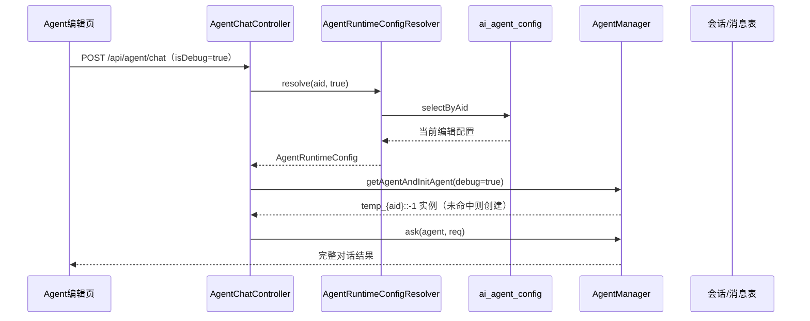
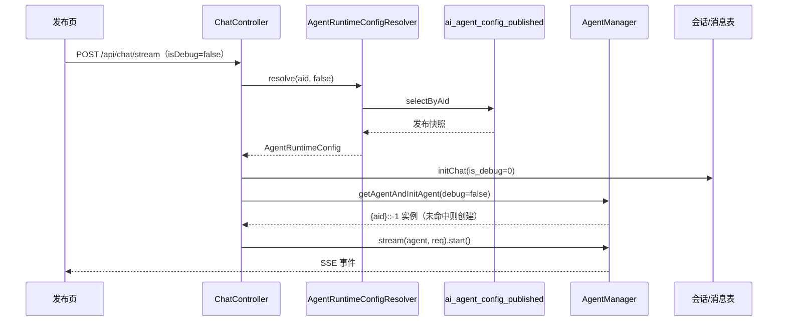

# 核心 Agent 调试与发布对话设计与实现

## 一、背景

AgentForge 里同一个 Agent 会面对两种对话场景：

- Agent 编辑页右侧的**调试对话**：边改 Prompt、模型和记忆配置，边立即验证效果。
- Agent 发布页的**正式对话**：用户访问已经发布的 Agent，和线上配置对话。

这两种场景在页面上看起来都是“和一个 Agent 聊天”，但对后端来说，它们读取的配置、使用的运行时实例、写入的会话记录语义完全不同。早期版本里两处都读 `ai_agent_config`，结果是编辑页保存一次配置，线上对话的行为立刻被改变，调试和发布之间没有边界。

引入 `ai_agent_config_published` 之后，问题变成：**同一个 Agent、同一套运行时、同一个对话协议，如何在不复制整套代码的前提下，让两种对话各自读自己的配置、各用各的实例、各写各的会话记录。**

本文只讨论 `agentforge-service` 层内的职责划分与落地实现，围绕统一入口 `AgentChatController`，说明调试态与发布态的配置解析、运行时实例管理和会话存储设计，不展开 Agent 框架内部的推理循环、模型调用与工具执行细节。

## 二、设计目标

1. **一个入口**：调试和正式对话共用同一套请求模型与运行时协议，不为“调试”单独复制一套 Agent 逻辑。
2. **配置来源唯一**：`isDebug=true` 只读当前编辑配置，`isDebug=false` 只读发布快照，正式对话不允许回退到编辑配置。
3. **运行实例隔离**：同一 `aid` 的调试实例和正式实例在缓存中互不复用，改配置不会串味。
4. **会话可追溯**：调试会话与正式会话都落 `ai_agent_session`，用 `is_debug` 区分，历史消息按 `events` 重放。
5. **不可用可降级**：Agent 未发布、已停止发布或已删除时，对话接口返回一条正常 AI 提示，而不是 500 和异常堆栈。
6. **配置变更后可重建**：保存、发布、取消发布后只清理对应运行态缓存，下一次对话按数据源懒加载重建。

## 三、两条链路与一张表

调试与发布对话的差异，可以压缩成一张对照表：

| 维度 | 编辑页调试对话 | 发布页正式对话 |
| --- | --- | --- |
| 页面 | `AgentConfigPage` 右侧调试面板 | `PublishedAgentChatPage` |
| 请求参数 | `isDebug=true` | `isDebug=false` |
| 配置数据源 | `ai_agent_config` | `ai_agent_config_published` |
| 运行时实例 key | `temp_{aid}::-1` | `{aid}::-1` |
| 会话表 `is_debug` | `1` | `0` |
| 配置保存影响 | 保存后清理调试实例 | 重新发布会替换发布快照并清理正式实例 |
| 对话接口 | `/api/chat/stream`（流式）<br>`/api/agent/chat`（同步） | 同左 |

这里最关键的约定是：**`isDebug` 是唯一的运行态开关**。它不区分接口，只决定三件事——读哪张表、用哪个实例 key、会话按哪种类型落库。

由此带来的直接收益是，配置解析、实例管理、会话写入都只维护一份逻辑。调试链路不会因为“少走某个分支”而和正式链路产生行为差异。

## 四、统一请求与入口

### 4.1 AgentChatReq：对话请求的统一载体

`AgentChatReq` 同时承载调试与正式对话：

```java
public class AgentChatReq {

    private String aid;
    private String sessionId;
    private String message;
    private Boolean isDebug;

    /** 本次请求初始化得到的 AI 消息主键，用于会话生命周期中间件收口。 */
    private Long aiMessageId;

    /** 会话表主键。 */
    private Long sessionPk;

    /** 会话标题，仅首次创建时有值。 */
    private String sessionTitle;
}
```

前四个字段来自页面，后三个字段由服务端在请求初始化阶段回填，只在流式链路中使用。调试和正式对话的请求结构完全一致，页面不需要感知“自己是在调哪个接口的哪种模式”。

`isDebug` 使用包装类型 `Boolean` 而不是 `boolean`，解析时统一按 `Boolean.TRUE.equals(...)` 处理。这样缺省、`null` 和 `false` 都归入正式态，避免历史调用方漏传参数时被误判成调试请求。

### 4.2 AgentChatController：一个入口完成运行态分派

`AgentChatController` 是这条链路的核心。它做的事很少，但每一步都对应一个明确的边界：

```java
@RestController
@RequestMapping("/api/agent")
@CrossOrigin
public class AgentChatController {

    private final AgentRuntimeConfigResolver runtimeConfigResolver;
    private final AgentManagerFactory agentManagerFactory;

    @PostMapping("/chat")
    public ChatResult chat(@RequestBody AgentChatReq req) {
        if (req == null || req.getAid() == null || req.getAid().trim().isEmpty()) {
            throw new IllegalArgumentException("aid 不能为空");
        }
        if (req.getMessage() == null || req.getMessage().trim().isEmpty()) {
            throw new IllegalArgumentException("对话内容不能为空");
        }
        boolean isDebug = Boolean.TRUE.equals(req.getIsDebug());
        AgentRuntimeConfig config;
        try {
            config = runtimeConfigResolver.resolve(req.getAid(), isDebug);
        } catch (AgentForgeException e) {
            // Agent 未发布、已停止发布或已删除：作为一条正常回答返回，避免 500 与异常堆栈
            return ChatResult.toFinished(req.getMessage().trim(), e.getMessage());
        }
        IAgentManager<Object, Object> agentManager =
                agentManagerFactory.getAgentManagerByType(config.getType());
        Object agent =
                agentManager.getAgentAndInitAgent(
                        AgentInitContext.builder()
                                .aid(config.getAid())
                                .agentConfig(config.getAgentConfig())
                                .debug(isDebug)
                                .channelId(AgentInitContext.WEBSITE_CHANNEL_ID)
                                .build());
        return agentManager.ask(agent, req);
    }
}
```

代码中的 `ChatResult` 只是服务层对外的对话结果载体，本文不展开其内部结构。按顺序拆开看：

1. **参数校验**：`aid` 与 `message` 为空属于调用方错误，直接抛 `IllegalArgumentException`，由全局异常处理器转成 400。
2. **解析运行态配置**：把 `(aid, isDebug)` 交给 `AgentRuntimeConfigResolver`，由它决定读哪张表。Controller 不出现任何 Mapper 调用，也不判断 `publish` 字段。
3. **业务不可用降级**：`AgentUnavailableException` 继承 `AgentForgeException`，被捕获后包装成一条正常对话结果。用户看到的是“该 Agent 尚未发布或已停止发布”，不是异常页。
4. **按类型取管理器**：`AgentManagerFactory` 以 `config.getType()` 分发。Agent 类型来自配置本身，调试态和正式态用的是同一套类型体系。
5. **初始化并复用实例**：`getAgentAndInitAgent` 内部先查缓存，未命中才创建，调试与正式由 `context.isDebug()` 区分。
6. **执行对话**：交给具体管理器的 `ask`，Controller 不关心 Agent 内部如何执行。

需要特别说明的是第 4 步：`type` 取自 `AgentRuntimeConfig`，而不是请求体。页面即使传了错误的类型也不会生效，运行类型始终以服务端配置为准。

### 4.3 同步与流式的分工

`/api/agent/chat` 是同步接口，返回一次完整的对话结果，适合不需要逐字输出的调试场景；`/api/chat/stream` 是 SSE 接口，负责正式页和调试面板的流式交互。

两条链路在“配置解析 + 实例获取”这一段完全一致，区别只在会话记录：

| 能力 | `POST /api/agent/chat` | `POST /api/chat/stream` |
| --- | --- | --- |
| 配置解析 | `AgentRuntimeConfigResolver` | 同左 |
| 实例获取 | `getAgentAndInitAgent` | 同左 |
| 返回形式 | 完整对话结果 | SSE 事件流 |
| 会话落库 | 不写会话/消息表 | 写 `ai_agent_session` + `ai_agent_session_message` |
| 停止能力 | 不支持 | `/api/chat/stop` |

这条分工必须说清楚：**同步接口是“一次问答”，流式接口才是“一段会话”**。页面上的调试历史、会话列表都来自流式链路的落库结果，同步接口不承担会话持久化职责，避免出现两套写入方。

## 五、配置读取：AgentRuntimeConfigResolver

### 5.1 统一返回结构

无论调试还是正式，解析结果都收敛为 `AgentRuntimeConfig`：

```java
public class AgentRuntimeConfig {

    private final String aid;
    private final Integer type;
    private final String agentConfig;
}
```

Controller 后续只依赖这三个字段：用 `aid` 定位 Agent，用 `type` 选管理器，用 `agentConfig` 初始化运行时。至于是从哪张表读出来的，Controller 完全不需要知道。

### 5.2 按运行态选择数据源

```java
public AgentRuntimeConfig resolve(String aid, boolean debug) {
    if (aid == null || aid.trim().isEmpty()) {
        throw new IllegalArgumentException("aid 不能为空");
    }
    String normalizedAid = aid.trim();
    if (debug) {
        AgentConfigPojo config = agentConfigMapper.selectByAid(normalizedAid);
        if (config == null) {
            throw new AgentUnavailableException("该 Agent 不存在或已被删除，暂时无法对话。");
        }
        return new AgentRuntimeConfig(
                config.getAid(), config.getType(), config.getAgentConfig());
    }
    AgentConfigPublishedPojo published = agentConfigPublishedMapper.selectByAid(normalizedAid);
    if (published == null) {
        throw new AgentUnavailableException("该 Agent 尚未发布或已停止发布，暂时无法对话。请联系创建者重新发布后再试。");
    }
    return new AgentRuntimeConfig(
            published.getAid(), published.getType(), published.getAgentConfig());
}
```

几个容易忽略但很重要的细节：

- **调试态不校验发布状态**：编辑页的 Agent 可能从未发布，也可能已经停止发布，但调试必须可用。因此 `debug=true` 只看当前配置表是否存在未删除记录。
- **正式态不回退**：发布表查不到就直接抛 `AgentUnavailableException`，绝不回退去读 `ai_agent_config`。一旦允许回退，编辑页改一半保存的配置就可能被线上用户读到。
- **`aid` 统一归一化**：`trim()` 后的值参与查询，并回填到 `AgentRuntimeConfig.aid`，保证实例 key 与配置查询使用同一个标识。
- **只取运行必需字段**：`exper_config`、`avatar`、`description` 不进入运行时配置。它们属于页面展示，发布页另有 `GET /api/agent-config/published/{aid}/basic` 从发布表读取。

### 5.3 不可用异常的语义

```java
public class AgentUnavailableException extends AgentForgeException {

    public static final String CODE = "AGENT_UNAVAILABLE";

    public AgentUnavailableException(String message) {
        super(CODE, message);
    }
}
```

`message` 直接面向终端用户，因此文案按“用户能看懂、知道下一步做什么”来写。异常携带错误码，便于日志排查；但对话接口不把错误码暴露给页面，而是把 message 当成 AI 回答返回。

## 六、运行时实例隔离

### 6.1 实例 key 的构成

`AbstractAgentManager` 用 `aid + debug + channelId` 生成缓存 key：

```java
public static final String TEMP_AID_TEMPLATE = "temp_%s";

protected String buildAgentKey(AgentInitContext context) {
    return buildAidPrefix(context.getAid(), context.isDebug())
            + context.getNormalizedChannelId();
}

private String buildAidPrefix(String aid, boolean isDebug) {
    return (isDebug ? String.format(TEMP_AID_TEMPLATE, aid) : aid) + "::";
}
```

以网页渠道 `channelId = "-1"` 为例：

| 运行态 | 实例 key |
| --- | --- |
| 调试 | `temp_4v7qri4t4vo0::-1` |
| 正式 | `4v7qri4t4vo0::-1` |

加 `temp_` 前缀有两个作用：一是调试与正式实例天然不冲突；二是按前缀批量清理时可以用 `startsWith` 精确命中某一运行态，不会误删另一种。

`channelId` 参与 key 是为了给后续多渠道（网页、API、第三方平台）留出隔离维度，当前统一使用 `AgentInitContext.WEBSITE_CHANNEL_ID = "-1"`。

### 6.2 懒加载与并发创建

`getAgentAndInitAgent` 先查后建，并对同一个 key 加锁做二次检查：

```java
public final T getAgentAndInitAgent(AgentInitContext context) {
    String agentKey = buildAgentKey(context);
    T agent = getAgent(context);
    if (agent == null) {
        synchronized (agentKey.intern()) {
            agent = getAgent(context);
            if (agent == null) agent = createAndStoreAgent(context);
        }
    }
    return agent;
}
```

这样做的好处是：配置保存后不需要立即重建 Agent，只要删除缓存，下一次对话自然按最新配置创建。发布、取消发布走的是同一套机制，省掉了“发布后预热”的一致性问题。

### 6.3 什么操作清理哪种实例

| 操作 | 数据变化 | 清理的实例 | 入口 |
| --- | --- | --- | --- |
| 仅保存 | 更新 `ai_agent_config` | `isDebug=true` | `AgentConfigServiceImpl#upsert` |
| 保存并提交版本 | 更新当前表 + 新增版本快照 | `isDebug=true` | 同上 |
| 发布 / 重新发布 | 写发布快照 | `isDebug=false` | `#updatePublishStatus` |
| 取消发布 | 删除发布快照 | `isDebug=false` | 同上 |
| 删除 Agent | 删除当前配置 + 发布快照 | 两种都清理 | `#delete` |
| 切换历史版本 | 不落库 | 不清理 | `#switchVersion` |

清理动作注册在事务提交之后执行：

```java
private void evictAfterCommit(AgentConfigPojo pojo, boolean debug) {
    afterCommit(
            () -> {
                IAgentManager<Object, Object> agentManager =
                        agentManagerFactory.getAgentManagerByType(pojo.getType());
                agentManager.removeAgent(pojo.getAid(), debug);
            });
}
```

`afterCommit` 保证“数据库已经改了，缓存才失效”。如果反过来先删缓存再提交，事务回滚时缓存已经被清空，虽然会重建出旧配置，但中间会出现一次无谓的实例重建；更糟的是并发请求可能在新旧配置之间反复切换。放在提交后执行，语义最清晰。

`removeAgent(aid, isDebug)` 内部按前缀删除：

```java
public final void removeAgent(String aid, boolean isDebug) {
    if (aid != null) {
        String aidPrefix = buildAidPrefix(aid, isDebug);
        agents.keySet().removeIf(key -> key.startsWith(aidPrefix));
        agentConfigs.keySet().removeIf(key -> key.startsWith(aidPrefix));
    }
}
```

这解释了为什么 key 一定要带 `debug` 前缀：只清理调试实例时，`temp_{aid}::` 不会命中正式实例 `{aid}::`。

## 七、会话记录存储

调试和正式对话共用一套会话表，用 `is_debug` 区分类型，而不是建两张表或两套接口。

### 7.1 表结构与职责

| 表 | 职责 | 与对话的关系 |
| --- | --- | --- |
| `ai_agent_session` | 一次连续对话的元数据 | 列表、标题、置顶、状态、`is_debug` |
| `ai_agent_session_message` | 会话内消息明细 | 用户问题、AI 最终回答、SSE 事件快照 |
| `ai_agent_memrory` | 模型上下文窗口 | 由服务内的记忆存储维护，不承担页面展示 |

`ai_agent_session` 的关键字段：

| 字段 | 说明 |
| --- | --- |
| `session_id` | 对外会话标识，同时作为运行时记忆标识 |
| `aid` | 所属 Agent |
| `title` | 首条用户消息截取生成 |
| `status` | `0` 空闲、`1` 运行中、`2` 完成、`3` 失败 |
| `is_debug` | `0` 正式会话、`1` 调试会话 |
| `pin_order` | 置顶序号 |

`ai_agent_session_message` 的关键字段：

| 字段 | 说明 |
| --- | --- |
| `session_id` | 关联会话内部主键 |
| `seq_num` | 会话内稳定顺序号 |
| `role_type` | `1` 用户、`2` AI |
| `status` | `1` 创建、`2` 处理中、`3` 失败、`4` 取消、`5` 成功 |
| `content` | 用户问题或 AI 最终回答 |
| `events` | 实际推给页面的事件 JSON 数组，用于历史重放 |

`session_id` 同时作为运行时记忆标识，意味着调试会话和正式会话天然拥有各自独立的模型上下文。即使 `aid` 相同，编辑页调试产生的上下文也不会进入正式对话的窗口。

### 7.2 写入时机

流式对话在启动 Agent 之前完成一次初始化：

```java
public SessionInitResult initChat(
        String aid, String sessionId, String message, Long createUserId, boolean debug) {
    // 1. sessionId 为空则生成 UUID，作为对外标识与运行时记忆标识
    // 2. 会话不存在则创建：title、status=0、is_debug 按 debug 写入
    // 3. 写入 USER 消息：role_type=1、status=5
    // 4. 写入 AI 占位消息：role_type=2、status=1、started_at=NULL
}
```

其中 `is_debug` 的写入只有一行：

```java
session.setIsDebug(
        debug ? SessionDebugEnum.DEBUG.getCode() : SessionDebugEnum.FORMAL.getCode());
```

之后的推进与收口全部由 `SessionLifecycleMiddleware` 负责：

| 阶段 | 会话 | AI 消息 |
| --- | --- | --- |
| 请求进入 | 新建或刷新 `modify_time` | 插入占位 `1` |
| Agent 启动（`onInitComplete`） | `status=1` | `1 → 2`，写 `started_at` |
| 流式执行中 | 保持 `1` | 保持 `2`，事件只在内存聚合 |
| `onStop(NORMAL)` | `status=2` | `5`，补齐 `content/events/elapsed_ms/finished_at` |
| 异常 | `status=2` | `3` |
| 用户停止 | `status=2` | `4` |

关键点是“先落记录，再启动 Agent”。这样即使 Agent 初始化失败，会话里也已经有一条用户问题和一条待收口的 AI 占位消息，问题与失败原因都能追溯。

### 7.3 调试会话与正式会话的读取隔离

会话列表查询按 `is_debug` 过滤。编辑页的调试历史只取 `isDebug=1`，发布页只取 `isDebug=0`：

```java
Integer debugFilter =
        debug == null
                ? null
                : (debug
                        ? SessionDebugEnum.DEBUG.getCode()
                        : SessionDebugEnum.FORMAL.getCode());
```

这带来一个很实用的效果：同一个 Agent 在编辑页反复调试产生的会话，不会出现在正式用户的历史列表里；正式用户的会话也不会干扰开发者排查。两边共用表结构、共用消息模型，只在查询条件上分流。

### 7.4 事件快照与历史重放

流式过程中不逐帧写库，只在内存中收集推送事件，结束时一次性写入 `events`：

- `think`、`resp`、`tool_call` 按到达顺序进入 JSON 数组。
- `content` 只保存最终正文，用于快速渲染。
- 历史重放时解析 `events`，思考块、工具卡片、耗时都能还原。

调试会话和正式会话使用同一份事件协议，因此调试面板看到的过程与正式页完全一致。排查“线上为什么这么回答”时，可以直接在当前配置上复现，不需要再为调试单独造一套渲染逻辑。

## 八、关键流程

### 8.1 编辑页调试对话



若走流式调试面板，则在启动前多一步 `initChat`，把 `is_debug=1` 的会话与消息写入；同步接口不写会话表。

### 8.2 发布页正式对话



### 8.3 发布后配置切换

```text
编辑页保存
  → 更新 ai_agent_config
  → afterCommit 清理 temp_{aid}::-1
  → 下一次调试按新配置重建

点击发布
  → 覆盖 ai_agent_config_published
  → afterCommit 清理 {aid}::-1
  → 下一次正式对话按发布快照重建
```

两种运行态各自失效、各自重建，互不影响。这也是“发布后继续编辑不会影响线上对话”的落地方式：编辑只改当前表、只清调试实例，正式实例和发布快照都不动。

## 九、边界与约定

1. **正式对话禁止回退**：发布表查不到就是不可用，不能拿 `ai_agent_config` 兜底，否则编辑态和发布态重新耦合。
2. **调试态不校验发布状态**：编辑页必须能在未发布、已停止发布时正常调试。
3. **不可用返回 200 语义**：同步接口返回一条普通对话结果，流式接口返回一条 `resp + resp_end` 事件，页面按普通回答渲染。
4. **实例清理在事务提交后**：避免回滚与缓存失效顺序错乱。
5. **只清理对应运行态**：保存清调试，发布/取消发布清正式，删除清全部。
6. **类型以服务端配置为准**：请求体不参与 Agent 类型判定。
7. **会话类型由请求决定一次**：`is_debug` 在会话创建时写入，后续继续对话沿用原会话，不因请求参数变化而改写。
8. **同步接口不落会话**：会话历史的唯一写入方是流式链路的初始化 + 生命周期中间件。
9. **`session_id` 即运行时记忆标识**：调试与正式会话的记忆上下文天然隔离。
10. **发布页展示与运行同源**：`basic` 接口和正式对话都读 `ai_agent_config_published`。

## 十、接口与落地文件

| 接口 | 作用 | 数据源 |
| --- | --- | --- |
| `POST /api/agent/chat` | 同步对话，按 `isDebug` 选择运行态 | 当前表 / 发布表 |
| `POST /api/chat/stream` | 流式对话，按 `isDebug` 选择运行态 | 当前表 / 发布表 |
| `POST /api/chat/stop` | 发送停止信号，不写库 | 运行时 |
| `GET /api/agent-config/{id}` | 编辑页配置 | `ai_agent_config` |
| `GET /api/agent-config/published/{aid}/basic` | 发布页基本信息 | `ai_agent_config_published` |
| `GET /api/agent/session-messages/detail` | 调试/正式会话历史 | `ai_agent_session_message` |

核心落地文件：

| 层次 | 类 |
| --- | --- |
| Controller | `AgentChatController`、`ChatController` |
| 配置解析 | `AgentRuntimeConfigResolver`、`AgentRuntimeConfig` |
| 异常 | `AgentUnavailableException` |
| 运行时 | `AgentManagerFactory`、`IAgentManager`、`AbstractAgentManager`、`StandardReActAgentManager` |
| 初始化上下文 | `AgentInitContext` |
| 会话 | `IAgentSessionService` / `AgentSessionServiceImpl`、`SessionLifecycleMiddleware` |
| 配置服务 | `AgentConfigServiceImpl`（保存、发布、取消发布、版本切换） |

## 十一、总结

调试对话与发布对话的差异，最终收敛为三个开关：

- **读哪张表**：由 `AgentRuntimeConfigResolver` 根据 `isDebug` 决定。
- **用哪个实例**：由 `AbstractAgentManager` 的 `temp_{aid}::` / `{aid}::` 前缀决定。
- **写哪种会话**：由 `ai_agent_session.is_debug` 决定。

`AgentChatController` 只做参数校验、配置解析、类型分发和异常降级，把“怎么跑”交给运行时，把“从哪读”交给解析器，把“记什么”交给会话服务。三者通过 `aid`、`isDebug`、`channelId` 三个维度对齐，同一份代码同时支撑编辑页调试和发布页正式对话，也保证了两者之间的配置隔离与实例隔离。
