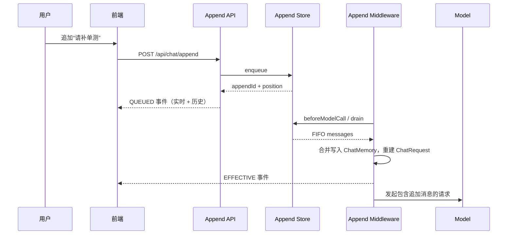
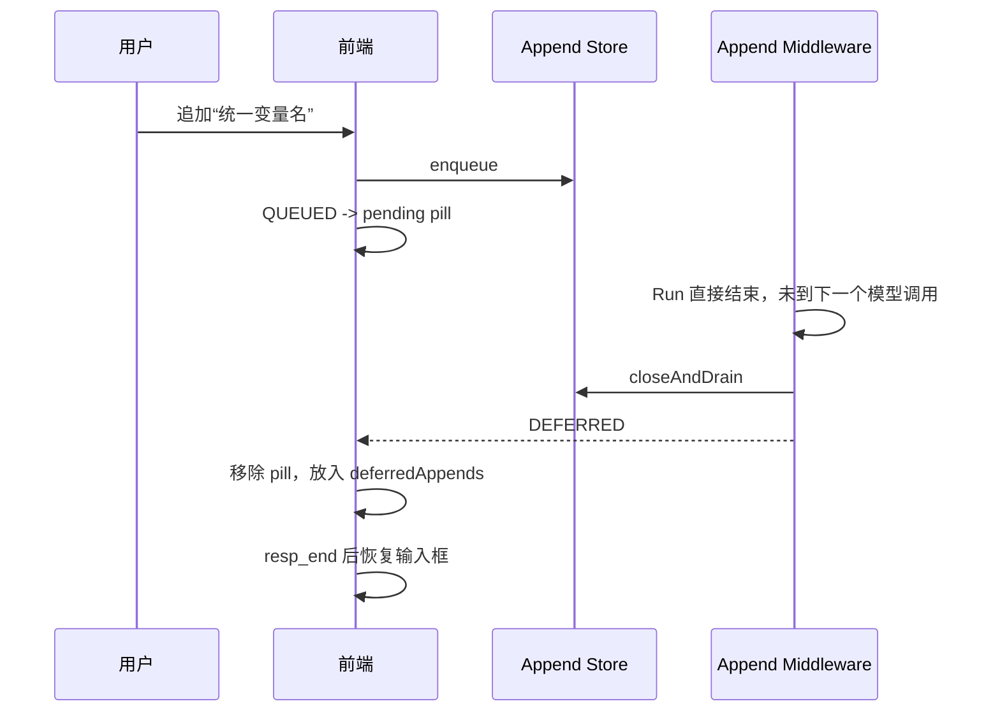

# AgentForge 运行时追加用户消息与插入 Agent Loop 设计与实现

> 文档定位：描述仓库当前已落地的实现（as-built），不是未来方案。
>
> 实现范围：`agentforge-agent-core` + `agentforge-service-web` + `agentforge-service-ui`。
>
> 当前边界：单进程运行态、MySQL/SQLite 持久化待处理队列、SSE 实时投递、HTTP 轮询恢复。
> Redis/多实例运行态、SSE 断线重连属于后续演进，文中会单独标注。

## 1. 背景与目标

ReAct Agent 在一次用户请求内会多次执行“模型思考 -> 工具调用 -> 再思考”。任务运行时间较长时，用户经常会在中途补充约束或纠正方向，例如：

- “不要改数据库表结构”；
- “修改完后请补单测”；
- “刚才的实现方向不对，改用 Redis”。

如果此时前端只能禁用输入框，用户只能等本轮结束后重新发一条消息，既丢失“补充上下文”的语义，也无法让当前 Run 立即看到新指令。

本能力要解决的问题是：

1. Agent 运行期间允许用户继续发送消息；
2. 追加消息**不启动新的 Agent Run**，而是在当前 Run 的下一个模型调用边界注入；
3. 追加消息既进入 `ChatMemory`，也进入这一次即将发起的 `ChatRequest`；
4. 用显式事件表达“已排队、已生效、未赶上、已取消”；
5. 实时流和历史重放使用同一套事件语义，刷新页面后页面状态可恢复；
6. 同一套中间件同时覆盖 `run/ask` 与 `runStream/stream`。

## 2. 关键设计前提

### 2.1 消费点在 beforeModelCall

AgentForge 已有完整的 `IAgentMiddleware` 生命周期，最合适的注入点是：

```java
ChatRequest beforeModelCall(
        int currentStep,
        ChatRequest chatRequest,
        AgentChatContext chatContext);
```

- 非流式：`ReActAgent.think()` 在每轮模型调用前触发；
- 流式：`ReActTokenStream` 在每轮发起 Streaming Model 请求前触发。

因此追加能力不需要修改 ReAct loop 主流程，只需要注册一个中间件。

### 2.2 必须重建 ChatRequest，不能只写 ChatMemory

非流式 `ReActAgent.think()` 的顺序是：

```text
chatMemory.messages()
    -> 构建不可变 ChatRequest
    -> triggerBeforeModelCall(...)
    -> chatModel.chat(processedRequest)
```

`ChatRequest` 在中间件执行前已经完成消息快照，且本身不可变。若中间件只写 `ChatMemory` 并原样返回 request：

```java
chatContext.getChatMemory().add(UserMessage.from(content));
return chatRequest;   // 错误
```

追加消息只会被“再下一次”新建的 request 看到。如果本轮模型直接 final，就会出现“后端发了 EFFECTIVE，但模型从未读到”的语义错误。

正确做法是写入记忆后返回重建的 request：

```java
ChatRequest rebuilt = ChatRequest.builder()
        .messages(chatContext.getChatMemory().messages())
        .parameters(request.parameters())
        .build();
return rebuilt;
```

由此得到稳定承诺：**`EFFECTIVE` 表示追加消息已写入记忆，且即将发起的这次模型请求一定包含它。**

### 2.3 Agent 实例与会话不是一对一

`AbstractAgentManager` 按 `aid + debug + channelId` 缓存 Agent，一个 `ReActAgent` 会被多个 session 复用。因此：

- 追加队列必须以 `memoryId/sessionId` 隔离，不能放在 Agent 实例的单一字段里；
- 同一 Agent 上的不同 session 可以并行，所有运行态结构都按 memoryId 分区；
- 追加窗口只属于“某一次 Run”，Run 结束必须关闭。

### 2.4 事件有实时与历史两个消费者

同一类过程事件同时进入：

- `ServiceStreamingMiddleware`：写入当前 session 绑定的 `SseEmitter`；
- `SessionLifecycleMiddleware`：收集到当前 AI 消息的 `events`，供历史重放。

所以追加事件不能只发 SSE，还必须进入 AI 消息的事件序列；否则刷新后“插入 Agent loop 的用户追加消息”会消失。

### 2.5 恢复必须由事件驱动，而不是由接口响应驱动

append 的 HTTP 响应只是一次命令回执（是否入队、appendId、队列位置），**不能作为页面状态来源**。页面展示必须由随后的事件序列推导：

- `QUEUED` 才出现等待 pill；
- `EFFECTIVE` 才进入 AI 消息的过程片段；
- `DEFERRED` 才恢复为草稿；
- `CANCELED` 才移除 pill。

为此前后端共用同一套状态机（见第 7 节）。

## 3. 总体架构

```text
前端运行中发送
    |
    | POST /api/chat/append
    v
UserMessageAppendController
    |
    | 校验 session 归属（aid + isDebug + createUserId）
    v
IUserMessageAppendService
    |
    v
UserMessageAppendStore ------------------------------+
    |                                                |
    +-- MysqlUserMessageAppendStore（默认）           |
    +-- InMemoryUserMessageAppendStore（测试/扩展）    |
                                                     |
ReAct loop -> UserMessageAppendMiddleware.beforeModelCall
                 | drain FIFO
                 | 合并为一条补充指令写入 ChatMemory
                 | 重建 ChatRequest
                 v
             EFFECTIVE event
                 |
                 v
     UserMessageAppendEventListener（core 接口）
                 |
                 v
  ServiceUserMessageAppendEventListener（service 实现）
                 |                         |
                 v                         v
     ServiceStreamingMiddleware   SessionLifecycleMiddleware
                 |                         |
                 v                         v
                SSE                 AI message.events（增量落库）
```

分层原则：

- `agentforge-agent-core` 只定义追加领域对象、Store、Service 门面、中间件和事件监听接口，不依赖 Spring/SSE/业务表；
- `agentforge-service-web` 负责会话校验、HTTP API、事件协议构建、双通道投递与增量落库；
- UI 只依据 appendId 与事件序列渲染，不通过 loading 状态猜消息状态。

## 4. Agent Core 实现

### 4.1 领域对象

`AppendedUserMessage`：

```java
public final class AppendedUserMessage {
    private final Long appendId;   // 持久化后由 Store 生成
    private final String content;
    private final long queuedAt;
}
```

`UserMessageAppendResult` 表达入队结果：

| Code | 含义 |
| --- | --- |
| `QUEUED` | 入队成功，返回 appendId 与队列位置 |
| `INVALID_ARGUMENT` | memoryId/content 非法 |
| `RUN_NOT_OPEN` | 当前 Run 尚未打开追加窗口 |
| `RUN_ALREADY_CLOSED` | 当前 Run 已结束 |
| `QUEUE_FULL` | 待处理队列达到上限 |

### 4.2 Store 接口

```java
public interface UserMessageAppendStore {
    boolean open(Object memoryId);
    UserMessageAppendResult enqueue(Object memoryId, AppendedUserMessage message);
    List<AppendedUserMessage> drain(Object memoryId);
    Optional<AppendedUserMessage> remove(Object memoryId, Long appendId);
    List<AppendedUserMessage> closeAndDrain(Object memoryId);
    void clear(Object memoryId);
    int size(Object memoryId);
}
```

生命周期：

```text
open -> enqueue / remove -> drain -> ... -> closeAndDrain
```

`AbstractUserMessageAppendStore` 统一实现：

- 每个 memoryId 一个 `RunState`（`ReentrantLock + open` 标记）；
- `open` 幂等，重复打开返回 false；
- `enqueue` 在窗口未开或已关闭时拒绝；
- 容量上限由子类构造参数决定；
- `drain` 按 FIFO 取走当前全部待处理消息，窗口保持开启；
- `remove` 只允许移除尚未消费的消息；
- `closeAndDrain` 原子关闭窗口并返回残留，重复关闭返回空列表；
- 跨 memoryId 互不影响。

实现：

- `InMemoryUserMessageAppendStore`：`ConcurrentHashMap<Object, ArrayDeque>`；
- `MysqlUserMessageAppendStore`：默认实现，最大待处理数 10。

### 4.3 Service 门面

`IUserMessageAppendService` 是 Agent 与 HTTP 入口共享的门面：

```java
boolean open(Object memoryId);
UserMessageAppendResult append(Object memoryId, String content);
List<AppendedUserMessage> drain(Object memoryId);
Optional<AppendedUserMessage> cancel(Object memoryId, Long appendId);
List<AppendedUserMessage> closeAndDrain(Object memoryId);
void clear(Object memoryId);
int size(Object memoryId);
```

`UserMessageAppendServiceImpl` 只做参数规整（`trim`）与事务包装，不承担业务语义。

### 4.4 UserMessageAppendMiddleware

这是核心中间件，负责“窗口打开、注入、关闭”三件事：

```java
public class UserMessageAppendMiddleware implements IAgentMiddleware {

    @Override
    public void onInitComplete(AgentChatContext context) {
        appendService.open(context.getMemoryId());
    }

    @Override
    public ChatRequest beforeModelCall(
            int currentStep, ChatRequest request, AgentChatContext context) {
        List<AppendedUserMessage> messages = appendService.drain(context.getMemoryId());
        if (messages.isEmpty()) return request;

        context.getChatMemory().add(UserMessage.from(mergeMessages(messages)));
        ChatRequest rebuilt = ChatRequest.builder()
                .messages(context.getChatMemory().messages())
                .parameters(request.parameters())
                .build();

        for (AppendedUserMessage message : messages) {
            eventListener.effective(context.getMemoryId(), message, currentStep);
        }
        return rebuilt;
    }

    @Override
    public void onStop(int currentStep, StopResult result, AgentChatContext context) {
        close(context);
    }

    @Override
    public void onStopWithError(int currentStep, Throwable error, AgentChatContext context) {
        close(context);
    }

    private void close(AgentChatContext context) {
        for (AppendedUserMessage message :
                appendService.closeAndDrain(context.getMemoryId())) {
            eventListener.deferred(context.getMemoryId(), message);
        }
    }
}
```

实现细节：

- 同一模型调用边界收到的多条追加会**合并为一条用户消息**，并附带运行期补充语义前缀，避免模型把多条指令理解成多轮对话；
- 只有 `ChatMemory.add` 与 request 重建完成后才发 `EFFECTIVE`，防止事件先于事实；
- `onStop`/`onStopWithError` 通过 `closeAndDrain` 收敛残留；`closeAndDrain` 幂等，不会重复发 `DEFERRED`；
- 流式路径的 `onStop` 由 `SessionLifecycleMiddleware`/`ServiceStreamingMiddleware` 的收口顺序保证：先 `DEFERRED`，再 `resp_end`，最后关闭 SSE。

### 4.5 中间件顺序

`ReActAgentFactory` 当前注册顺序：

```java
Arrays.asList(
        userMessageAppendMiddleware,   // 必须最前
        new LoggingIAgentMiddleware(),
        sessionLifecycleMiddleware,
        streamingMiddleware,
        agentTraceMiddleware);
```

原因：

1. 追加消息先进入 memory/request，log/trace 看到的是真实最终请求；
2. `onStop` 时先发 `DEFERRED`，再由 `ServiceStreamingMiddleware` 发 `resp_end` 并解绑，避免 `DEFERRED` 因 SSE 已关闭而丢失；
3. `onStop` 时先收集 `DEFERRED`，再由 `SessionLifecycleMiddleware` 完成最终事件落库。

## 5. Service 实现

### 5.1 组件装配

`UserMessageAppendConfiguration` 负责注册：

| Bean | 作用 |
| --- | --- |
| `UserMessageAppendStore` | 默认 `MysqlUserMessageAppendStore`，容量 10 |
| `UserMessageAppendEventListener` | `ServiceUserMessageAppendEventListener` |
| `UserMessageAppendMiddleware` | 复用 core 实现，作为 Service 扩展入口 |

### 5.2 持久化表

增量脚本：`sql/increment/1.0.x/20261104000000_v1.0.x.sql`、`sql/sqllite/1.0.x/...`。

`ai_agent_session_message_append`：

| 字段 | 说明 |
| --- | --- |
| `id` | 追加消息 ID，同时作为对外 `appendId` |
| `session_id` | 会话业务标识，等于 Agent 的 `memoryId` |
| `content` | 待插入 Agent Loop 的用户消息 |
| `status` | `1` 待生效、`2` 已生效、`3` 已延后、`4` 已取消 |
| `queued_at` | 入队时间 |
| `create_time` / `modify_time` | 审计时间 |

当前实现中待处理队列只保留 `QUEUED` 记录：

- 入队插入一条 `status=1`；
- `drain` 后直接删除记录；
- `remove` 只删除 `status=1` 的记录；
- `closeAndDrain` 删除残留并返回。

因此 `EFFECTIVE/DEFERRED/CANCELED` 的最终事实由 **AI 消息的 events** 承担，队列表只负责“待注入消息”。

Mapper：`UserMessageAppendMapper`，同时提供 MySQL 与 SQLite 两套 XML。

### 5.3 HTTP API 与权限校验

`UserMessageAppendController`：

```text
POST /api/chat/append
POST /api/chat/append/cancel
```

请求体公共字段：`aid`、`sessionId`、`isDebug`。

校验规则：

1. 会话存在；
2. `aid` 与会话一致；
3. `isDebug` 与会话 `is_debug` 一致；
4. `createUserId` 与会话创建人一致（当前阶段统一为 `1L`）。

`append` 成功返回：

```json
{"queued":true,"appendId":123,"queuePosition":1,"reason":null}
```

失败返回 `{"queued":false,"reason":"RUN_NOT_OPEN"}` 等。

`cancel` 成功返回 `{"canceled":true}`；若消息已生效、已延后或本轮已结束，返回：

```json
{"canceled":false,"reason":"ALREADY_EFFECTIVE_OR_TERMINAL"}
```

只有 Store 真正移除了消息，才向事件监听器发 `CANCELED`。

### 5.4 事件协议

`StreamEventEnums` 新增：

```java
USER_MESSAGE(
        "user_message",
        "运行时追加用户消息",
        TypeEnum.APPEND_QUEUED,
        TypeEnum.APPEND_EFFECTIVE,
        TypeEnum.APPEND_DEFERRED,
        TypeEnum.APPEND_CANCELED)
```

`UserMessageAppendStatus` 把状态映射为事件：

| status | 事件 type | isFinish |
| --- | --- | --- |
| `1` QUEUED | `append_queued` | false |
| `2` EFFECTIVE | `append_effective` | true |
| `3` DEFERRED | `append_deferred` | true |
| `4` CANCELED | `append_canceled` | true |

事件示例：

```json
{"event":"user_message","type":"append_queued","content":{"appendId":1,"content":"请补充单测","status":1,"queuePosition":1,"queuedAt":1793692800000,"eventAt":1793692800001},"isFinish":false}
{"event":"user_message","type":"append_effective","content":{"appendId":1,"content":"请补充单测","status":2,"effectiveStep":3,"queuedAt":1793692800000,"eventAt":1793692803500},"isFinish":true}
{"event":"user_message","type":"append_deferred","content":{"appendId":2,"content":"统一变量名","status":3,"queuedAt":1793692805000,"eventAt":1793692805100},"isFinish":true}
{"event":"user_message","type":"append_canceled","content":{"appendId":3,"content":"不再执行这条","status":4,"queuedAt":1793692806000,"eventAt":1793692806200},"isFinish":true}
```

`UserMessageAppendProcessor` 是唯一构造上述事件的地方，避免 Controller 与 Middleware 产生两种 JSON。

### 5.5 双通道投递

`ServiceUserMessageAppendEventListener` 同时投递：

```java
private void publish(Object memoryId, StreamEventResponse event) {
    streamingMiddleware.publish(memoryId, event);       // 实时 SSE
    lifecycleMiddleware.collectEvent(memoryId, event);  // 历史 events
}
```

- `QUEUED/CANCELED` 由 Controller 在 Store 操作成功后触发；
- `EFFECTIVE/DEFERRED` 由 Middleware 触发；
- 两个 sink 互不阻塞：SSE 断开不应影响历史收集，历史收集失败也不应阻断 Agent loop。

### 5.6 增量事件落库

为了让“运行中切到另一个页面/刷新”也能恢复，`SessionLifecycleMiddleware` 不再只在结束时写 events：

- 普通 `think/resp/tool_call`：按 `EVENT_PERSIST_INTERVAL_MS = 800ms` 节流写入 events 快照；
- append 的 `QUEUED/EFFECTIVE/DEFERRED/CANCELED` 以及 `retry`：通过 `collectEvent` **强制立即落库**；
- `finishState` 与增量写入共用 `synchronized (state)`，最终收口写完整 events，避免旧快照覆盖终态。

对应 Mapper：

```java
int updateEvents(
        @Param("id") Long id,
        @Param("events") String events,
        @Param("modifyTime") Date modifyTime);
```

这使其他页面在 Run 进行中调用 `session-messages/detail` 时，能拿到“截至最近一次落库”的部分事件序列。

### 5.7 Run 生命周期与 SSE 绑定

`ChatController` 的流式入口负责：

```java
final String sessionId = initResult.getSessionId();
streamingMiddleware.bind(sessionId, emitter);
activeStops.put(sessionId, () -> agentManager.cancel(agent, sessionId));

emitter.onCompletion(() -> streamingMiddleware.unbind(sessionId));
emitter.onTimeout(() -> streamingMiddleware.unbind(sessionId));
```

关键点：`JdkHttpTransport.executeStreaming` 是**异步**的，`start()` 会立即返回。因此：

- 不能在 `start()` 后立刻 `unbind`，否则流式期间所有事件都会丢失；
- `activeStops` 不能依赖 SSE completion 清理，否则客户端断开后无法从其他页面停止 Run；
- 正确做法是通过 TokenStream 的真实结束回调清理：

```java
agentManager.stream(agent, chatReq)
        .onCompleteResponse(response -> activeStops.remove(sessionId))
        .onError(error -> activeStops.remove(sessionId))
        .ignoreErrors()
        .start();
```

`streamingMiddleware.unbind` 只由 emitter 完成/超时触发；Run 结束由 `ServiceStreamingMiddleware.onStop/onStopWithError` 收口。

## 6. 前端实现

### 6.1 运行中 send 分流

发布页与调试面板统一：

```text
running == false -> POST /api/chat/stream，开启新 Run
running == true  -> POST /api/chat/append，追加到当前 Run
```

页面维护：

```js
pendingAppends: [{ appendId, content, queuePosition, queuedAt }]
deferredAppends: []
```

`sendAppend` 的 HTTP 响应只用于失败提示与清空输入框，**不直接生成 pending pill**；pill 由 `QUEUED` 事件驱动。

### 6.2 统一 reducer

`utils/appendEventReducer.js` 是实时与历史共用的状态机：

```js
reduceAppendEvent(state, answer, event)
```

| 事件 | 行为 |
| --- | --- |
| `QUEUED` | 按 appendId 去重后加入 `state.pendingAppends` |
| `EFFECTIVE` | 移出 pending，向 `answer.parts` 插入 `appended_user_message` |
| `DEFERRED` | 移出 pending，加入 `state.deferredAppends` |
| `CANCELED` | 仅移出 pending |

实时调用：

```js
case 'user_message':
  reduceAppendEvent(this, answer, event)
  break
```

历史重放也调用同一个函数，保证两套链路语义一致。

### 6.3 pending pill 与取消

输入框上方渲染 `append-queue`：

- 标题显示“后续指令 / N 条等待插入”；
- 每条 pill 显示内容、`第 N 位`、取消按钮；
- “第 N 位”由 `pendingAppends` 数组顺序推导，不直接使用事件里的 `queuePosition`，避免 drain 后位置过期；
- 取消调用 `/api/chat/append/cancel`，真正移除后由 `CANCELED` 事件移除 pill。

### 6.4 DEFERRED 草稿恢复

Run 结束时：

1. `DEFERRED` 事件把内容放入 `deferredAppends`；
2. 流结束后合并回输入框；
3. 不自动开启新一轮 Run，避免未经用户确认产生消费。

历史打开会话时也恢复：

- `replaySession(records)` 返回 `deferredAppends`；
- 只在“显式打开历史会话”时回填输入框；
- Run 结束后的 `loadSessions` 刷新不重复回填，避免内容重复。

### 6.5 历史重放

`utils/sessionReplay.js`：

```js
const { messages, pendingAppends, deferredAppends } = replaySession(records)
```

- `replayMessage` 逐条解析 `events`，`user_message` 交给同一个 reducer；
- 已完成的 Run 里 `pendingAppends` 正常为空：`QUEUED` 必然会有终态事件；
- 只有 `EFFECTIVE` 生成 `appended_user_message` 过程片段；
- `DEFERRED` 进入页面级草稿恢复；
- `CANCELED` 不生成展示。

### 6.6 跨页面恢复

Run 进行中打开另一个页面时：

1. `session-messages/detail` 返回增量落库的部分事件；
2. 最后一条 AI 消息 `status=2`（处理中）时，页面进入 running 状态；
3. 页面每 1.5s 轮询一次，刷新消息与 `pendingAppends`；
4. Run 结束后停止轮询，恢复 deferred 并刷新会话列表；
5. 此时发送消息会自动走 append 接口。

由于 `activeStops` 不再随 SSE 断开清理，恢复后的页面仍可以停止后台 Run。

### 6.7 运行中指示与重试提示

- 发布模式（`ElegantMessage`）与调试模式（`DebugMessage`）在 `status === 'running'` 时，**底部持续显示运行中指示**，即使已经输出部分正文；
- 出现重试时，`RetryNotice` 取代运行中指示，显示 `Retrying (第 x 轮 · n/m · Ns)` 并自行倒计时；
- 下一次 `think/resp/tool_call/resp_end/error` 到达时清除重试提示；
- 历史重放不生成重试提示，避免刷新后出现过期倒计时。

## 7. 关键时序

### 7.1 正常生效



### 7.2 未赶上本轮



### 7.3 取消与消费竞态

```text
cancel -> remove 成功 -> CANCELED -> 本轮模型不会看到该消息
cancel -> drain 已取走 -> cancel 返回 ALREADY_EFFECTIVE_OR_TERMINAL -> EFFECTIVE
```

同一 appendId 不会同时出现 `CANCELED` 与 `EFFECTIVE`。

## 8. 边界与已知限制

1. **追加窗口属于单次 Run**：`open` 在 `onInitComplete`，`closeAndDrain` 在 `onStop/onStopWithError`；窗口外追加返回 `RUN_NOT_OPEN`/`RUN_ALREADY_CLOSED`。
2. **容量上限 10**：`MysqlUserMessageAppendStore` 构造时固定，超出返回 `QUEUE_FULL`。
3. **取消只对 QUEUED 有效**：消息一旦被 drain，就无法撤回。
4. **事件才是最终事实**：队列表只保存待处理消息，drain 后立即删除；`EFFECTIVE/DEFERRED/CANCELED` 由 AI 消息 events 承担。
5. **增量落库是快照覆盖写**：当前每次写入完整 events JSON，超长 Run 存在写放大；后续可改为 append-only 事件行。
6. **跨页面恢复依赖轮询**：当前没有 SSE attach/重连协议；恢复页面通过 1.5s 轮询增量事件与 pending 状态。
7. **多实例仍未覆盖**：`AbstractUserMessageAppendStore` 的 open/lock 状态在进程内，MySQL 只持久化待处理行；多实例运行态需要 Redis 或数据库级锁/注册中心。
8. **恢复页面的历史重试提示不重建**：`retry` 事件会落库用于审计，但历史重放默认不渲染过期倒计时。

## 9. 落地文件

### 9.1 agentforge-agent-core

| 类型 | 文件 |
| --- | --- |
| 领域对象 | `extend/middlewares/append/domain/AppendedUserMessage`、`UserMessageAppendResult` |
| 事件接口 | `extend/middlewares/append/event/UserMessageAppendEventListener` |
| Service 门面 | `extend/middlewares/append/service/IUserMessageAppendService` |
| Store | `extend/middlewares/append/store/UserMessageAppendStore`、`AbstractUserMessageAppendStore`、`InMemoryUserMessageAppendStore` |
| 中间件 | `extend/middlewares/append/UserMessageAppendMiddleware` |

### 9.2 agentforge-service-web

| 类型 | 文件 |
| --- | --- |
| 装配 | `modules/agent/config/UserMessageAppendConfiguration` |
| 控制器 | `modules/agent/controller/UserMessageAppendController` |
| 门面实现 | `modules/agent/service/impl/UserMessageAppendServiceImpl` |
| 事件适配 | `modules/agent/service/ServiceUserMessageAppendEventListener` |
| Store 实现 | `modules/agent/store/MysqlUserMessageAppendStore` |
| 状态枚举 | `modules/agent/enums/UserMessageAppendStatus` |
| 事件构造 | `protocol/processor/append/UserMessageAppendProcessor` |
| 事件枚举 | `protocol/enums/StreamEventEnums`（`USER_MESSAGE` + `APPEND_*`） |
| Mapper | `modules/agent/dao/UserMessageAppendMapper` + MySQL/SQLite XML |
| 增量事件 | `modules/agent/middleware/SessionLifecycleMiddleware`（`collectEvent` + `updateEvents`） |
| 流式生命周期 | `web/ChatController`、`modules/agent/middleware/ServiceStreamingMiddleware` |
| 建表脚本 | `sql/increment/1.0.x/20261104000000_v1.0.x.sql`、`sql/sqllite/1.0.x/...` |

### 9.3 agentforge-service-ui

| 类型 | 文件 |
| --- | --- |
| 状态常量 | `utils/userMessageAppendStatus.js` |
| 统一 reducer | `utils/appendEventReducer.js` |
| 历史重放 | `utils/sessionReplay.js`（`replaySession`） |
| 过程片段 | `components/AppendedUserMessage.vue` |
| 重试提示 | `components/RetryNotice.vue` |
| 渲染模式 | `modes/debug/DebugMessage.vue`、`modes/elegant/ElegantMessage.vue` |
| 对话页面 | `pages/published/PublishedAgentChatPage.vue`、`pages/agents/AgentDebugPanel.vue` |
| 样式 | `styles/chat.css`（`append-queue`、`append-pill`） |

## 10. 测试

- `InMemoryUserMessageAppendStoreTest`：窗口状态、FIFO、容量、remove/close 幂等。
- `AgentRuntimeConfigResolverTest`：调试/正式配置解析不受影响。
- `AiRetryProcessorTest`：重试事件字段与时间换算。
- `ReActAgentStreamTest`：流式工具轮、错误、取消、重试。
- UI：`npm run build` 校验 SFC 与事件处理链路。

## 11. 后续演进

1. **事件持久化改为 append-only 行**：降低超长 Run 的快照写放大，并支持按 eventId 增量拉取。
2. **SSE attach/重连**：用 Run 级事件序号替代轮询，让恢复页面实时接续。
3. **多实例运行态**：Redis 窗口锁 + 待处理队列 + 活跃 Run 注册中心。
4. **更精确的取消结果**：持久化状态后，`cancel` 可区分 EFFECTIVE/DEFERRED/CANCELED/不存在。
5. **共享前端 append 控制器**：把两个页面的 append 逻辑收敛为一个 composable/mixin，进一步降低漂移风险。
