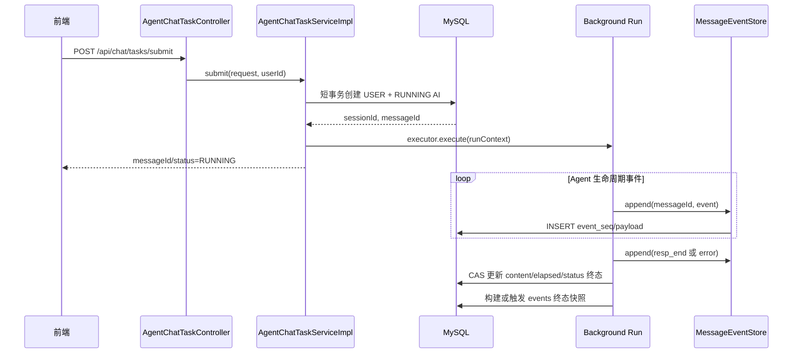

# AgentForge 流式对话支持重连二段式设计方案（MySQL 第一阶段）

## 一、设计结论与核心流程

### 1.1 一句话说明

AgentForge 将“启动 Agent 任务”和“消费流式事件”拆成两个独立阶段：提交接口只负责创建消息并启动后台 Run，订阅接口只负责从可重放事件存储读取事件并推送 SSE。页面刷新、网络断开或重新建立 SSE 都不会影响后台 Agent 的继续执行。

第一阶段使用 MySQL 表模拟可追加 Stream，同时提供仅用于本地开发的 InMemory 实现；后续可以将事件 Store/Sink 替换为 Redis Stream，而不改变 Controller、Agent Middleware、前端事件协议和重连状态机。

### 1.2 六步核心流程

1. 前端调用 `POST /api/chat/tasks/submit`，服务端创建 USER 消息和 AI 占位消息，返回 `messageId`。
2. `AgentChatTaskServiceImpl` 在线程池中启动 Agent Run，任务不持有页面的 `SseEmitter`。
3. `ServiceStreamingMiddleware` 将 Agent 生命周期回调统一转换成 `StreamEventResponse`。
4. 本轮 `StreamEventSink` 将事件写入当前配置的 `MessageEventStore`；MySQL 模式写入事件表，InMemory 模式写入进程内有序集合。
5. 前端调用 `GET /api/chat/tasks/stream?messageId=...&afterSeq=...`，独立消费者按游标读取事件并推送 SSE。
6. Agent 通过统一 `onStop` 收口：先写 `resp_end/error`，再根据 `StopResultState` 将消息更新为 `SUCCEEDED/FAILED/CANCELLED`，订阅端排空尾事件后结束。

```text
                        生产链（不依赖页面连接）
POST /api/chat/tasks/submit
        │
        ▼
创建 USER + AI 占位消息，返回 messageId
        │
        ▼
后台 Agent Run
        │ 生命周期回调
        ▼
ServiceStreamingMiddleware
        │ StreamEventResponse
        ▼
MessageEventFactory.createSink(messageId)
        ├─ mysql    → BufferedMessageEventSink → MysqlMessageEventStore
        └─ inmemory → InMemoryMessageEventSink → InMemoryMessageEventStore
        │
        ▼
最后事件落入 Store → message/session 更新终态

                        消费链（可反复连接）
GET /api/chat/tasks/stream?messageId=...&afterSeq=...
        │
        ▼
ReconnectableChatStreamService
        │ readAfter / awaitAfter
        ▼
按 eventSeq 推送 SSE → 断线重连 → 终态尾读 → 完成
```

### 1.3 三类状态的权威来源

| 数据 | 权威来源 | 作用 |
| --- | --- | --- |
| 任务状态 | `ai_agent_session_message.status` | 判断 RUNNING、SUCCEEDED、FAILED、CANCELLED |
| 运行期事件 | `MessageEventStore` | 可追加、可重放、支持每连接私有游标 |
| 历史展示 | `ai_agent_session_message.events/content` | 终态快照与会话历史详情 |

事件与状态的顺序必须保持：

```text
最后一条 resp_end/error 写入 Store
    happens-before
AI message 与 session 更新为终态
```

### 1.4 当前实现与后续扩展

| 能力 | 当前状态 | 后续方向 |
| --- | --- | --- |
| 二段式 submit/stream | 已实现 | 保持接口稳定 |
| MySQL 事件暂存 | 已实现 | 高并发时迁移 Redis Stream |
| InMemory Store/Sink | 已实现，仅本地开发 | 不用于多实例和可靠恢复 |
| Store/Sink Factory | 已实现，读取 `EnvironmentContext` | 注册 Redis Store/Sink |
| 取消收口 | 已复用统一 `onStop(CANCEL)` | 多实例取消需命令总线 |
| 终态快照 | 已实现基础快照 | 增强为 CAS、延迟清理与自愈 |
| Redis | 仅预留配置值，尚未实现 | 实现 `XADD/XREAD BLOCK/XRANGE/TTL` |

## 二、为什么需要新增事件表

当前实现已经具备会话消息与历史事件字段，但还不是可重连流：

| 当前实现 | 问题 | 本方案调整 |
| --- | --- | --- |
| `POST /api/chat/stream` 同时启动 Run 和返回 SSE | HTTP 连接生命周期与任务启动耦合，无法只重连订阅 | 拆成 `submit + stream` 两段 |
| `ServiceStreamingMiddleware` 原来只绑定 `SseEmitter` | 刷新会替换旧连接，任务输出与页面连接耦合 | Middleware 改为绑定统一 `StreamEventSink`，由 Sink 决定直推 SSE 或写事件 Store |
| `SessionLifecycleMiddleware.RunState` 在 JVM 内聚合事件 | 进程退出后未落库片段丢失 | 每条业务事件先写 MySQL 暂存表 |
| 每 800ms 将完整 JSON 数组重写到 `message.events` | 数据越长写放大越严重，且没有稳定游标 | 事件表按行追加，`events` 只保存终态快照 |
| 事件协议没有稳定事件序号 | 重放后前端难以严格去重 | 增加消息内 `eventSeq`，SSE `id` 使用 `event_seq` |
| `activeStops` 与运行态只在 Controller 内存 | 重连请求不能可靠识别任务；多实例 stop 有边界 | 状态以消息表为准；停止能力第一阶段明确为单实例限制 |

因此，这里确实需要新增一张表。它不是新的“任务表”，任务生命周期继续复用 `ai_agent_session_message.status`；新表只承担短期、可排序、可重放的事件日志。

## 三、目标与边界

### 3.1 第一阶段目标

| 目标 | 实现方式 |
| --- | --- |
| 页面刷新不终止 Agent Run | Run 在线程池中独立执行，不持有请求对象和 `SseEmitter` |
| 连接前事件不丢 | 业务事件先写 MySQL，再由 SSE 查询 |
| 断线后继续接收 | 使用 `messageId + afterSeq` 继续，缺少游标时从 0 重放 |
| 多窗口并发订阅 | 每条连接维护私有游标，不维护共享 ACK |
| 多实例可订阅 | 事件和消息状态均在 MySQL，订阅请求可落到任意实例 |
| 历史展示沿用现有结构 | 终态后仍写 `ai_agent_session_message.events` JSON 快照 |
| 将来平滑切换 Redis | 生产和消费均依赖 `MessageEventStore` 接口 |

### 3.2 明确边界

- 第一阶段保证“断开 SSE 不影响仍在运行的 JVM 后台任务”，不保证 JVM 崩溃后恢复模型调用。
- MySQL 轮询适合当前单机/低并发落地，不把它定义为高并发长远方案；达到容量阈值后将 `MessageEventStore` 切换到 Redis Stream。
- `stop` 的运行时 cancel handle 当前仍在本机内存，多实例下只能由启动 Run 的实例执行真正取消。MySQL 第一阶段可先保持单实例部署，或让网关按 `sessionId` 粘滞；跨实例停止另行引入命令表/消息总线。
- 不持久化 SSE 心跳。心跳是传输层行为，不属于业务事件，也不进入历史快照。
- 本方案不额外创建 task 表，不重复维护消息状态。

## 四、数据模型

### 4.1 现有消息表继续作为任务状态源

`ai_agent_session_message` 已有的字段可以直接承载任务生命周期：

| 字段 | 用途 |
| --- | --- |
| `id` | `messageId`，同时是一轮 Run 的任务 ID |
| `status` | `CREATED(1) / RUNNING(2) / FAILED(3) / CANCELLED(4) / SUCCEEDED(5)` |
| `started_at / finished_at / elapsed_ms` | 生命周期时间 |
| `content` | AI 最终正文 |
| `events` | 终态历史快照，不再用于运行期反复覆盖 |

提交成功前建议直接将 AI 占位消息置为 `RUNNING` 并写入 `started_at`，避免线程尚未真正启动时页面看到 `CREATED` 却无法判断是否应订阅。若后台线程提交失败，立即 CAS 收口为 `FAILED`。

### 4.2 新增 MySQL 事件暂存表

建议新增增量脚本并同时提供 SQLite 等价脚本：

```sql
CREATE TABLE IF NOT EXISTS `ai_agent_session_message_event` (
    `id`             BIGINT       NOT NULL AUTO_INCREMENT COMMENT '主键ID',
    `message_id`     BIGINT       NOT NULL COMMENT 'AI消息ID，同时是一轮Run ID',
    `event_seq`      BIGINT       NOT NULL COMMENT '消息内严格递增序号，从1开始',
    `event_type`     VARCHAR(32)  NOT NULL COMMENT '冗余事件大类，如resp/tool_call',
    `payload`        LONGTEXT     NOT NULL COMMENT 'StreamEventResponse完整JSON',
    `create_time`    DATETIME     NOT NULL DEFAULT CURRENT_TIMESTAMP COMMENT '创建时间',
    PRIMARY KEY (`id`),
    UNIQUE KEY `uk_message_seq` (`message_id`, `event_seq`),
    KEY `idx_message_id_id` (`message_id`, `id`)
) ENGINE=InnoDB DEFAULT CHARSET=utf8mb4 COLLATE=utf8mb4_general_ci
  COMMENT='Agent消息流式事件暂存表';
```

字段取舍：

| 字段 | 必要性 | 说明 |
| --- | --- | --- |
| `message_id` | 必须 | 查询和清理边界；必须是 AI 消息 |
| `event_seq` | 必须 | 对外稳定游标；不能直接把全局自增 `id` 当作消息内协议 |
| `event_type` | 建议 | 运维排查和统计方便，权威内容仍是 `payload` |
| `payload` | 必须 | 保存完整统一事件协议，禁止重建时改变字段 |
| `execution_id` | 第一阶段不加 | 当前不支持同一 `messageId` 原地重新生成；未来支持时应增加 generation/execution 维度 |

不建议把事件暂存做成 `message.events` 的字符串追加：MySQL 对 LONGTEXT 的并发追加没有天然逐事件幂等语义，查询无法稳定分页，且每次修改都会产生大字段写放大。

### 4.3 事件协议扩展

`StreamEventResponse` 增加一个字段：

```java
private Long eventSeq;      // append 成功后由存储层返回并回填
```

语义必须区分：

- `eventSeq`：一条消息内的读取游标和 SSE `id`，用于高效续读。
- `messageId + eventSeq`：单条事件的稳定身份，用于从头重放、DB 快照补发和前端幂等。
- `toolCallId`：工具卡片的业务聚合键；开始和完成事件可以共用一个 `toolCallId`，但拥有不同的 `eventSeq`。

### 4.4 序号分配

当前 Sink 在创建时读取一次 `maxSeq(messageId)`，随后在同步的 `publish/append` 临界区内递增 `nextSeq`，并依赖唯一键兜底。Agent 生命周期可能存在并发工具完成回调，因此同一轮事件必须经过同一个 Sink 实例串行执行：

```text
构造事件 → synchronized 分配 eventSeq → Store.append → Tailer 可见
```

不能在每次 append 时执行 `SELECT MAX(event_seq) + 1`；多线程或未来双执行会产生竞态。当前约束同一 `messageId` 只有一个生产 Sink；若未来允许多生产者，应增加 execution/generation 维度并使用原子序号或 Redis Stream ID。

## 五、对外接口

### 5.1 提交后台对话

```http
POST /api/chat/tasks/submit
Content-Type: application/json
```

请求体沿用 `ChatStreamRequest`：

```json
{
  "aid": "agent_xxx",
  "sessionId": "session_xxx",
  "message": "帮我分析这个问题",
  "isDebug": false
}
```

返回：

```json
{
  "sessionId": "session_xxx",
  "sessionPk": 12,
  "userMessageId": 101,
  "messageId": 102,
  "status": 2
}
```

提交事务：

1. 解析并固化 Agent 配置、用户 ID、debug 标识，不让后台线程读取 Web Request/ThreadLocal。
2. 在一个短事务内校验会话归属和运行状态，插入 USER 消息、AI `RUNNING` 占位消息。
3. 事务提交后构建 Agent 及 `AgentChatReq`，提交到受 Spring 管理的有界线程池。
4. 线程池拒绝或同步启动失败时，以 `WHERE status IN (CREATED,RUNNING)` CAS 将 AI 消息收口为 `FAILED`。
5. 成功提交后立即返回，客户端再建立订阅连接。

不能继续使用 Controller 内 `Executors.newCachedThreadPool()`；应提供独立 `ThreadPoolTaskExecutor`，配置核心线程、最大线程、队列长度、线程名前缀和拒绝策略，以便关闭时优雅等待与监控。

### 5.2 订阅/重连事件

```http
GET /api/chat/tasks/stream?messageId=102&afterSeq=0
Accept: text/event-stream
```

- `afterSeq` 可选，默认 `0`，服务端发送所有 `event_seq > afterSeq` 的事件。
- SSE 每条业务帧设置 `id: eventSeq`，浏览器原生 `EventSource` 重连时也可读取 `Last-Event-ID`；显式 `afterSeq` 优先级更高。
- 若页面刷新后前端无法证明本地已完整保留旧事件，则必须传 `0`，依靠 `messageId + eventSeq` 去重，不可盲目信任旧游标。
- 接口先校验消息角色为 AI、消息和会话未删除、会话属于当前用户。
- 该接口只消费事件，绝不能再次启动 Agent。

SSE 示例：

```text
id: 7
event: message
data: {"event":"resp","type":"text","content":"结果","isFinish":false,"eventSeq":7}

: heartbeat
```

### 5.3 停止接口

完整的同步等待、超时取消状态、CAS 和多实例扩展设计见同目录《AgentForge二段式流式对话停止与超时取消设计方案.md》。

保留：

```http
POST /api/chat/tasks/stop?messageId=102
```

二段式任务以 `messageId` 查找本机 cancel handle，再调用 `agent.cancel(memoryId)`。框架不增加独立 `onCancel`，而是复用统一停止回调：

```text
POST tasks/stop(messageId)
  → manager.cancel(agent, sessionId/memoryId)
  → ReAct Agent 检测取消标记
  → middleware.onStop(StopResultState.CANCEL, reason)
      ├─ ServiceStreamingMiddleware 写出唯一 resp_end 并关闭 Sink
      └─ SessionLifecycleMiddleware
           ├─ 历史事件补齐 resp_end
           ├─ AI message.status = CANCELLED
           └─ session.status = FINISHED
```

`StopResult.result` 只承载正常完成的最终结果，`StopResult.reason` 承载取消和最大步数等停止原因，避免原 `runRes` 字段混用两种语义。

当前 cancel handle 存放在启动 Run 的 JVM 内，因此停止能力仍有单实例边界；未来 Redis 多实例方案需要增加取消命令的跨实例通知，但消息状态收口仍复用上述 `onStop(CANCEL)` 主链路。

### 5.4 历史详情

`POST /api/agent/session-messages/detail` 保持不变，返回 `status/content/events`。页面恢复规则：

```text
先请求 detail 并渲染已有 events
    ├─ 最新 AI 消息 RUNNING：订阅 messageId
    ├─ 已终态但 events 为空：仍订阅，触发暂存事件补发/快照修复
    └─ 已终态且 events 完整：无需建立 SSE
```

## 六、核心扩展实现设计

本章是第一阶段实现的重点：MySQL 只负责“伪装成一条可追加、可按游标读取的 Stream”，不能让 MyBatis、轮询间隔或表字段渗透到业务主流程。业务核心只认识三种能力：追加事件、读取游标之后的事件、等待新事件或超时。

| 组件 | 职责 | 建议位置 |
| --- | --- | --- |
| `AgentChatController` | 统一承载一次性 invoke 与 legacy stream/stop，通过方法和 URL 区分 | `modules/agent/controller` |
| `AgentChatTaskController` | 提供 detached submit/stream/stop，不承载运行状态 | `modules/agent/controller` |
| `AgentChatTaskServiceImpl` | 会话初始化、后台任务提交、cancel handle 与启动失败收口 | `modules/agent/service/impl` |
| `MessageEventStore` | 事件追加、游标查询、快照查询、清理抽象 | `modules/agent/event/store` |
| `MysqlMessageEventStore` | MySQL 第一阶段实现 | `modules/agent/event/store/mysql` |
| `InMemoryMessageEventStore` | 本地开发使用的进程内实现，重启即丢失 | `modules/agent/event/store/memory` |
| `MessageEventFactory` | 根据 EnvironmentContext 成对选择 Store 与 Sink | `modules/agent/event/store` |
| `StreamEventSink` | Middleware 的统一事件出口，隔离事件生产与投递通道 | `modules/agent/event/sink` |
| `SseEmitterEventSink` | 封装 `SseEmitter`，供 legacy 模式直接推送 | `modules/agent/event/sink` |
| `BufferedMessageEventSink` | MySQL 模式生产出口，合并高频文本增量后写入 Store | `modules/agent/event/sink/store` |
| `InMemoryMessageEventSink` | InMemory 模式生产出口，即时写入内存 Store | `modules/agent/event/sink/memory` |
| `ReconnectableChatStreamService` | Store 尾读、SSE 推送、心跳和终态判断 | `modules/agent/service/impl` |
| `SessionLifecycleMiddleware` | 聚合正文、推进消息状态；不再周期性覆盖 events | 原位置改造 |
| `MessageEventSnapshotService` | 从 Store 生成终态 events 快照 | `modules/agent/service/impl` |

### 6.1 核心 SPI

```java
public interface MessageEventStore {
    StoredMessageEvent append(
            long messageId, long eventSeq, String eventType, String payload);

    List<StoredMessageEvent> readAfter(long messageId, long afterSeq, int limit);

    List<StoredMessageEvent> readAll(long messageId);

    long maxSeq(long messageId);

    void deleteByMessageId(long messageId);
}
```

为避免 SSE Service 自己判断底层到底是轮询还是阻塞读，再增加一个等待能力：

```java
public interface MessageEventTailer {
    /**
     * 返回 afterSeq 之后的一批事件；没有新事件时最多等待 timeout。
     * timeout 返回空集合，不代表流已经结束，是否结束只看消息终态。
     */
    List<StoredMessageEvent> awaitAfter(
        long messageId, long afterSeq, int limit, long waitMillis);
}
```

`ReconnectableChatStreamService` 只依赖 `MessageEventStore/MessageEventTailer`，不出现 MyBatis Mapper 或 RedisTemplate 等具体存储代码：

```java
public final class ReconnectableChatStreamService {
    private final MessageEventTailer eventTailer;
    private final MessageQueryService messageQueryService;
    private final MessageEventSnapshotService snapshotService;
}
```

具体实现对应关系：

| 核心语义 | MySQL 第一阶段（伪 Stream） | Redis 后续实现 |
| --- | --- | --- |
| `append` | `INSERT ai_agent_session_message_event` | `XADD message:{id}:events * ...` |
| `awaitAfter` | `SELECT event_seq > ?` + 自适应等待/本机唤醒 | `XREAD BLOCK ... STREAMS key cursor` |
| 私有游标 | `event_seq` | Redis record ID 或 payload 中的 `eventSeq` |
| 从头重放 | `afterSeq=0` | cursor=`0-0` |
| 保存期限 | 终态快照后延迟清理 | Stream TTL |
| 完整快照 | 按 `event_seq` 查询后序列化 | 从 `0-0` 排空后序列化 |

接口和领域对象放在核心包，实现放在适配器包：

```text
modules/agent/event
├── sink
│   ├── StreamEventSink.java
│   ├── SseEmitterEventSink.java
│   ├── memory/InMemoryMessageEventSink.java
│   └── store/BufferedMessageEventSink.java
└── store
    ├── MessageEventStore.java
    ├── MessageEventTailer.java
    ├── MessageEventFactory.java
    ├── StoredMessageEvent.java
    ├── memory/InMemoryMessageEventStore.java
    ├── mysql
    │   ├── MysqlMessageEventStore.java
    │   └── MessageEventMapper.java
    └── redis                     # 后续新增，不改上层调用方
        └── RedisMessageEventStore.java
```

接口不得暴露 MyBatis POJO、Redis record ID 或 `RedisTemplate`。`StoredMessageEvent` 是稳定领域对象，至少包含 `messageId/eventSeq/eventType/payload/createdAt`。

### 6.2 实现选择与配置

通过配置选择适配器，默认使用 MySQL：

```yaml
agentforge:
  chat:
    event-store:
      type: mysql       # mysql / inmemory；redis 名称预留但尚未实现
```

当前实际配置项只有 `type`；轮询、批大小、缓冲阈值和保留时间仍是实现常量，后续需要运维调优时再统一纳入 `EnvironmentContext`，不要在各组件中散落读取配置。

由 `EnvironmentContext#getChatEventStoreType` 读取配置，`MessageEventFactory` 成对创建 Store 与 Sink：

```java
mysql    -> MysqlMessageEventStore + BufferedMessageEventSink
inmemory -> InMemoryMessageEventStore + InMemoryMessageEventSink
redis    -> 预留，当前启动时给出未实现提示
```

切换 Redis 时只新增依赖与适配器、修改配置并迁移尚未结束的任务；Controller、后台 Run、统一事件协议、前端接口和重连算法均不改。为避免切换瞬间遗留 RUNNING 事件读不到，灰度期间要么等 MySQL 中所有 RUNNING 消息结束后再切换，要么提供只读 fallback：Redis 查空时对切换前的 messageId 回查 MySQL。

### 6.3 一个 Middleware、两种事件出口

参考灵瞳的 `StreamLyntonMiddleware + LyntonEventSink`，Agent 运行时只装配一套 `ServiceStreamingMiddleware`。Middleware 负责把生命周期回调转换成统一事件，具体投递交给本轮绑定的 `StreamEventSink`：

```text
Agent 生命周期回调
  → ServiceStreamingMiddleware（唯一事件转换器）
      → StreamEventSink
          ├─ legacy：SseEmitterEventSink → 浏览器
          └─ detached：MessageEventFactory.createSink → MessageEventStore

独立消费链
  ReconnectableChatStreamService
      → MessageEventStore.readAfter(cursor)
      → SseEmitter → 浏览器
```

legacy 请求把 `SseEmitterEventSink` 绑定到 Middleware；二段式提交从 `MessageEventFactory` 获取与 Store 匹配的 Sink 并绑定到同一个 Middleware。Agent 核心逻辑不感知 SSE、MySQL 或 Redis，也不存在两个 Middleware 重复转换同一生命周期事件的问题。

MySQL Sink 会把相邻且同类型的 `resp/text`、`think/text` 增量合并，达到条数、字符数或时间阈值后再 append。工具调用、错误、结束等边界事件到达时必须先 flush 文本缓冲，再立即写入边界事件；Sink 关闭时也必须 flush，保证尾部文本不丢失。该优化只减少暂存表写放大，不改变前端事件协议与顺序。

## 七、完整时序

### 7.1 提交与后台生产



生产不变量：

1. `INSERT event` 成功后才认为事件已发布。
2. 末尾控制事件成功写入后，消息才能进入终态。
3. SSE 是否在线不参与生产决策。
4. SSE 写失败只关闭该连接，不反向取消 Run。
5. 消息终态更新使用 `WHERE status = RUNNING` CAS，防止重复回调覆盖终态。

### 7.2 SSE 消费与重连

每个连接维护自己的 `cursor`；需要与历史快照合并时，以 `messageId + eventSeq` 作为已发送集合的键：

```text
cursor = request.afterSeq 或 Last-Event-ID 或 0

while 连接有效:
    batch = SELECT ...
            WHERE message_id = ? AND event_seq > cursor
            ORDER BY event_seq ASC LIMIT 100

    if batch 非空:
        逐条发送 SSE（id = event_seq）
        发送成功后 cursor = event_seq
        continue

    message = 查询 ai_agent_session_message
    if message.status == RUNNING/CREATED:
        发送心跳（到期时）
        等待 pollInterval 后继续
        continue

    // 已终态也不能立即结束，必须再做一次非阻塞尾读
    tail = readAfter(messageId, cursor)
    if tail 非空:
        继续发送并排空
        continue

    if message.events 有终态快照:
        按 eventSeq 补发本连接缺少的事件
    else:
        尝试从事件表生成快照并 CAS 写入 message.events
        CAS 失败则重读 DB 快照

    发送完成标志并 complete SSE
```

MySQL 没有 Redis `XREAD BLOCK`，建议使用自适应轮询：有数据时立即连续拉取；无数据时从 `100ms` 退避到 `500ms`，心跳间隔 `15s`。同实例可增加 `Condition/CompletableFuture` 本地唤醒以降低延迟，但数据库轮询仍是跨实例正确性的兜底，不能只依赖内存通知。

### 7.3 为什么终态后还要尾读

即使生产约束是“先事件、后终态”，订阅连接也可能先查到某次空结果，随后正好发生最后事件 INSERT 和终态 UPDATE。观察到终态后再次 `readAfter(cursor)`，可以覆盖查询时序窗口。建议将“最后事件 INSERT + 消息终态 UPDATE”放在同一短事务中，进一步保证其他事务不会只看到终态却看不到尾事件；大模型调用本身绝不能放进事务。

## 八、终态快照与清理策略

### 8.1 快照生成

历史详情继续使用 `ai_agent_session_message.events`，避免前端和既有接口同时改为逐行事件查询。快照由事件表按 `event_seq ASC` 读取后序列化为 JSON 数组。

当前 `MessageEventSnapshotService` 会从 Store 按序读取全部事件并更新 `message.events`；后台生产完成时主动生成一次，订阅者发现“终态但 events 为空”时再次自愈。

为了支持多实例并发订阅，后续应将普通 UPDATE 增强为以下 CAS SQL：

```sql
UPDATE ai_agent_session_message
SET events = :events,
    modify_time = CURRENT_TIMESTAMP
WHERE id = :messageId
  AND status IN (3, 4, 5)
  AND is_deleted = 0
  AND (events IS NULL OR events = '' OR events = '[]');
```

CAS 落地后，生产者和多个订阅者可同时尝试，最终只有一个写入，其他调用读取已存在快照即可。

### 8.2 不要立即物理删除

MySQL 第一阶段不建议 CAS 成功后立即删除事件行。原因是慢连接可能尚未读取尾部，而 `events` 补发虽能兜底，立即删除会增加并发状态机复杂度。

建议：

- 终态快照完成后保留暂存事件 24 小时（配置项）。
- 定时任务只删除“消息已终态、`events` 非空、且 `finished_at` 早于保留截止时间”的事件。
- 删除按主键/消息分批执行，单批例如 500～1000 行，避免长事务。
- 消息逻辑删除时可异步清理对应暂存事件；清理失败不影响业务正确性。

清理 SQL 的资格条件必须关联消息表，禁止仅凭事件 `create_time` 删除仍为 `RUNNING` 的长任务。

## 九、事务、并发与失败处理

| 场景 | 处理 |
| --- | --- |
| submit 事务失败 | 不启动后台任务，接口直接失败 |
| 线程池拒绝任务 | CAS 将 AI 消息收口 `FAILED`，返回明确失败或返回终态 messageId |
| 事件 INSERT 失败 | 当前 Run 转失败；尽力追加 error，若仍失败则直接 CAS 收口 FAILED |
| 客户端断开 | 只关闭当前 SSE；后台 Run 与事件行不受影响 |
| 多客户端订阅 | 各自持有 cursor，均为只读，不互相抢占/删除事件 |
| 多实例订阅 | 通过 MySQL 读取同一事件日志，语义一致 |
| 重复生命周期回调 | 发布器使用本地 finished 标志拒绝终止后的事件，消息终态使用 CAS 防重复收口 |
| 观察到终态但尾部未读 | 强制尾读直到空，再结束 SSE |
| `events` 快照写入竞争 | 条件 UPDATE CAS，失败者重读快照 |
| 快照生成失败 | 事件表仍在，历史接口或后续订阅可以重试自愈 |
| JVM 在运行中退出 | 消息可能遗留 RUNNING；超时扫描收口 FAILED，已写事件仍可重放 |
| JVM 在最后事件后、终态前退出 | 超时扫描根据状态收口；不要凭存在 resp_end 擅自标成功，除非协议明确携带最终状态 |

### 9.1 RUNNING 超时扫描

增加定时收口任务，按固定截止时间查询 `status IN (CREATED,RUNNING)` 且 `started_at/modify_time` 超时的 AI 消息，CAS 更新为 `FAILED`，错误原因为“服务异常退出或任务超时”。扫描器只负责状态收口，不尝试恢复模型 Run。

### 9.2 同一会话并发提交

`initChat` 需要在事务中阻止同一会话出现两个 `RUNNING` AI 消息。第一阶段可对 `ai_agent_session` 对应行 `SELECT ... FOR UPDATE`，锁内检查运行消息再分配 `seq_num` 和插入消息。这也同时解决当前 `MAX(seq_num)+1` 的并发竞争。

## 十、前端改造约定

1. 发送消息先调用 `/api/chat/tasks/submit`，拿到 `sessionId + messageId` 后建立 `/api/chat/tasks/stream`。
2. 前端状态以 `messageId` 隔离，不能继续只用 `sessionId` 标识当前 Run。
3. 每条事件先按 `messageId + eventSeq` 去重，再按事件业务键处理；工具卡片继续按 `toolCallId` 合并。
4. 正常网络短断线且页面内存仍在时，可用最后成功处理的 `eventSeq` 作为 `afterSeq`。
5. 页面刷新时先请求历史详情。若历史快照不完整，则从 `afterSeq=0` 重放并按 `messageId + eventSeq` 去重。
6. SSE 结束后重新拉取 detail，以 MySQL 终态 `status/content/events` 校准页面。
7. `heartbeat` 是 SSE 注释帧，前端无需进入业务 reducer。
8. 一个连接收到重复事件是允许的，丢事件不允许；因此 reducer 必须幂等。

## 十一、对现有代码的具体改造清单

| 现有位置 | 改造 |
| --- | --- |
| `modules/agent/controller/AgentChatController.java` | 合并一次性非流式调用与原 legacy 流式入口；`invoke`、`stream`、`stopStream` 名称明确区分 |
| `modules/agent/controller/AgentChatTaskController.java` | 提供 `/submit`、只读 `/stream` 与 `/stop` 二段式接口，仅负责 Web 协议适配 |
| `modules/agent/service/AgentChatTaskService` / `service/impl/AgentChatTaskServiceImpl` | 负责 Agent 初始化、后台任务提交、停止句柄和任务收口 |
| `modules/agent/service/LegacyChatStreamService` / `service/impl/LegacyChatStreamServiceImpl` | 承载旧版单请求 SSE 的业务实现，Controller 不直接编排 Agent Run |
| `middleware/ServiceStreamingMiddleware.java` | 保留统一事件转换职责，输出由本轮 `StreamEventSink` 决定 |
| `event/sink/StreamEventSink.java` | 定义事件生产出口，隔离 Middleware 与传输/存储实现 |
| `event/sink/SseEmitterEventSink.java` | 封装原始 `SseEmitter` 实时输出 |
| `event/store/MessageEventFactory.java` | 根据环境参数成对选择 Store/Sink，预留 Redis 分支 |
| `event/sink/store/BufferedMessageEventSink.java` | MySQL 生产端，合并高频增量并按 messageId/eventSeq 写入 EventStore |
| `event/sink/memory/InMemoryMessageEventSink.java` | InMemory 生产端，直接写入进程内 EventStore |
| `middleware/SessionLifecycleMiddleware.java` | 聚合 content/events，通过统一 `onStop` 将 NORMAL/CANCEL/MAX_STEPS 映射到消息与会话终态 |
| `protocol/StreamEventResponse.java` | 增加 `eventSeq` |
| `session/dao/AgentSessionMessageMapper` | 增加 `finishIfRunning`、`saveEventsIfAbsent`、超时扫描；弱化/删除运行期 `updateEvents` |
| `session/AgentSessionServiceImpl` | `initChat` 加会话行锁和运行消息检查，提交结果返回 user/AI messageId |
| 新增 `modules/agent/event` | 定义 EventStore、MySQL Mapper/POJO、Publisher |
| `service/impl/ReconnectableChatStreamService.java` | 管理每个 SSE 连接的私有 cursor、等待、心跳和尾读 |
| SQL increment / SQLite | 新增事件表、索引与对应 Mapper XML |
| UI `PublishedAgentChatPage` / `AgentDebugPanel` | 改成 submit 后订阅，以 `messageId + eventSeq` 去重并支持恢复 |

建议保留旧 `/api/chat/stream` 一段灰度期，但它应在内部调用 submit 后再桥接订阅，不能维持另一套直接推送实现。待前端全部切换后删除 legacy 路径。

## 十二、分阶段实施顺序

### 阶段 A：存储与协议

1. 新增事件表、POJO、Mapper 和 `MessageEventStore`。
2. 为协议增加 `eventSeq`。
3. 增加发布器并完成并发排序测试。

### 阶段 B：后台生产解耦

1. 新增 `/api/chat/tasks/submit` 和受管线程池。
2. 让事件统一写 MySQL，不依赖 SSE 在线。
3. 调整末尾事件与消息终态的提交顺序。

### 阶段 C：可重连消费

1. 新增只读 `/api/chat/tasks/stream` 和 Store Tailer 消费。
2. 实现私有游标、心跳、终态尾读、快照补齐。
3. 前端接入 submit/stream、去重与历史恢复。

### 阶段 D：自愈与运维

1. 增加终态快照 CAS、延迟清理任务。
2. 增加 RUNNING 超时扫描。
3. 补充指标、压测并确定切 Redis 的容量阈值。

## 十三、测试与验收

### 13.1 后端集成测试

1. submit 返回后立即断开客户端，Run 仍生成完整事件并进入终态。
2. 事件已产生一半后首次订阅，可以按 `event_seq` 从 1 收到全部事件。
3. 订阅中断后携带 `afterSeq` 重连，只收到后续事件。
4. 从 0 重放时每条事件的 `eventSeq` 与首次投递一致。
5. 两个客户端并发订阅同一 `messageId`，均收到完整有序事件。
6. 不同实例分别生产和订阅时仍能收到完整事件。
7. 并发工具回调下 `event_seq` 连续且唯一，没有乱序和重复。
8. 最后一条事件与终态紧邻时，消费者通过尾读拿到末尾事件。
9. 客户端写出失败只结束自身连接，不修改消息状态、不删除事件。
10. 多线程同时生成终态快照时只有一个 CAS 成功，最终 JSON 顺序正确。
11. 清理任务不删除 RUNNING 消息事件，只清理过期且已有快照的终态消息。
12. 线程池拒绝、事件 INSERT 失败、模型异常均能把消息收口到明确终态。
13. JVM 异常留下的 RUNNING 消息能被超时扫描收口。

### 13.2 前端验收

1. 连续刷新页面不会重复显示正文 token、工具卡片或 Todo/append 事件。
2. 多标签页同时打开同一会话，互不影响且都能完成。
3. 断网恢复后页面从最后游标继续；游标丢失时从头重放也能幂等还原。
4. 历史详情先到、SSE 重放后到时，最终 UI 与 `events` 快照一致。
5. 任务失败和取消均能停止 loading，并展示已产生的过程事件。

## 十四、Redis 持久化扩展设计

### 14.1 为什么 Redis 只应是适配器

当前生产链与消费链都依赖 `StreamEventSink + MessageEventStore + MessageEventTailer`，上层不感知 MySQL、内存或 Redis。这是后续切换 Redis 的关键：Redis 不是重新设计一套聊天流程，而是实现同一组事件日志语义。

Redis 实现必须继续满足：

1. 同一 `messageId` 内事件严格有序。
2. 连接前产生的事件可以从头重放。
3. 每个 SSE 连接维护自己的读取游标，不能使用会互相抢占的消费者组 ACK。
4. 生产者发布最后事件后，才能更新 MySQL 消息终态。
5. Redis 清理或过期后，MySQL `message.events` 仍是历史展示的权威快照。

### 14.2 Redis Stream 数据模型

```text
Key: agentforge:chat:message:{messageId}:events

XADD key *
  eventSeq   17
  eventType  resp
  payload    {完整 StreamEventResponse JSON}
  createdAt  1793980800000
```

建议继续把 `eventSeq` 放入 payload 和字段中：Redis record ID 用于高效 `XREAD`，`eventSeq` 继续作为前端协议和 MySQL 快照中的稳定序号。这样 Store 切换不会改变前端去重键 `messageId + eventSeq`。

不建议使用 Redis Consumer Group。这里是广播式重放，每个浏览器连接都应看到完整事件；Consumer Group 更适合多个消费者竞争处理同一条消息，会破坏多标签页独立重放语义。

### 14.3 需要新增的实现

```text
event/sink/redis/RedisMessageEventSink
  └─ 可直接调用 RedisMessageEventStore.append

event/store/redis/RedisMessageEventStore
  ├─ MessageEventStore
  │   ├─ append      → XADD
  │   ├─ readAfter   → XREAD 非阻塞
  │   ├─ readAll     → XRANGE
  │   ├─ maxSeq      → 读取尾记录中的 eventSeq
  │   └─ delete      → DEL
  └─ MessageEventTailer
      └─ awaitAfter  → XREAD BLOCK
```

`MessageEventFactory` 增加 redis 分支即可：

```java
mysql    -> MysqlMessageEventStore + BufferedMessageEventSink
inmemory -> InMemoryMessageEventStore + InMemoryMessageEventSink
redis    -> RedisMessageEventStore + RedisMessageEventSink
```

Controller、`AgentChatTaskServiceImpl`、`ServiceStreamingMiddleware`、`ReconnectableChatStreamService` 和前端均不需要感知变化。

### 14.4 TTL、快照和清理

- 每次 `XADD` 后刷新 Stream TTL，TTL 必须覆盖最长任务时间和允许重连窗口。
- 运行中的 Stream 不删除单条记录，避免慢连接或其他标签页丢事件。
- 消息终态并确认 `message.events` 快照完整后，可以删除 Stream；删除失败由 TTL 兜底。
- 无客户端在线时，生产者仍持续写 Stream，后续连接从 `0-0` 重放。
- Redis 数据不可作为永久历史；终态 MySQL 快照仍需要保留。

### 14.5 切换与灰度策略

配置保持统一：

```yaml
agentforge:
  chat:
    event-store:
      type: redis
```

当前代码已预留 `redis` 值，但在实现落地前选择它会启动失败并给出明确提示。正式实现后建议按以下方式灰度：

1. 等待 MySQL Store 中所有 RUNNING 消息结束，再切换新任务到 Redis；这是最简单可靠的方式。
2. 如果必须在线切换，为任务固化 `eventStoreType` 或 generation，保证同一轮 Run 的生产和消费始终访问同一 Store。
3. 灰度期可在 Redis 查空时对切换前的 RUNNING messageId 回查 MySQL，但 fallback 只能读，不能让同一任务向两个 Store 双写。
4. 回滚同理：先停止创建 Redis 新任务，等待已有 Redis Run 终态并快照完成，再恢复 MySQL。

### 14.6 监控与切换判断

至少记录以下指标：

- `chat_submit_total / chat_submit_rejected_total`
- 后台 Run 活跃数、队列长度、执行耗时
- `message_event_insert_total / failure_total / latency`
- SSE 活跃连接数、重连次数、单连接轮询次数、空轮询比例
- 事件从写入到推送的延迟 P50/P95/P99
- 单消息事件数量与 payload 字节数
- RUNNING 超时收口数量
- 快照生成失败与待清理事件行数

出现以下任一情况时，应优先实现 Redis：数据库空轮询持续造成明显 QPS 压力、P95 推送延迟无法接受、单机订阅数进入数百至上千、事件写入与业务事务争抢连接池。切换时仍保持 `messageId`、`eventSeq`、tasks/submit、tasks/stream 接口和消费状态机不变。

## 十五、必须保持的设计不变量

1. 任务生命周期属于 `ai_agent_session_message`，事件表不是任务表。
2. 后台 Run 与任意一个 SSE 连接的生命周期无关。
3. 每条业务事件先持久化，后推送；持久化失败不能假装已送达。
4. 每个订阅连接维护私有游标，不存在会被其他连接推进的共享消费位点。
5. 最后一条事件持久化发生在消息进入终态之前。
6. 观察到终态后必须排空尾部，再结束 SSE。
7. `messageId + eventSeq` 在首次写入、重放和历史快照中保持不变。
8. `message.events` 是终态历史快照，运行期不再频繁重写大 JSON。
9. 暂存事件只能延迟清理，且必须确认消息终态与快照完整。
10. 前端按至少一次投递设计：允许重复、不得依赖“绝不重复”。

