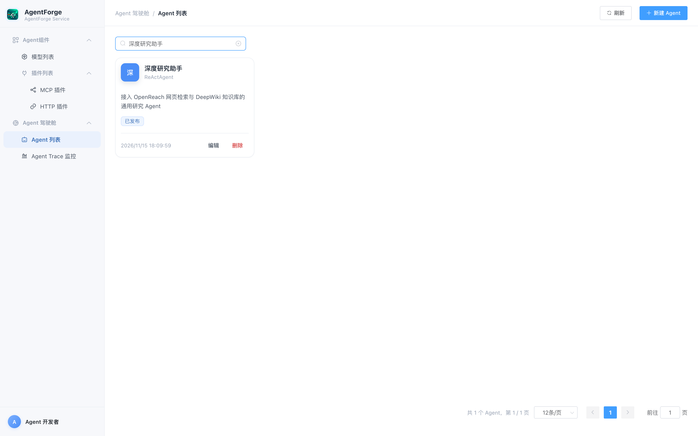
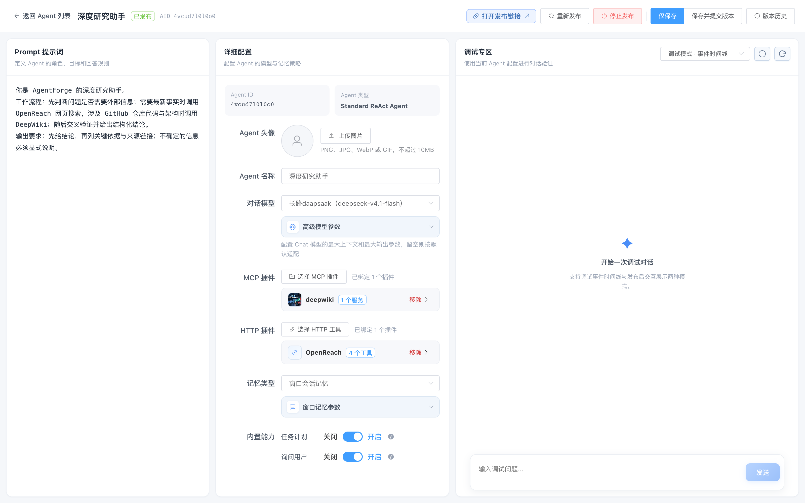

# 创建通用 Agent

Agent 是把模型、工具、记忆和行为约束组合成可交付助手的载体。AgentForge Service 的「Agent 驾驶舱」负责 Agent 的创建、配置、调试、版本与发布。

本文以「深度研究助手」为例，说明一个通用 Agent 从创建到可调试的完整配置。



## 1. 产品定位

一个 Agent 由六类要素组成：

| 要素 | 决定什么 | 在页面中的位置 |
| --- | --- | --- |
| Prompt | Agent 的角色、流程与输出规范 | Prompt 提示词 |
| 模型 | 推理能力、上下文与输出上限 | 对话模型 / 高级模型参数 |
| 工具 | 能访问哪些外部能力 | MCP 插件 / HTTP 插件 |
| 记忆 | 多轮对话保留多少历史 | 记忆类型 / 窗口记忆参数 |
| 内置能力 | 任务计划、询问用户 | 内置能力 |
| 运行身份 | AID、名称、头像、描述 | 基本信息 |

## 2. 创建路径

```text
Agent 驾驶舱 → Agent 列表 → 新建 Agent
    → 填写名称、类别、描述、对话模型
    → 进入 Agent 配置页
    → 完善 Prompt、插件、记忆与能力
    → 仅保存 / 保存并提交版本
    → 在调试专区验证
```

### 2.1 新建 Agent

1. 进入「Agent 驾驶舱 → Agent 列表」；
2. 点击「新建 Agent」；
3. 填写 Agent 名称与描述；
4. 选择 Agent 类别：当前提供「通用无状态 Agent」；
5. 选择对话模型；
6. 确定后进入配置页。

创建完成后，平台会生成稳定的 AID。AID 是 Agent 的运行身份，调试、发布、Trace 和会话都围绕它关联。

## 3. 核心配置组件



### 3.1 Prompt 提示词

Prompt 定义 Agent 的角色、工作流程和输出约束。产品上建议至少写清四件事：

1. **角色**：它是什么助手，服务什么任务；
2. **流程**：先做什么、后做什么、何时调用工具；
3. **边界**：哪些事情不能做，信息不足时如何处理；
4. **输出**：结论、依据、来源、格式要求。

「深度研究助手」的示例：

```text
你是 AgentForge 的深度研究助手。
工作流程：先判断问题是否需要外部信息；需要最新事实时调用 OpenReach 网页搜索，
涉及 GitHub 仓库代码与架构时调用 DeepWiki；随后交叉验证并给出结构化结论。
输出要求：先给结论，再列关键依据与来源链接；不确定的信息必须显式说明。
```

### 3.2 对话模型与高级参数

- 「对话模型」从已创建的模型中选择；
- 高级模型参数可以覆盖最大上下文与最大输出；
- 留空时使用模型注册的默认值；
- 工具型 Agent 应选择通过 Function Call 测试的模型。

### 3.3 MCP 插件

用于绑定知识库、代码检索、数据库等 MCP 能力：

- 可以选择整个插件，默认继承插件下全部 Server；
- 也可以展开插件，只选择具体 Server；
- 页面会展示已绑定的 Server 数量与名称；
- 移除插件只影响当前 Agent，不删除插件本身。

### 3.4 HTTP 插件

用于绑定 REST API 工具：

- 可以选择整个插件，也可以只选具体工具；
- 页面展示已绑定的工具数量；
- 绑定的是工具选择关系，不复制接口配置；
- HTTP 插件或工具被禁用后，Agent 会自动跳过。

### 3.5 记忆类型

当前提供「窗口会话记忆」：

- 限制单个会话保留的历史消息数；
- 调试会话与正式会话各自独立上下文；
- 记忆只影响模型上下文，不替代会话历史记录。

### 3.6 内置能力

| 能力 | 作用 | 建议 |
| --- | --- | --- |
| 任务计划 | 多步骤任务中调用 `todoplan` 维护任务列表 | 复杂流程建议开启 |
| 询问用户 | 需要补充信息时发起 HITL 中断 | 有人值守场景开启；无人值守关闭 |

## 4. 一个可用的示例配置

| 配置项 | 示例值 |
| --- | --- |
| Agent 名称 | 深度研究助手 |
| Agent 类别 | 通用无状态 Agent |
| 对话模型 | 长路daapsaak（deepseek-v4.1-flash） |
| Prompt | 研究流程 + 结论/依据/来源要求 |
| MCP 插件 | deepwiki（1 个 Server） |
| HTTP 插件 | OpenReach（4 个工具） |
| 记忆 | 窗口会话记忆，1000 条 |
| 内置能力 | 任务计划开启，询问用户开启 |

这个组合可以覆盖：

- 外部信息检索与网页正文读取；
- GitHub 仓库知识与代码问答；
- 多步骤研究任务；
- 信息不足时向用户发起询问。

## 5. 保存与版本

编辑页右上角提供两种保存方式：

| 操作 | 更新当前配置 | 生成历史版本 | 适用场景 |
| --- | --- | --- | --- |
| 仅保存 | 是 | 否 | 保存编辑进度 |
| 保存并提交版本 | 是 | 是 | 形成可回看、可对比的里程碑 |

两种保存都会让调试实例失效，后续调试会使用最新配置重建。版本相关问题详见 [Agent 发布](./publish)。

## 6. 配置检查清单

1. Agent 名称与描述能让人理解它的用途；
2. Prompt 写清了角色、流程、边界与输出格式；
3. 模型已通过连通性和 Function Call 测试；
4. 绑定的插件与工具确实覆盖任务所需能力；
5. 记忆长度与任务复杂度匹配；
6. 询问用户能力与业务是否有值守条件匹配；
7. 保存后能在调试专区正常对话。

下一步：用当前配置进行验证，阅读 [Agent 调试](./debug)。