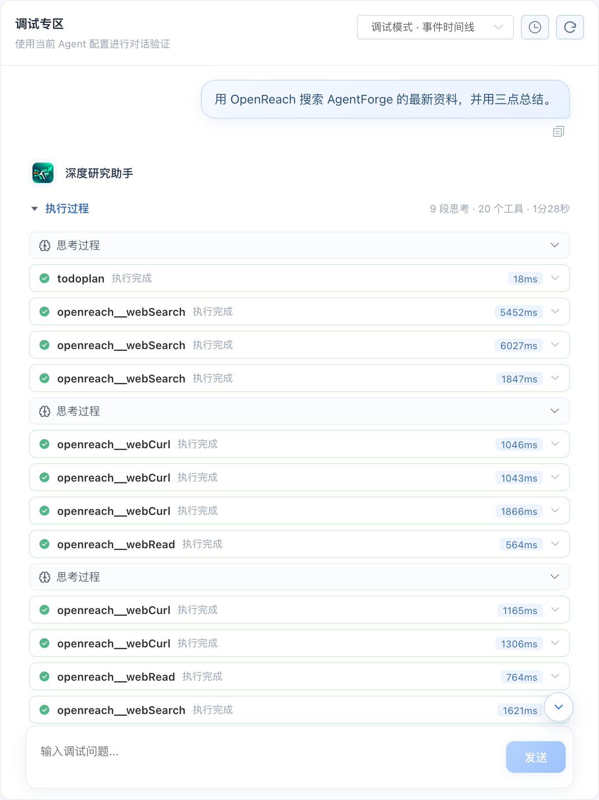
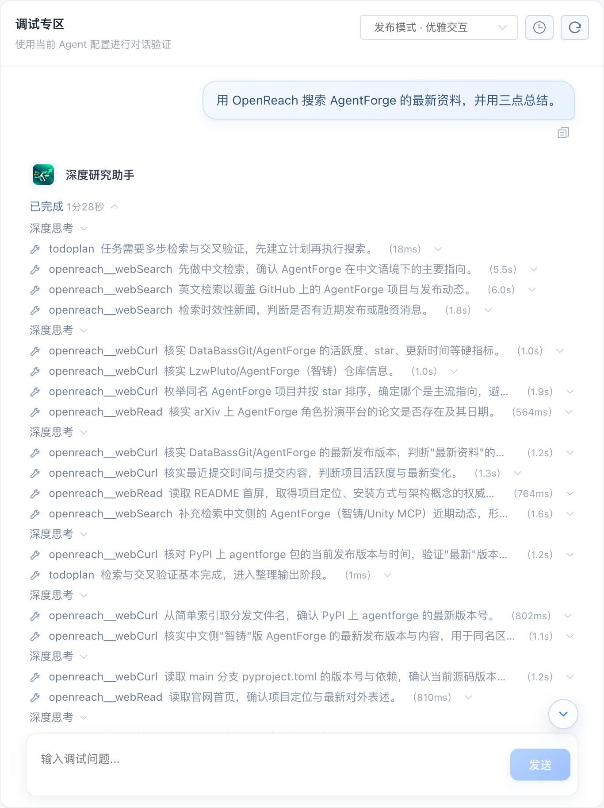

# Agent 调试

调试专区用于在发布前验证 Agent 的当前配置。它连接的是编辑中的 `ai_agent_config`，不是线上发布快照，因此可以放心修改、反复试错。

调试不是简单聊天窗口，而是把一次 ReAct 运行拆成可观察的思考、工具和回答过程。



## 1. 调试专区解决什么问题

- 验证 Prompt 是否能让模型按预期工作；
- 验证 HTTP / MCP 工具是否被正确选择与调用；
- 观察思考过程、工具参数、工具结果和耗时；
- 在发布前发现模型、工具或权限配置问题；
- 保留历史调试会话，支持回看和继续迭代。

适合的角色：Agent 开发者、产品经理、提示词工程师、测试人员。

## 2. 调试模式与发布模式的交互对比

调试专区提供两种渲染模式，它们消费同一份 SSE 事件和会话数据，但面向的读者不同：

| 模式 | 页面选项 | 面向对象 | 主要目的 |
| --- | --- | --- | --- |
| 调试模式 | 调试模式 · 事件时间线 | Agent 开发者、测试人员 | 看清模型思考、工具选择和参数结果 |
| 发布模式 | 发布模式 · 优雅交互 | 产品经理、最终用户 | 预览发布后的对话观感与信息密度 |

### 2.1 调试模式：把执行过程摊开


调试模式把一次运行拆成可检查的节点（截图中执行过程已展开）：

- 思考过程按段展开，可以看到模型为什么选择下一步；
- 工具卡片显示工具名、执行状态与耗时；
- 展开工具卡片可以查看参数和返回结果；
- 顶部汇总「X 段思考 · Y 个工具 · 总耗时」；
- 适合定位“为什么调错工具”“为什么参数不对”“时间花在哪里”。

### 2.2 发布模式：把执行过程收起来



发布模式使用与正式发布页一致的优雅交互（截图已手动展开执行过程，便于与调试模式对比）：

- 执行过程默认收起为一行「已完成 · 总耗时」；
- 用户可以先看最终答案，需要时再展开过程；
- 思考与工具以更轻量的条目展示，不抢占正文注意力；
- 不展示调试侧的重点标记和排查信息；
- 适合验收最终用户看到的阅读节奏与信息层级。

> 发布模式是编辑页里的“预览模式”，会话仍然是调试会话；真正的发布页使用独立正式会话，不包含调试模式切换、历史调试入口等开发控件。

### 2.3 交互差异对照

| 对比维度 | 调试模式 | 发布模式 |
| --- | --- | --- |
| 默认展开状态 | 运行中展开，完成后可收起 | 完成后默认收起 |
| 思考内容 | 分段完整展示 | 收纳在可展开过程里 |
| 工具调用 | 强调工具卡片、耗时与状态 | 轻量事件条目 |
| 工具参数与结果 | 可逐项展开检查 | 以用户可理解为先 |
| 页面辅助信息 | 思考段数、工具数、耗时 | 完成状态与总耗时 |
| 调试控件 | 模式切换、历史、新建会话、停止/追加 | 无调试控件 |
| 会话数据 | `is_debug=1` | 预览仍是调试会话；正式页为 `is_debug=0` |
| 典型问题 | “为什么这样调用？” | “用户看到的是什么样？” |

### 2.4 推荐使用节奏

```text
开发阶段：调试模式
    → 检查 Prompt、工具选择、参数与结果
    → 修复问题

验收阶段：发布模式
    → 检查答案可读性、过程收起后的信息密度
    → 确认最终用户体验

发布之后：正式发布页
    → 用真实用户会话再次验证
```

开发阶段建议使用事件时间线，验收阶段切换到发布模式，确认最终用户体验后再进入 [Agent 发布](./publish)。

## 3. 操作路径

```text
Agent 配置页 → 修改 Prompt / 插件 / 模型
    → 仅保存
    → 调试专区输入问题
    → 观察思考、工具调用与最终回答
    → 根据结果继续调整
    → 保存 → 保存并记录版本
```

### 3.1 发起调试

1. 在配置页右侧调试专区输入问题；
2. 点击「发送」；
3. 运行中按钮变为「停止」，可随时终止；
4. 运行中继续输入内容会作为「后续指令」排队，在下一轮生效；
5. 完成后展示执行过程与最终回答。

### 3.2 解读执行过程

一次运行可能包含：

| 元素 | 含义 |
| --- | --- |
| 思考过程 | 模型在每一步的推理片段 |
| 工具卡片 | 工具名、参数、结果、耗时与状态 |
| 执行过程摘要 | 思考段数与工具数量 |
| 最终回答 | 面向用户的 Markdown 内容 |

示例中，Agent 先调用 `todoplan` 规划任务，再连续调用 `openreach__webSearch`、`openreach__webRead` 与 `openreach__webCurl`，最后生成带来源的结论。

如果出现以下信号，说明配置需要调整：

- 工具没有被调用：检查 Prompt、工具描述、模型 Function Call 能力；
- 调用了错误工具：补充工具描述与选择规则；
- 工具参数错误：检查参数描述、必填项与类型；
- 回答缺少来源：在 Prompt 中明确输出格式；
- 反复重试或超时：检查模型、网络与工具接口。

### 3.3 停止与追加

- **停止**：结束当前运行，已产生的内容保留；
- **追加**：运行中发送补充指令，进入下一轮处理；
- 追加消息会进入队列，页面展示等待位置；
- 取消追加只取消尚未生效的指令。

## 4. 历史调试会话

调试专区右上角的时钟按钮打开「历史调试会话」。


产品能力：

- 每个 Agent 独立维护调试历史；
- 调试会话通过 `is_debug=1` 与正式会话隔离；
- 历史记录保存用户问题、AI 回答与 SSE 事件快照；
- 打开历史会话时按同一套事件协议重放思考、工具与回答；
- 运行中的会话可以重新接管并继续刷新；
- 新建会话不会删除历史。

这意味着：

1. 调试产生的会话不会出现在发布页用户的历史列表中；
2. 发布页的用户会话也不会干扰开发者排查；
3. 同一个 Agent 的调试历史可以长期保留，便于对比不同 Prompt 或插件配置。

### 4.1 什么时候使用历史

- 对比两次 Prompt 调整的效果；
- 复现某个失败对话；
- 找回调试中验证过的工具调用；
- 让其他同事查看问题现场；
- 从历史会话继续补充问题。

## 5. 调试与发布的关系

| 维度 | 调试 | 发布 |
| --- | --- | --- |
| 数据源 | `ai_agent_config` 当前配置 | `ai_agent_config_published` 发布快照 |
| 会话类型 | `is_debug=1` | `is_debug=0` |
| 影响线上用户 | 不影响 | 直接影响 |
| 配置变更 | 保存后生效，调试实例重建 | 需要重新发布 |

调试通过不代表可以跳过发布流程。确认配置后，仍需要「保存 → 保存并记录版本」和「发布」。

## 6. 产品化调试建议

1. **每次只改一个变量**：Prompt、模型、工具分开验证；
2. **用固定问题集回归**：覆盖正常、缺信息、工具失败和边界场景；
3. **先看工具卡片再看最终回答**：最终回答可能掩盖工具错误；
4. **保存关键里程碑版本**：避免调试结果无法复现；
5. **验收时切到优雅模式**：确认最终用户看到的内容可读；
6. **复杂问题开启任务计划**：便于观察多步骤执行。

## 7. 验收清单

1. 当前配置已保存；
2. 调试对话能正常返回；
3. 思考过程和工具调用可见；
4. HTTP / MCP 工具按预期被选择；
5. 停止与追加行为符合预期；
6. 历史调试会话可以打开并重放；
7. 调试会话不出现在发布页历史中。

下一步：把验证通过的配置固化为版本并发布，阅读 [Agent 发布](./publish)。