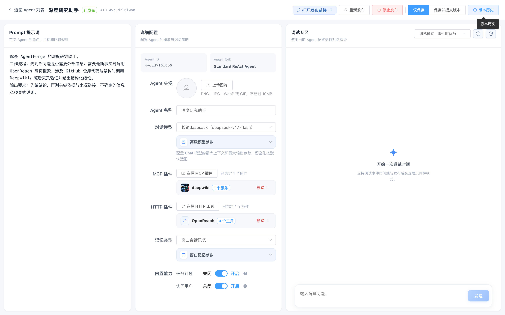
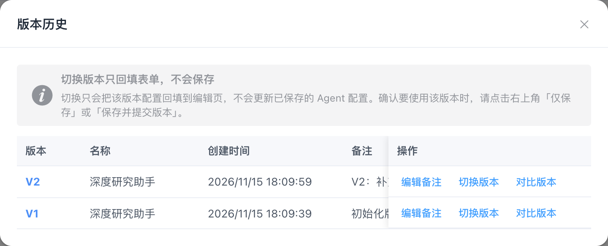
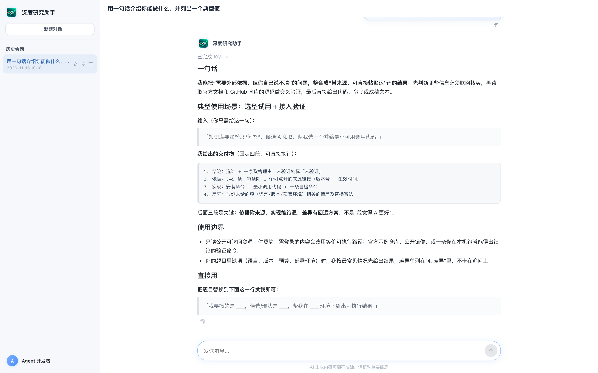

# Agent 发布

Agent 发布的核心动作，是把**当前最新的 Agent 配置复制一份为独立的发布配置**。发布后，正式对话不再读取编辑页配置，而是按 AID 读取这份发布快照来初始化 Agent。

这里最容易混淆的是三个概念：当前配置、历史版本、发布快照。理解它们的关系，才能正确使用「保存」弹窗中的「仅保存」「保存并记录版本」和「发布」。发布之后，每个 Agent 本身就是一个独立门户：拥有自己的链接、身份、配置和正式会话历史。



## 1. 三个概念的区别

| 概念 | 存储位置 | 作用 | 何时变化 |
| --- | --- | --- | --- |
| 当前配置 | `ai_agent_config` | 编辑页正在维护的最新配置 | 每次保存 |
| 历史版本 | `ai_agent_config_version` | 可回看、可对比的配置快照 | 保存并记录版本 |
| 发布快照 | `ai_agent_config_published` | 线上实际运行的配置 | 发布 / 重新发布 |

三者的关系：

```text
编辑页
  ├── 仅保存 ───────────────→ 更新当前配置
  ├── 保存并记录版本 ───────→ 更新当前配置 + 新增历史版本
  └── 发布 ─────────────────→ 用当前配置覆盖发布快照
```

关键结论：**发布始终以当前最新配置为准，不要求先选择某个历史版本。**

> 发布不是给当前配置打一个“已发布”标记，而是把最新配置复制成一份独立的发布配置。编辑页后续怎么改，都不会影响线上，直到再次发布。

## 2. 保存方式

编辑页右上角只有一个「保存」按钮，点击后弹出保存方式确认框，其中提供三个按钮：

| 按钮 | 更新当前配置 | 生成历史版本 | 适用场景 |
| --- | --- | --- | --- |
| 仅保存 | 是 | 否 | 调整中、频繁保存 |
| 保存并记录版本 | 是 | 是，版本号 +1 | 形成里程碑、准备发布 |
| 取消 | 否 | 否 | 放弃本次保存 |

选择「保存并记录版本」后会再弹出一个独立窗口填写版本备注（选填），备注写入历史版本，最多 1024 字符，提交后仍可编辑。点「取消」则不保存。

「仅保存」和「保存并记录版本」都会使调试实例失效，后续调试使用最新配置重建。

## 3. 版本历史

点击「版本历史」查看历史快照：



每个版本展示：

- 版本号：V1、V2、V3……；
- 版本名称；
- 创建时间；
- 版本备注；
- 操作：编辑备注、切换版本、对比版本。

### 3.1 切换版本

切换版本只把历史配置回填到编辑页：

- 不更新当前配置；
- 不生成新版本；
- 不影响发布快照；
- 不影响正在运行的正式 Agent。

切换后如果确认使用该配置，仍需点击右上角「保存」，再选择「仅保存」或「保存并记录版本」。

### 3.2 对比版本

「对比版本」用左右镜像展示历史版本与当前最新配置：

- 对比 Prompt、名称、描述、模型与记忆配置；
- 不一致字段显示红色边框与「存在差异」；
- 顶部展示差异总数；
- 全部一致时提示「两侧配置完全一致」。

版本对比是纯只读操作，不修改任何数据。

## 4. 发布流程

1. 确认调试通过；
2. 点击右上角「保存」，在弹窗中选择「保存并记录版本」，在随后弹出的窗口中填写版本备注（可留空）；
3. 点击右上角「发布」；
4. 发布成功后页面显示「已发布」与最新发布时间；
5. 点击「打开发布链接」进入正式对话页。

发布动作会：

- 把当前配置复制到发布快照；
- 刷新最新发布时间；
- 删除旧的发布记录后整体写入新快照；
- 清理正式 Agent 运行时缓存；
- 保持编辑配置和历史版本不变。

### 4.1 重新发布

配置更新后，已发布 Agent 会显示「重新发布」：

- 重新发布使用当前最新配置；
- 不需要选择历史版本；
- 重新发布后新的正式对话使用新快照；
- 已存在的正式会话历史仍保留。

### 4.2 停止发布

「停止发布」会：

- 取消发布状态；
- 删除发布快照；
- 清理正式运行实例；
- 保留编辑配置与历史版本。

停止发布后，发布链接不再提供正式对话服务。

### 4.3 正式对话如何读取发布配置

发布后的对话不会读取编辑中的 `ai_agent_config`，而是按 AID 读取 `ai_agent_config_published`：

```text
用户打开 /agent/published/{aid}
    → 按 aid 查询发布配置
    → 读取 Prompt、模型、HTTP/MCP 插件、记忆与能力配置
    → 初始化或复用正式 Agent 实例
    → 创建正式会话（is_debug=0）
    → 开始对话
```

这带来三个直接结果：

1. **编辑与线上隔离**：编辑页继续修改配置，不会改变已发布门户的行为；
2. **发布即切换**：重新发布后，后续正式对话使用新的发布配置；
3. **缓存可重建**：发布或停止发布会清理正式实例缓存，下一次对话按最新发布配置重新初始化。

已有正式会话的消息历史会保留，但后续对话所读取的 Agent 配置以当前发布快照为准。

## 5. 每个 Agent 就是一个门户

发布后的 Agent 不只是一个接口，而是一个独立门户：

```text
Agent 门户
  ├── 独立入口：/agent/published/{aid}
  ├── 独立身份：名称、头像、描述、AID
  ├── 独立能力：Prompt、模型、HTTP/MCP 插件、记忆
  ├── 独立会话：正式会话历史与继续对话
  └── 独立生命周期：发布、重新发布、停止发布
```



| 门户维度 | 表现 |
| --- | --- |
| 入口 | 每个 Agent 有稳定发布链接，可直接分享或嵌入 |
| 身份 | 名称、头像、描述面向最终用户展示 |
| 能力 | 只暴露对话，不暴露 Prompt、插件配置与调试控件 |
| 数据 | 正式会话与调试会话隔离 |
| 更新 | 重新发布后，门户背后切换到新的发布配置 |
| 关闭 | 停止发布后，门户停止提供正式对话 |

因此，多个 Agent 就是多个门户：

- 客服 Agent 是一个客服门户；
- 研究 Agent 是一个研究门户；
- 运维 Agent 是一个运维门户。

它们共享同一个 Service 平台、同一套模型与插件基础设施，但各自拥有独立的配置、会话和发布节奏。

## 6. 发布页体验

发布链接进入标准对话页。产品能力：

- 独立的正式会话历史；
- 支持流式回答、Markdown、工具调用展示；
- 会话标题、历史列表与继续对话；
- 与调试会话完全隔离；
- 同一 AID 的正式会话围绕发布快照运行。

发布页不展示 Prompt、插件配置或调试信息，只展示面向最终用户的对话体验。

## 7. 版本与发布的关系

常见误区：

| 误区 | 正确理解 |
| --- | --- |
| 发布前必须选择某个版本 | 发布使用当前最新配置，版本只是历史快照 |
| 切换版本就等于发布 | 切换只回填表单，不保存、不发布 |
| 发布后编辑配置会立即生效 | 编辑配置需要重新发布才会更新线上快照 |
| 停止发布会删除历史版本 | 停止发布只删除发布快照，历史版本保留 |
| 仅保存也会生成版本 | 仅保存不生成历史版本 |

## 8. 发布前检查清单

1. 当前配置已通过调试；
2. Prompt 不包含内部调试信息或敏感内容；
3. 模型与插件状态正常；
4. 工具描述不会误导模型；
5. 版本备注能说明本次变更；
6. 发布后打开链接完成一次真实对话；
7. 确认正式会话历史与调试历史相互隔离。

下一步：通过 Trace 观察线上运行的模型与工具耗时，阅读 [Agent Trace 监控](../agent-infrastructure/trace)。