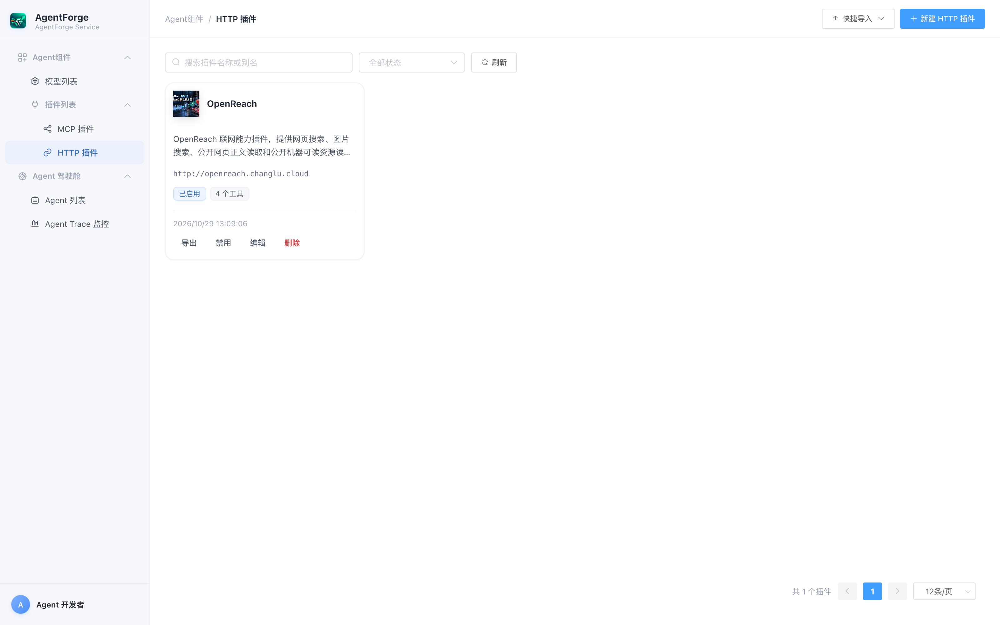
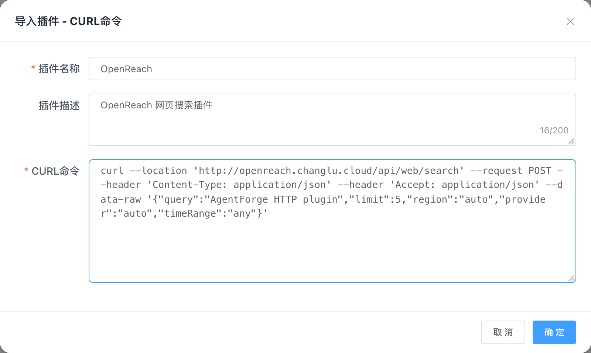
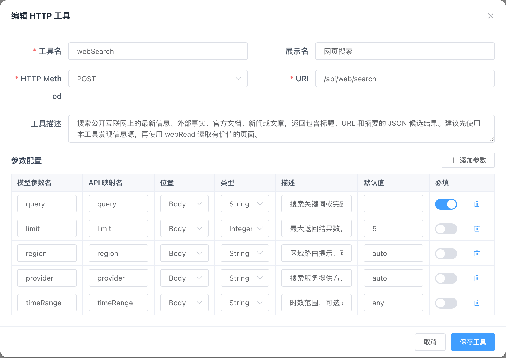
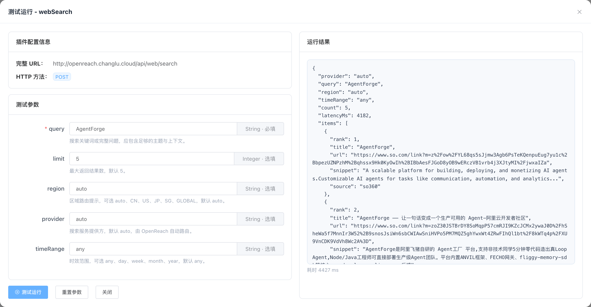
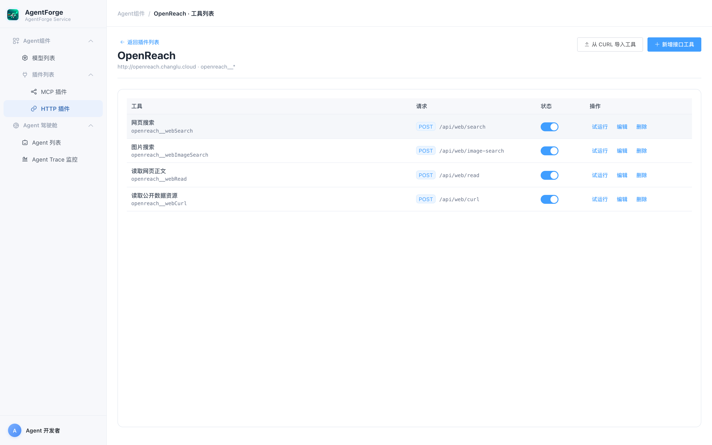

# 创建 HTTP 插件

HTTP 插件把已有 HTTP API 转换为模型可调用的 Function Call。插件负责描述「服务地址与公共请求头」，工具方法负责描述「一个具体接口如何被调用」。

本文以 OpenReach 网页搜索服务为例，演示插件创建、工具方法和 Agent 绑定。



## 1. 背景：一个 Base URL 下的多个接口如何进入 Agent

企业内部系统通常以「一个服务地址 + 多个接口」的方式提供能力，例如 OpenReach：

```text
http://openreach.changlu.cloud
├── POST /api/web/search
├── POST /api/web/image-search
├── POST /api/web/read
└── POST /api/web/curl
```

模型无法直接理解这些 HTTP 接口，需要把每个接口转换成可调用的 Function Call。HTTP 插件就是这层转换与管理系统：

```text
Base URL + 静态 Headers
        │
        ▼
HTTP 插件
  ├── 工具方法：/api/web/search → openreach__webSearch
  ├── 工具方法：/api/web/image-search → openreach__webImageSearch
  ├── 工具方法：/api/web/read → openreach__webRead
  └── 工具方法：/api/web/curl → openreach__webCurl
        │
        ▼ 绑定选择关系
Agent 插件系统 → Agent 配置 → 模型 Function Call
```

插件化的三个关键点：

1. **同域接口统一管理**：一个 Base URL 与共享 Headers 只配置一次；
2. **每个接口独立成工具**：Method、URI、参数和描述独立维护；
3. **Agent 只保存选择关系**：Agent 绑定 `pluginId + methodIds`，接口配置修改后不需要重新改 Agent 结构；禁用工具后 Agent 自动跳过。

## 2. 这个页面解决什么问题

- 不写代码，把 REST API 变成 Agent 工具；
- 用插件 + 方法 + 参数三层结构管理接口；
- 通过 CURL 或 JSON 快速导入，减少手工录入；
- 在绑定 Agent 前直接试运行，先验证接口再交付。

适合的角色：需要接入企业 API、SaaS 服务、内部微服务的产品与研发团队。

## 3. 三个核心概念

| 层级 | 作用 | 示例 |
| --- | --- | --- |
| 插件 | 一个同域服务的集合，保存 Base URL 与静态 Headers | `OpenReach` |
| 工具方法 | 插件下的一个接口，定义 Method、URI 与参数 | `webSearch` |
| 参数 | 工具方法暴露给模型的输入 | `query`、`limit`、`region` |

最终工具名为：

```text
插件别名__方法名
openreach__webSearch
```

## 4. 操作路径

```text
Agent组件 → HTTP 插件 → 新建 HTTP 插件
    → 填写插件名称、别名、Base URL、静态 Headers
    → 在插件详情中新增接口工具
    → 配置参数映射
    → 试运行
    → 在 Agent 配置中绑定插件与工具
```

### 3.1 创建插件

1. 进入「Agent组件 → HTTP 插件」；
2. 点击「新建 HTTP 插件」；
3. 填写名称、别名、Base URL 和静态 Headers；
4. 保存后进入插件详情。

| 字段 | 说明 |
| --- | --- |
| 插件名称 | 面向人的名称，例如 `OpenReach` |
| 插件别名 | 工具名前缀，例如 `openreach`，创建后不建议修改 |
| Base URL | 同域服务根地址，例如 `http://openreach.changlu.cloud` |
| 静态 Headers | 所有工具共享的请求头，例如 `Content-Type`、`Authorization` |
| 描述 | 说明插件能力与适用场景 |

### 3.2 使用 CURL 快速导入

如果接口已经有可用的 CURL 命令，可以直接导入：

1. 在列表页点击「快捷导入 → 一键 CURL 导入」；
2. 填写插件名称与描述；
3. 粘贴 CURL；
4. 确认导入。

OpenReach 示例：

```bash
curl --location 'http://openreach.changlu.cloud/api/web/search' \
  --request POST \
  --header 'Content-Type: application/json' \
  --header 'Accept: application/json' \
  --data-raw '{"query":"AgentForge HTTP plugin","limit":5,"region":"auto","provider":"auto","timeRange":"any"}'
```

导入后会自动生成插件与工具参数。建议再进入工具编辑页，把 `query` 设为必填、清空示例默认值，并补充参数说明。



### 3.3 配置工具方法

在插件详情中点击「新增接口工具」，配置：

| 字段 | 说明 |
| --- | --- |
| 工具名 | 插件内唯一，最终拼成 `alias__methodName` |
| 展示名 | 页面展示名称 |
| HTTP Method | GET / POST / PUT / DELETE / PATCH |
| URI | 相对 Base URL 的路径，例如 `/api/web/search` |
| 工具描述 | 告诉模型何时调用该工具 |
| 参数配置 | 模型参数名、API 映射名、位置、类型、必填、默认值与描述 |

参数位置支持：

```text
Query / Body / Path / Header
```

参数类型支持：

```text
String / Integer / Number / Boolean / Array / Object
```



工具编辑页把「模型看到的参数」和「接口实际需要的参数」分开：

| 列 | 作用 |
| --- | --- |
| 模型参数名 | 暴露给模型的参数名，也是 Function Call 中的 key |
| API 映射名 | 映射到接口实际字段名；不需要改名时可与模型参数名一致 |
| 位置 | Query / Body / Path / Header |
| 类型 | String / Integer / Number / Boolean / Array / Object |
| 描述 | 告诉模型这个参数的业务含义与取值要求 |
| 默认值 | 未提供参数时使用的值；必填参数不应依赖默认值 |
| 必填 | 控制模型是否必须提供该参数 |

> 工具描述和参数描述会直接进入模型上下文，是模型能否正确调用工具的关键。不要只写字段名。

### 3.4 试运行

在工具行点击「试运行」，填写参数后执行：

- 左侧展示插件配置、完整 URL、HTTP 方法与参数表单；
- 必填参数未填写时无法执行，先由页面拦截；
- 右侧展示运行结果、状态和耗时；
- 失败时展示错误信息，不写入 Agent 会话；
- 试运行不会经过 Agent，只验证 HTTP 接口本身。



建议按以下顺序验证：

```text
1. 打开工具编辑页，确认 Method / URI / 参数映射
2. 用固定测试参数试运行
3. 检查响应结构是否符合预期
4. 把稳定的调用参数与描述保留在工具配置中
5. 再到 Agent 调试中验证模型能否正确生成参数
```

接口本身不可用时，不要通过提示词让模型“重试解决”。

## 5. OpenReach 示例结果

示例插件包含 4 个工具：

| 工具 | 用途 |
| --- | --- |
| `openreach__webSearch` | 搜索公开互联网信息，返回标题、URL 与摘要 |
| `openreach__webImageSearch` | 搜索公开互联网图片 |
| `openreach__webRead` | 读取公开网页正文 |
| `openreach__webCurl` | 读取公开机器可读资源，例如 GitHub API |



## 6. 导入、导出与状态

- 支持 CURL 导入、JSON 文件导入与 JSON 导出；
- 导出文件可用于备份、迁移或在其他环境复用；
- 插件和单个工具都可以启用/禁用；
- 禁用后已绑定 Agent 会跳过对应工具；
- 静态 Headers 中的敏感值保存后只显示脱敏内容。

## 7. 最佳实践

1. **一个插件只覆盖一个同域服务**，不要把多个域名塞进同一插件；
2. **工具名保持稳定**，避免 Agent 提示词和审计记录失效；
3. **必填参数明确标记**，其余参数提供安全默认值；
4. **参数描述写清业务含义**，比写“参数值”更有用；
5. **先试运行再绑定**，避免把接口错误带进 Agent 调试；
6. **敏感 Header 使用服务端密钥**，不要在描述或示例中暴露。

## 8. 验收清单

1. 插件列表中能看到插件与工具数量；
2. 插件详情中的 Method / URI 与真实接口一致；
3. 必填参数与默认值符合接口契约；
4. 试运行返回成功响应；
5. Agent 配置中能选中该插件与具体工具；
6. 禁用工具后 Agent 不再调用它。

下一步：创建 Agent 并绑定该插件，阅读 [创建通用 Agent](../agent-cockpit/create-agent)。