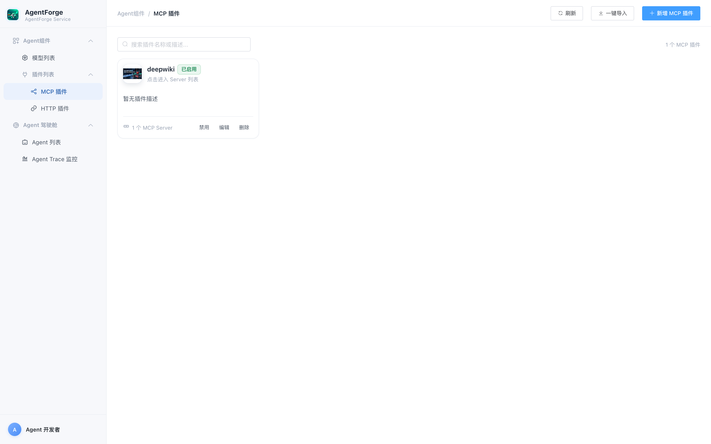
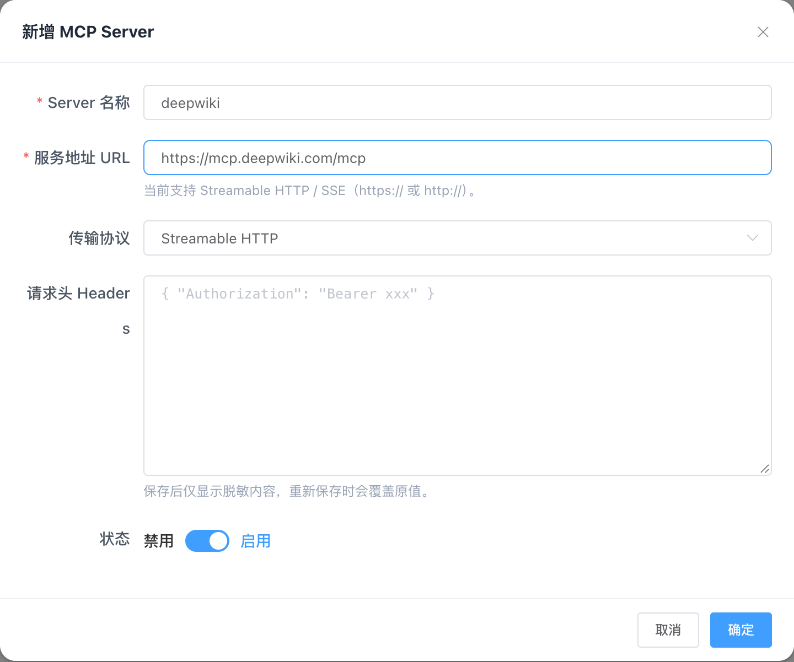
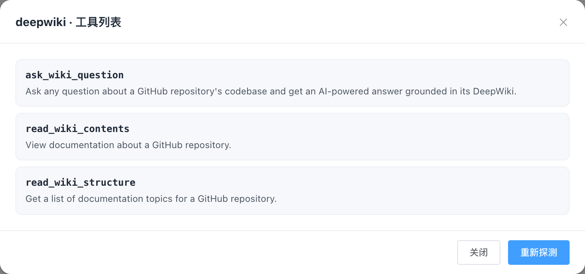
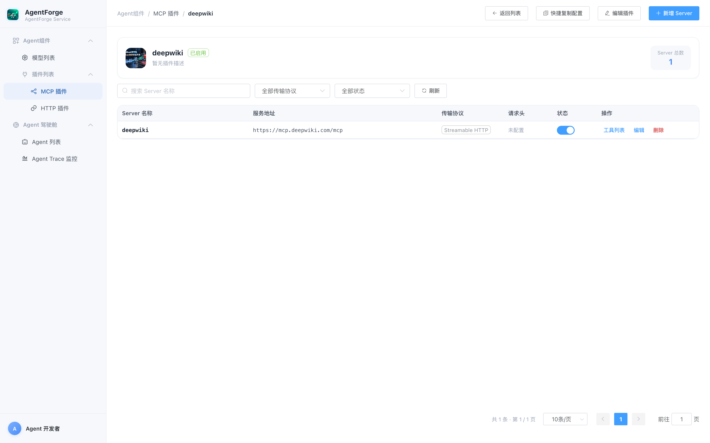

# 创建 MCP 插件

MCP（Model Context Protocol）让 Agent 在运行时动态发现外部工具，不需要像 HTTP 插件那样逐个手工录入参数。AgentForge Service 负责管理 MCP Server、探测工具列表，并在 Agent 装配时把工具转换为统一 Function Call。

本文以 DeepWiki 公共 MCP Server 为例，演示插件、Server 与工具发现流程。



## 1. 背景：把外部业务协议以插件形式接入 Agent

外部能力可能来自知识库、代码检索、浏览器、数据库或企业服务。MCP 把这些能力以标准 Server 的形式暴露，平台再把 Server 纳入插件管理，并转换成 Agent 可调用的工具：

```text
外部业务能力
    │ MCP 协议
    ▼
MCP Server（Streamable HTTP / SSE）
    │ initialize → notifications/initialized → tools/list
    ▼
MCP 插件（平台管理边界）
    ├── Server 1
    ├── Server 2
    └── 动态发现工具
    │ Agent 配置绑定
    ▼
统一 Function Call → Agent
```

与 HTTP 插件的共同点：两者最终都进入 Agent 的插件系统，以「插件 + 工具」的选择关系挂载到 Agent。区别在于工具来源：

- HTTP 插件由人工维护接口与参数；
- MCP 插件由 Server 通过 `tools/list` 动态声明。

这样做的价值是：外部业务协议不需要侵入 Agent 主循环，平台负责连接、鉴权和工具发现，Agent 只消费统一后的工具能力。

## 2. 这个页面解决什么问题

- 统一管理多个 MCP Server；
- 自动探测 `tools/list`，不需要手写工具 Schema；
- 把 MCP 工具与 HTTP 工具一起交给同一个 Agent；
- 支持插件级、Server 级启停与工具聚合。

适合的角色：需要接入知识库、代码检索、浏览器、数据库等 MCP 能力的团队。

## 3. 三个核心概念

| 层级 | 作用 | 示例 |
| --- | --- | --- |
| MCP 插件 | 一组 MCP Server 的逻辑集合 | `deepwiki` |
| MCP Server | 一个可连接的 MCP 服务 | `https://mcp.deepwiki.com/mcp` |
| MCP Tool | Server 通过 `tools/list` 动态声明的工具 | `ask_wiki_question` |

与 HTTP 插件的差异：

| 维度 | HTTP 插件 | MCP 插件 |
| --- | --- | --- |
| 工具来源 | 人工录入 Method / URI / 参数 | Server 运行时声明 |
| 工具 Schema | 平台内手工维护 | MCP Server 自动返回 |
| 适配成本 | 每个接口都要配置 | 配好 Server 即可发现全部工具 |
| 适用场景 | 已有 REST API、内部服务 | 标准化 MCP 生态与知识服务 |

## 4. 操作路径

```text
Agent组件 → MCP 插件 → 新增 MCP 插件
    → 在插件下新增 MCP Server
    → 探测工具列表
    → 在 Agent 配置中绑定插件或具体 Server
```

### 3.1 新增 MCP 插件

1. 进入「Agent组件 → MCP 插件」；
2. 点击「新增 MCP 插件」；
3. 填写插件名称、描述与状态；
4. 保存后进入插件详情。

### 3.2 新增 MCP Server



| 字段 | 说明 | DeepWiki 示例 |
| --- | --- | --- |
| Server 名称 | 插件内唯一名称 | `deepwiki` |
| 服务地址 URL | MCP Server 地址 | `https://mcp.deepwiki.com/mcp` |
| 传输协议 | 当前支持 Streamable HTTP / SSE | `Streamable HTTP` |
| 请求头 Headers | 鉴权或自定义 Header，敏感值脱敏保存 | 无 |
| 状态 | 启用 / 禁用 | 启用 |

### 3.3 探测工具列表

保存 Server 后，在 Server 行点击「工具列表」：

1. 平台连接 MCP Server；
2. 完成初始化握手；
3. 调用 `tools/list`；
4. 展示工具名称、描述和输入 Schema。

DeepWiki 示例返回 3 个工具：

| 工具 | 用途 |
| --- | --- |
| `ask_wiki_question` | 针对 GitHub 仓库问答 |
| `read_wiki_contents` | 读取仓库 Wiki 文档 |
| `read_wiki_structure` | 获取文档主题结构 |



如果探测失败，优先检查网络、URL、传输协议和鉴权 Header，而不是修改 Agent 提示词。

## 5. 一键导入 mcpServers

如果已有标准 `mcpServers` 配置，可以在列表页点击「一键导入」：

```json
{
  "mcpServers": {
    "deepwiki": {
      "url": "https://mcp.deepwiki.com/mcp"
    }
  }
}
```

平台会创建插件与 Server，并跳过缺少 `url` 的配置。导入后仍建议进入详情页探测一次工具列表。

## 6. 在 Agent 中绑定

Agent 编辑页的「MCP 插件」支持两种粒度：

- 绑定整个插件：默认使用插件下全部 Server，后续新增 Server 自动生效；
- 绑定具体 Server：只使用选中的 Server，适合精细授权。

需要注意：

- 只有状态为启用的插件和 Server 才会参与装配；
- 工具在 Agent 构建时动态发现，Server 不可用会导致对应工具缺失；
- 同一 Agent 可以同时绑定 HTTP 插件与 MCP 插件；
- 工具命名会带上插件与 Server 前缀，避免同名冲突。



## 7. 产品使用建议

1. **按能力域建插件，而不是按供应商建插件**；
2. **公共 Server 与内部 Server 分开管理**，便于权限和审计；
3. **先用工具列表验证连通性**，再交给 Agent；
4. **对生产 Agent 尽量绑定具体 Server**，避免自动继承新增工具；
5. **关注工具描述质量**，MCP 工具描述会直接影响模型选择；
6. **不要在 Header 中暴露长期密钥**，优先使用短期凭证。

## 8. 验收清单

1. 插件与 Server 状态均为启用；
2. 工具列表能成功返回；
3. Agent 配置中能看到并绑定该插件；
4. 调试对话中可以看到 MCP 工具被调用；
5. Trace 中能看到对应工具节点与耗时。

下一步：把模型、HTTP 插件与 MCP 插件组合成一个 Agent，阅读 [创建通用 Agent](../agent-cockpit/create-agent)。