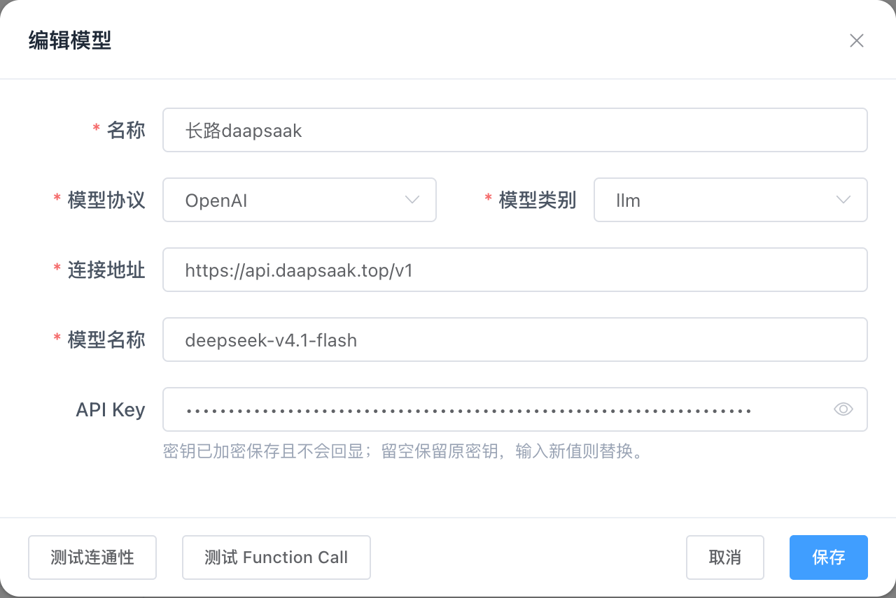

# 创建模型

模型是 Agent 的推理引擎。AgentForge Service 把模型配置从 Agent 中独立出来：先在「模型列表」接入模型并验证可用，再让一个或多个 Agent 复用同一个模型。

本文以 `长路daapsaak`（`deepseek-v4.1-flash`）为例，演示从新建到验证的完整路径。



## 1. 这个页面解决什么问题

- 统一管理 OpenAI / OpenAI-compatible 模型的连接地址、模型名与密钥；
- 在创建 Agent 前先验证模型连通性与 Function Call 能力；
- 让模型配置成为可复用资产，而不是散落在每个 Agent 里；
- 密钥加密保存，不在页面回显。

适合的角色：平台管理员、Agent 开发者、需要切换模型的业务团队。

## 2. 目前支持的两种模型协议

Service 当前支持两种模型协议，选择协议后由对应的 Provider 适配器负责请求与响应转换：

| 协议 | 适用场景 | 典型 Base URL | 典型模型名 |
| --- | --- | --- | --- |
| OpenAI | OpenAI 官方、OpenAI-compatible 服务、大多数国产模型网关 | `https://api.openai.com/v1` | `gpt-4o`、`deepseek-chat` |
| Anthropic | Anthropic 官方 Claude 模型 | `https://api.anthropic.com` | `claude-sonnet-4-5` |

两种协议的关键差异：

| 维度 | OpenAI 协议 | Anthropic 协议 |
| --- | --- | --- |
| 请求路径 | `/v1/chat/completions` | `/v1/messages` |
| 鉴权方式 | `Authorization: Bearer <key>` | `x-api-key` + `anthropic-version` |
| 工具调用 | `tools` / `tool_calls` | `tools` / `tool_use` |
| 消息结构 | system / user / assistant / tool | system / user / assistant + content block |

选择时只需匹配实际 Provider：

- 如果服务商宣称兼容 OpenAI API，选择 `OpenAI`；
- 如果接入 Anthropic 官方接口，选择 `Anthropic`；
- Base URL、模型名称必须与所选协议一致，不能把 Anthropic 模型填到 OpenAI 协议下；
- 两种协议都可以使用「测试连通性」和「测试 Function Call」验证。

## 3. 操作路径

```text
Agent组件 → 模型列表 → 新建模型
    → 填写协议、地址、模型名与密钥
    → 测试连通性 / 测试 Function Call
    → 保存
```

### 2.1 新建模型

1. 进入「Agent组件 → 模型列表」；
2. 点击右上角「新建模型」；
3. 填写模型信息；
4. 先点击「测试连通性」，再按需点击「测试 Function Call」；
5. 测试通过后点击「保存」。

### 2.2 字段说明

| 字段 | 说明 | 示例 |
| --- | --- | --- |
| 名称 | 平台内展示名，建议包含渠道或用途 | `长路daapsaak` |
| 模型协议 | 当前主要使用 OpenAI 兼容协议 | `OpenAI` |
| 模型类别 | 对话模型选择 `llm` | `llm` |
| 连接地址 | Provider 的 Base URL | `https://api.daapsaak.top/v1` |
| 模型名称 | 请求中实际使用的模型标识 | `deepseek-v4.1-flash` |
| API Key | 调用凭证，加密保存且不回显 | `sk-...` |

> 连接地址通常需要包含版本路径（例如 `/v1`），但不要包含具体接口路径。模型名称必须与 Provider 文档一致。

## 4. 验证模型

模型列表中的每个模型都可以直接「测试连接」，编辑弹窗内提供两项更细的验证：

| 验证 | 作用 | 何时使用 |
| --- | --- | --- |
| 测试连通性 | 确认地址、密钥和模型名可以完成一次基础调用 | 新接入模型时必做 |
| 测试 Function Call | 确认模型支持工具调用协议 | Agent 绑定 HTTP / MCP 工具前必做 |

如果 Agent 需要调用插件工具，Function Call 验证非常关键。基础对话可用但 Function Call 不可用的模型，不适合作为工具型 Agent 的主模型。

## 5. 密钥与安全

- API Key 输入框使用密码类型，保存后只显示掩码；
- 编辑时留空表示保留原密钥，输入新值才会替换；
- 页面不提供明文查看入口；
- 模型列表只展示名称、协议、模型名和连接地址，不展示密钥；
- 建议为不同环境、不同业务使用独立密钥，便于审计和吊销。

## 6. 模型复用与变更

一个模型可以被多个 Agent 引用。修改模型配置后：

- 新建或重新初始化的 Agent 会使用新配置；
- 修改模型后，建议重新验证并重新发布引用该模型的 Agent，确保线上行为一致；
- 删除模型前应确认没有 Agent 正在引用，否则相关 Agent 的对话会失败。

## 7. 验收清单

1. 模型列表能看到新增模型；
2. 「测试连接」返回成功；
3. 工具型 Agent 的模型通过「测试 Function Call」；
4. API Key 在列表与编辑弹窗中均不明文展示；
5. 创建 Agent 时可以在「对话模型」下拉框中选中该模型。

下一步：为 Agent 接入外部能力，阅读 [创建 HTTP 插件](./http-plugin) 或 [创建 MCP 插件](./mcp-plugin)。