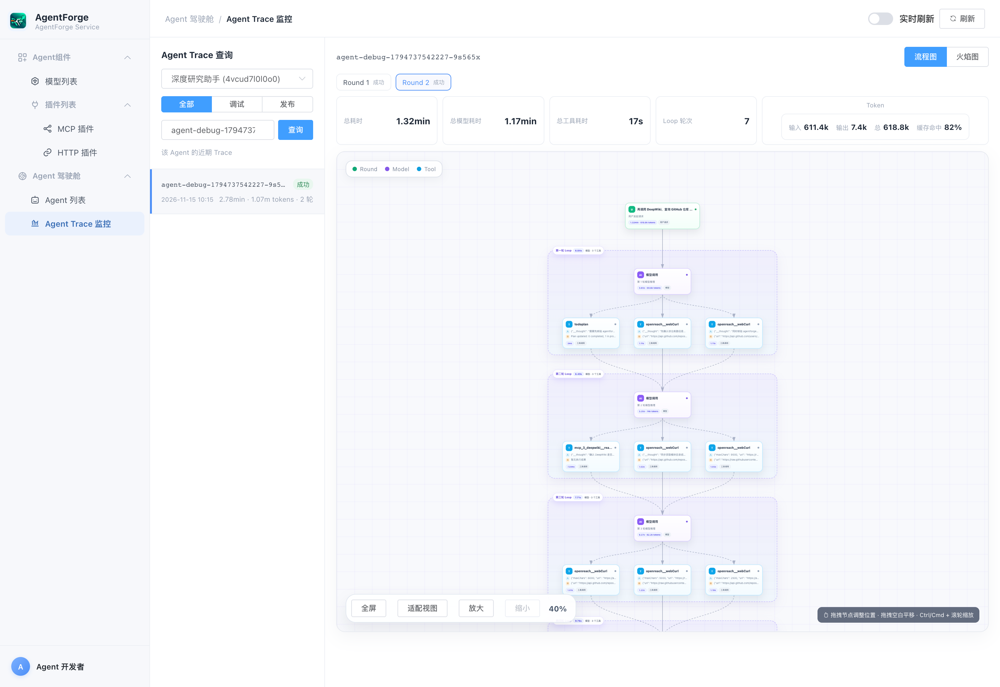
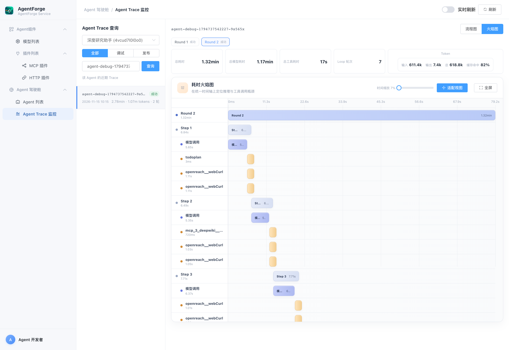

# Agent Trace 监控

Agent Trace 用于回答「这次运行到底慢在哪里、贵在哪里、工具调用是否合理」。它把一次 Agent 运行整理成 Round → Step → Model / Tool 的结构化链路，而不是只看最终回答。

页面提供两种视图：**流程图**看调用关系，**火焰图**看时间分布。



## 1. 这个页面解决什么问题

- 定位多轮 ReAct 中哪一步耗时最长；
- 对比模型耗时与工具耗时；
- 查看每次工具调用的参数与结果；
- 观察 Token 消耗与缓存命中；
- 复盘调试会话与正式会话的运行差异；
- 在问题发生后快速找到异常节点。

适合的角色：Agent 开发者、平台管理员、性能与成本负责人。

## 2. 查询路径

```text
Agent 驾驶舱 → Agent Trace 监控
    → 选择 Agent
    → 选择来源：全部 / 调试 / 发布
    → 选择近期 Trace，或输入 sessionId 查询
    → 选择 Round
    → 切换流程图 / 火焰图
```

### 2.1 选择 Agent

页面左侧先选择 Agent。选择后加载该 Agent 的近期 Trace：

- **全部**：调试与发布会话都展示；
- **调试**：只看编辑页调试产生的会话；
- **发布**：只看正式发布页产生的会话。

如果知道会话 ID，也可以直接输入 `sessionId` 查询。Trace 会校验会话是否属于当前 Agent。

### 2.2 选择 Round

一次会话可能包含多轮用户提问。页面按 `Round 1 / Round 2 / ...` 展示，右侧只渲染当前选中的一轮，避免多个问题混在同一张图里。

顶部指标卡展示：

| 指标 | 含义 |
| --- | --- |
| 总耗时 | 当前 Round 的实际耗时 |
| 总模型耗时 | 模型调用累计耗时 |
| 总工具耗时 | 工具调用累计耗时 |
| Loop 轮次 | 当前 Round 的 ReAct Step 数 |
| Token | 输入、输出、总量与缓存命中率 |

> 工具并发执行时，工具累计耗时可大于总耗时，这是并发执行的自然结果，不是数据错误。

## 3. 流程图

流程图按调用关系展开：

```text
Round
└── Step
    ├── 模型调用
    └── 工具调用
```

点击节点可查看：

- 节点类型与状态；
- 开始时间与耗时；
- Token 使用；
- 调用参数与执行结果；
- 异常信息。

流程图适合回答：

- 这一轮为什么调用了 5 次工具？
- 哪个工具返回了错误？
- 模型是在什么上下文下做出下一步决策？
- 工具结果是否被正确写回？

画布支持拖拽、缩放、适配视图和全屏。

## 4. 火焰图



火焰图把当前 Round 放到统一时间轴：

```text
Round
└── Step
    ├── 模型调用
    └── 工具调用（并发时并列）
```

火焰图适合回答：

- 时间主要花在模型还是工具？
- 是否存在长时间阻塞的工具？
- 多个工具是否真的并发？
- 每一步之间的等待区间在哪里？

支持时间缩放、横向滚动、节点详情、适配视图与全屏。

## 5. 数据来源与边界

Trace 与消息事件是两套数据：

| 数据 | 用途 |
| --- | --- |
| 会话消息事件 | 页面重放、对话渲染 |
| Trace 快照 | ReAct 结构、耗时、Token、工具节点 |

Trace 按 `sessionId + questionRound + step` 组织快照，独立于 ChatMemory，也不直接复用消息事件绘图。这样可以保证：

- 图结构稳定，不受前端渲染格式影响；
- 工具参数与结果可以单独审计；
- 模型与工具耗时可精确归因；
- 历史会话即使消息很多，也能快速定位某一轮。

当前边界：

- Trace 以 Round 为单位查看，不支持跨会话聚合报表；
- 实时刷新需要页面保持打开；
- 数据保留周期由部署侧策略决定；
- Trace 只做观测，不会修改 Agent 配置或重放工具副作用。

## 6. 典型排查路径

### 6.1 回答很慢

1. 打开火焰图；
2. 看模型耗时占比；
3. 看是否有单个工具长时间占用；
4. 检查是否发生多次重试；
5. 结合流程图确认是否存在不必要的工具调用。

### 6.2 Token 消耗异常

1. 看输入 Token 是否持续增长；
2. 检查窗口记忆是否过大；
3. 检查工具结果是否返回超长内容；
4. 检查是否重复读取同一资源；
5. 评估 Prompt 与工具描述是否可以精简。

### 6.3 工具调用不符合预期

1. 在流程图中找到工具节点；
2. 查看工具名、参数与结果；
3. 对照 Agent 绑定关系与工具描述；
4. 回到调试专区复现；
5. 调整 Prompt 或工具配置后重新发布。

## 7. 产品使用建议

1. **调试和发布分开筛选**：避免把开发期噪声混入线上分析；
2. **先看火焰图定位，再看流程图归因**；
3. **关注缓存命中率**：高输入 Token 且低缓存命中通常意味着上下文膨胀；
4. **把 Trace 当作回归工具**：配置调整前后对比同一类问题的耗时与工具路径；
5. **不要用 Trace 替代日志**：Trace 看结构，日志看异常堆栈与外部系统错误。

## 8. 验收清单

1. 选择 Agent 后能加载近期 Trace；
2. 调试 / 发布来源筛选正确；
3. 多轮会话能按 Round 切换；
4. 流程图节点可以查看参数与结果；
5. 火焰图能定位模型与工具耗时；
6. Token 与缓存命中率展示正确；
7. 实时刷新可用，且不会重置当前视图。