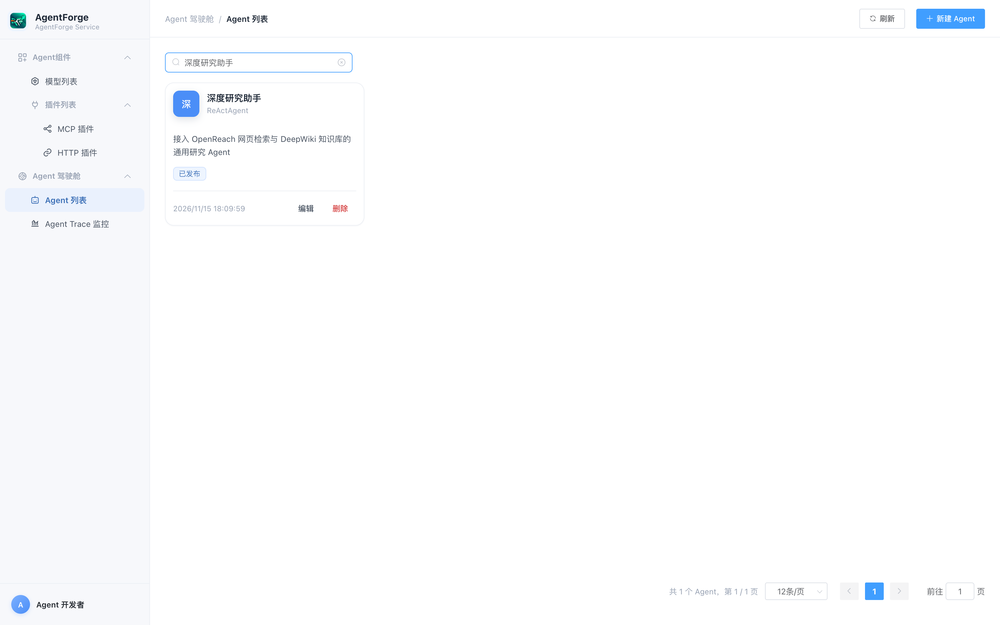

# AgentForge Service

AgentForge Service 是构建在 AgentForge 框架之上的标准 Agent 工作台。它把「接模型、接工具、配 Agent、调试、版本、发布、观测」做成一套可运行的产品，让团队不必从零搭建前后端。

```text
模型配置 → 插件接入 → Agent 配置 → 调试 → 版本 → 发布 → 会话与 Trace
```



## 1. 产品定位

AgentForge SDK 解决「如何构建 Agent」，AgentForge Service 解决「如何把 Agent 交付给团队使用」。

| 层次 | 解决的问题 | 对应能力 |
| --- | --- | --- |
| 组件层 | 模型与工具从哪来 | 模型列表、HTTP 插件、MCP 插件 |
| 驾驶舱 | Agent 怎么配、怎么验证、怎么上线 | Agent 列表、配置、调试、版本、发布 |
| 基础设施 | 上线后如何观察与排障 | 会话历史、Agent Trace、Token 与耗时 |

Service 不是 SDK 的替代品，而是 SDK 的产品化外壳：同一套 Agent 运行时，既可以通过 Java 代码嵌入，也可以通过工作台配置和发布。

## 2. 适合谁

| 角色 | 关注点 | 常用页面 |
| --- | --- | --- |
| Agent 开发者 | Prompt、模型、工具、调试与发布 | Agent 配置、调试专区 |
| 产品经理 | Agent 能做什么、交互是否达标 | Agent 列表、发布页、调试优雅模式 |
| 平台管理员 | 模型渠道、插件、权限与运行状态 | 模型列表、HTTP / MCP 插件 |
| 运维与性能负责人 | 耗时、Token、工具异常 | Agent Trace 监控 |

## 3. 产品结构

### Agent组件

| 页面 | 作用 |
| --- | --- |
| [创建模型](./agent-components/model) | 接入 OpenAI / OpenAI-compatible 模型并验证连通性 |
| [创建 HTTP 插件](./agent-components/http-plugin) | 把 REST API 转换为 Agent 工具 |
| [创建 MCP 插件](./agent-components/mcp-plugin) | 接入 MCP Server，动态发现工具 |

### Agent 驾驶舱

| 页面 | 作用 |
| --- | --- |
| [创建通用 Agent](./agent-cockpit/create-agent) | 组合 Prompt、模型、插件、记忆与内置能力 |
| [Agent 调试](./agent-cockpit/debug) | 验证当前配置，观察思考与工具调用，查看历史调试会话 |
| [Agent 发布](./agent-cockpit/publish) | 保存版本、发布当前配置、打开发布链接或停止发布 |

### Agent 基础设施

| 页面 | 作用 |
| --- | --- |
| [Agent Trace 监控](./agent-infrastructure/trace) | 用流程图与火焰图观察 ReAct Loop、模型/工具耗时与 Token |

## 4. 一个完整示例

本文档中的截图来自一个可运行的「深度研究助手」：

| 配置 | 示例 |
| --- | --- |
| 模型 | 长路daapsaak（`deepseek-v4.1-flash`） |
| HTTP 插件 | OpenReach，提供网页搜索、图片搜索、网页正文读取与公开数据读取 |
| MCP 插件 | DeepWiki，提供 GitHub 仓库知识与代码问答 |
| 内置能力 | 任务计划、询问用户 |
| 运行方式 | 调试验证后提交 V1/V2，发布到正式对话页 |

它覆盖了 Service 的主要闭环：

```text
接入模型 → 接入 HTTP / MCP 工具 → 创建 Agent
    → 调试 → 保存版本 → 发布 → 正式对话 → Trace 复盘
```

## 5. 核心能力

| 能力 | 说明 |
| --- | --- |
| 模型管理 | 协议、Base URL、模型名、API Key 加密保存与连接测试 |
| 插件管理 | HTTP 插件 / 方法 / 参数三层模型，支持 CURL 与 JSON 导入 |
| MCP 管理 | Server 管理、工具探测、多 Server 聚合、`mcpServers` 导入导出 |
| Agent 配置 | Prompt、模型、插件、窗口记忆、任务计划与询问用户 |
| 调试 | 当前配置调试、思考/工具事件时间线、优雅模式、历史调试会话 |
| 版本 | 仅保存与提交版本分离、版本备注、切换与对比 |
| 发布 | 当前配置发布、重新发布、停止发布、正式对话链接 |
| 会话 | 调试与正式会话隔离，消息与 SSE 事件快照 |
| Trace | Round / Step / Model / Tool 链路，流程图与火焰图 |

## 6. 推荐上手路径

1. 按 [快速部署](./quick-deploy) 启动服务；
2. 在 [创建模型](./agent-components/model) 接入一个可用模型；
3. 按需接入 [HTTP 插件](./agent-components/http-plugin) 或 [MCP 插件](./agent-components/mcp-plugin)；
4. 在 [创建通用 Agent](./agent-cockpit/create-agent) 组合能力；
5. 用 [Agent 调试](./agent-cockpit/debug) 验证配置；
6. 用 [Agent 发布](./agent-cockpit/publish) 固化版本并上线；
7. 用 [Agent Trace 监控](./agent-infrastructure/trace) 观察运行质量。

## 7. 技术结构

```text
agentforge-service
├── agentforge-service-ui     # Vue 2 + Vite 前端
└── agentforge-service-backend
    └── agentforge-service-web # Spring Boot 后端
        └── modules
            ├── model             # 模型配置
            ├── agent             # Agent 配置、版本、发布与运行时装配
            ├── session           # 会话、消息与 SSE 事件重放
            ├── plugins           # HTTP / MCP 插件
            └── trace             # Agent 链路快照与查询
```

前端负责工作台交互与流式 Markdown 渲染，后端负责配置持久化、Agent 装配、事件推送与链路追踪。两者共享同一套 Agent 运行时。

## 8. 与 SDK 的关系

```text
AgentForge SDK
    ├── agentforge-model-*       统一模型协议
    └── agentforge-agent-core    ReAct / Middleware / Tool
                │
                ▼
AgentForge Service
    ├── 配置持久化
    ├── Agent 装配与运行时
    ├── SSE 事件与会话
    └── 工作台 UI
```

- 想嵌入自己的 Java 应用：使用 [SDK 文档](../about/introduction)；
- 想直接使用成品工作台：使用 AgentForge Service；
- 想二次开发 Service：从源码构建，复用同一套 Agent 运行时。

## 9. 当前边界

- Service 面向标准通用 ReAct Agent，自定义 Agent 类型需要扩展后端；
- MCP 当前支持远程 Streamable HTTP / SSE，不包含本地 stdio 进程管理；
- Trace 以 Session / Round 为单位查看，暂不提供跨 Agent 聚合报表；
- 发布以当前配置为准，发布快照不承担多版本灰度或流量分配；
- 登录、租户与细粒度权限由部署侧或企业现有体系接入。

从 [快速部署](./quick-deploy) 开始，或直接进入 [创建模型](./agent-components/model)。