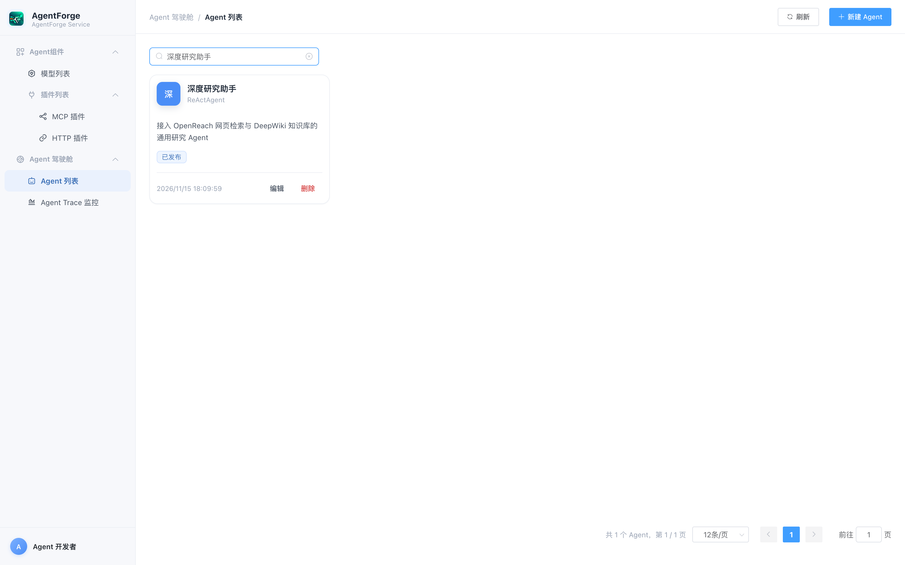
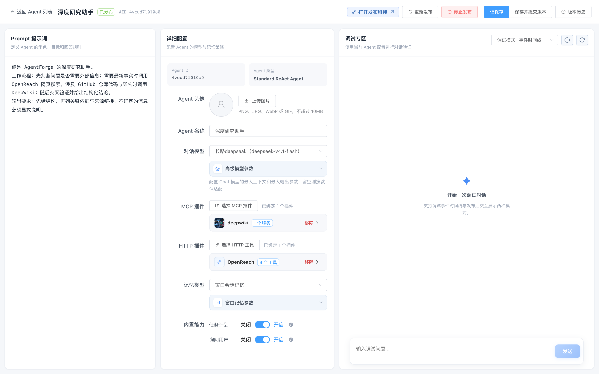

# Create a General Agent

An Agent is the vehicle that combines models, tools, memory, and behavioral constraints into a deliverable assistant. The Agent Cockpit in AgentForge Service is responsible for creating, configuring, debugging, versioning, and publishing Agents.

This article uses a "Deep Research Assistant" as an example to explain the complete configuration of a general Agent from creation to being ready for debugging.



## 1. Product positioning

An Agent consists of six kinds of elements:

| Element | Determines | Location in the page |
| --- | --- | --- |
| Prompt | The Agent's role, workflow, and output conventions | Prompt |
| Model | Reasoning capability, context, and output limits | Chat model / Advanced model parameters |
| Tools | Which external capabilities can be accessed | MCP plugins / HTTP plugins |
| Memory | How much history is retained across turns | Memory type / Window memory parameters |
| Built-in capabilities | Task planning, asking the user | Built-in capabilities |
| Runtime identity | AID, name, avatar, description | Basic information |

## 2. Creation path

```text
Agent Cockpit → Agent list → New Agent
    → Fill in name, category, description, and chat model
    → Enter the Agent configuration page
    → Complete Prompt, plugins, memory, and capabilities
    → Save only / Save and commit version
    → Verify in the debug panel
```

### 2.1 Create a new Agent

1. Go to "Agent Cockpit → Agent list";
2. Click "New Agent";
3. Fill in the Agent name and description;
4. Select the Agent category: currently "General Stateless Agent" is available;
5. Select a chat model;
6. Confirm to enter the configuration page.

After creation, the platform generates a stable AID. The AID is the Agent's runtime identity, and debugging, publishing, traces, and sessions are all associated through it.

## 3. Core configuration components



### 3.1 Prompt

Prompt defines the Agent's role, workflow, and output constraints. From a product perspective, at least four things should be made clear:

1. **Role**: what kind of assistant it is and what tasks it serves;
2. **Workflow**: what to do first, what to do next, and when to call tools;
3. **Boundaries**: what it must not do, and how to handle insufficient information;
4. **Output**: conclusions, evidence, sources, and format requirements.

The "Deep Research Assistant" example:

```text
You are AgentForge's deep research assistant.
Workflow: first determine whether the question requires external information; when the latest facts are needed, call OpenReach web search; when GitHub repository code and architecture are involved, call DeepWiki; then cross-validate and give a structured conclusion.
Output requirements: give the conclusion first, then list key evidence and source links; information that is uncertain must be explicitly stated.
```

### 3.2 Chat model and advanced parameters

- The "Chat model" is selected from models that have already been created;
- Advanced model parameters can override the maximum context and maximum output;
- When left blank, the model's registered defaults are used;
- Tool-oriented Agents should use a model that has passed Function Call testing.

### 3.3 MCP plugins

Used to bind MCP capabilities such as knowledge bases, code search, and databases:

- You can select an entire plugin, which inherits all Servers under it by default;
- You can also expand a plugin and select only specific Servers;
- The page shows the number and names of bound Servers;
- Removing a plugin only affects the current Agent and does not delete the plugin itself.

### 3.4 HTTP plugins

Used to bind REST API tools:

- You can select an entire plugin or only specific tools;
- The page shows the number of bound tools;
- Binding is a tool selection relationship; the interface configuration is not copied;
- If an HTTP plugin or tool is disabled, the Agent skips it automatically.

### 3.5 Memory type

Currently "Window session memory" is available:

- Limits the number of historical messages retained per session;
- Debug sessions and production sessions each have independent contexts;
- Memory only affects the model context and does not replace session history records.

### 3.6 Built-in capabilities

| Capability | Purpose | Recommendation |
| --- | --- | --- |
| Task planning | Calls `todoplan` in multi-step tasks to maintain a task list | Recommended for complex workflows |
| Ask user | Initiates a HITL interruption when additional information is needed | Enable for attended scenarios; disable for unattended ones |

## 4. A working example configuration

| Configuration item | Example value |
| --- | --- |
| Agent name | Deep Research Assistant |
| Agent category | General Stateless Agent |
| Chat model | 长路daapsaak (deepseek-v4.1-flash) |
| Prompt | Research workflow + conclusion/evidence/source requirements |
| MCP plugin | deepwiki (1 Server) |
| HTTP plugin | OpenReach (4 tools) |
| Memory | Window session memory, 1000 messages |
| Built-in capabilities | Task planning on, ask user on |

This combination covers:

- External information retrieval and reading web page content;
- GitHub repository knowledge and code Q&A;
- Multi-step research tasks;
- Asking the user when information is insufficient.

## 5. Saving and versions

Two save options are provided in the upper-right corner of the edit page:

| Action | Updates current configuration | Creates a history version | When to use |
| --- | --- | --- | --- |
| Save only | Yes | No | Save editing progress |
| Save and commit version | Yes | Yes | Create a reviewable, comparable milestone |

Both save options invalidate the debug instance; subsequent debugging rebuilds it with the latest configuration. For version-related details, see [Agent Publishing](./publish).

## 6. Configuration checklist

1. The Agent name and description make its purpose clear;
2. The Prompt states the role, workflow, boundaries, and output format;
3. The model has passed connectivity and Function Call tests;
4. The bound plugins and tools actually cover the capabilities the task requires;
5. The memory length matches the task complexity;
6. The ask-user capability matches whether the business has staff on duty;
7. After saving, conversations work normally in the debug panel.

Next: validate with the current configuration by reading [Agent Debugging](./debug).