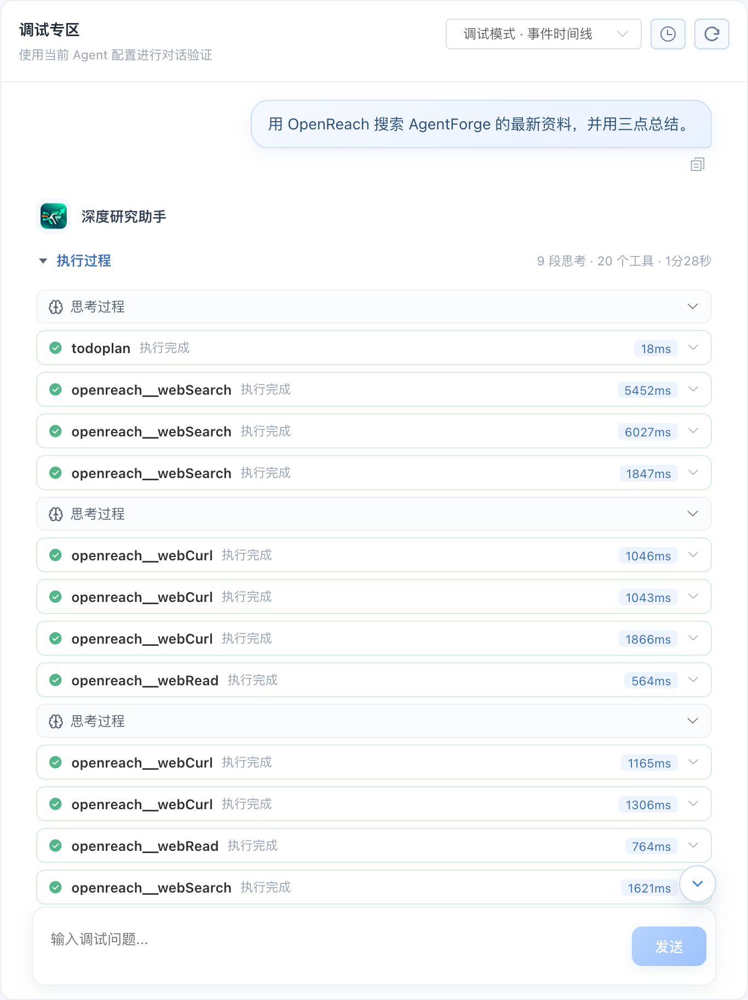
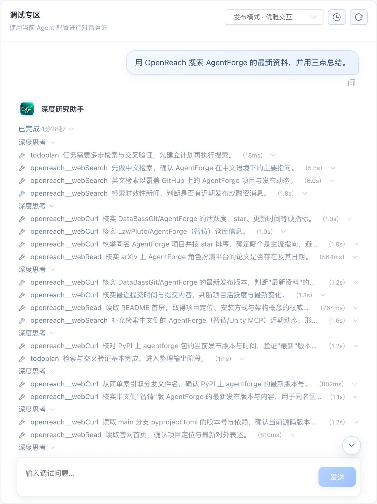

# Agent Debugging

The debug panel validates an Agent's current configuration before publishing. It connects to the `ai_agent_config` draft, not the published snapshot, so you can modify and retry safely.

Debugging is not just a chat window. It breaks a ReAct run into observable thinking, tool, and answer stages.



## 1. What the debug panel solves

- Verify that the Prompt makes the model work as expected;
- Verify that HTTP / MCP tools are selected and called correctly;
- Observe thinking, tool arguments, tool results, and durations;
- Find model, tool, or permission configuration issues before publishing;
- Keep historical debug sessions for review and continued iteration.

Suitable roles: Agent developers, product managers, prompt engineers, and testers.

## 2. Debug mode vs. publish mode

The debug panel provides two rendering modes. They consume the same SSE events and session data, but serve different readers:

| Mode | Page option | Audience | Main purpose |
| --- | --- | --- | --- |
| Debug mode | Debug mode · event timeline | Agent developers, testers | See model thinking, tool selection, arguments, and results |
| Publish mode | Publish mode · elegant interaction | Product managers, end users | Preview the post-publish conversation experience and information density |

### 2.1 Debug mode: expose the execution process


Debug mode breaks a run into inspectable nodes (the screenshot has the execution process expanded):

- Thinking is expanded in sections so you can see why the model chose the next step;
- Tool cards show the tool name, execution status, and duration;
- Expand a tool card to inspect arguments and returned results;
- The header summarizes "X thinking sections · Y tools · total duration";
- Best for diagnosing "why was the wrong tool called", "why are the arguments wrong", and "where did the time go".

### 2.2 Publish mode: collapse the execution process



Publish mode uses the same elegant interaction as the published page (the screenshot manually expanded the process for comparison):

- The execution process is collapsed to a single "Completed · total duration" line by default;
- Users can read the final answer first and expand the process when needed;
- Thinking and tools appear as lighter entries and do not compete with the main content;
- Debug-only markers and troubleshooting details are hidden;
- Best for validating the reading rhythm and information hierarchy end users will see.

> Publish mode in the editor is a "preview mode"; the session is still a debug session. The real publish page uses a separate production session and does not include debug mode switching, historical debug entry points, or other developer controls.

### 2.3 Interaction differences

| Dimension | Debug mode | Publish mode |
| --- | --- | --- |
| Default expansion | Expanded while running, collapsible after completion | Collapsed after completion |
| Thinking content | Fully expanded in sections | Folded into the expandable process |
| Tool calls | Emphasizes tool cards, durations, and status | Lightweight event entries |
| Tool arguments and results | Expand and inspect item by item | Prioritizes user comprehension |
| Page metadata | Thinking section count, tool count, duration | Completion status and total duration |
| Debug controls | Mode switch, history, new session, stop/append | No debug controls |
| Session data | `is_debug=1` | Preview is still a debug session; the production page is `is_debug=0` |
| Typical question | "Why was it called this way?" | "What does the user see?" |

### 2.4 Recommended rhythm

```text
Development: debug mode
    → Check Prompt, tool selection, arguments, and results
    → Fix issues

Acceptance: publish mode
    → Check answer readability and information density after collapsing
    → Confirm the end-user experience

After publishing: production page
    → Validate again with real user sessions
```

Use the event timeline during development, switch to publish mode during acceptance, and continue to [Agent Publishing](./publish) after confirming the end-user experience.

## 3. Workflow

```text
Agent configuration page → Modify Prompt / plugins / model
    → Save only
    → Enter a question in the debug panel
    → Observe thinking, tool calls, and the final answer
    → Adjust based on results
    → Save and commit a version
```

### 3.1 Start debugging

1. Enter a question in the debug panel on the right side of the configuration page;
2. Click "Send";
3. While running, the button becomes "Stop" and can terminate at any time;
4. Entering more content while running queues it as a "follow-up instruction" for the next round;
5. When finished, the execution process and final answer are displayed.

### 3.2 Read the execution process

A run may contain:

| Element | Meaning |
| --- | --- |
| Thinking | The model's reasoning fragments at each step |
| Tool card | Tool name, arguments, results, duration, and status |
| Execution summary | Number of thinking sections and tools |
| Final answer | User-facing Markdown content |

In the example, the Agent first calls `todoplan` to plan the task, then calls `openreach__webSearch`, `openreach__webRead`, and `openreach__webCurl` in sequence, and finally produces a conclusion with sources.

These signals indicate that the configuration needs adjustment:

- The tool is not called: check the Prompt, tool description, and the model's Function Call capability;
- The wrong tool is called: improve tool descriptions and selection rules;
- Tool arguments are wrong: check parameter descriptions, required fields, and types;
- The answer lacks sources: specify the output format in the Prompt;
- Repeated retries or timeouts: check the model, network, and tool endpoints.

### 3.3 Stop and append

- **Stop**: ends the current run and keeps content already produced;
- **Append**: sends an additional instruction while running for the next round;
- Appended messages enter a queue and the page shows their waiting position;
- Canceling an append only cancels instructions that have not taken effect.

## 4. Historical debug sessions

The clock button in the upper-right corner of the debug panel opens "Historical debug sessions".


Capabilities:

- Each Agent maintains its own debug history;
- Debug sessions are isolated from production sessions through `is_debug=1`;
- History stores user questions, AI answers, and SSE event snapshots;
- Opening a historical session replays thinking, tools, and answers through the same event protocol;
- A running session can be reattached and continue refreshing;
- Creating a new session does not delete history.

This means:

1. Debug sessions do not appear in the published page's user history;
2. Production user sessions do not interfere with developer troubleshooting;
3. Debug history for the same Agent can be retained long-term for comparing Prompt or plugin configurations.

### 4.1 When to use history

- Compare the effect of two Prompt adjustments;
- Reproduce a failed conversation;
- Recover a tool call verified during debugging;
- Let colleagues inspect the problem context;
- Continue asking questions from a historical session.

## 5. Debugging and publishing

| Dimension | Debug | Publish |
| --- | --- | --- |
| Data source | Current `ai_agent_config` | `ai_agent_config_published` snapshot |
| Session type | `is_debug=1` | `is_debug=0` |
| Affects production users | No | Yes |
| Configuration changes | Take effect after saving; the debug instance is rebuilt | Require republishing |

Passing debugging does not mean you can skip the publishing process. After confirming the configuration, you still need "Save and commit version" and "Publish".

## 6. Product debugging recommendations

1. **Change one variable at a time**: validate Prompt, model, and tools separately;
2. **Regress with a fixed question set**: cover normal, missing-information, tool-failure, and boundary cases;
3. **Inspect tool cards before the final answer**: the final answer may hide tool errors;
4. **Save key milestone versions**: avoid unreproducible debug results;
5. **Switch to elegant mode during acceptance**: confirm that end users can read the content;
6. **Enable task planning for complex questions**: makes multi-step execution observable.

## 7. Acceptance checklist

1. The current configuration has been saved;
2. Debug conversations return normally;
3. Thinking and tool calls are visible;
4. HTTP / MCP tools are selected as expected;
5. Stop and append behave as expected;
6. Historical debug sessions can be opened and replayed;
7. Debug sessions do not appear in the published page history.

Next: freeze the validated configuration into a version and publish it by reading [Agent Publishing](./publish).