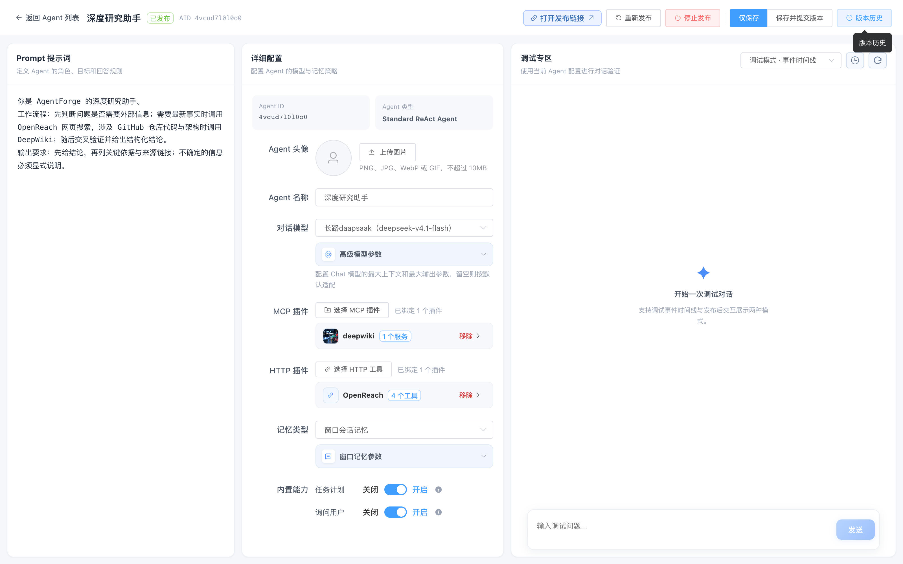
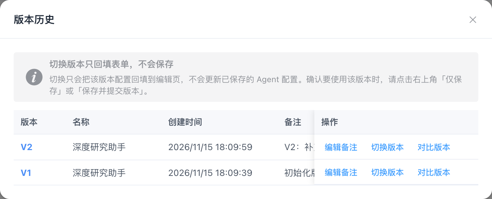
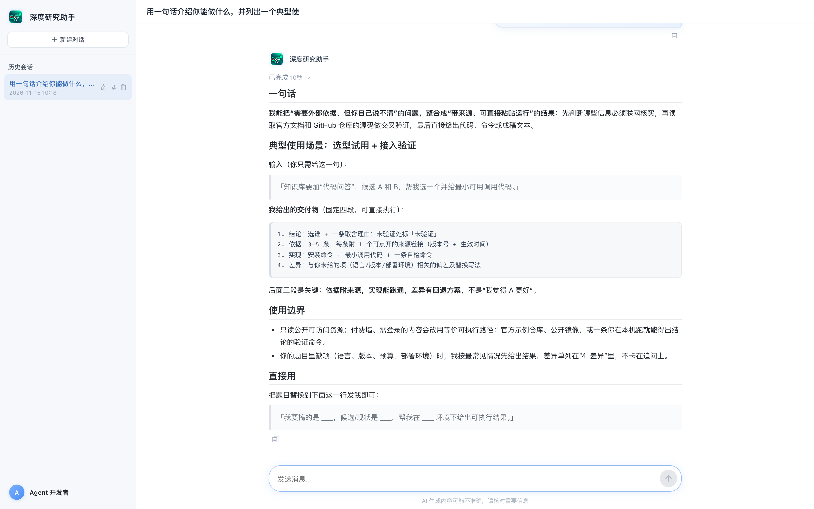

# Agent Publishing

The core action of Agent publishing is to **copy the latest Agent configuration into an independent published configuration**. After publishing, production conversations no longer read the editor configuration; they initialize the Agent from this published snapshot by AID.

The three most confusing concepts are current configuration, historical versions, and publish snapshot. Understanding their relationship is necessary to use "Save only", "Save and commit version", and "Publish" correctly. After publishing, each Agent is an independent portal with its own link, identity, configuration, and production session history.



## 1. Differences between the three concepts

| Concept | Storage | Purpose | When it changes |
| --- | --- | --- | --- |
| Current configuration | `ai_agent_config` | The latest configuration maintained by the editor | Every save |
| Historical version | `ai_agent_config_version` | Config snapshot for review and comparison | Save and commit version |
| Publish snapshot | `ai_agent_config_published` | The configuration actually running in production | Publish / republish |

Relationships:

```text
Editor
  ├── Save only ───────────────→ Update current configuration
  ├── Save and commit version ─→ Update current configuration + add historical version
  └── Publish ─────────────────→ Overwrite publish snapshot with current configuration
```

Key conclusion: **Publishing always uses the latest current configuration. You do not need to select a historical version first.**

> Publishing is not marking the current configuration as "published"; it copies the latest configuration into an independent published configuration. Future editor changes do not affect production until you publish again.

## 2. Save options

The upper-right corner of the editor provides two adjacent buttons:

| Action | Updates current configuration | Creates historical version | Use case |
| --- | --- | --- | --- |
| Save only | Yes | No | Work in progress, frequent saves |
| Save and commit version | Yes | Yes, version number +1 | Create a milestone, prepare to publish |

After clicking "Save and commit version", a confirmation dialog appears where you can enter a version note. Notes can be up to 1024 characters and remain editable after submission.

Both save actions invalidate the debug instance; subsequent debugging rebuilds from the latest configuration.

## 3. Version history

Click "Version history" to view historical snapshots:



Each version shows:

- Version number: V1, V2, V3, and so on;
- Version name;
- Creation time;
- Version note;
- Actions: edit note, switch version, compare versions.

### 3.1 Switch version

Switching a version only fills the historical configuration back into the editor:

- It does not update the current configuration;
- It does not create a new version;
- It does not affect the publish snapshot;
- It does not affect running production Agents.

After switching, if you confirm the configuration, you still need to click "Save only" or "Save and commit version".

### 3.2 Compare versions

"Compare versions" shows the historical version and the latest current configuration side by side:

- Compares Prompt, name, description, model, and memory configuration;
- Fields that differ have a red border and "Difference";
- The header shows the total number of differences;
- When everything matches, it shows "Both configurations are identical".

Version comparison is read-only and does not modify any data.

## 4. Publishing flow

1. Confirm that debugging passed;
2. Click "Save and commit version" and enter a version note;
3. Click "Publish" in the upper-right corner;
4. After publishing, the page shows "Published" and the latest publish time;
5. Click "Open publish link" to enter the production conversation page.

Publishing:

- Copies the current configuration into the publish snapshot;
- Refreshes the latest publish time;
- Deletes old publish records before writing the new snapshot;
- Clears the production Agent runtime cache;
- Keeps the editor configuration and historical versions unchanged.

### 4.1 Republish

After the configuration changes, a published Agent shows "Republish":

- Republishing uses the latest current configuration;
- You do not need to select a historical version;
- New production conversations use the new snapshot after republishing;
- Existing production session history is preserved.

### 4.2 Unpublish

"Unpublish":

- Cancels the published state;
- Deletes the publish snapshot;
- Clears the production runtime instance;
- Keeps the editor configuration and historical versions.

After unpublishing, the publish link no longer provides production conversations.

### 4.3 How production conversations read the published configuration

Published conversations do not read the editor's `ai_agent_config`; they read `ai_agent_config_published` by AID:

```text
User opens /agent/published/{aid}
    → Query the published configuration by aid
    → Read Prompt, model, HTTP/MCP plugins, memory, and capability configuration
    → Initialize or reuse the production Agent instance
    → Create a production session (is_debug=0)
    → Start the conversation
```

This has three direct results:

1. **Editor and production isolation**: editor changes do not change the behavior of the published portal;
2. **Publishing switches immediately**: after republishing, subsequent production conversations use the new published configuration;
3. **Cache can be rebuilt**: publishing or unpublishing clears the production instance cache; the next conversation initializes from the latest published configuration.

Existing production session message history is preserved, but the Agent configuration used by subsequent conversations follows the current publish snapshot.

## 5. Each Agent is a portal

A published Agent is not just an endpoint; it is an independent portal:

```text
Agent portal
  ├── Independent entry: /agent/published/{aid}
  ├── Independent identity: name, avatar, description, AID
  ├── Independent capabilities: Prompt, model, HTTP/MCP plugins, memory
  ├── Independent sessions: production history and continued conversation
  └── Independent lifecycle: publish, republish, unpublish
```



| Portal dimension | Behavior |
| --- | --- |
| Entry | Each Agent has a stable publish link that can be shared or embedded |
| Identity | Name, avatar, and description are shown to end users |
| Capabilities | Only the conversation is exposed; Prompt, plugin configuration, and debug controls are hidden |
| Data | Production sessions are isolated from debug sessions |
| Updates | After republishing, the portal switches to the new published configuration |
| Shutdown | After unpublishing, the portal stops providing production conversations |

Therefore, multiple Agents are multiple portals:

- A customer-service Agent is a customer-service portal;
- A research Agent is a research portal;
- An operations Agent is an operations portal.

They share the same Service platform and the same model and plugin infrastructure, but each has independent configuration, sessions, and publishing cadence.

## 6. Published page experience

The publish link opens the standard conversation page. Capabilities:

- Independent production session history;
- Streaming answers, Markdown, and tool-call display;
- Session titles, history list, and continued conversations;
- Fully isolated from debug sessions;
- Production sessions for the same AID run against the publish snapshot.

The published page does not show the Prompt, plugin configuration, or debugging information; it only shows the end-user conversation experience.

## 7. Relationship between versions and publishing

Common misconceptions:

| Misconception | Correct understanding |
| --- | --- |
| A version must be selected before publishing | Publishing uses the latest current configuration; versions are only historical snapshots |
| Switching a version is the same as publishing | Switching only fills the form; it does not save or publish |
| Editor changes take effect immediately after publishing | Editor changes require republishing to update the production snapshot |
| Unpublishing deletes historical versions | Unpublishing only deletes the publish snapshot; historical versions remain |
| Save only also creates versions | Save only does not create a historical version |

## 8. Pre-publish checklist

1. The current configuration has passed debugging;
2. The Prompt contains no internal debug information or sensitive content;
3. Models and plugins are in normal status;
4. Tool descriptions do not mislead the model;
5. The version note explains this change;
6. After publishing, open the link and complete a real conversation;
7. Confirm that production session history and debug history are isolated.

Next: use Trace to observe production model and tool durations by reading [Agent Trace Monitoring](../agent-infrastructure/trace).