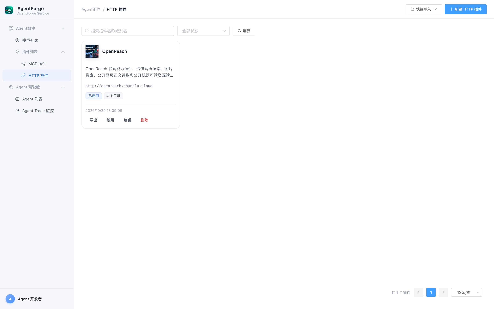
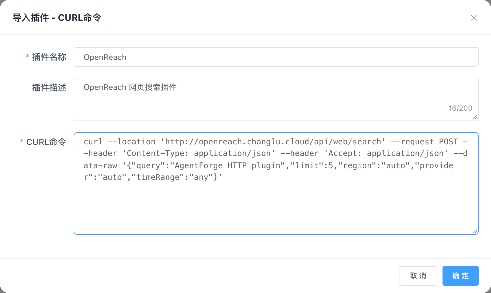
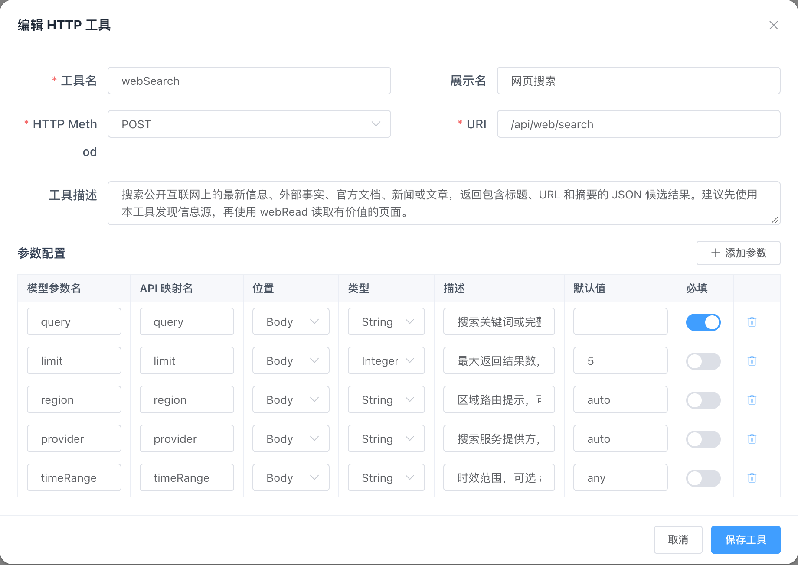
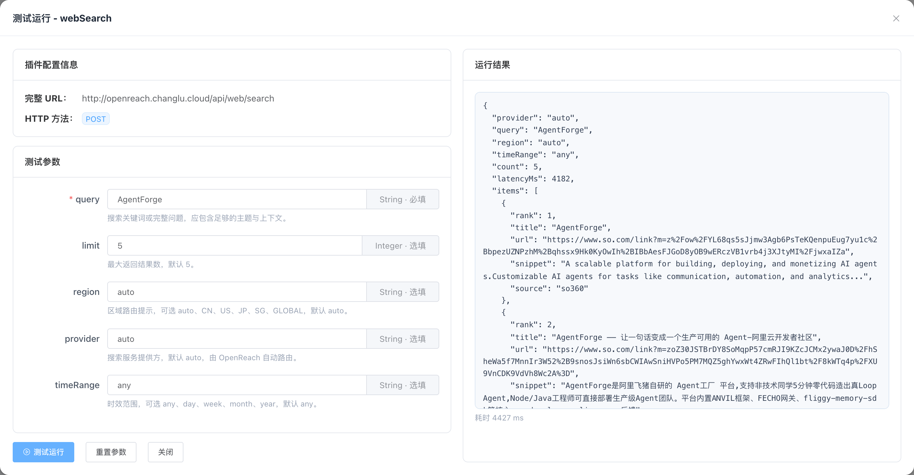
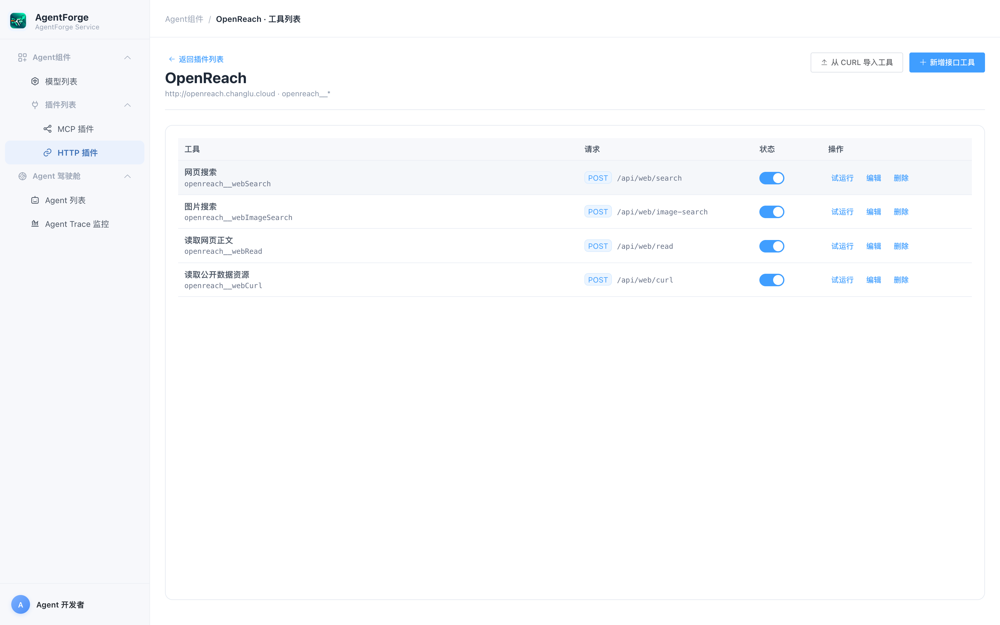

# Create an HTTP Plugin

An HTTP plugin turns existing HTTP APIs into Function Calls that models can invoke. The plugin describes "the service address and common request headers", while tool methods describe "how a specific API is called".

This page uses the OpenReach web search service as an example to walk through plugin creation, tool methods, and Agent binding.



## 1. Background: how multiple APIs under one Base URL reach an Agent

Enterprise internal systems usually expose capabilities as "one service address + multiple APIs", for example OpenReach:

```text
http://openreach.changlu.cloud
├── POST /api/web/search
├── POST /api/web/image-search
├── POST /api/web/read
└── POST /api/web/curl
```

A model cannot understand these HTTP APIs directly; each API must be converted into a callable Function Call. The HTTP plugin is this conversion and management layer:

```text
Base URL + static Headers
        │
        ▼
HTTP plugin
  ├── Tool method: /api/web/search → openreach__webSearch
  ├── Tool method: /api/web/image-search → openreach__webImageSearch
  ├── Tool method: /api/web/read → openreach__webRead
  └── Tool method: /api/web/curl → openreach__webCurl
        │
        ▼ Selection relationship
Agent plugin system → Agent configuration → Model Function Call
```

Three key points of the plugin approach:

1. **Unified management of same-domain APIs**: one Base URL and shared Headers are configured only once;
2. **Each API becomes an independent tool**: Method, URI, parameters, and descriptions are maintained independently;
3. **An Agent stores only the selection relationship**: the Agent binds `pluginId + methodIds`, so changing an API configuration does not require restructuring the Agent; disabled tools are skipped automatically by the Agent.

## 2. What this page solves

- Turn REST APIs into Agent tools without writing code;
- Manage APIs with a three-layer structure of plugin + method + parameters;
- Import quickly via CURL or JSON to reduce manual entry;
- Run trial calls directly before binding an Agent, verifying the API first and delivering after.

Suitable roles: product and engineering teams that need to connect enterprise APIs, SaaS services, or internal microservices.

## 3. Three core concepts

| Level | Purpose | Example |
| --- | --- | --- |
| Plugin | A collection of same-domain services, storing the Base URL and static Headers | `OpenReach` |
| Tool method | One API under the plugin, defining Method, URI, and parameters | `webSearch` |
| Parameter | Input exposed by the tool method to the model | `query`, `limit`, `region` |

The final tool name is:

```text
plugin alias__method name
openreach__webSearch
```

## 4. Operation path

```text
Agent Components → HTTP Plugins → New HTTP Plugin
    → Fill in plugin name, alias, Base URL, static Headers
    → Add API tools in the plugin details
    → Configure parameter mapping
    → Trial run
    → Bind the plugin and tools in the Agent configuration
```

### 3.1 Create a plugin

1. Go to "Agent Components → HTTP Plugins";
2. Click "New HTTP Plugin";
3. Fill in the name, alias, Base URL, and static Headers;
4. After saving, enter the plugin details.

| Field | Description |
| --- | --- |
| Plugin name | Human-facing name, for example `OpenReach` |
| Plugin alias | Tool name prefix, for example `openreach`; changing it after creation is not recommended |
| Base URL | Root address of the same-domain service, for example `http://openreach.changlu.cloud` |
| Static Headers | Request headers shared by all tools, for example `Content-Type`, `Authorization` |
| Description | Explains the plugin's capabilities and applicable scenarios |

### 3.2 Quick import with CURL

If a working CURL command already exists for the API, you can import it directly:

1. Click "Quick Import → One-click CURL Import" on the list page;
2. Fill in the plugin name and description;
3. Paste the CURL;
4. Confirm the import.

OpenReach example:

```bash
curl --location 'http://openreach.changlu.cloud/api/web/search' \
  --request POST \
  --header 'Content-Type: application/json' \
  --header 'Accept: application/json' \
  --data-raw '{"query":"AgentForge HTTP plugin","limit":5,"region":"auto","provider":"auto","timeRange":"any"}'
```

The import automatically generates the plugin and tool parameters. It is recommended to open the tool edit page, mark `query` as required, clear the sample default value, and add parameter descriptions.



### 3.3 Configure tool methods

In the plugin details, click "Add API Tool" and configure:

| Field | Description |
| --- | --- |
| Tool name | Unique within the plugin; finally assembled as `alias__methodName` |
| Display name | Name shown on the page |
| HTTP Method | GET / POST / PUT / DELETE / PATCH |
| URI | Path relative to the Base URL, for example `/api/web/search` |
| Tool description | Tells the model when to call this tool |
| Parameter configuration | Model parameter name, API mapping name, location, type, required, default value, and description |

Supported parameter locations:

```text
Query / Body / Path / Header
```

Supported parameter types:

```text
String / Integer / Number / Boolean / Array / Object
```



The tool edit page separates "the parameters the model sees" from "the parameters the API actually needs":

| Column | Purpose |
| --- | --- |
| Model parameter name | Parameter name exposed to the model; also the key in the Function Call |
| API mapping name | Maps to the actual field name of the API; can match the model parameter name when no renaming is needed |
| Location | Query / Body / Path / Header |
| Type | String / Integer / Number / Boolean / Array / Object |
| Description | Tells the model the business meaning and value requirements of this parameter |
| Default value | Value used when the parameter is not provided; required parameters should not rely on default values |
| Required | Controls whether the model must provide this parameter |

> Tool descriptions and parameter descriptions go directly into the model context and are key to whether the model can call the tool correctly. Do not write only the field name.

### 3.4 Trial run

Click "Trial Run" on a tool row, fill in the parameters, and execute:

- The left side shows the plugin configuration, full URL, HTTP method, and parameter form;
- Execution is blocked when required parameters are missing, intercepted by the page;
- The right side shows the run result, status, and duration;
- On failure, the error message is shown and nothing is written to the Agent session;
- A trial run does not go through the Agent; it only verifies the HTTP API itself.



It is recommended to verify in the following order:

```text
1. Open the tool edit page and confirm Method / URI / parameter mapping
2. Run a trial with fixed test parameters
3. Check whether the response structure matches expectations
4. Keep stable call parameters and descriptions in the tool configuration
5. Then verify in Agent debugging whether the model can generate parameters correctly
```

When the API itself is unavailable, do not use prompts to make the model "retry until it works".

## 5. OpenReach example result

The example plugin contains 4 tools:

| Tool | Purpose |
| --- | --- |
| `openreach__webSearch` | Search public internet information and return titles, URLs, and summaries |
| `openreach__webImageSearch` | Search images on the public internet |
| `openreach__webRead` | Read the main content of public web pages |
| `openreach__webCurl` | Read public machine-readable resources, such as the GitHub API |



## 6. Import, export, and status

- Supports CURL import, JSON file import, and JSON export;
- Exported files can be used for backup, migration, or reuse in other environments;
- Both plugins and individual tools can be enabled/disabled;
- When disabled, bound Agents skip the corresponding tool;
- Sensitive values in static Headers are displayed only in masked form after saving.

## 7. Best practices

1. **One plugin covers only one same-domain service**; do not put multiple domains into the same plugin;
2. **Keep tool names stable** to avoid invalidating Agent prompts and audit records;
3. **Mark required parameters explicitly**, and provide safe default values for the rest;
4. **Write clear business meanings in parameter descriptions**; this is more useful than writing "parameter value";
5. **Run a trial before binding** to avoid bringing API errors into Agent debugging;
6. **Use server-side secrets for sensitive Headers** and do not expose them in descriptions or examples.

## 8. Acceptance checklist

1. The plugin and its tool count are visible in the plugin list;
2. The Method / URI in the plugin details match the real API;
3. Required parameters and default values follow the API contract;
4. The trial run returns a successful response;
5. The plugin and specific tools can be selected in the Agent configuration;
6. After a tool is disabled, the Agent no longer calls it.

Next step: create an Agent and bind this plugin by reading [Create a General Agent](../agent-cockpit/create-agent).