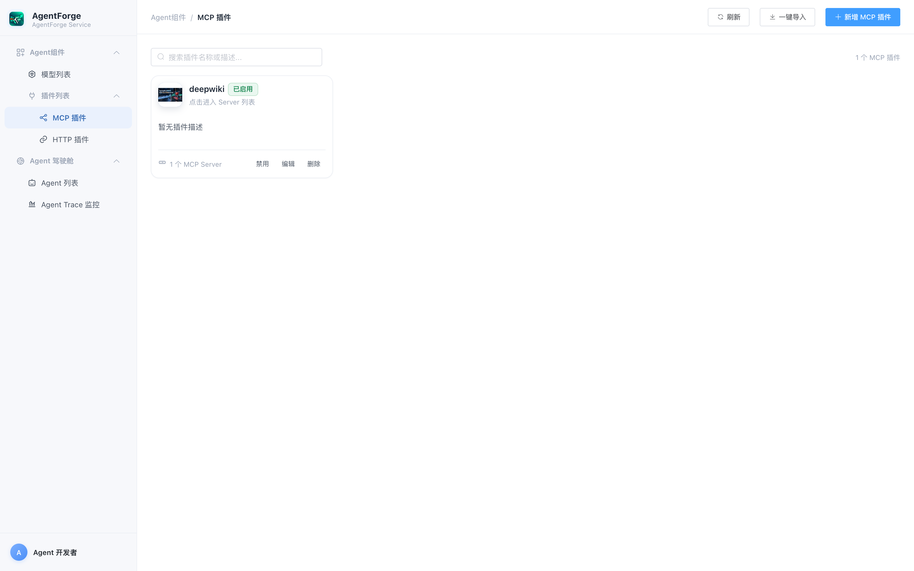
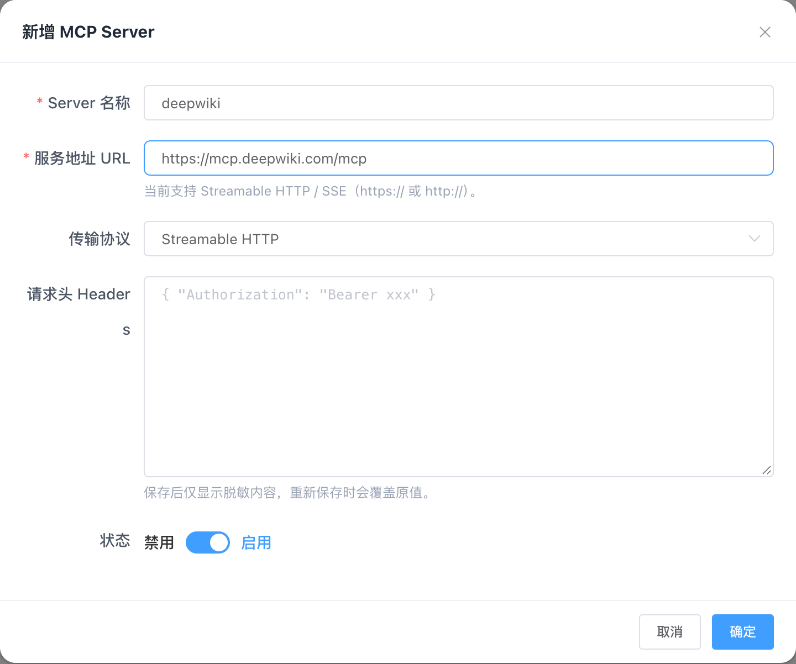
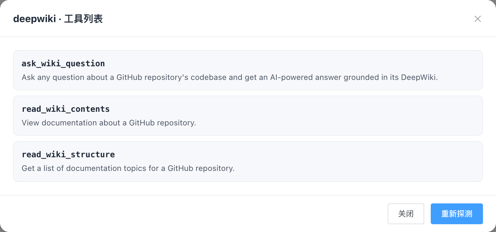
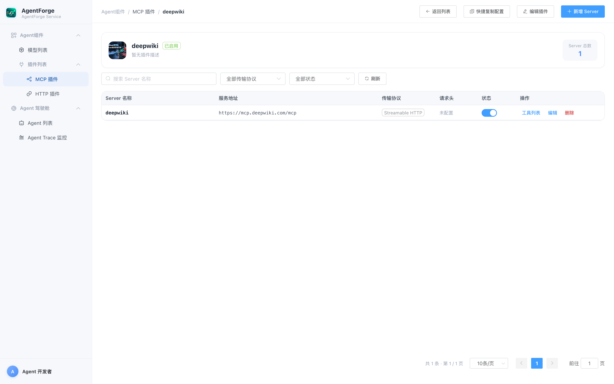

# Create an MCP Plugin

MCP (Model Context Protocol) lets an Agent dynamically discover external tools at runtime, without manually entering parameters one by one as with HTTP plugins. AgentForge Service manages MCP Servers, discovers tool lists, and converts tools into unified Function Calls when assembling an Agent.

This page uses the public DeepWiki MCP Server as an example to walk through the plugin, Server, and tool discovery flow.



## 1. Background: connecting external business protocols to an Agent as plugins

External capabilities may come from knowledge bases, code search, browsers, databases, or enterprise services. MCP exposes these capabilities as standard Servers, and the platform brings Servers into plugin management and converts them into tools that Agents can call:

```text
External business capability
    │ MCP protocol
    ▼
MCP Server (Streamable HTTP / SSE)
    │ initialize → notifications/initialized → tools/list
    ▼
MCP plugin (platform management boundary)
    ├── Server 1
    ├── Server 2
    └── Dynamically discovered tools
    │ Agent configuration binding
    ▼
Unified Function Call → Agent
```

What it has in common with HTTP plugins: both ultimately enter the Agent's plugin system and are mounted onto the Agent as a "plugin + tool" selection relationship. The difference is where tools come from:

- HTTP plugins have their APIs and parameters maintained manually;
- MCP plugins have their tools declared dynamically by the Server through `tools/list`.

The value of this approach is that external business protocols do not need to intrude into the Agent main loop; the platform handles connections, authentication, and tool discovery, and the Agent consumes only the unified tool capabilities.

## 2. What this page solves

- Centrally manage multiple MCP Servers;
- Automatically discover `tools/list` without writing tool schemas by hand;
- Hand MCP tools and HTTP tools together to the same Agent;
- Support plugin-level and Server-level enable/disable and tool aggregation.

Suitable roles: teams that need to connect MCP capabilities such as knowledge bases, code search, browsers, and databases.

## 3. Three core concepts

| Level | Purpose | Example |
| --- | --- | --- |
| MCP plugin | A logical collection of MCP Servers | `deepwiki` |
| MCP Server | A connectable MCP service | `https://mcp.deepwiki.com/mcp` |
| MCP Tool | A tool declared dynamically by the Server through `tools/list` | `ask_wiki_question` |

Differences from HTTP plugins:

| Dimension | HTTP plugin | MCP plugin |
| --- | --- | --- |
| Tool source | Method / URI / parameters entered manually | Declared by the Server at runtime |
| Tool schema | Maintained manually within the platform | Returned automatically by the MCP Server |
| Integration cost | Every API must be configured | Configure the Server and all tools are discovered |
| Use case | Existing REST APIs, internal services | Standardized MCP ecosystem and knowledge services |

## 4. Operation path

```text
Agent Components → MCP Plugins → Add MCP Plugin
    → Add an MCP Server under the plugin
    → Discover the tool list
    → Bind the plugin or a specific Server in the Agent configuration
```

### 3.1 Add an MCP plugin

1. Go to "Agent Components → MCP Plugins";
2. Click "Add MCP Plugin";
3. Fill in the plugin name, description, and status;
4. After saving, enter the plugin details.

### 3.2 Add an MCP Server



| Field | Description | DeepWiki example |
| --- | --- | --- |
| Server name | Unique name within the plugin | `deepwiki` |
| Service URL | MCP Server address | `https://mcp.deepwiki.com/mcp` |
| Transport protocol | Streamable HTTP / SSE are currently supported | `Streamable HTTP` |
| Request Headers | Authentication or custom Headers; sensitive values are stored masked | None |
| Status | Enabled / Disabled | Enabled |

### 3.3 Discover the tool list

After saving the Server, click "Tool List" on the Server row:

1. The platform connects to the MCP Server;
2. The initialization handshake is completed;
3. `tools/list` is called;
4. Tool names, descriptions, and input schemas are displayed.

The DeepWiki example returns 3 tools:

| Tool | Purpose |
| --- | --- |
| `ask_wiki_question` | Ask questions about a GitHub repository |
| `read_wiki_contents` | Read the repository Wiki documentation |
| `read_wiki_structure` | Get the topic structure of the documentation |



If discovery fails, check the network, URL, transport protocol, and authentication Headers first, rather than modifying the Agent prompt.

## 5. One-click import of mcpServers

If you already have a standard `mcpServers` configuration, click "One-click Import" on the list page:

```json
{
  "mcpServers": {
    "deepwiki": {
      "url": "https://mcp.deepwiki.com/mcp"
    }
  }
}
```

The platform creates the plugin and Server, and skips configurations that lack `url`. After importing, it is still recommended to open the details page and discover the tool list once.

## 6. Binding in an Agent

"MCP Plugins" on the Agent edit page supports two levels of granularity:

- Bind the entire plugin: all Servers under the plugin are used by default, and Servers added later take effect automatically;
- Bind a specific Server: only the selected Server is used, suitable for fine-grained authorization.

Note the following:

- Only plugins and Servers whose status is enabled participate in assembly;
- Tools are discovered dynamically when the Agent is built; an unavailable Server causes the corresponding tools to be missing;
- The same Agent can bind HTTP plugins and MCP plugins at the same time;
- Tool names carry the plugin and Server prefix to avoid name conflicts.



## 7. Product recommendations

1. **Create plugins by capability domain, not by vendor**;
2. **Manage public Servers and internal Servers separately** for easier permissions and auditing;
3. **Verify connectivity with the tool list first**, then hand it to an Agent;
4. **For production Agents, bind specific Servers where possible** to avoid automatically inheriting newly added tools;
5. **Pay attention to tool description quality**; MCP tool descriptions directly affect model selection;
6. **Do not expose long-term keys in Headers**; prefer short-lived credentials.

## 8. Acceptance checklist

1. Both the plugin and Server status are enabled;
2. The tool list can be returned successfully;
3. The plugin can be seen and bound in the Agent configuration;
4. MCP tools can be seen being called in the debug conversation;
5. The corresponding tool nodes and durations are visible in the Trace.

Next step: combine a model, an HTTP plugin, and an MCP plugin into one Agent by reading [Create a General Agent](../agent-cockpit/create-agent).