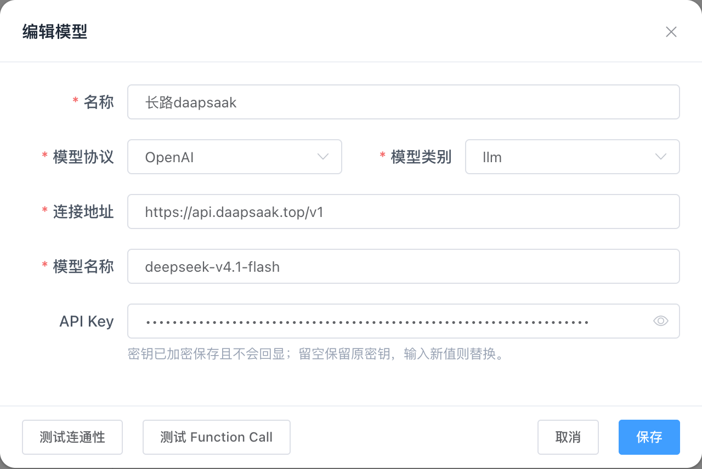

# Create a Model

A model is the reasoning engine of an Agent. AgentForge Service separates model configuration from Agents: first connect a model in the Model List and verify that it works, then let one or more Agents reuse the same model.

This page uses `长路daapsaak` (`deepseek-v4.1-flash`) as an example to walk through the full path from creation to verification.



## 1. What this page solves

- Centrally manage the endpoint, model name, and key of OpenAI / OpenAI-compatible models;
- Verify model connectivity and Function Call capability before creating an Agent;
- Make model configuration a reusable asset instead of something scattered across every Agent;
- Store keys encrypted and never echo them back on the page.

Suitable roles: platform administrators, Agent developers, and business teams that need to switch models.

## 2. Two model protocols currently supported

Service currently supports two model protocols. After you select a protocol, the corresponding Provider adapter handles request and response conversion:

| Protocol | Use case | Typical Base URL | Typical model name |
| --- | --- | --- | --- |
| OpenAI | OpenAI official, OpenAI-compatible services, most domestic model gateways | `https://api.openai.com/v1` | `gpt-4o`, `deepseek-chat` |
| Anthropic | Anthropic official Claude models | `https://api.anthropic.com` | `claude-sonnet-4-5` |

Key differences between the two protocols:

| Dimension | OpenAI protocol | Anthropic protocol |
| --- | --- | --- |
| Request path | `/v1/chat/completions` | `/v1/messages` |
| Authentication | `Authorization: Bearer <key>` | `x-api-key` + `anthropic-version` |
| Tool calling | `tools` / `tool_calls` | `tools` / `tool_use` |
| Message structure | system / user / assistant / tool | system / user / assistant + content block |

When choosing, just match the actual Provider:

- If the vendor claims OpenAI API compatibility, choose `OpenAI`;
- If you are connecting to the official Anthropic API, choose `Anthropic`;
- The Base URL and model name must match the selected protocol; do not put an Anthropic model under the OpenAI protocol;
- Both protocols support verification with "Test Connectivity" and "Test Function Call".

## 3. Operation path

```text
Agent Components → Model List → New Model
    → Fill in protocol, endpoint, model name, and key
    → Test Connectivity / Test Function Call
    → Save
```

### 2.1 Create a model

1. Go to "Agent Components → Model List";
2. Click "New Model" in the upper right corner;
3. Fill in the model information;
4. Click "Test Connectivity" first, then "Test Function Call" as needed;
5. Click "Save" after the tests pass.

### 2.2 Field descriptions

| Field | Description | Example |
| --- | --- | --- |
| Name | Display name within the platform; including the channel or purpose is recommended | `长路daapsaak` |
| Model protocol | OpenAI-compatible protocol is currently the main choice | `OpenAI` |
| Model category | Choose `llm` for chat models | `llm` |
| Endpoint | The Provider's Base URL | `https://api.daapsaak.top/v1` |
| Model name | The model identifier actually used in requests | `deepseek-v4.1-flash` |
| API Key | Call credential, stored encrypted and never echoed | `sk-...` |

> The endpoint usually needs to include the version path (for example `/v1`), but it must not include a specific API path. The model name must match the Provider documentation.

## 4. Verify the model

Every model in the Model List can be tested directly with "Test Connection", and the edit dialog offers two more granular checks:

| Check | Purpose | When to use |
| --- | --- | --- |
| Test Connectivity | Confirm that the endpoint, key, and model name can complete a basic call | Required when connecting a new model |
| Test Function Call | Confirm that the model supports the tool-calling protocol | Required before binding HTTP / MCP tools to an Agent |

If an Agent needs to call plugin tools, Function Call verification is critical. A model that works for basic chat but does not support Function Call is not suitable as the primary model for a tool-using Agent.

## 5. Keys and security

- The API Key input uses a password type and shows only a mask after saving;
- Leaving it empty while editing keeps the original key; the key is replaced only when a new value is entered;
- The page provides no entry point for viewing plaintext;
- The Model List shows only the name, protocol, model name, and endpoint, not the key;
- Use separate keys for different environments and businesses to simplify auditing and revocation.

## 6. Model reuse and changes

A model can be referenced by multiple Agents. After you modify the model configuration:

- Newly created or reinitialized Agents use the new configuration;
- After changing a model, re-verify it and republish the Agents that reference it to ensure consistent online behavior;
- Before deleting a model, confirm that no Agent is referencing it; otherwise conversations in the affected Agents will fail.

## 7. Acceptance checklist

1. The newly added model appears in the Model List;
2. "Test Connection" returns success;
3. The model of a tool-using Agent passes "Test Function Call";
4. The API Key is not displayed in plaintext in either the list or the edit dialog;
5. The model can be selected in the "Chat Model" dropdown when creating an Agent.

Next step: give an Agent external capabilities by reading [Create an HTTP Plugin](./http-plugin) or [Create an MCP Plugin](./mcp-plugin).