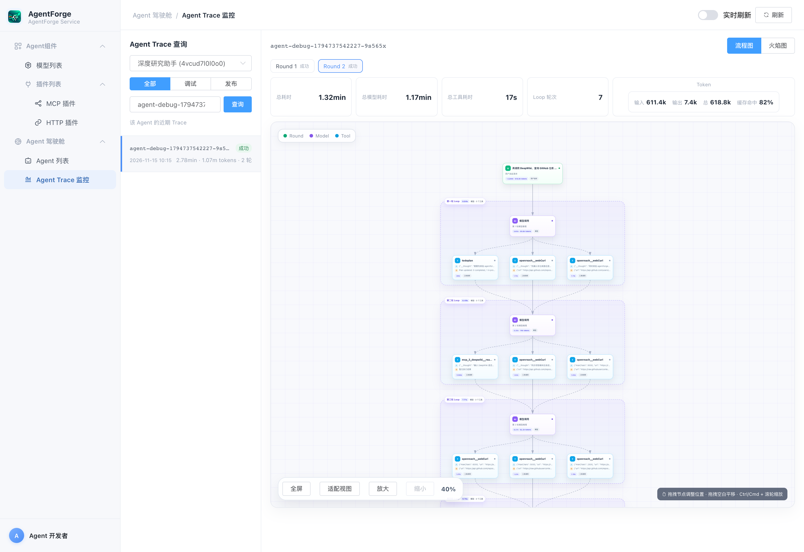
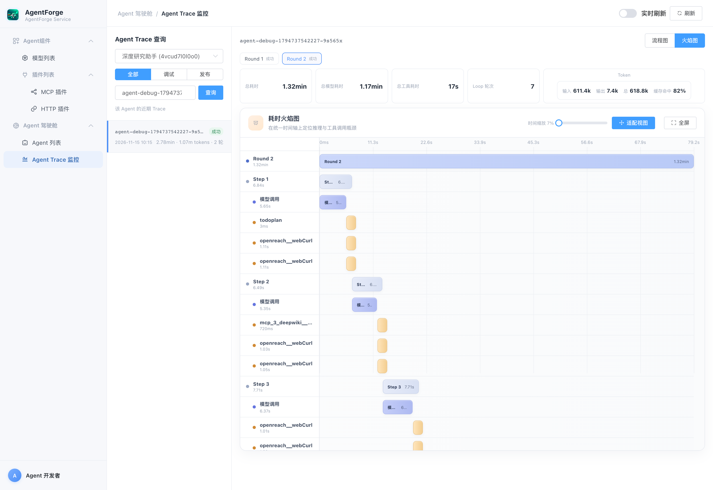

# Agent Trace Monitoring

Agent Trace answers "where exactly was this run slow, where was it expensive, and were the tool calls reasonable". It organizes an Agent run into a structured Round → Step → Model / Tool chain instead of only showing the final answer.

The page provides two views: the **flow chart** shows call relationships, and the **flame graph** shows time distribution.



## 1. What this page is for

- Identify which step takes the longest in a multi-round ReAct loop;
- Compare model time with tool time;
- Inspect the parameters and results of each tool call;
- Observe Token consumption and cache hit rate;
- Compare the behavior of debug sessions and production sessions;
- Quickly locate an abnormal node after a problem occurs.

Intended roles: Agent developers, platform administrators, and performance and cost owners.

## 2. Query path

```text
Agent Cockpit → Agent Trace Monitoring
    → Select an Agent
    → Select a source: All / Debug / Publish
    → Select a recent Trace, or enter a sessionId to query
    → Select a Round
    → Switch between flow chart / flame graph
```

### 2.1 Select an Agent

Select an Agent on the left side of the page. Recent Traces for that Agent are loaded after selection:

- **All**: show both debug and production sessions;
- **Debug**: show only sessions produced by debugging on the edit page;
- **Publish**: show only sessions produced by the published page.

If you know the session ID, you can also enter the `sessionId` directly to query. Trace verifies that the session belongs to the current Agent.

### 2.2 Select a Round

A single session may contain multiple rounds of user questions. The page displays them as `Round 1 / Round 2 / ...`, and only the currently selected round is rendered on the right, so multiple questions are not mixed into one chart.

The metric cards at the top show:

| Metric | Meaning |
| --- | --- |
| Total duration | Actual duration of the current Round |
| Total model time | Cumulative duration of model calls |
| Total tool time | Cumulative duration of tool calls |
| Loop rounds | Number of ReAct Steps in the current Round |
| Token | Input, output, total, and cache hit rate |

> When tools run concurrently, cumulative tool time can exceed the total duration. This is a natural result of concurrent execution, not a data error.

## 3. Flow chart

The flow chart expands the call relationships:

```text
Round
└── Step
    ├── Model call
    └── Tool call
```

Click a node to view:

- Node type and status;
- Start time and duration;
- Token usage;
- Call parameters and execution results;
- Error information.

The flow chart is suitable for answering:

- Why did this round call tools five times?
- Which tool returned an error?
- What context did the model use to make its next decision?
- Were tool results written back correctly?

The canvas supports dragging, zooming, fitting the view, and full screen.

## 4. Flame graph



The flame graph places the current Round on a unified timeline:

```text
Round
└── Step
    ├── Model call
    └── Tool call (side by side when concurrent)
```

The flame graph is suitable for answering:

- Is time mainly spent on models or tools?
- Are there long-blocking tools?
- Are multiple tools really running concurrently?
- Where are the waiting gaps between steps?

It supports time zooming, horizontal scrolling, node details, fitting the view, and full screen.

## 5. Data sources and boundaries

Trace and message events are two separate datasets:

| Data | Purpose |
| --- | --- |
| Session message events | Page replay and conversation rendering |
| Trace snapshot | ReAct structure, durations, Tokens, and tool nodes |

Trace organizes snapshots by `sessionId + questionRound + step`, independent of ChatMemory, and does not directly reuse message events for rendering. This ensures:

- The graph structure is stable and unaffected by frontend rendering formats;
- Tool parameters and results can be audited separately;
- Model and tool durations can be attributed precisely;
- A specific round in a historical session can be located quickly even when the session has many messages.

Current boundaries:

- Trace is viewed per Round and does not support cross-session aggregate reports;
- Real-time refresh requires the page to stay open;
- The data retention period is determined by deployment-side policies;
- Trace only observes; it does not modify Agent configuration or replay tool side effects.

## 6. Typical troubleshooting paths

### 6.1 Slow responses

1. Open the flame graph;
2. Check the proportion of model time;
3. Check whether a single tool is occupied for a long time;
4. Check whether multiple retries occurred;
5. Use the flow chart to confirm whether there are unnecessary tool calls.

### 6.2 Abnormal Token consumption

1. Check whether input Tokens keep growing;
2. Check whether window memory is too large;
3. Check whether tool results return excessively long content;
4. Check whether the same resource is read repeatedly;
5. Evaluate whether the Prompt and tool descriptions can be simplified.

### 6.3 Unexpected tool calls

1. Locate the tool node in the flow chart;
2. Check the tool name, parameters, and results;
3. Compare them with the Agent bindings and tool descriptions;
4. Return to the debug area to reproduce;
5. Adjust the Prompt or tool configuration and publish again.

## 7. Usage recommendations

1. **Filter debug and production separately**: avoid mixing development-time noise into production analysis;
2. **Use the flame graph to locate first, then the flow chart to attribute**;
3. **Watch the cache hit rate**: high input Tokens with a low cache hit rate usually means context bloat;
4. **Treat Trace as a regression tool**: compare durations and tool paths for the same kind of problem before and after configuration changes;
5. **Do not use Trace as a replacement for logs**: Trace shows structure, while logs show exception stacks and external system errors.

## 8. Acceptance checklist

1. Recent Traces load after selecting an Agent;
2. Debug / Publish source filtering is correct;
3. Multi-round sessions can be switched by Round;
4. Flow chart nodes allow viewing parameters and results;
5. The flame graph can locate model and tool durations;
6. Token and cache hit rate are displayed correctly;
7. Real-time refresh works without resetting the current view.