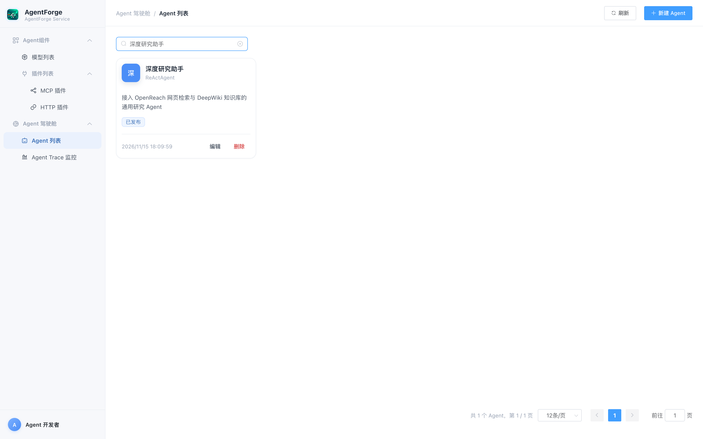

# AgentForge Service

AgentForge Service is a standard Agent workbench built on the AgentForge framework. It turns "connect models, connect tools, configure Agents, debug, version, publish, and observe" into a runnable product, so teams do not have to build the frontend and backend from scratch.

```text
Model configuration → Plugin integration → Agent configuration → Debug → Version → Publish → Sessions and Trace
```



## 1. Product positioning

The AgentForge SDK solves "how to build an Agent"; AgentForge Service solves "how to deliver an Agent for a team to use".

| Layer | Problem it solves | Corresponding capabilities |
| --- | --- | --- |
| Component layer | Where models and tools come from | Model list, HTTP plugins, MCP plugins |
| Cockpit | How to configure, validate, and launch an Agent | Agent list, configuration, debugging, versions, publishing |
| Infrastructure | How to observe and troubleshoot after launch | Session history, Agent Trace, Tokens and durations |

Service is not a replacement for the SDK, but its productized shell: the same Agent runtime can be embedded through Java code or configured and published through the workbench.

## 2. Who it is for

| Role | Focus | Common pages |
| --- | --- | --- |
| Agent developer | Prompt, models, tools, debugging, and publishing | Agent configuration, debug area |
| Product manager | What the Agent can do and whether the interaction meets expectations | Agent list, publish page, elegant mode in debugging |
| Platform administrator | Model channels, plugins, permissions, and runtime status | Model list, HTTP / MCP plugins |
| Operations and performance owner | Durations, Tokens, tool errors | Agent Trace Monitoring |

## 3. Product structure

### Agent components

| Page | Purpose |
| --- | --- |
| [Create model](./agent-components/model) | Connect OpenAI / OpenAI-compatible models and verify connectivity |
| [Create HTTP plugin](./agent-components/http-plugin) | Turn a REST API into an Agent tool |
| [Create MCP plugin](./agent-components/mcp-plugin) | Connect an MCP Server and discover tools dynamically |

### Agent Cockpit

| Page | Purpose |
| --- | --- |
| [Create general Agent](./agent-cockpit/create-agent) | Combine Prompt, model, plugins, memory, and built-in capabilities |
| [Agent debugging](./agent-cockpit/debug) | Validate the current configuration, observe thinking and tool calls, and view historical debug sessions |
| [Agent publishing](./agent-cockpit/publish) | Save versions, publish the current configuration, open the publish link, or stop publishing |

### Agent infrastructure

| Page | Purpose |
| --- | --- |
| [Agent Trace Monitoring](./agent-infrastructure/trace) | Observe the ReAct Loop, model/tool durations, and Tokens through flow charts and flame graphs |

## 4. A complete example

The screenshots in this documentation come from a runnable "deep research assistant":

| Configuration | Example |
| --- | --- |
| Model | Changlu daapsaak (`deepseek-v4.1-flash`) |
| HTTP plugin | OpenReach, providing web search, image search, web page content reading, and public data reading |
| MCP plugin | DeepWiki, providing GitHub repository knowledge and code Q&A |
| Built-in capabilities | Task planning, ask the user |
| Runtime mode | Submit V1/V2 after debug validation, then publish to the production chat page |

It covers the main Service loop:

```text
Connect model → Connect HTTP / MCP tools → Create Agent
    → Debug → Save version → Publish → Production chat → Trace review
```

## 5. Core capabilities

| Capability | Description |
| --- | --- |
| Model management | Protocol, Base URL, model name, encrypted API Key storage, and connection tests |
| Plugin management | Three-layer HTTP plugin / method / parameter model, with CURL and JSON import |
| MCP management | Server management, tool discovery, multi-server aggregation, and `mcpServers` import/export |
| Agent configuration | Prompt, model, plugins, window memory, task planning, and ask the user |
| Debugging | Debug the current configuration, thinking/tool event timeline, elegant mode, and historical debug sessions |
| Versions | Separate save-only and submitted versions, version notes, switching, and comparison |
| Publishing | Publish the current configuration, republish, stop publishing, and production chat links |
| Sessions | Isolated debug and production sessions, with message and SSE event snapshots |
| Trace | Round / Step / Model / Tool chain, flow charts, and flame graphs |

## 6. Recommended getting-started path

1. Start the service with [Quick Deploy](./quick-deploy);
2. Connect a usable model in [Create model](./agent-components/model);
3. Connect an [HTTP plugin](./agent-components/http-plugin) or [MCP plugin](./agent-components/mcp-plugin) as needed;
4. Combine capabilities in [Create general Agent](./agent-cockpit/create-agent);
5. Validate the configuration with [Agent debugging](./agent-cockpit/debug);
6. Lock in a version and go live with [Agent publishing](./agent-cockpit/publish);
7. Observe runtime quality with [Agent Trace Monitoring](./agent-infrastructure/trace).

## 7. Technical structure

```text
agentforge-service
├── agentforge-service-ui     # Vue 2 + Vite frontend
└── agentforge-service-backend
    └── agentforge-service-web # Spring Boot backend
        └── modules
            ├── model             # Model configuration
            ├── agent             # Agent configuration, versions, publishing, and runtime assembly
            ├── session           # Sessions, messages, and SSE event replay
            ├── plugins           # HTTP / MCP plugins
            └── trace             # Agent chain snapshots and queries
```

The frontend handles workbench interactions and streaming Markdown rendering, while the backend handles configuration persistence, Agent assembly, event push, and tracing. Both share the same Agent runtime.

## 8. Relationship to the SDK

```text
AgentForge SDK
    ├── agentforge-model-*       Unified model protocol
    └── agentforge-agent-core    ReAct / Middleware / Tool
                │
                ▼
AgentForge Service
    ├── Configuration persistence
    ├── Agent assembly and runtime
    ├── SSE events and sessions
    └── Workbench UI
```

- To embed in your own Java application: use the [SDK docs](../about/introduction);
- To use the ready-made workbench directly: use AgentForge Service;
- To customize Service: build from source and reuse the same Agent runtime.

## 9. Current boundaries

- Service targets standard general ReAct Agents; custom Agent types require backend extensions;
- MCP currently supports remote Streamable HTTP / SSE and does not include local stdio process management;
- Trace is viewed per Session / Round and does not yet provide cross-Agent aggregate reports;
- Publishing uses the current configuration as-is; publish snapshots do not provide multi-version canary releases or traffic allocation;
- Login, tenancy, and fine-grained permissions are integrated through the deployment side or the enterprise's existing systems.

Start with [Quick Deploy](./quick-deploy), or go directly to [Create model](./agent-components/model).